# Dragões

Dragões verdadeiros são repteis alados de linhagem ancestral e poderes assustadores. Eles são conhecidos e temidos por sua astúcia predatória e ganância, onde os dragões mais antigos são considerados como as criaturas mais poderosas no mundo. Os dragões também são criaturas mágicas cujo poder inato carrega suas temíveis armas de sopro e outras habilidades preternaturais.

Muitas criaturas, incluindo wyverns e tartarugas-dragão, possuem sangue dracônico. No entanto, os dragões verdadeiros são formados pelas duas vastas categorias dos dragões cromáticos e metálicos. Os dragões azul, branco, negro, verde e vermelho são egoístas, malignos e temidos por todos. Os dragões de bronze, cobre, latão, ouro e prata são nobres, benignos e altamente respeitados pelos sábios.

Embora seus objetivos e ideais variem tremendamente, todos os dragões verdadeiros ambicionam riqueza, acumulando montes de moedas e coletando gemas, joias e itens mágicos. Dragões com grandes montanhas de tesouro detestam abandona-las por muito tempo, aventurando-se fora de seus covis apenas para patrulhar e se alimentar.

Dragões verdadeiros passam por quatro estágios distintos de vida, de pequenos filhotes até dragões anciões, que podem viver por milhares de anos. A partir desse momento, sua força pode se tornar incomparável e suas pilhas de tesouro podem crescer além do imaginável.

> **Categorias de Idade de Dragão**

| Categoria | Tamanho | Faixa Etária |
| --- | --- | --- |
| Filhote | Médio | 5 anos ou menos |
| Jovem | Grande | 6–100 anos |
| Adulto | Enorme | 101–800 anos |
| Ancião | Imenso | 801 anos ou mais |

> **Variação: Dragões Como Conjuradores Inatos**
>
> Dragões são criatura inatamente mágicas que podem dominar algumas magias à medida que envelhecem, usando essa variação. Um dragão jovem ou mais velho pode, inatamente, conjurar uma quantidade de magias igual ao seu modificador de Carisma. Cada magia pode ser conjurada uma vez por dia, não necessitando de componentes materiais, e o nível da magia não pode ser maior que um terço do nível de desafio (arredondado para baixo) do dragão. O bônus para atingir com ataques de magia do dragão é igual ao seu bônus de proficiência + seu bônus de Carisma. A CD de resistência das magias do dragão é igual a 8 + seu bônus de proficiência + seu bônus de Carisma.

### Dragões Cromáticos

Os dragões azul, branco, negro, verde e vermelho representam o lado maligno da espécie dracônica. Agressivos, vorazes e vaidosos, os dragões cromáticos são sábios cruéis e tiranos poderosos temidos por todas as criaturas – incluindo uns aos outros.

***Guiados pela Ganância***. Os dragões cromáticos cobiçam tesouros e essa ganância impele cada artifício e trama deles. Eles acreditam que as riquezas do mundo pertencem a eles por direito, e um dragão cromático confisca essas riquezas sem se preocupar com os humanoides e outras criaturas que “roubaram” elas. Com suas pilhas de moedas, gemas brilhantes e itens mágicos, o tesouro de um dragão é o material das lendas. No entanto, os dragões cromáticos não tem interesse em comercializar, acumulando riqueza com o único intuito de possui-la.

***Criaturas Egocêntricas***. Os dragões cromáticos são unidos pelo senso de superioridade, considerando a si próprios como as mais poderosas e valorosas de todas as criaturas mortais. Quando eles interagem com outras criaturas, isso ocorre apenas para dar seguimento a seus próprios interesses. Eles acreditam no seu direito inerente de governar e essa crença é o objetivo de vida da personalidade e visão de mundo de cada dragão cromático. Tentar humilhar um dragão cromático é como tentar convencer os ventos a pararem de se mover. Para essas criaturas, humanoides e animais, encaixam-se como caça ou bestas de carga e não são merecedores de qualquer respeito.

***Covis Perigosos***. O covil de um dragão serve como sua base de poder e um cofre para seu tesouro. Com sua resistência e tolerância inatas para os efeitos de ambientes severos, um dragão escolhe ou constrói seu covil não para se abrigar, mas para se defender, preferindo múltiplas entradas e saídas e segurança para seu tesouro.

A maioria dos covis de dragões cromáticos estão escondidos em locais perigosos e remotos para impedir que ninguém além dos mais audaciosos mortais alcancem-nos. Um dragão negro irá habitar no coração de um vasto pântano, enquanto que um dragão vermelho irá reclamar sua caldeira em um vulcão ativo. Além das defesas naturais de seus covis, dragões cromáticos poderosos usam guardiões e armadilhas mágicas e subvertem criaturas a proteger seus tesouros.

***Rainha dos Dragões Malignos***. Tiamat, a Rainha Dragão, é a divindade governante das espécies de dragões malignos. Ela reside em Avernus, a primeira camada dos Nove Infernos. Como uma deus menor, Tiamat tem o poder de conceder magias a seus adoradores, apesar de ela detestar partilhar seu poder. Ela sintetiza a avareza dos dragões malignos, acreditando que o multiverso e todos os tesouros nele serão, um dia, dela e apenas dela.

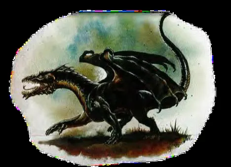

Tiamat é um dragão gigantesco cujas cinco cabeças refletem as formas dos dragões cromáticos que a veneram – azul, branco, negro, verde e vermelho. Ela é um terror no campo de batalha, capaz de aniquilar exércitos inteiros com suas cinco armas de sopro, sua conjuração formidável e suas garras assustadoras.

O inimigo mais odiado de Tiamat é Bahamut, o Dragão de Platina, com quem ela divide o controle da crença da espécie dracônica. Ela também possui uma inimizade especial por Asmodeu, que há muito tempo atrás a despojou do governo de Avernus e que continua a inibir o poder da Rainha Dragão.

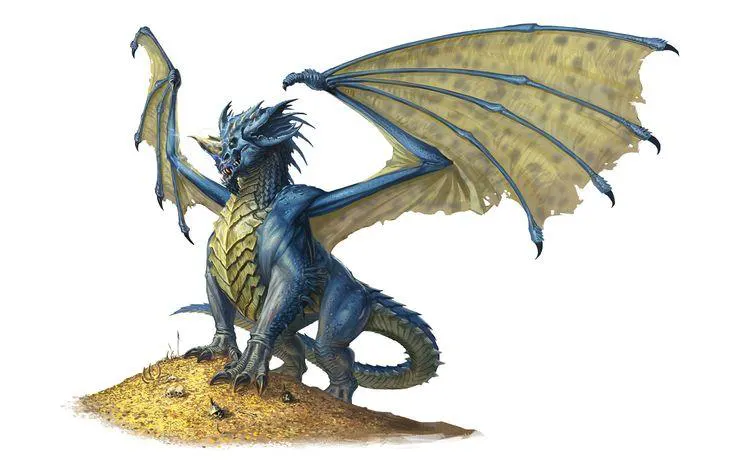

## Bloco de estatísticas: Dragão Azul Ancião

*Dragão Imenso, leal e mau*

**Classe de Armadura** 22 (armadura natural)  
**Pontos de Vida** 481 (26d20 + 208)  
**Deslocamento** 12 m, escavação 12 m, voo 24 m

| FOR | DES | CON | INT | SAB | CAR |
| :---: | :---: | :---: | :---: | :---: | :---: |
| 29 (+9) | 10 (+0) | 27 (+8) | 18 (+4) | 17 (+3) | 21 (+5) |

**Testes de Resistência** Des +7, Con +15, Sab +10, Car +12  
**Perícias** Furtividade +7, Percepção +17  
**Imunidade a Dano** elétrico  
**Sentidos** percepção às cegas 18 m, visão no escuro 36 m, Percepção passiva 27  
**Idiomas** Comum, Dracônico  
**Nível de Desafio** 23 (50.000 XP)

***Resistência Lendária (3/Dia)***. Se o dragão falhar em um teste de resistência, ele pode escolher obter sucesso, no lugar.

### Ações

***Ataques Múltiplos***. O dragão pode usar sua Presença Aterradora, ele pode então, realizar três ataques: um com sua mordida e dois com suas garras.

***Mordida***. *Ataque Corpo-a-Corpo com Arma*: +16 para atingir, alcance 4,5 m, um alvo. *Acerto*: 20 (2d10 + 9) de dano perfurante mais 11 (2d10) de dano elétrico.

***Garra***. *Ataque Corpo-a-Corpo com Arma*: +16 para atingir, alcance 3 m, um alvo. *Acerto*: 16 (2d6 + 9) de dano cortante.

***Cauda***. *Ataque Corpo-a-Corpo com Arma*: +16 para atingir, alcance 6 m, um alvo. *Acerto*: 18 (2d8 + 9) de dano de concussão.

***Presença Aterradora***. Cada criatura, à escolha do dragão, que esteja a até 36 metros do dragão e esteja ciente disso, deve ser bem sucedida num teste de resistência de Sabedoria CD 20 ou ficará amedrontada por 1 minuto. Uma criatura pode repetir o teste de resistência no final de cada um dos turnos dela, terminando o efeito sobre si, caso obtenha sucesso. Se o teste de resistência de uma criatura for bem sucedido ou caso o efeito termine sobre ela, a criatura ficará imune a Presença Aterradora do dragão pelas próximas 24 horas.

***Sopro Elétrico (Recarrega 5–6)***. O dragão pode expelir eletricidade em uma linha com 36 metros de comprimento e 3 metros de largura. Cada criatura na linha deve ser bem sucedida num teste de resistência de Destreza CD 23, sofrendo 88 (16d10) de dano elétrico se falhar na resistência, ou metade desse dano caso obtenha sucesso.

### Ações Lendárias

O dragão pode realizar 3 ações lendárias, escolhidas dentre as opções abaixo. Apenas uma ação lendária pode ser usada por vez e apenas no final do turno de outra criatura. O dragão recupera as ações lendárias gastas no começo do turno dele.

**Detectar**. O dragão realiza um teste de Sabedoria (Percepção).  
**Ataque com Cauda**. O dragão realiza um ataque de cauda.  
**Ataque com Asas (Custa 2 Ações).** O dragão bate suas asas. Cada criatura a até 4,5 metros do dragão deve ser bem sucedida num teste de resistência de Destreza CD 24 ou sofrerá 16 (2d6 + 9) de dano de concussão e cairá no chão. Após bater suas asas, o dragão pode voar até metade do seu deslocamento de voo.

## Bloco de estatísticas: Dragão Azul Adulto

*Dragão Enorme, leal e mau*

**Classe de Armadura** 19 (armadura natural)  
**Pontos de Vida** 225 (18d12 + 108)  
**Deslocamento** 12 m, escavação 9 m, voo 24 m

| FOR | DES | CON | INT | SAB | CAR |
| :---: | :---: | :---: | :---: | :---: | :---: |
| 25 (+7) | 10 (+0) | 23 (+6) | 16 (+3) | 15 (+2) | 19 (+4) |

**Testes de Resistência** Des +5, Con +11, Sab +7, Car +9  
**Perícias** Furtividade +5, Percepção +12  
**Imunidade a Dano** elétrico  
**Sentidos** percepção às cegas 18 m, visão no escuro 36 m, Percepção passiva 22  
**Idiomas** Comum, Dracônico  
**Nível de Desafio** 16 (15.000 XP)

***Resistência Lendária (3/Dia)***. Se o dragão falhar em um teste de resistência, ele pode escolher obter sucesso, no lugar.

### Ações

***Ataques Múltiplos***. O dragão pode usar sua Presença Aterradora, ele pode então, realizar três ataques: um com sua mordida e dois com suas garras.

***Mordida***. *Ataque Corpo-a-Corpo com Arma*: +12 para atingir, alcance 3 m, um alvo. *Acerto*: 18 (2d10 + 7) de dano perfurante mais 5 (1d10) de dano elétrico.

***Garra***. *Ataque Corpo-a-Corpo com Arma*: +12 para atingir, alcance 1,5 m, um alvo. *Acerto*: 14 (2d6 + 7) de dano cortante.

***Cauda***. *Ataque Corpo-a-Corpo com Arma*: +12 para atingir, alcance 4,5 m, um alvo. *Acerto*: 16 (2d8 + 7) de dano de concussão.

***Presença Aterradora***. Cada criatura, à escolha do dragão, que esteja a até 36 metros do dragão e esteja ciente disso, deve ser bem sucedida num teste de resistência de Sabedoria CD 17 ou ficará amedrontada por 1 minuto. Uma criatura pode repetir o teste de resistência no final de cada um dos turnos dela, terminando o efeito sobre si, caso obtenha sucesso. Se o teste de resistência de uma criatura for bem sucedido ou caso o efeito termine sobre ela, a criatura ficará imune a Presença Aterradora do dragão pelas próximas 24 horas.

***Sopro Elétrico (Recarrega 5–6)***. O dragão pode expelir eletricidade em uma linha com 27 metros de comprimento e 1,5 metro de largura. Cada criatura na linha deve ser bem sucedida num teste de resistência de Destreza CD 19, sofrendo 66 (12d10) de dano elétrico se falhar na resistência, ou metade desse dano caso obtenha sucesso.

### Ações Lendárias

O dragão pode realizar 3 ações lendárias, escolhidas dentre as opções abaixo. Apenas uma ação lendária pode ser usada por vez e apenas no final do turno de outra criatura. O dragão recupera as ações lendárias gastas no começo do turno dele.

**Detectar**. O dragão realiza um teste de Sabedoria (Percepção).  
**Ataque com Cauda**. O dragão realiza um ataque de cauda.  
**Ataque com Asas (Custa 2 Ações).** O dragão bate suas asas. Cada criatura a até 3 metros do dragão deve ser bem sucedida num teste de resistência de Destreza CD 20 ou sofrerá 14 (2d6 + 7) de dano de concussão e cairá no chão. Após bater suas asas, o dragão pode voar até metade do seu deslocamento de voo.

## Bloco de estatísticas: Dragão Azul Jovem

*Dragão Grande, leal e mau*

**Classe de Armadura** 18 (armadura natural)  
**Pontos de Vida** 152 (16d10 + 64)  
**Deslocamento** 12 m, escavação 9 m, voo 24 m

| FOR | DES | CON | INT | SAB | CAR |
| :---: | :---: | :---: | :---: | :---: | :---: |
| 21 (+5) | 10 (+0) | 19 (+4) | 14 (+2) | 13 (+1) | 17 (+3) |

**Testes de Resistência** Des +4, Con +8, Sab +5, Car +7  
**Perícias** Furtividade +4, Percepção +9  
**Imunidade a Dano** elétrico  
**Sentidos** percepção às cegas 9 m, visão no escuro 36 m, Percepção passiva 19  
**Idiomas** Comum, Dracônico  
**Nível de Desafio** 9 (5.000 XP)

### Ações

***Ataques Múltiplos***. O dragão realiza três ataques: um com sua mordida e dois com suas garras.

***Mordida***. *Ataque Corpo-a-Corpo com Arma*: +9 para atingir, alcance 3 m, um alvo. *Acerto*: 16 (2d10 + 5) de dano perfurante mais 5 (1d10) de dano elétrico.

***Garra***. *Ataque Corpo-a-Corpo com Arma*: +9 para atingir, alcance 1,5 m, um alvo. *Acerto*: 12 (2d6 + 5) de dano cortante.

***Sopro Elétrico (Recarrega 5–6)***. O dragão pode expelir eletricidade em uma linha com 18 metros de comprimento e 1,5 metro de largura. Cada criatura na linha deve ser bem sucedida num teste de resistência de Destreza CD 16, sofrendo 55 (10d10) de dano elétrico se falhar na resistência, ou metade desse dano caso obtenha sucesso.

## Bloco de estatísticas: Dragão Azul Filhote

*Dragão Médio, leal e mau*

**Classe de Armadura** 17 (armadura natural)  
**Pontos de Vida** 52 (8d8 + 16)  
**Deslocamento** 9 m, escavação 4,5 m, voo 18 m

| FOR | DES | CON | INT | SAB | CAR |
| :---: | :---: | :---: | :---: | :---: | :---: |
| 17 (+3) | 10 (+0) | 15 (+2) | 12 (+1) | 11 (+0) | 15 (+2) |

**Testes de Resistência** Des +2, Con +4, Sab +2, Car +4  
**Perícias** Furtividade +4, Percepção +2  
**Imunidade a Dano** elétrico  
**Sentidos** percepção às cegas 3 m, visão no escuro 18 m, Percepção passiva 14  
**Idiomas** Dracônico  
**Nível de Desafio** 3 (700 XP)

### Ações

***Mordida***. *Ataque Corpo-a-Corpo com Arma*: +5 para atingir, alcance 1,5 m, um alvo. *Acerto*: 8 (1d10 + 3) de dano perfurante mais 3 (1d6) de dano elétrico.

***Sopro Elétrico (Recarrega 5–6)***. O dragão pode expelir eletricidade em uma linha com 9 metros de comprimento e 1,5 metro de largura. Cada criatura na linha deve ser bem sucedida num teste de resistência de Destreza CD 12, sofrendo 22 (4d10) de dano elétrico se falhar na resistência, ou metade desse dano caso obtenha sucesso.

### Dragão Azul

Vaidosos e territorialistas, os dragões azuis pairam pelos céus dos desertos, caçando caravanas e saqueando rebanhos e assentamentos nas terras verdejantes além dos limites do deserto. Esses dragões também podem ser encontrados em estepes secas, ermos escaldantes e costas rochosas. Eles guardam seus territórios contra todos os potenciais competidores, especialmente os dragões de latão.

Um dragão azul é reconhecido por suas impressionantes orelhas franzidas e um único chifre maciço emergindo do seu focinho. Fileiras de espinhos estendem-se de trás de suas narinas formando linhas na sua testa e aglomerados no seu maxilar inferior.

As escamas de um dragão azul variam de coloração desde um azul-celeste iridescente até o azul-marinho, lustrosas e polidas pelas areias do deserto. À medida que o dragão envelhece, suas escamas tornam-se mais compactas e duras e seu couro costuma emitir zumbidos e estalos devido a eletricidade estática. Esses efeitos se intensificam quando o dragão está furioso ou prestes a atacar, liberando um forte odor de ozônio e ar árido.

***Vaidosos e Mortais***. Um dragão azul não irá aceitar qualquer comentário ou insinuação de que ele é fraco ou inferior, tendo grande prazer em demonstrar seu poder para os humanoides e outras criaturas menores.

Um dragão azul é um combatente paciente e metódico. Quando lutando do seu próprio modo, ele transforma o combate em uma assunto que pode durar horas ou até dias, atacando à distância com rajadas elétricas, depois voando bem pra longe do alcance nocivo enquanto espera para atacar novamente.

***Predadores do Deserto***. Apesar de as vezes comerem cactos e outras plantas do deserto para saciar seu apetite voraz, dragões azuis são carnívoros. Eles preferem jantar animais de rebanho, cozinhando essas criaturas com seu sopro elétrico antes de devorá-los. Seus hábitos alimentares fazem dos dragões azuis enormes ameaças para caravanas do deserto e tribos nômades, que tornam-se convenientes montes de comida e tesouro aos olhos do dragão.

Quando ele caça, o dragão azul enterra-se na areia do deserto deixando apenas o chifre no seu nariz para fora da superfície, parecendo ser um afloramento de rocha. Quando a presa se aproxima, o dragão se ergue, a areia escorre de suas asas, como uma avalanche, enquanto ele ataca.

***Senhores e criados***. Os dragões azuis cobiçam criaturas valiosas e talentosas cujo serviço reforça o senso de superioridade deles. Bardos, sábios, artistas, magos e assassinos podem ser valiosos agentes para o dragão azul, o qual recompensa o leal serviço generosamente.

Um dragão azul mantem seu covil em segredo e bem protegido e, mesmo seu servo mais confiável raramente tem permissão de adentrar nele. Ele incentiva ankhegs, escorpiões gigantes e outras criaturas do deserto a habitarem próximo do seu covil para segurança adicional. Dragões azuis mais velhos, às vezes, atraem elementais do ar e outras criaturas para servi-los.

Colecionadores de Gemas. Apesar de dragões azuis coletarem qualquer coisa que pareça valiosa, eles são especialmente afeiçoados às gemas. Considerando o azul como a mais nobre e bela das cores, eles cobiçam safiras, preferindo joias e itens mágicos adornados com essas gemas.

Um dragão azul enterra seus tesouros mais preciosos bem fundo na areia, enquanto espalha algumas bugigangas menos valiosas a vista em sumidouros escondidos para punir e eliminar possíveis ladrões.

### O Covil do Dragão Azul

Os dragões azuis fazem seus covis em locais áridos, usando seus sopros elétricos e suas habilidades de escavação para esculpir cavernas cristalizadas e túneis abaixo da areia. Trovoadas ecoam ao redor do covil de um dragão azul lendário e estreitos tubos com revestimento vítreo ventilam o covil, ao mesmo tempo em que evitam os sumidouros que são a primeira linha de defesa do dragão. Um dragão azul irá desmoronar as cavernas que levam ao seu covil caso ele seja invadido. O dragão então, os enterrará, deixando seus invasores serem esmagados e sufocarem. Depois, quando ele voltar, ele coletará seus pertences – junto com a riqueza dos intrusos mortos.

### Ações de Covil

No valor de iniciativa 20 (quebrando toda a sequência de iniciativa), o dragão realiza uma ação de covil fazendo um dos efeitos a seguir; o dragão não pode usar o mesmo efeitos em duas rodadas consecutivas:

- Parte do teto desmorona sobre uma criatura que o dragão possa ver, a até 36 metros dele. A criatura deve ser bem sucedida num teste de resistência de Destreza CD 15 ou sofrerá 10 (3d6) de dano de concussão e será derrubada no chão e enterrada. O alvo enterrado está impedido e incapaz de respirar ou se levantar. Uma criatura pode usar uma ação para realizar um teste de resistência de Força CD 10, terminando o estado de enterrado se obtiver sucesso.
- Uma nuvem de areia rodopia em uma esfera de 6 metros de raio centrada num ponto que o dragão possa ver, a até 36 metros dele. A nuvem se espalha, dobrando esquinas. Cada criatura na nuvem deve ser bem sucedida num teste de resistência de Constituição CD 15 ou ficará cega por 1 minuto. Uma criatura pode repetir o teste de resistência no final de cada uma de suas rodadas, terminando o efeito sobre se, caso obtenha sucesso.
- Eletricidade salta, formando uma linha de 1,5 metro de largura entre duas das superfícies sólidas do covil, que o dragão possa ver. Elas devem estar a 36 metros do dragão e 36 metros entre si. Cada criatura na linha deve ser bem sucedida num teste de resistência de Destreza CD 15 ou sofrerá (3d6) de dano elétrico.

### Efeitos Regionais

A região contendo o covil de um dragão azul lendário é deformada pela presença da criatura, o que cria um ou mais dos seguintes efeitos:

- Trovões ecoam a até 9 quilômetros do covil.
- Diabos de poeira vagam pelo terreno a até 9 quilômetros do covil. Um diabo de poeira tem as estatísticas de um elemental do ar, mas não pode voar, possui 15 metros de deslocamento e Inteligência e Carisma 1 (–5).
- Sumidouros escondidos se formam dentro e em volta do covil do dragão. Um sumidouro pode ser visto de uma distância segura com um teste bem sucedido de Sabedoria (Percepção) CD 20. Do contrário, a primeira criatura que pisar na fina crosta cobrindo o sumidouro deve ser bem sucedida num teste de resistência de Destreza CD 15 ou cairá 1d6 x 3 metros dentro do sumidouro.

Se o dragão morrer, os diabos de poeira desaparecem imediatamente e as trovoadas diminuirão dentro de 1d10 dias. Quaisquer sumidouros permanecerão onde estão.

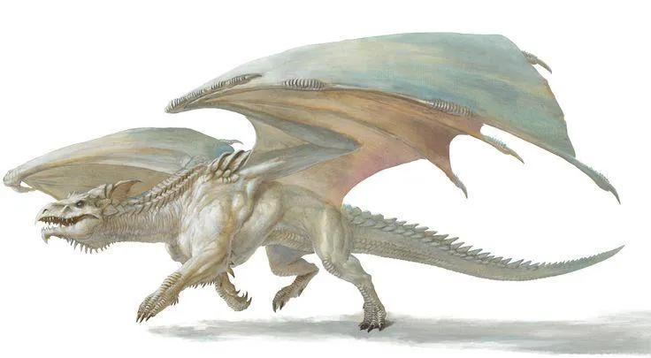

## Bloco de estatísticas: Dragão Branco Ancião

*Dragão Imenso, caótico e mau*

**Classe de Armadura** 20 (armadura natural)  
**Pontos de Vida** 333 (18d20 + 144)  
**Deslocamento** 12 m, escavação 12 m, natação 12 m, voo 24 m

| FOR | DES | CON | INT | SAB | CAR |
| :---: | :---: | :---: | :---: | :---: | :---: |
| 26 (+8) | 10 (+0) | 26 (+8) | 10 (+0) | 13 (+1) | 14 (+2) |

**Testes de Resistência** Des +6, Con +14, Sab +7, Car +8  
**Perícias** Furtividade +6, Percepção +13  
**Imunidade a Dano** frio  
**Sentidos** percepção às cegas 18 m, visão no escuro 36 m, Percepção passiva 23  
**Idiomas** Comum, Dracônico  
**Nível de Desafio** 20 (25.000 XP)

***Andar no Gelo***. O dragão pode se mover e escalar superfícies congeladas sem precisar realizar um teste de habilidade. Além disso, terreno difícil composto por gelo ou neve não custa movimento extra para ele.

***Resistência Lendária (3/Dia)***. Se o dragão falhar em um teste de resistência, ele pode escolher obter sucesso, no lugar.

### Ações

***Ataques Múltiplos***. O dragão pode usar sua Presença Aterradora, ele pode então, realizar três ataques: um com sua mordida e dois com suas garras.

***Mordida***. *Ataque Corpo-a-Corpo com Arma*: +14 para atingir, alcance 4,5 m, um alvo. *Acerto*: 19 (2d10 + 8) de dano perfurante mais 9 (2d8) de dano de frio.

***Garra***. *Ataque Corpo-a-Corpo com Arma*: +14 para atingir, alcance 3 m, um alvo. *Acerto*: 15 (2d6 + 8) de dano cortante.

***Cauda***. *Ataque Corpo-a-Corpo com Arma*: +14 para atingir, alcance 6 m, um alvo. *Acerto*: 17 (2d8 + 8) de dano de concussão.

***Presença Aterradora***. Cada criatura, à escolha do dragão, que esteja a até 36 metros do dragão e esteja ciente disso, deve ser bem sucedida num teste de resistência de Sabedoria CD 16 ou ficará amedrontada por 1 minuto. Uma criatura pode repetir o teste de resistência no final de cada um dos turnos dela, terminando o efeito sobre si, caso obtenha sucesso. Se o teste de resistência de uma criatura for bem sucedido ou caso o efeito termine sobre ela, a criatura ficará imune a Presença Aterradora do dragão pelas próximas 24 horas.

***Sopro Congelante (Recarrega 5–6)***. O dragão pode expelir uma explosão gélida num cone de 27 metros. Cada criatura na área deve realiza um teste de resistência de Constituição CD 22, sofrendo 72 (16d8) de dano de frio se falhar na resistência, ou metade desse dano caso obtenha sucesso.

### Ações Lendárias

O dragão pode realizar 3 ações lendárias, escolhidas dentre as opções abaixo. Apenas uma ação lendária pode ser usada por vez e apenas no final do turno de outra criatura. O dragão recupera as ações lendárias gastas no começo do turno dele.

**Detectar**. O dragão realiza um teste de Sabedoria (Percepção).  
**Ataque com Cauda**. O dragão realiza um ataque de cauda.  
**Ataque com Asas (Custa 2 Ações).** O dragão bate suas asas. Cada criatura a até 4,5 metros do dragão deve ser bem sucedida num teste de resistência de Destreza CD 22 ou sofrerá 15 (2d6 + 9) de dano de concussão e cairá no chão. Após bater suas asas, o dragão pode voar até metade do seu deslocamento de voo.

## Bloco de estatísticas: Dragão Branco Adulto

*Dragão Enorme, caótico e mau*

**Classe de Armadura** 18 (armadura natural)  
**Pontos de Vida** 200 (16d12 + 96)  
**Deslocamento** 12 m, escavação 9 m, natação 12 m, voo 24 m

| FOR | DES | CON | INT | SAB | CAR |
| :---: | :---: | :---: | :---: | :---: | :---: |
| 22 (+6) | 10 (+0) | 22 (+6) | 8 (–1) | 12 (+1) | 12 (+1) |

**Testes de Resistência** Des +5, Con +11, Sab +6, Car +6  
**Perícias** Furtividade +5, Percepção +11  
**Imunidade a Dano** frio  
**Sentidos** percepção às cegas 18 m, visão no escuro 36 m, Percepção passiva 21  
**Idiomas** Comum, Dracônico  
**Nível de Desafio** 13 (10.000 XP)

***Andar no Gelo***. O dragão pode se mover e escalar superfícies congeladas sem precisar realizar um teste de habilidade. Além disso, terreno difícil composto por gelo ou neve não custa movimento extra para ele.

***Resistência Lendária (3/Dia)***. Se o dragão falhar em um teste de resistência, ele pode escolher obter sucesso, no lugar.

### Ações

***Ataques Múltiplos***. O dragão pode usar sua Presença Aterradora, ele pode então, realizar três ataques: um com sua mordida e dois com suas garras.

***Mordida***. *Ataque Corpo-a-Corpo com Arma*: +11 para atingir, alcance 3 m, um alvo. *Acerto*: 17 (2d10 + 6) de dano perfurante mais 4 (1d8) de dano de frio.

***Garra***. *Ataque Corpo-a-Corpo com Arma*: +11 para atingir, alcance 1,5 m, um alvo. *Acerto*: 13 (2d6 + 6) de dano cortante.

***Cauda***. *Ataque Corpo-a-Corpo com Arma*: +11 para atingir, alcance 4,5 m, um alvo. *Acerto*: 15 (2d8 + 6) de dano de concussão.

***Presença Aterradora***. Cada criatura, à escolha do dragão, que esteja a até 36 metros do dragão e esteja ciente disso, deve ser bem sucedida num teste de resistência de Sabedoria CD 14 ou ficará amedrontada por 1 minuto. Uma criatura pode repetir o teste de resistência no final de cada um dos turnos dela, terminando o efeito sobre si, caso obtenha sucesso. Se o teste de resistência de uma criatura for bem sucedido ou caso o efeito termine sobre ela, a criatura ficará imune a Presença Aterradora do dragão pelas próximas 24 horas.

***Sopro Congelante (Recarrega 5–6)***. O dragão pode expelir uma explosão gélida num cone de 18 metros. Cada criatura na área deve realiza um teste de resistência de Constituição CD 19, sofrendo 54 (12d8) de dano de frio se falhar na resistência, ou metade desse dano caso obtenha sucesso.

### Ações Lendárias

O dragão pode realizar 3 ações lendárias, escolhidas dentre as opções abaixo. Apenas uma ação lendária pode ser usada por vez e apenas no final do turno de outra criatura. O dragão recupera as ações lendárias gastas no começo do turno dele.

**Detectar**. O dragão realiza um teste de Sabedoria (Percepção).  
**Ataque com Cauda**. O dragão realiza um ataque de cauda.  
**Ataque com Asas (Custa 2 Ações).** O dragão bate suas asas. Cada criatura a até 3 metros do dragão deve ser bem sucedida num teste de resistência de Destreza CD 19 ou sofrerá 13 (2d6 + 6) de dano de concussão e cairá no chão. Após bater suas asas, o dragão pode voar até metade do seu deslocamento de voo.

## Bloco de estatísticas: Dragão Branco Jovem

*Dragão Grande, caótico e mau*

**Classe de Armadura** 17 (armadura natural)  
**Pontos de Vida** 133 (14d10 + 56)  
**Deslocamento** 12 m, escavação 9 m, natação 12 m, voo 24 m

| FOR | DES | CON | INT | SAB | CAR |
| :---: | :---: | :---: | :---: | :---: | :---: |
| 18 (+4) | 10 (+0) | 18 (+4) | 6 (–2) | 11 (+0) | 12 (+1) |

**Testes de Resistência** Des +3, Con +7, Sab +3, Car +4  
**Perícias** Furtividade +3, Percepção +6  
**Imunidade a Dano** frio  
**Sentidos** percepção às cegas 9 m, visão no escuro 36 m, Percepção passiva 16  
**Idiomas** Comum, Dracônico  
**Nível de Desafio** 6 (2.300 XP)

***Andar no Gelo***. O dragão pode se mover e escalar superfícies congeladas sem precisar realizar um teste de habilidade. Além disso, terreno difícil composto por gelo ou neve não custa movimento extra para ele.

### Ações

***Ataques Múltiplos***. O dragão realiza três ataques: um com sua mordida e dois com suas garras.

***Mordida***. *Ataque Corpo-a-Corpo com Arma*: +7 para atingir, alcance 3 m, um alvo. *Acerto*: 15 (2d10 + 4) de dano perfurante mais 4 (1d8) de dano de frio.

***Garra***. *Ataque Corpo-a-Corpo com Arma*: +7 para atingir, alcance 1,5 m, um alvo. *Acerto*: 11 (2d6 + 4) de dano cortante.

***Sopro Congelante (Recarrega 5–6)***. O dragão pode expelir uma explosão gélida num cone de 9 metros. Cada criatura na área deve realiza um teste de resistência de Constituição CD 15, sofrendo 45 (10d8) de dano de frio se falhar na resistência, ou metade desse dano caso obtenha sucesso.

## Bloco de estatísticas: Dragão Branco Filhote

*Dragão Médio, caótico e mau*

**Classe de Armadura** 16 (armadura natural)  
**Pontos de Vida** 32 (5d8 + 10)  
**Deslocamento** 9 m, escavação 4,5 m, natação 9 m, voo 18 m

| FOR | DES | CON | INT | SAB | CAR |
| :---: | :---: | :---: | :---: | :---: | :---: |
| 14 (+2) | 10 (+0) | 14 (+2) | 5 (–3) | 10 (+0) | 11 (+0) |

**Testes de Resistência** Des +2, Con +4, Sab +2, Car +2  
**Perícias** Furtividade +4, Percepção +2  
**Imunidade a Dano** frio  
**Sentidos** percepção às cegas 3 m, visão no escuro 18 m, Percepção passiva 14  
**Idiomas** Dracônico  
**Nível de Desafio** 2 (450 XP)

### Ações

***Mordida***. *Ataque Corpo-a-Corpo com Arma*: +4 para atingir, alcance 1,5 m, um alvo. *Acerto*: 7 (1d10 + 2) de dano perfurante mais 2 (1d4) de dano de frio.

***Sopro Congelante (Recarrega 5–6)***. O dragão pode expelir uma explosão gélida num cone de 4,5 metros. Cada criatura na área deve realiza um teste de resistência de Constituição CD 12, sofrendo 22 (5d8) de dano de frio se falhar na resistência, ou metade desse dano caso obtenha sucesso.

### Dragão Branco

Os menores, menos inteligentes e mais animalescos dos dragões cromáticos, os dragões brancos habitam em climas gelados, preferindo áreas árticas ou montanhas congeladas. Eles são repteis perversos e cruéis, guiados pelo apetite e ganância.

Um dragão branco tem olhos ferinos, um focinho afilado e uma papada espinhosa. As escamas de um dragão branco filhote reluzem puro branco. À medida que o dragão envelhece, esse brilho desaparece e algumas escamas começam a escurecer, então, em idades mais avançadas, ele torna-se mosqueado com tons de azul claro e cinza claro. Esse padrão ajuda o dragão a se mesclar nos reinos de gelo e rochas quando ele caça, e para sumir da vista quando ele plana através do céu coberto de nuvens.

***Primitivos e Vingativos***. Os dragões brancos não possuem a astúcia e senso tático da maioria dos outros dragões. No entanto, sua natureza bestial faz deles os melhores caçadores dentre todos da espécie dracônica, singularmente focados em sobreviver e massacrar seus inimigos. Um dragão branco consume apenas comida congelada, devorando as criaturas mortas por seu ataque de sopro enquanto ainda estão rígidas e geladas. Ele enclausura outros mortos em gelo ou enterra-os na neve próxima de seu covil, e encontrar esses cadáveres é um bom indicativo que um dragão branco vive próximo.

Um dragão branco também mantem os corpos de seus maiores inimigos como troféus, congelando os corpos onde ele possa observa-los e regozijar. Os cadáveres de gigantes, remorhazes e outros dragões são muitas vezes posicionados em locais proeminentes dentro do covil de um dragão branco como um aviso para os intrusos.

Apesar de serem apenas moderadamente inteligentes, dragões brancos tem uma memória extraordinária. Eles lembram-se de cada desrespeito e derrota, e são conhecidos por conduzir vinganças maliciosas contra as criaturas que os ofenderam. Isso geralmente inclui dragões de prata, que habitam os mesmos territórios dos brancos. Os dragões brancos podem falar, como todos os dragões, mas eles raramente falam, a não ser que sejam movidos a fazê-lo.

***Mestres Solitários***. Os dragões brancos evitam todos os outros dragões, exceto os brancos do sexo oposto. Mesmo assim, quando dragões brancos procuram outro para procriar, eles permanecem juntos apenas tempo o suficiente para conceber a prole antes de partirem para o isolamento novamente.

Os dragões brancos não conseguem coexistir com rivais próximos aos seus covis. Como resultado, um dragão branco ataque outras criaturas sem provocação, considerando tais criaturas ou muito fracas ou muito poderosas para viver. As únicas criaturas que geralmente servem um dragão branco são humanoides inteligentes que demonstrem força suficiente para acalmar a ira do dragão e devem se adaptar a perdas regulares como resultado do apetite dele. Estão inclusos kobolds adoradores de dragões, que são frequentemente encontrados em seus covis.

Criaturas poderosas podem, as vezes, adquirir a obediência de um dragão branco através de demonstração de força física ou mágica. Gigantes do gelo desafiam os dragões brancos para provar sua própria força e subirem de posto em seus clãs e os ossos partidos deles espalham-se pelos covis de dragões brancos. No entanto, um dragão branco derrotado por um gigante do gelo se tornará servo dele, aceitando a autoridade de uma criatura superior em troca de afirmar seu próprio domínio sobre as outras criaturas que servem ou se opõem ao gigante.

***Tesouro sob o Gelo***. Os dragões brancos adoram o brilho frio do gelo e preferem tesouros com qualidades similares, particularmente diamantes. No entanto, nos seus climas árticos remotos, os tesouros escondidos dos dragões brancos geralmente contem presas de marfim de morsas e mamutes, esculturas de ossos de baleia, carrancas de navios, pelagens e itens mágicos usurpados de aventureiros excessivamente ousados.

Moedas e gemas espalham-se pelo covil de um dragão branco, brilhando como estrelas quando a luz às atinge. Grandes tesouros e baús são envoltos por finas camadas de gelo criadas pelo sobro do dragão branco e ficam guardados em segurança sob a camada de gelo transparente. A grande força do dragão permite que ele acesse suas riquezas com facilidade, enquanto criaturas menores irão gastar horas quebrando ou derretendo o gelo para alcançar o tesouro principal do dragão.

A memória impecável do dragão branco faz com que ele saiba como ele conseguiu adquirir cada moeda, gema e item mágico de seu tesouro, e ele associa cada item a uma vitória específica. Os dragões brancos são notoriamente difíceis de se subornar, já que cada oferta de tesouro é vista como um insulto à sua habilidade de simplesmente aniquilar a criatura que está fazendo a oferta e apanhar o tesouro dela por si só.

### O Covil do Dragão Branco

Os dragões brancos fazem seus covis em cavernas geladas e profundas câmaras subterrâneas longe do sol. Eles preferem vales montanhosos acessíveis apenas por voo, cavernas em encostas de penhascos e cavernas geladas labirínticas em geleiras. Os dragões brancos adoram alturas verticais em suas cavernas, voando até o teto e se empoleirando como morcegos ou escorregando geleira abaixo.

A magia inata de um dragão branco lendário intensifica o gelo na área em volta do seu covil. Cavernas montanhosas são rapidamente congeladas pela presença do dragão branco. Um dragão branco pode, muitas vezes, detectar intrusos pela forma que os ventos constantes do seu covil mudam de tom.

Um dragão branco descansa em altas escarpas ou penhascos gelados em seu covil, o chão em volta dele é um traiçoeiro charco de gelo e rocha partidos, fossos escondidos e ladeiras escorregadias. Enquanto os inimigos lutam para se mover por ele, o dragão voa de poleiro em poleiro e os destrói com seu sopro congelante.

### Ações de Covil

No valor de iniciativa 20 (quebrando toda a sequência de iniciativa), o dragão realiza uma ação de covil fazendo um dos efeitos a seguir; o dragão não pode usar o mesmo efeitos em duas rodadas consecutivas:

- Um nevoeiro gelado preenche uma esfera de 6 metros de raio, centrada num ponto que o dragão possa ver a até 36 metros dele. O nevoeiro se espalha, dobrando esquinas e sua área é de escuridão densa. Cada criatura no nevoeiro quando ele aparece, deve realizar um teste de resistência de Constituição CD 10, sofrendo 10 (3d6) de dano de frio se falhar na resistência ou metade desse dano se obtiver sucesso. Uma criatura que termine o turno dela no nevoeiro sofre 10 (3d6) de dano de frio. Um vento de, pelo menos 30 quilômetros por hora, dispersa o nevoeiro. O nevoeiro, do contrário, dura até o dragão usar essa ação de covil novamente ou até o dragão morrer.
- Estilhas de gelo chanfradas caem do teto, atingindo até três criaturas abaixo delas que o dragão possa ver, a até 36 metros dele. O dragão realiza uma jogada de ataque à distância (+7 para atingir) contra cada criatura. Se atingir, o alvo sofre 10 (3d6) de dano perfurante.
- O dragão cria uma parede de gelo opaca em uma superfície sólida que ele possa ver, a até 36 metros dele. A parede pode ter até 9 metros de comprimento, 9 metros de largura e 30 centímetros de espessura. Quando a parede aparece, cada criatura dentro da área dela é empurrada 1,5 metros para fora do espaço da parede, indo para qualquer dos lados da parede que desejar. Cada seção de 3 metros da parede tem CA 5, 30 pontos de vida, vulnerabilidade a fogo e imunidade a dano de ácido, frio, necrótico, psíquico e veneno. A parede desaparece quando o dragão usa essa ação de covil novamente ou quando o dragão morre.

### Efeitos Regionais

A região contendo o covil de um dragão branco lendário é deformada pela presença da criatura, o que cria um ou mais dos seguintes efeitos:

- Nevoeiro congelante causa escuridão leve no terreno a até 9 quilômetros do covil do dragão.
- Precipitação gelada cai a até 9 quilômetros do covil do dragão, às vezes, formando condições de nevasca quando o dragão está descansando.
- Paredes de gelo bloqueiam áreas no covil do dragão. Cada parede tem 15 centímetros de espessura, e uma seção de 3 metros tem CA 5, 15 pontos de vida, vulnerabilidade a fogo e imunidade a dano de ácido, frio, necrótico, psíquico e veneno. Se o dragão desejar se mover pela parede, ele pode fazê-lo sem ter seu deslocamento reduzido. A porção de gelo pela qual o dragão se move é destruída, no entanto.

Se o dragão morrer, o nevoeiro e a precipitação desaparecerão em 1 dia. As paredes de gelo derreterão ao longo de 1d10 dias.

## Bloco de estatísticas: Dragão Negro Ancião

*Dragão Imenso, caótico e mau*

**Classe de Armadura** 22 (armadura natural)  
**Pontos de Vida** 367 (21d20 + 147)  
**Deslocamento** 12 m, natação 12 m, voo 24 m

| FOR | DES | CON | INT | SAB | CAR |
| :---: | :---: | :---: | :---: | :---: | :---: |
| 27 (+8) | 14 (+2) | 25 (+7) | 16 (+3) | 15 (+2) | 19 (+4) |

**Testes de Resistência** Des +9, Con +14, Sab +9, Car +11  
**Perícias** Furtividade +9, Percepção +16  
**Imunidade a Dano** ácido  
**Sentidos** percepção às cegas 18 m, visão no escuro 36 m, Percepção passiva 26  
**Idiomas** Comum, Dracônico  
**Nível de Desafio** 21 (33.000 XP)

***Anfíbio***. O dragão pode respirar ar e água.

***Resistência Lendária (3/Dia)***. Se o dragão falhar em um teste de resistência, ele pode escolher obter sucesso, no lugar.

### Ações

***Ataques Múltiplos***. O dragão pode usar sua Presença Aterradora, ele pode então, realizar três ataques: um com sua mordida e dois com suas garras.

***Mordida***. *Ataque Corpo-a-Corpo com Arma*: +15 para atingir, alcance 4,5 m, um alvo. *Acerto*: 19 (2d10 + 8) de dano perfurante mais 9 (2d8) de dano de ácido.

***Garra***. *Ataque Corpo-a-Corpo com Arma*: +15 para atingir, alcance 3 m, um alvo. *Acerto*: 15 (2d6 + 8) de dano cortante.

***Cauda***. *Ataque Corpo-a-Corpo com Arma*: +15 para atingir, alcance 6 m, um alvo. *Acerto*: 17 (2d8 + 8) de dano de concussão.

***Presença Aterradora***. Cada criatura, à escolha do dragão, que esteja a até 36 metros do dragão e esteja ciente disso, deve ser bem sucedida num teste de resistência de Sabedoria CD 19 ou ficará amedrontada por 1 minuto. Uma criatura pode repetir o teste de resistência no final de cada um dos turnos dela, terminando o efeito sobre si, caso obtenha sucesso. Se o teste de resistência de uma criatura for bem sucedido ou caso o efeito termine sobre ela, a criatura ficará imune a Presença Aterradora do dragão pelas próximas 24 horas.

***Sopro Ácido (Recarrega 5–6)***. O dragão pode expelir ácido em uma linha com 27 metros de comprimento e 3 metros de largura. Cada criatura na linha deve realizar um teste de resistência de Destreza CD 22, sofrendo 67 (15d8) de dano de ácido se falhar na resistência, ou metade desse dano caso obtenha sucesso.

### Ações Lendárias

O dragão pode realizar 3 ações lendárias, escolhidas dentre as opções abaixo. Apenas uma ação lendária pode ser usada por vez e apenas no final do turno de outra criatura. O dragão recupera as ações lendárias gastas no começo do turno dele.

**Detectar**. O dragão realiza um teste de Sabedoria (Percepção).  
**Ataque com Cauda**. O dragão realiza um ataque de cauda.  
**Ataque com Asas (Custa 2 Ações).** O dragão bate suas asas. Cada criatura a até 4,5 metros do dragão deve ser bem sucedida num teste de resistência de Destreza CD 23 ou sofrerá 15 (2d6 + 8) de dano de concussão e cairá no chão. Após bater suas asas, o dragão pode voar até metade do seu deslocamento de voo.

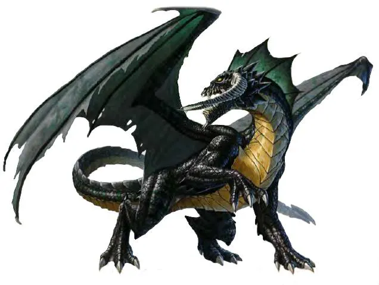

## Bloco de estatísticas: Dragão Negro Adulto

*Dragão Enorme, caótico e mau*

**Classe de Armadura** 19 (armadura natural)  
**Pontos de Vida** 195 (17d12 + 85)  
**Deslocamento** 12 m, natação 12 m, voo 24 m

| FOR | DES | CON | INT | SAB | CAR |
| :---: | :---: | :---: | :---: | :---: | :---: |
| 23 (+6) | 14 (+2) | 21 (+5) | 14 (+2) | 13 (+1) | 17 (+3) |

**Testes de Resistência** Des +7, Con +10, Sab +6, Car +8  
**Perícias** Furtividade +7, Percepção +11  
**Imunidade a Dano** ácido  
**Sentidos** percepção às cegas 18 m, visão no escuro 36 m, Percepção passiva 21  
**Idiomas** Comum, Dracônico  
**Nível de Desafio** 14 (11.500 XP)

***Anfíbio***. O dragão pode respirar ar e água.

***Resistência Lendária (3/Dia)***. Se o dragão falhar em um teste de resistência, ele pode escolher obter sucesso, no lugar.

### Ações

***Ataques Múltiplos***. O dragão pode usar sua Presença Aterradora, ele pode então, realizar três ataques: um com sua mordida e dois com suas garras.

***Mordida***. *Ataque Corpo-a-Corpo com Arma*: +11 para atingir, alcance 3 m, um alvo. *Acerto*: 17 (2d10 + 6) de dano perfurante mais 4 (1d8) de dano de ácido.

***Garra***. *Ataque Corpo-a-Corpo com Arma*: +11 para atingir, alcance 1,5 m, um alvo. *Acerto*: 13 (2d6 + 6) de dano cortante.

***Cauda***. *Ataque Corpo-a-Corpo com Arma*: +11 para atingir, alcance 4,5 m, um alvo. *Acerto*: 15 (2d8 + 6) de dano de concussão.

***Presença Aterradora***. Cada criatura, à escolha do dragão, que esteja a até 36 metros do dragão e esteja ciente disso, deve ser bem sucedida num teste de resistência de Sabedoria CD 16 ou ficará amedrontada por 1 minuto. Uma criatura pode repetir o teste de resistência no final de cada um dos turnos dela, terminando o efeito sobre si, caso obtenha sucesso. Se o teste de resistência de uma criatura for bem sucedido ou caso o efeito termine sobre ela, a criatura ficará imune a Presença Aterradora do dragão pelas próximas 24 horas.

***Sopro Ácido (Recarrega 5–6)***. O dragão pode expelir ácido em uma linha com 18 metros de comprimento e 1,5 metro de largura. Cada criatura na linha deve realizar um teste de resistência de Destreza CD 18, sofrendo 54 (12d8) de dano de ácido se falhar na resistência, ou metade desse dano caso obtenha sucesso.

### Ações Lendárias

O dragão pode realizar 3 ações lendárias, escolhidas dentre as opções abaixo. Apenas uma ação lendária pode ser usada por vez e apenas no final do turno de outra criatura. O dragão recupera as ações lendárias gastas no começo do turno dele.

**Detectar**. O dragão realiza um teste de Sabedoria (Percepção).  
**Ataque com Cauda**. O dragão realiza um ataque de cauda.  
**Ataque com Asas (Custa 2 Ações).** O dragão bate suas asas. Cada criatura a até 3 metros do dragão deve ser bem sucedida num teste de resistência de Destreza CD 19 ou sofrerá 13 (2d6 + 6) de dano de concussão e cairá no chão. Após bater suas asas, o dragão pode voar até metade do seu deslocamento de voo.

## Bloco de estatísticas: Dragão Negro Jovem

*Dragão Grande, caótico e mau*

**Classe de Armadura** 18 (armadura natural)  
**Pontos de Vida** 127 (15d10 + 45)  
**Deslocamento** 12 m, natação 12 m, voo 24 m

| FOR | DES | CON | INT | SAB | CAR |
| :---: | :---: | :---: | :---: | :---: | :---: |
| 19 (+4) | 14 (+2) | 17 (+3) | 12 (+1) | 11 (+0) | 15 (+2) |

**Testes de Resistência** Des +5, Con +6, Sab +3, Car +5  
**Perícias** Furtividade +5, Percepção +6  
**Imunidade a Dano** ácido  
**Sentidos** percepção às cegas 9 m, visão no escuro 36 m, Percepção passiva 16  
**Idiomas** Comum, Dracônico  
**Nível de Desafio** 7 (2.900 XP)

***Anfíbio***. O dragão pode respirar ar e água.

### Ações

***Ataques Múltiplos***. O dragão realiza três ataques: um com sua mordida e dois com suas garras.

***Mordida***. *Ataque Corpo-a-Corpo com Arma*: +7 para atingir, alcance 3 m, um alvo. *Acerto*: 15 (2d10 + 4) de dano perfurante mais 4 (1d8) de dano de ácido.

***Garra***. *Ataque Corpo-a-Corpo com Arma*: +7 para atingir, alcance 1,5 m, um alvo. *Acerto*: 11 (2d6 + 4) de dano cortante.

***Sopro Ácido (Recarrega 5–6)***. O dragão pode expelir ácido em uma linha com 9 metros de comprimento e 1,5 metro de largura. Cada criatura na linha deve realizar um teste de resistência de Destreza CD 14, sofrendo 49 (11d8) de dano de ácido se falhar na resistência, ou metade desse dano caso obtenha sucesso.

## Bloco de estatísticas: Dragão Negro Filhote

*Dragão Médio, caótico e mau*

**Classe de Armadura** 17 (armadura natural)  
**Pontos de Vida** 33 (6d8 + 6)  
**Deslocamento** 9 m, natação 9 m, voo 18 m

| FOR | DES | CON | INT | SAB | CAR |
| :---: | :---: | :---: | :---: | :---: | :---: |
| 15 (+2) | 14 (+2) | 13 (+1) | 10 (+0) | 11 (+0) | 13 (+1) |

**Testes de Resistência** Des +4, Con +3, Sab +2, Car +3  
**Perícias** Furtividade +4, Percepção +4  
**Imunidade a Dano** ácido  
**Sentidos** percepção às cegas 3 m, visão no escuro 18 m, Percepção passiva 14  
**Idiomas** Dracônico  
**Nível de Desafio** 2 (450 XP)

### Ações

***Mordida***. *Ataque Corpo-a-Corpo com Arma*: +4 para atingir, alcance 1,5 m, um alvo. *Acerto*: 7 (1d10 + 2) de dano perfurante mais 2 (1d4) de dano de ácido.

***Sopro Ácido (Recarrega 5–6)***. O dragão pode expelir ácido em uma linha com 4,5 metros de comprimento e 1,5 metro de largura. Cada criatura na linha deve realizar um teste de resistência de Destreza CD 11, sofrendo 22 (5d8) de dano de ácido se falhar na resistência, ou metade desse dano caso obtenha sucesso.

### Dragão Negro

Os de pior temperamento e mais vis dos dragões cromáticos, dragões negros coletam os destroços e tesouros de pessoas mortas. Esses dragões detestam ver os fracos prosperarem e deleitam-se com o colapso de reinos humanoides. Eles fazem seus lares em pântanos fétidos e ruínas abandonadas onde jaziam reinos.

Com órbitas oculares profundas e fossas nasais largas, a face de um dragão negro lembra uma caveira. Seus chifres segmentados curvados tem coloração de osso na base e escurecem até o preto morto nas pontas. À medida que um dragão negro envelhece, a carne ao redor de seus chifres e maçãs do rosto se deteriora enquanto é devorada por ácido, deixando finas camadas de couro que acentual sua aparência esquelética. A cabeça de um dragão negro é evidenciada pelos espinhos e chifres. Sua língua é chata com uma ponta bifurcada, babando limo cujo cheiro acidífero se mesclar ao fedor de vegetação apodrecida e água suja do dragão.

Quando nasce, um dragão negro possui escamas lustrosas. Quando envelhece, essas escamas tornam-se grossas e maciças, ajudando-o a se mesclar nos pântanos e ruínas destruídas onde eles moram.

***Brutais e Cruéis***. Todos os dragões cromáticos são malignos, mas os dragões negros se destacam por sua natureza sádica. Um dragão negro vive para ver suas presas clamarem por misericórdia, e irá, diversas vezes, oferecer a ilusão de adiamento ou de fuga antes de acabar com seus inimigos.

Um dragão negro ataca seus inimigos mais fracos primeiro, garantindo uma vitória rápida e brutal, o que infla seu ego enquanto ele aterroriza os oponentes restantes. Quando está à beira da derrota, um dragão negro faz todo o possível para se salvar, mas ele prefere aceitar a morte antes de permitir que qualquer outra criatura tente domina-lo.

***Adversários e Servos***. Os dragões negros odeiam e temem outros dragões. Eles espionam rivais dracônicos de longe, esperando por oportunidades de matar dragões mais fracos e evitando os mais fortes. Se o dragão mais forte o ameaçar, um dragão negro abandonará seu covil e buscara um novo território.

Povos lagartos malignos veneram e servem os dragões negros assaltando assentamentos humanoides em busca de tesouros e comida dados como tributo e construindo efigies dracônicos simplórios ao longo das fronteiras do domínio do seu mestre dragão.

A influência malévola de um dragão negro também pode causar a criação espontânea de arbustos errantes malignos que buscam e matam as criaturas boas que se aproximarem do covil do dragão.

Kobolds infestam os covis de muitos dragões negros, como vermes. Eles se tornam cruéis como seus mestres tenebrosos, muitas vezes torturando e enfraquecendo prisioneiros com picadas de centopeias e ferroadas de escorpiões antes de envia-los para saciar o apetite do dragão.

***Riqueza dos Anciões***. Dragões negros detém os tesouros e itens mágicos de impérios destruídos e de reinos conquistados para lembrarem-se de sua grandeza. Quanto mais civilizações o dragão devasta, mais vontade ele tem de adquirir as riquezas das civilizações atuais para ele.

### O Covil do Dragão Negro

Os dragões negros fazem seus covis em pântanos nos limites destruídos de civilizações. O covil de um dragão negro é uma caverna sombria, gruta ou ruína que esteja, pelo menos, parcialmente inundada, contendo piscinas onde o dragão descansa e onde suas vítimas podem fermentar. O covil está repleto de ossos de vítimas derretidas e carcaças de carne morta cheias de moscas, vigiadas por ruínas de estátuas. Centopeias, escorpiões e serpentes infestam o covil, que é preenchido com o fedor de morte e decomposição.

### Ações de Covil

No valor de iniciativa 20 (quebrando toda a sequência de iniciativa), o dragão realiza uma ação de covil fazendo um dos efeitos a seguir; o dragão não pode usar o mesmo efeitos em duas rodadas consecutivas:

- Piscinas de água que o dragão puder ver, a até 36 metros dele, erguem-se criando ondas potentes. Qualquer criatura no solo a até 6 metros de tais piscinas devem ser bem sucedidas num teste de resistência de Força CD 15 ou serão empurradas a até 6 metros da água e cairão no chão.
- Uma nuvem de enxames de insetos preenche uma esfera de 6 metros de raio, centrada num ponto à escolha do dragão, a até 36 metros dele. A nuvem se espalha, dobrando esquinas e permanece até o dragão dissipa-la com uma ação, usar essa ação de covil novamente ou morrer. A nuvem produz escuridão leve. Qualquer criatura na nuvem quando ela aparece deve realizar um teste de resistência de Constituição CD 15, sofrendo 10 (3d6) de dano perfurante se falhar na resistência, ou metade desse dano se obtiver sucesso. Uma criatura que termina o turno dela dentro da nuvem sofre 10 (3d6) de dano perfurante.
- Escuridão mágica espalha-se de um ponto, à escolha do dragão, a até 18 metros dele, preenchendo uma esfera de 4,5 metros de raio até o dragão dissipa-la com uma ação, usar essa ação de covil novamente ou morrer. A escuridão se espalha, dobrando esquinas. Uma criatura com visão no escuro não pode ver através da escuridão e luz não-mágica não pode iluminar dentro dela. Se qualquer parte da área afetada sobrepor uma área criada por uma magia de 2° nível ou inferior, a magia que criou a luz é dissipada.

### Efeitos Regionais

A região contendo o covil de um dragão negro lendário é deformada pela presença da criatura, o que cria um ou mais dos seguintes efeitos:

- O terreno a até 9 quilômetros do covil requer o dobro do tempo normal para ser atravessado, já que as plantas crescem grossas e retorcidas, e os pântanos são densos devido à lama fétida.
- Fontes de água a até 1,5 quilômetro do covil são sobrenaturalmente poluídas. Inimigos do dragão que beberem dessa água a vomitarão dentro de minutos.
- Nevoeiro cria escuridão leve no terreno a até 9 quilômetros do covil.

Se o dragão morrer, a vegetação permanecerá espessa, mas os outros efeitos desaparecerão ao longo de 1d10 dias.

## Bloco de estatísticas: Dragão Verde Ancião

*Dragão Imenso, leal e mau*

**Classe de Armadura** 21 (armadura natural)  
**Pontos de Vida** 385 (22d20 + 154)  
**Deslocamento** 12 m, natação 12 m, voo 24 m

| FOR | DES | CON | INT | SAB | CAR |
| :---: | :---: | :---: | :---: | :---: | :---: |
| 27 (+8) | 12 (+1) | 25 (+7) | 20 (+5) | 17 (+3) | 19 (+4) |

**Testes de Resistência** Des +8, Con +14, Sab +10, Car +11  
**Perícias** Enganação +11, Furtividade +8, Intuição +10, Percepção +17, Persuasão +11  
**Imunidade a Dano** veneno  
**Imunidade a Condição** envenenado  
**Sentidos** percepção às cegas 18 m, visão no escuro 36 m, Percepção passiva 27  
**Idiomas** Comum, Dracônico  
**Nível de Desafio** 22 (41.000 XP)

***Anfíbio***. O dragão pode respirar ar e água.

***Resistência Lendária (3/Dia)***. Se o dragão falhar em um teste de resistência, ele pode escolher obter sucesso, no lugar.

### Ações

***Ataques Múltiplos***. O dragão pode usar sua Presença Aterradora, ele pode então, realizar três ataques: um com sua mordida e dois com suas garras.

***Mordida***. *Ataque Corpo-a-Corpo com Arma*: +15 para atingir, alcance 4,5 m, um alvo. *Acerto*: 19 (2d10 + 8) de dano perfurante mais 10 (3d6) de dano de veneno.

***Garra***. *Ataque Corpo-a-Corpo com Arma*: +15 para atingir, alcance 3 m, um alvo. *Acerto*: 15 (2d6 + 8) de dano cortante.

***Cauda***. *Ataque Corpo-a-Corpo com Arma*: +15 para atingir, alcance 6 m, um alvo. *Acerto*: 17 (2d8 + 8) de dano de concussão.

***Presença Aterradora***. Cada criatura, à escolha do dragão, que esteja a até 36 metros do dragão e esteja ciente disso, deve ser bem sucedida num teste de resistência de Sabedoria CD 19 ou ficará amedrontada por 1 minuto. Uma criatura pode repetir o teste de resistência no final de cada um dos turnos dela, terminando o efeito sobre si, caso obtenha sucesso. Se o teste de resistência de uma criatura for bem sucedido ou caso o efeito termine sobre ela, a criatura ficará imune a Presença Aterradora do dragão pelas próximas 24 horas.

***Sopro Venenoso (Recarrega 5–6)***. O dragão pode expelir gás venenoso em uma cone de 27 metros. Cada criatura na área deve realizar um teste de resistência de Constituição CD 22, sofrendo 77 (22d6) de dano de veneno se falhar na resistência, ou metade desse dano caso obtenha sucesso.

### Ações Lendárias

O dragão pode realizar 3 ações lendárias, escolhidas dentre as opções abaixo. Apenas uma ação lendária pode ser usada por vez e apenas no final do turno de outra criatura. O dragão recupera as ações lendárias gastas no começo do turno dele.

**Detectar**. O dragão realiza um teste de Sabedoria (Percepção).  
**Ataque com Cauda**. O dragão realiza um ataque de cauda.  
**Ataque com Asas (Custa 2 Ações).** O dragão bate suas asas. Cada criatura a até 4,5 metros do dragão deve ser bem sucedida num teste de resistência de Destreza CD 23 ou sofrerá 15 (2d6 + 8) de dano de concussão e cairá no chão. Após bater suas asas, o dragão pode voar até metade do seu deslocamento de voo.

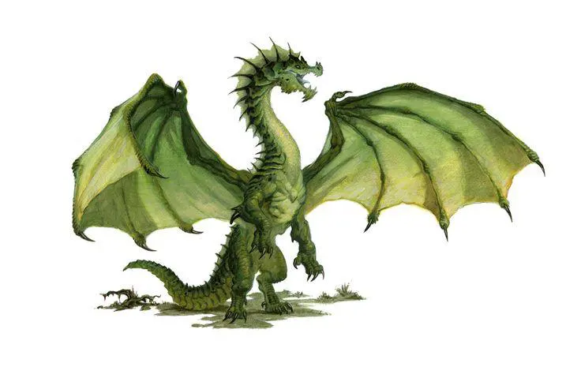

## Bloco de estatísticas: Dragão Verde Adulto

*Dragão Enorme, leal e mau*

**Classe de Armadura** 19 (armadura natural)  
**Pontos de Vida** 207 (18d12 + 90)  
**Deslocamento** 12 m, natação 12 m, voo 24 m

| FOR | DES | CON | INT | SAB | CAR |
| :---: | :---: | :---: | :---: | :---: | :---: |
| 23 (+6) | 12 (+1) | 21 (+5) | 18 (+4) | 15 (+2) | 17 (+3) |

**Testes de Resistência** Des +6, Con +10, Sab +7, Car +8  
**Perícias** Enganação +8, Furtividade +6, Intuição +7, Percepção +12, Persuasão +8  
**Imunidade a Dano** veneno  
**Imunidade a Condição** envenenado  
**Sentidos** percepção às cegas 18 m, visão no escuro 36 m, Percepção passiva 21  
**Idiomas** Comum, Dracônico  
**Nível de Desafio** 15 (13.000 XP)

***Anfíbio***. O dragão pode respirar ar e água.

***Resistência Lendária (3/Dia)***. Se o dragão falhar em um teste de resistência, ele pode escolher obter sucesso, no lugar.

### Ações

***Ataques Múltiplos***. O dragão pode usar sua Presença Aterradora, ele pode então, realizar três ataques: um com sua mordida e dois com suas garras.

***Mordida***. *Ataque Corpo-a-Corpo com Arma*: +11 para atingir, alcance 3 m, um alvo. *Acerto*: 17 (2d10 + 6) de dano perfurante mais 7 (2d6) de dano de veneno.

***Garra***. *Ataque Corpo-a-Corpo com Arma*: +11 para atingir, alcance 1,5 m, um alvo. *Acerto*: 13 (2d6 + 6) de dano cortante.

***Cauda***. *Ataque Corpo-a-Corpo com Arma*: +11 para atingir, alcance 4,5 m, um alvo. *Acerto*: 15 (2d8 + 6) de dano de concussão.

***Presença Aterradora***. Cada criatura, à escolha do dragão, que esteja a até 36 metros do dragão e esteja ciente disso, deve ser bem sucedida num teste de resistência de Sabedoria CD 16 ou ficará amedrontada por 1 minuto. Uma criatura pode repetir o teste de resistência no final de cada um dos turnos dela, terminando o efeito sobre si, caso obtenha sucesso. Se o teste de resistência de uma criatura for bem sucedido ou caso o efeito termine sobre ela, a criatura ficará imune a Presença Aterradora do dragão pelas próximas 24 horas.

***Sopro Venenoso (Recarrega 5–6)***. O dragão pode expelir gás venenoso em uma cone de 18 metros. Cada criatura na área deve realizar um teste de resistência de Constituição CD 18, sofrendo 56 (16d6) de dano de veneno se falhar na resistência, ou metade desse dano caso obtenha sucesso.

### Ações Lendárias

O dragão pode realizar 3 ações lendárias, escolhidas dentre as opções abaixo. Apenas uma ação lendária pode ser usada por vez e apenas no final do turno de outra criatura. O dragão recupera as ações lendárias gastas no começo do turno dele.

**Detectar**. O dragão realiza um teste de Sabedoria (Percepção).  
**Ataque com Cauda**. O dragão realiza um ataque de cauda.  
**Ataque com Asas (Custa 2 Ações).** O dragão bate suas asas. Cada criatura a até 3 metros do dragão deve ser bem sucedida num teste de resistência de Destreza CD 19 ou sofrerá 13 (2d6 + 6) de dano de concussão e cairá no chão. Após bater suas asas, o dragão pode voar até metade do seu deslocamento de voo.

## Bloco de estatísticas: Dragão Verde Jovem

*Dragão Grande, leal e mau*

**Classe de Armadura** 18 (armadura natural)  
**Pontos de Vida** 136 (16d10 + 48)  
**Deslocamento** 12 m, natação 12 m, voo 24 m

| FOR | DES | CON | INT | SAB | CAR |
| :---: | :---: | :---: | :---: | :---: | :---: |
| 19 (+4) | 12 (+1) | 17 (+3) | 16 (+3) | 13 (+1) | 15 (+2) |

**Testes de Resistência** Des +6, Con +10, Sab +7, Car +8  
**Perícias** Enganação +5, Furtividade +4, Percepção +7  
**Imunidade a Dano** veneno  
**Imunidade a Condição** envenenado  
**Sentidos** percepção às cegas 9 m, visão no escuro 36 m, Percepção passiva 17  
**Idiomas** Comum, Dracônico  
**Nível de Desafio** 8 (3.900 XP)

***Anfíbio***. O dragão pode respirar ar e água.

### Ações

***Ataques Múltiplos***. O dragão realiza três ataques: um com sua mordida e dois com suas garras.

***Mordida***. *Ataque Corpo-a-Corpo com Arma*: +7 para atingir, alcance 3 m, um alvo. *Acerto*: 15 (2d10 + 4) de dano perfurante mais 7 (2d8) de dano de veneno.

***Garra***. *Ataque Corpo-a-Corpo com Arma*: +7 para atingir, alcance 1,5 m, um alvo. *Acerto*: 11 (2d6 + 4) de dano cortante.

***Sopro Venenoso (Recarrega 5–6)***. O dragão pode expelir gás venenoso em uma cone de 9 metros. Cada criatura na área deve realizar um teste de resistência de Constituição CD 14, sofrendo 42 (12d6) de dano de veneno se falhar na resistência, ou metade desse dano caso obtenha sucesso.

## Bloco de estatísticas: Dragão Verde Filhote

*Dragão Médio, leal e mau*

**Classe de Armadura** 17 (armadura natural)  
**Pontos de Vida** 38 (6d8 + 6)  
**Deslocamento** 9 m, natação 9 m, voo 18 m

| FOR | DES | CON | INT | SAB | CAR |
| :---: | :---: | :---: | :---: | :---: | :---: |
| 15 (+2) | 12 (+1) | 13 (+1) | 14 (+2) | 11 (+0) | 13 (+1) |

**Testes de Resistência** Des +3, Con +3, Sab +2, Car +3  
**Perícias** Furtividade +3, Percepção +4  
**Imunidade a Dano** veneno  
**Imunidade a Condição** envenenado  
**Sentidos** percepção às cegas 3 m, visão no escuro 18 m, Percepção passiva 14  
**Idiomas** Dracônico  
**Nível de Desafio** 2 (450 XP)

***Anfíbio***. O dragão pode respirar ar e água.

### Ações

***Mordida***. *Ataque Corpo-a-Corpo com Arma*: +4 para atingir, alcance 1,5 m, um alvo. *Acerto*: 7 (1d10 + 2) de dano perfurante mais 3 (1d6) de dano de veneno.

***Sopro Venenoso (Recarrega 5–6)***. O dragão pode expelir gás venenoso em uma cone de 4,5 metros. Cada criatura na área deve realizar um teste de resistência de Constituição CD 11, sofrendo 21 (6d6) de dano de veneno se falhar na resistência, ou metade desse dano caso obtenha sucesso.

### Dragão Verde

Os mais astutos e traiçoeiros dos dragões verdadeiros, os dragões verdes usam enganação e trapaça para obter vantagem sobre seus inimigos. De temperamento desagradável e completamente malignos eles sentem um prazer especial em subverter e corromper os de bom-coração. Nas antigas florestas que eles vagam, os dragões verdes demonstram uma agressividade que geralmente não tem a ver com território, mas sim com adquirir poder e riqueza com o mínimo de esforço possível.

Um dragão verde é reconhecido por sua mandíbula encurvada e a crista que começa próximo aos olhos e continua espinha abaixo, atingindo sua altura máxima bem atrás do crânio. Um dragão verde não possui ouvido externo, mas tem placas de couro espinhosas que correm abaixo da lateral do seu pescoço.

As finas escamas de um dragão verde filhote tem um tom de verde tão escuro que beira o negro. À medida que o dragão envelhece, suas escamas crescem e clareiam, adquirindo tons de floresta, esmeralda e verde oliva para ajudar o dragão a se mesclar com o ambiente arborizado ao redor. Suas asas tem um padrão de manchas, escuras perto das bordas e mais claras na parte interna.

As patas de um dragão verde são mais longas em relação ao seu corpo que em qualquer outro dragão, permitindo que ele passe com facilidade sobre arbustos e detritos florestais quando ele caminha. Com seu pescoço igualmente comprido, um dragão verde mais velho pode elevar-se acima da copa das árvores sem se erguer.

***Caçadores Caprichosos***. Um dragão verde caça patrulhando seu território florestal do ar e do solo. Ele devora qualquer criatura que vê, e vai consumir arbustos e pequenas árvores se estiver faminto o suficiente, mas suas presas favoritas são os elfos.

Os dragões verdes são mentirosos compulsivos e mestres do duplo sentido. Eles preferem intimidar as criaturas menores, mas preferem aplicar manipulações mais sutis quando estão lidando com outros dragões. Um dragão verde ataca animais e monstros sem provocação, especialmente quando está lidando com ameaças em potencial em seu território. Quando está lidando com criaturas racionais, um dragão verde demonstra um desejo por poder que rivaliza seu desejo dracônico por tesouros e ele está sempre à procura de criaturas que possam ajudá-lo a alcançar suas ambições.

Um dragão verde espreita suas vítimas enquanto planeja seu ataque, às vezes perseguindo criaturas por dias. Quando o alvo é fraco, o dragão diverte-se com o terror que sua aparência evoca antes de atacar. Ele nunca matar todos os seus adversários, preferindo usar intimidação para estabelecer controle sobre os sobreviventes. Então, ele aprende o que puder sobre as atividades de outras criaturas próximas de seu território e sobre qualquer tesouro que possa ser encontrado nas proximidades. Dragões verdes ocasionalmente libertam prisioneiros caso possa resgatá-los. Do contrário, uma criatura deverá provar seu valor ao dragão diariamente, ou morrerá.

***Manipuladores de Intrigas***. Como uma criatura astuta e sutil, um dragão verde submete outras criaturas a sua vontade ao avaliar e jogar fora os mais profundos desejos delas. Qualquer criatura tola o bastante para tentar subjugar um dragão verde eventualmente perceberá que a criatura estava apenas fingindo servir para avaliar seu pretenso mestre.

Quando estão manipulando outras criaturas, os dragões verdes tem boca-doce e são brandos e sofisticados. Entre sua própria espécie, eles são barulhentos, grosseiros e rudes, especialmente quando estão lidando com dragões de mesma idade e posição.

***Conflito e Corrupção***. Os dragões verdes, às vezes, disputam com outros dragões os territórios onde florestas cruzam com outros terrenos. Um dragão verde, tipicamente, finge recuar, apenas para esperar e observar – às vezes por décadas – pela chance de aniquilar o outro dragão, então reivindicando o covil e tesouro dele.

Dragões verdes aceitam a servidão de criaturas racionais como goblinoides, ettercaps, ettins, kobolds, orcs e yuan-tis. Eles também se deleitam em corromper e submeter os elfos à sua vontade. Um dragão verde, às vezes, dilacera as mentes dos seus lacaios através do medo ao ponto de leva-los a insanidade, sendo que a névoa que se espalha por sua floresta reflete os sonhos tortuosos desses lacaios.

***Tesouros Vivos***. Os tesouros prediletos de um dragão verde são as criaturas racionais que ele submete à sua vontade, incluindo figuras significativas como heróis populares, sábios conhecidos e bardos renomados. Entre os tesouros materiais, um dragão verde prefere esmeraldas, gravuras em madeira, instrumentos musicais e esculturas de indivíduos humanoides.

### O Covil do Dragão Verde

Os dragões verdes amantes de florestas as vezes competem por território com os dragões negros em florestas pantanosas e com os dragões brancos em taigas subárticas. No entanto, uma floresta controlada por um dragão verde é fácil de se perceber. Uma névoa perpétua suspende-se no ar na floresta de um dragão verde lendário, carregando um cheiro acre do sopro venenoso da criatura. As árvores cobertas de musgo crescem bem próximas, exceto nos caminhos sinuosos traçados como um labirinto no coração da floresta. A luz que toca o solo da floresta carrega um matiz verde-esmeralda e cada som parece abafado.

No centro da sua floresta, um dragão negro escolhe uma caverna em um desfiladeiro ou encostas lisos para seu covil, preferindo uma entrada escondida de olhos indiscretos. Alguns buscam bocas de caverna ocultas atrás de cachoeiras ou cavernas parcialmente submersas que possam ser acessadas através de lagos ou riachos. Outros escondem as entradas de seus covis com vegetação.

### Ações de Covil

No valor de iniciativa 20 (quebrando toda a sequência de iniciativa), o dragão realiza uma ação de covil fazendo um dos efeitos a seguir; o dragão não pode usar o mesmo efeitos em duas rodadas consecutivas:

- Raízes e vinhas preênseis emergem num raio de 6 metros, centrado num ponto no solo que o dragão possa ver, a até 36 metros dele. Essa área torna-se terreno difícil e cada criatura nela deve ser bem sucedida num teste de resistência de Força CD 15 ou ficará impedida pelas raízes e vinhas. Uma criatura pode se libertar caso ela ou outra criatura gaste uma ação para realizar um teste de resistência de Força CD 15 bem sucedido. As raízes e vinhas murcham quando o dragão usa essa ação de covil novamente ou quando ele morre.
- Uma muralha densa de arbustos cobertos de espinhos surge do nada em uma superfície solida a até 36 metros do dragão. A muralha tem até 18 metros de comprimentos, 3 metros de altura e 1,5 metro de espessura, e ela bloqueia a linha de visão. Quando a muralha aparece, cada criatura em sua área deve realizar um teste de resistência de Destreza CD 15. Uma criatura que fracasse na resistência sofre 18 (4d8) de dano perfurante e é empurrada 1,5 metros para longe do espaço da muralha, indo parar em qualquer dos lados da muralha que desejar. Uma criatura pode se mover através da muralha, embora lenta e dolorosamente. Para cada 1,5 metro que uma criatura atravesse da muralha, ela deve gastar 6 metros de movimento. Além disso, uma criatura no espaço da muralha deve realizar um teste de resistência de Destreza CD 15 a cada rodada em contato com a muralha, ou sofrerá 18 (4d8) de dano perfurante se falhar na resistência ou metade desse dano caso obtenha sucesso. Cada seção de 3 metros da muralha tem CA 5, 15 pontos de vida, vulnerabilidade a fogo, resistência a dano de concussão e perfurante e imunidade a dano psíquico. A muralha afunda de volta no solo quando o dragão usa essa ação de covil novamente ou quando o dragão morre.
- Névoa mágica rodeia uma criatura que o dragão possa ver, a até 36 metros dele. A criatura deve realizar um teste de resistência de Sabedoria CD 15 ou ficará enfeitiçada pelo dragão até a contagem de iniciativa 20, no próximo turno.

### Efeitos Regionais

A região contendo o covil de um dragão verde lendário é deformada pela presença da criatura, o que cria um ou mais dos seguintes efeitos:

- Arbustos formam passagens labirínticas a até 1,5 quilômetro do covil do dragão. Os arbustos agem como paredes de 3 metros de altura por 3 metros de espessura que bloqueia a linha de visão. Criaturas podem se mover através dos arbustos, mas cada 1,5 metro que a criatura se mover custa 6 metros de movimento. Uma criatura dentro dos arbustos deve realizar um teste de resistência de Destreza CD 15 a cada rodada que esteja em contato com os arbustos ou sofrerá 3 (1d6) de dano perfurante devido aos espinhos. Cada seção de 3 metros da muralha tem CA 5, 30 pontos de vida, resistência a dano de concussão e perfurante, vulnerabilidade a fogo e imunidade a dano psíquico e trovejante.
- A até 1,5 quilômetro do seu covil, o dragão não deixa qualquer evidência física de sua passagem, a não ser que deseje fazê-lo. Rastreia-lo ai é impossível, exceto por meios mágicos. Além disso, ele ignora impedimentos no movimento e danos causados por plantas nessa área que não sejam nem mágicas nem criaturas, incluindo dos arbustos descritos acima. As plantas afastam-se do caminho do dragão.
- Roedores e pássaros a até 1,5 quilômetro do covil do dragão servem como os olhos e ouvidos do dragão. Cervos e outros animais maiores estão estranhamente ausentes, dando dicas da presença de um faminto predador sobrenatural.

Se o dragão morrer, os roedores e pássaros perderão sua ligação sobrenatural com ele. Os arbustos permanecem, mas dentro de 1d10 dias, eles se tornarão plantas mundanas e terreno difícil, perdendo seus espinhos.

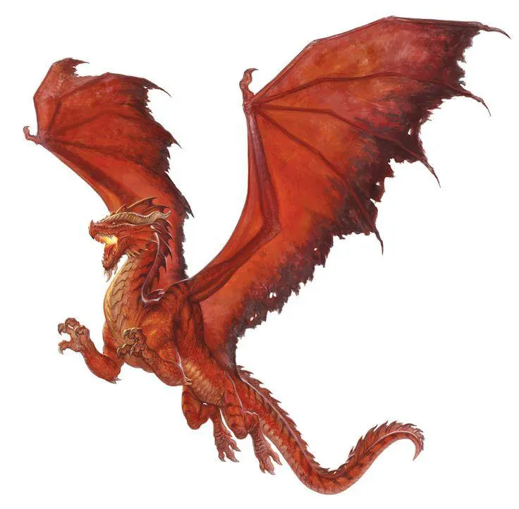

## Bloco de estatísticas: Dragão Vermelho Ancião

*Dragão Imenso, caótico e mau*

**Classe de Armadura** 22 (armadura natural)  
**Pontos de Vida** 546 (28d20 + 252)  
**Deslocamento** 12 m, escalada 12 m, voo 24 m

| FOR | DES | CON | INT | SAB | CAR |
| :---: | :---: | :---: | :---: | :---: | :---: |
| 30 (+10) | 10 (+0) | 29 (+9) | 18 (+4) | 15 (+2) | 23 (+6) |

**Testes de Resistência** Des +7, Con +16, Sab +9, Car +13  
**Perícias** Furtividade +7, Percepção +16  
**Imunidade a Dano** fogo  
**Sentidos** percepção às cegas 18 m, visão no escuro 36 m, Percepção passiva 23  
**Idiomas** Comum, Dracônico  
**Nível de Desafio** 24 (62.000 XP)

***Resistência Lendária (3/Dia)***. Se o dragão falhar em um teste de resistência, ele pode escolher obter sucesso, no lugar.

### Ações

***Ataques Múltiplos***. O dragão pode usar sua Presença Aterradora, ele pode então, realizar três ataques: um com sua mordida e dois com suas garras.

***Mordida***. *Ataque Corpo-a-Corpo com Arma*: +17 para atingir, alcance 4,5 m, um alvo. *Acerto*: 21 (2d10 + 10) de dano perfurante mais 14 (4d6) de dano de fogo.

***Garra***. *Ataque Corpo-a-Corpo com Arma*: +17 para atingir, alcance 3 m, um alvo. *Acerto*: 17 (2d6 + 10) de dano cortante.

***Cauda***. *Ataque Corpo-a-Corpo com Arma*: +17 para atingir, alcance 6 m, um alvo. *Acerto*: 19 (2d8 + 10) de dano de concussão.

***Presença Aterradora***. Cada criatura, à escolha do dragão, que esteja a até 36 metros do dragão e esteja ciente disso, deve ser bem sucedida num teste de resistência de Sabedoria CD 21 ou ficará amedrontada por 1 minuto. Uma criatura pode repetir o teste de resistência no final de cada um dos turnos dela, terminando o efeito sobre si, caso obtenha sucesso. Se o teste de resistência de uma criatura for bem sucedido ou caso o efeito termine sobre ela, a criatura ficará imune a Presença Aterradora do dragão pelas próximas 24 horas.

***Sopro Flamejante (Recarrega 5–6)***. O dragão pode expelir fogo num cone de 27 metros. Cada criatura na área deve realiza um teste de resistência de Destreza CD 24, sofrendo 91 (26d6) de dano de fogo se falhar na resistência, ou metade desse dano caso obtenha sucesso.

### Ações Lendárias

O dragão pode realizar 3 ações lendárias, escolhidas dentre as opções abaixo. Apenas uma ação lendária pode ser usada por vez e apenas no final do turno de outra criatura. O dragão recupera as ações lendárias gastas no começo do turno dele.

**Detectar**. O dragão realiza um teste de Sabedoria (Percepção).  
**Ataque com Cauda**. O dragão realiza um ataque de cauda.  
**Ataque com Asas (Custa 2 Ações).** O dragão bate suas asas. Cada criatura a até 4,5 metros do dragão deve ser bem sucedida num teste de resistência de Destreza CD 25 ou sofrerá 17 (2d6 + 10) de dano de concussão e cairá no chão. Após bater suas asas, o dragão pode voar até metade do seu deslocamento de voo.

## Bloco de estatísticas: Dragão Vermelho Adulto

*Dragão Enorme, caótico e mau*

**Classe de Armadura** 19 (armadura natural)  
**Pontos de Vida** 256 (19d12 + 133)  
**Deslocamento** 12 m, escalada 12 m, voo 24 m

| FOR | DES | CON | INT | SAB | CAR |
| :---: | :---: | :---: | :---: | :---: | :---: |
| 27 (+8) | 10 (+0) | 25 (+7) | 16 (+3) | 13 (+1) | 21 (+5) |

**Testes de Resistência** Des +6, Con +13, Sab +7, Car +11  
**Perícias** Furtividade +6, Percepção +13  
**Imunidade a Dano** fogo  
**Sentidos** percepção às cegas 18 m, visão no escuro 36 m, Percepção passiva 23  
**Idiomas** Comum, Dracônico  
**Nível de Desafio** 17 (18.000 XP)

***Resistência Lendária (3/Dia)***. Se o dragão falhar em um teste de resistência, ele pode escolher obter sucesso, no lugar.

### Ações

***Ataques Múltiplos***. O dragão pode usar sua Presença Aterradora, ele pode então, realizar três ataques: um com sua mordida e dois com suas garras.

***Mordida***. *Ataque Corpo-a-Corpo com Arma*: +14 para atingir, alcance 3 m, um alvo. *Acerto*: 19 (2d10 + 8) de dano perfurante mais 10 (3d6) de dano de fogo.

***Garra***. *Ataque Corpo-a-Corpo com Arma*: +14 para atingir, alcance 1,5 m, um alvo. *Acerto*: 15 (2d6 + 8) de dano cortante.

***Cauda***. *Ataque Corpo-a-Corpo com Arma*: +11 para atingir, alcance 4,5 m, um alvo. *Acerto*: 17 (2d8 + 8) de dano de concussão.

***Presença Aterradora***. Cada criatura, à escolha do dragão, que esteja a até 36 metros do dragão e esteja ciente disso, deve ser bem sucedida num teste de resistência de Sabedoria CD 19 ou ficará amedrontada por 1 minuto. Uma criatura pode repetir o teste de resistência no final de cada um dos turnos dela, terminando o efeito sobre si, caso obtenha sucesso. Se o teste de resistência de uma criatura for bem sucedido ou caso o efeito termine sobre ela, a criatura ficará imune a Presença Aterradora do dragão pelas próximas 24 horas.

***Sopro Flamejante (Recarrega 5–6)***. O dragão pode expelir fogo num cone de 18 metros. Cada criatura na área deve realiza um teste de resistência de Destreza CD 21, sofrendo 63 (18d6) de dano de fogo se falhar na resistência, ou metade desse dano caso obtenha sucesso.

### Ações Lendárias

O dragão pode realizar 3 ações lendárias, escolhidas dentre as opções abaixo. Apenas uma ação lendária pode ser usada por vez e apenas no final do turno de outra criatura. O dragão recupera as ações lendárias gastas no começo do turno dele.

**Detectar**. O dragão realiza um teste de Sabedoria (Percepção).  
**Ataque com Cauda**. O dragão realiza um ataque de cauda.  
**Ataque com Asas (Custa 2 Ações).** O dragão bate suas asas. Cada criatura a até 3 metros do dragão deve ser bem sucedida num teste de resistência de Destreza CD 22 ou sofrerá 15 (2d6 + 8) de dano de concussão e cairá no chão. Após bater suas asas, o dragão pode voar até metade do seu deslocamento de voo.

## Bloco de estatísticas: Dragão Vermelho Jovem

*Dragão Grande, caótico e mau*

**Classe de Armadura** 18 (armadura natural)  
**Pontos de Vida** 178 (17d10 + 85)  
**Deslocamento** 12 m, escalada 12 m, voo 24 m

| FOR | DES | CON | INT | SAB | CAR |
| :---: | :---: | :---: | :---: | :---: | :---: |
| 23 (+6) | 10 (+0) | 21 (+5) | 14 (+2) | 11 (+0) | 19 (+4) |

**Testes de Resistência** Des +4, Con +9, Sab +4, Car +8  
**Perícias** Furtividade +4, Percepção +8  
**Imunidade a Dano** fogo  
**Sentidos** percepção às cegas 9 m, visão no escuro 36 m, Percepção passiva 18  
**Idiomas** Comum, Dracônico  
**Nível de Desafio** 10 (5.900 XP)

### Ações

***Ataques Múltiplos***. O dragão realiza três ataques: um com sua mordida e dois com suas garras.

***Mordida***. *Ataque Corpo-a-Corpo com Arma*: +10 para atingir, alcance 3 m, um alvo. *Acerto*: 17 (2d10 + 6) de dano perfurante mais 7 (2d6) de dano de fogo.

***Garra***. *Ataque Corpo-a-Corpo com Arma*: +10 para atingir, alcance 1,5 m, um alvo. *Acerto*: 13 (2d6 + 6) de dano cortante.

***Sopro Flamejante (Recarrega 5–6)***. O dragão pode expelir fogo num cone de 9 metros. Cada criatura na área deve realiza um teste de resistência de Destreza CD 17, sofrendo 56 (16d6) de dano de fogo se falhar na resistência, ou metade desse dano caso obtenha sucesso.

## Bloco de estatísticas: Dragão Vermelho Filhote

*Dragão Médio, caótico e mau*

**Classe de Armadura** 17 (armadura natural)  
**Pontos de Vida** 75 (10d8 + 30)  
**Deslocamento** 9 m, escalada 9 m, voo 18 m

| FOR | DES | CON | INT | SAB | CAR |
| :---: | :---: | :---: | :---: | :---: | :---: |
| 19 (+4) | 10 (+0) | 17 (+3) | 12 (+1) | 11 (+0) | 15 (+2) |

**Testes de Resistência** Des +2, Con +5, Sab +2, Car +4  
**Perícias** Furtividade +4, Percepção +2  
**Imunidade a Dano** fogo  
**Sentidos** percepção às cegas 3 m, visão no escuro 18 m, Percepção passiva 14  
**Idiomas** Dracônico  
**Nível de Desafio** 4 (1.100 XP)

### Ações

***Mordida***. *Ataque Corpo-a-Corpo com Arma*: +6 para atingir, alcance 1,5 m, um alvo. *Acerto*: 9 (1d10 + 4) de dano perfurante mais 3 (1d6) de dano de fogo.

***Sopro Flamejante (Recarrega 5–6)***. O dragão pode expelir fogo num cone de 4,5 metros. Cada criatura na área deve realiza um teste de resistência de Destreza CD 13, sofrendo 24 (7d6) de dano de fogo se falhar na resistência, ou metade desse dano caso obtenha sucesso.

### Dragão Vermelho

Os mais avarentos de todos os dragões verdadeiros, os dragões vermelhos buscam aumentar suas montanhas de tesouros. Eles são excepcionalmente vaidosos, mesmo para os dragões, e esse conceito é refletido em suas posturas imponentes e no desdém pelas outras criaturas.

O odor de enxofre e fumaça envolve o dragão vermelho, cujos chifres voltados para trás e espinhos ósseos definem sua silhueta. Suas ventas abertas em seu focinho expelem fumaça todo o tempo, e seus olhos dançam como chamas quando ele está enfurecido. Suas asas são as mais longas dentre os dragões cromáticos e tem uma tonalidade azul escuro ao longo da borda externa, lembrando metal incandescente azulado pelo fogo.

As escamas de um dragão vermelho filhote têm uma coloração escarlate, lustrosas e brilhantes, desbotando com o tempo, adquirindo um tom vermelho escuro e tornando-se tão rígidas quanto metal à medida que o dragão envelhece. Suas pupilas também somem com a idade, e os dragões mais velhos tem olhos semelhantes a orbes cheias de lava derretida.

***Mestres da Montanha***. Os dragões vermelhos preferem terrenos montanhosos, ermos e qualquer outro local onde possam se empoleirar no alto e observar seus domínios. A preferência deles por montanhas provoca conflitos com os dragões de cobre habitantes de colinas de tempos em tempos.

***Tiranos Arrogantes***. Dragões vermelhos entram numa fúria destrutiva e agem por impulso quando enfurecidos. Eles são tão ferozes e vingativos que eles são considerados como o arquétipo do dragão maligno por muitas culturas.

Nenhum outro dragão se aproxima da arrogância do dragão vermelho. Essas criaturas se veem como reis e imperadores, e enxergam o resto da espécie dracônica como inferiores. Acreditando serem escolhidos por Tiamat para governar em nome dela, os dragões vermelhos consideram que mundo e cada criatura nele são deles para comandar.

***Posição e Escravos***. Os dragões vermelhos são ferozmente territorialistas e isolacionistas. No entanto, eles anseiam conhecer sobre os eventos em todo o mundo, e eles fazem uso de criaturas menores como informantes, mensageiros e espiões. Eles estão mais interessados em notícias sobre outros dragões vermelhos, com os quais eles competem constantemente por posições.

Quando precisa de servos, um dragão vermelho exige fidelidade de humanoides caóticos e maus. Se a submissão não for conseguida, ele aniquila os líderes da tribo e reivindica a liderança sobre os sobreviventes. As criaturas a serviço de um dragão vermelho vivem com um medo constante de serem carbonizadas e devoradas por desagrada-lo. Elas gastam a maior parte do tempo bajulando a criatura em uma tentativa de permanecerem vivas.

***Colecionadores Obsessivos***. Os dragões vermelhos valorizam a riqueza acima de tudo, e suas montanhas de tesouros são lendárias. Eles cobiçam qualquer coisa de valor monetário, e podem muitas vezes julgar o valor de uma quinquilharia em peças de cobre em um relance. Um dragão vermelho tem uma afeição especial por tesouros adquiridos de inimigos poderosos que ele matou, exibindo esses tesouros como prova de superioridade.

Um dragão vermelho sabe o valor e proveniência de cada item do seu tesouro, além da localização exata de cada item. Ele pode notar a falta de uma única moeda, dando início a sua ira enquanto rastreia e mata o larapio sem misericórdia. Se o ladrão não puder ser encontrado, o dragão entrará em fúria, devastando cidades e vilas numa tentativa de manifestar a sua ira.

### O Covil do Dragão Vermelho

Os dragões fazem seus covis em montanhas ou colinas altas, habitando em cavernas sob picos cobertos de neve, ou nos salões profundos de minas abandonadas e fortalezas anãs. Cavernas com atividade vulcânica ou geotérmica são os covis mais estimados para os dragões vermelhos, criando perigos que impedem intrusos e deixando o calor abrasador e os gases vulcânicos darem cabo deles enquanto o dragão dorme.

Com seus tesouros em protegidos nas profundezas do covil, um dragão vermelho passa mais tempo fora da montanha que dentro dela. Para um dragão vermelho, as maiores altitudes do mundo são o trono de onde ele observa e examinar tudo que ele controla – e a vastidão do mundo que ele busca controlar.

Ao longo do complexo do covil, servos erguem monumentos em homenagem ao poder do dragão, contando as histórias sinistras da vida dele, os inimigos que ele matou e as nações que ele conquistou.

### Ações de Covil

No valor de iniciativa 20 (quebrando toda a sequência de iniciativa), o dragão realiza uma ação de covil fazendo um dos efeitos a seguir; o dragão não pode usar o mesmo efeitos em duas rodadas consecutivas:

- Magma emerge de um ponto do solo que o dragão possa ver, a até 36 metros dele, criando um gêiser de 6 metros de altura por 1,5 metro de raio. Cada criatura no gêiser deve realizar um teste de resistência de Destreza CD 15, sofrendo 21 (6d6) de dano de fogo se falhar na resistência, ou metade desse dano se obtiver sucesso.
- Um tremor balança o covil num raio de 18 metros do dragão. Cada criatura além do dragão no solo na área deve ser bem sucedida num teste de resistência de Destreza CD 15 ou cairá no chão.
- Gases vulcânicos formam uma nuvem numa esfera de 6 metros de raio, centrada num ponto que o dragão possa ver, a até 36 metros dele. A esfera se espalha, dobrando esquinas, e a área dela é de escuridão leve. Ela dura até a contagem de iniciativa 20 da rodada seguinte. Cada criatura que começar seu turno na nuvem deve ser bem sucedida num teste de resistência de Constituição CD 13 ou ficará envenenada até o final do turno dela. Enquanto estiver envenenada desse jeito, um criatura está incapacitada.

### Efeitos Regionais

A região contendo o covil de um dragão vermelho lendário é deformada pela presença da criatura, o que cria um ou mais dos seguintes efeitos:

- Pequenos terremotos são comuns a até 9 quilômetros do covil do dragão.
- Fontes de água a até 1,5 quilômetro do covil são sobrenaturalmente quentes e infectadas por enxofre.
- Fissuras nas rochas a até 1,5 quilômetro do covil do dragão formam portais para o Plano Elemental do Fogo, permitindo que criaturas elementais do fogo entrem no mundo para habitar as proximidades.

Se o dragão morrer, esses efeitos somem no decorrer de 1d10 dias.

### Dragões Metálicos

Os dragões metálicos buscam preservar e proteger, vendo a si próprios como uma poderosa raça dentre as muitas raças que possuem um lugar no mundo.

***Nobre Curiosidade***. Dragões metálicos cobiçam tesouros assim como os malignos da espécie cromática, mas eles não são tão guiados pela ganância na sua busca por riquezas. Ao invés disso, os dragões metálicos são levados a investigar e coletar, pegando relíquias sem dono e armazenando-as em seus covis. O tesouro de um dragão metálico é cheio de itens que refletem sua persona, contando sua história e preservando sua memória. Da mesma forma, poderosos itens mágicos e até mesmo artefatos malignos são, algumas vezes, escondidos nos montes de tesouro de um dragão metálico.

Um dragão metálico pode ser persuadido a se desfazer de um item de seu tesouro para um bem maior. No entanto, a necessidade ou direito de outra criatura ao item é, muitas vezes, pouco clara do ponto de vista do dragão. Um dragão metálico deve ser subornado ou, de alguma forma, convencido de se desfazer do item.

Metamorfos Solitários. Em algum momento de suas longas vidas, os dragões metálicos ganham a habilidade mágica de assumir as formas de humanoides e bestas. Quando um dragão aprende como se disfarçar, ele pode se imergir em outras culturas por um tempo. Alguns dragões são muito tímidos ou paranoicos para se afastar de seus covis e de suas pilhas de tesouros, porém, dragões mais ousados adoram vagar pelas ruas de cidades em formas humanoides, fazendo parte da cultura e culinária locais e divertindo-se ao observar como as raças menores vivem.

Alguns dragões metálicos preferem se manter o mais longe possível da civilização para não atrair inimigos. No entanto, isso significa que eles estão, muitas vezes, longe do contato com os eventos atuais.

***A Persistência da Memória***. Dragões metálicos possuem ótimas memórias e eles formam opiniões sobre humanoides baseados nos contatos anteriores com os humanoides em questão. Dragões bons podem reconhecer linhagens humanoides pelo cheiro, farejando cada pessoa que eles conhecem e lembrando de quaisquer parentes que eles tenham tido contato com o passar dos anos. Um dragão de ouro pode nunca suspeitar da duplicidade de um vilão astuto, assumindo que o vilão tenha a mesma mente e coração bons e virtuosos de uma avó. Por outro lado, o dragão pode ficar ressentido de um nobre paladino cujo ancestral tenha usurpado uma estátua de prata do tesouro do dragão três séculos atrás.

***Rei dos Dragões Bons***. A divindade governante dos dragões metálicos é Bahamut, o Dragão de Platina. Ele vive nos Sete Paraísos Escalonados de Celestia, mas muitas vezes vaga pelo Plano Material com a aparência mágica de um humano idoso em roupas de camponês. Nessa forma, ele é geralmente acompanhado por sete canários dourados – na realidade, sete dragões de ouro anciões em forma metamorfoseada.

Bahamut raramente interfere nos negócios das criaturas mortais, apesar de ele fazer exceções para ajudar a frustrar as maquinações de Tiamat, a Rainha Dragão, e sua prole maligna. Clérigos bondosos e paladinos, às vezes, veneram Bahamut por sua dedicação à justiça e a proteção. Como um deus menor, ele tem poder para conceder magias divinas.

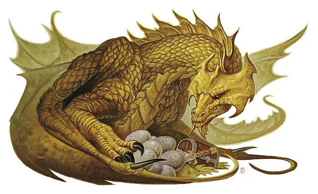

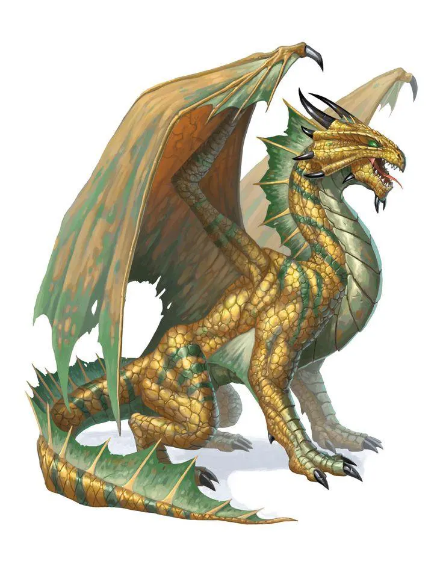

## Bloco de estatísticas: Dragão de Bronze Ancião

*Dragão Imenso, leal e bom*

**Classe de Armadura** 22 (armadura natural)  
**Pontos de Vida** 444 (24d20 + 192)  
**Deslocamento** 12 m, natação 12 m, voo 24 m

| FOR | DES | CON | INT | SAB | CAR |
| :---: | :---: | :---: | :---: | :---: | :---: |
| 29 (+9) | 10 (+0) | 27 (+8) | 18 (+4) | 17 (+3) | 21 (+5) |

**Testes de Resistência** Des +7, Con +15, Sab +10, Car +12  
**Perícias** Furtividade +7, Intuição +10, Percepção +17  
**Imunidade a Dano** elétrico  
**Sentidos** percepção às cegas 18 m, visão no escuro 36 m, Percepção passiva 27  
**Idiomas** Comum, Dracônico  
**Nível de Desafio** 22 (41.000 XP)

***Anfíbio***. O dragão pode respirar ar e água.

***Resistência Lendária (3/Dia)***. Se o dragão falhar em um teste de resistência, ele pode escolher obter sucesso, no lugar.

### Ações

***Ataques Múltiplos***. O dragão pode usar sua Presença Aterradora, ele pode então, realizar três ataques: um com sua mordida e dois com suas garras.

***Mordida***. *Ataque Corpo-a-Corpo com Arma*: +16 para atingir, alcance 4,5 m, um alvo. *Acerto*: 20 (2d10 + 9) de dano perfurante.

***Garra***. *Ataque Corpo-a-Corpo com Arma*: +16 para atingir, alcance 3 m, um alvo. *Acerto*: 16 (2d6 + 9) de dano cortante.

***Cauda***. *Ataque Corpo-a-Corpo com Arma*: +16 para atingir, alcance 6 m, um alvo. *Acerto*: 18 (2d8 + 9) de dano de concussão.

***Presença Aterradora***. Cada criatura, à escolha do dragão, que esteja a até 36 metros do dragão e esteja ciente disso, deve ser bem sucedida num teste de resistência de Sabedoria CD 20 ou ficará amedrontada por 1 minuto. Uma criatura pode repetir o teste de resistência no final de cada um dos turnos dela, terminando o efeito sobre si, caso obtenha sucesso. Se o teste de resistência de uma criatura for bem sucedido ou caso o efeito termine sobre ela, a criatura ficará imune a Presença Aterradora do dragão pelas próximas 24 horas.

***Arma de Sopro (Recarrega 5–6)***. O dragão usa um dos seguintes tipos de armas de sopro.

***Sopro Elétrico***. O dragão pode expelir eletricidade em uma linha com 36 metros de comprimento e 3 metros de largura. Cada criatura na linha deve ser bem sucedida num teste de resistência de Destreza CD 23, sofrendo 88 (16d10) de dano elétrico se falhar na resistência, ou metade desse dano caso obtenha sucesso.

***Sopro Repulsivo***. O dragão pode expelir energia repulsiva em um cone de 9 metros. Cada criatura na área deve ser bem sucedida num teste de resistência de Força CD 23. Se falhar na resistência, a criatura é empurrada 18 metros para longe do dragão.

***Mudar Forma***. O dragão se metamorfoseia magicamente em um humanoide ou besta que possua um nível de desafio inferior ao seu próprio, ou volta para sua forma verdadeira. Ele reverte a sua forma verdadeira se morrer. Qualquer equipamento vestido ou carregado é absorvido ou usado pela nova forma (à escolha do dragão). Na nova forma, o dragão mantem sua tendência, pontos de vida, Dados de Vida, capacidade de fala, proficiências, Resistência Lendária, ações de covil e valores de Inteligência, Sabedoria e Carisma, assim como essa ação. Suas estatísticas e capacidades, no mais, são substituídas pelas da nova forma, exceto quaisquer características de classe ou ações lendárias dessa forma.

### Ações Lendárias

O dragão pode realizar 3 ações lendárias, escolhidas dentre as opções abaixo. Apenas uma ação lendária pode ser usada por vez e apenas no final do turno de outra criatura. O dragão recupera as ações lendárias gastas no começo do turno dele.

**Detectar**. O dragão realiza um teste de Sabedoria (Percepção).  
**Ataque com Cauda**. O dragão realiza um ataque de cauda.  
**Ataque com Asas (Custa 2 Ações).** O dragão bate suas asas. Cada criatura a até 4,5 metros do dragão deve ser bem sucedida num teste de resistência de Destreza CD 24 ou sofrerá 16 (2d6 + 9) de dano de concussão e cairá no chão. Após bater suas asas, o dragão pode voar até metade do seu deslocamento de voo.

## Bloco de estatísticas: Dragão de Bronze Adulto

*Dragão Enorme, leal e bom*

**Classe de Armadura** 19 (armadura natural)  
**Pontos de Vida** 212 (17d12 + 102)  
**Deslocamento** 12 m, natação 12 m, voo 24 m

| FOR | DES | CON | INT | SAB | CAR |
| :---: | :---: | :---: | :---: | :---: | :---: |
| 25 (+7) | 10 (+0) | 23 (+6) | 16 (+3) | 15 (+2) | 19 (+4) |

**Testes de Resistência** Des +5, Con +11, Sab +7, Car +9  
**Perícias** Furtividade +5, Intuição +7, Percepção +12  
**Imunidade a Dano** elétrico  
**Sentidos** percepção às cegas 18 m, visão no escuro 36 m, Percepção passiva 22  
**Idiomas** Comum, Dracônico  
**Nível de Desafio** 15 (13.000 XP)

***Anfíbio***. O dragão pode respirar ar e água.

***Resistência Lendária (3/Dia)***. Se o dragão falhar em um teste de resistência, ele pode escolher obter sucesso, no lugar.

### Ações

***Ataques Múltiplos***. O dragão pode usar sua Presença Aterradora, ele pode então, realizar três ataques: um com sua mordida e dois com suas garras.

***Mordida***. *Ataque Corpo-a-Corpo com Arma*: +12 para atingir, alcance 3 m, um alvo. *Acerto*: 18 (2d10 + 7) de dano perfurante.

***Garra***. *Ataque Corpo-a-Corpo com Arma*: +12 para atingir, alcance 1,5 m, um alvo. *Acerto*: 14 (2d6 + 7) de dano cortante.

***Cauda***. *Ataque Corpo-a-Corpo com Arma*: +12 para atingir, alcance 4,5 m, um alvo. *Acerto*: 16 (2d8 + 7) de dano de concussão.

***Presença Aterradora***. Cada criatura, à escolha do dragão, que esteja a até 36 metros do dragão e esteja ciente disso, deve ser bem sucedida num teste de resistência de Sabedoria CD 17 ou ficará amedrontada por 1 minuto. Uma criatura pode repetir o teste de resistência no final de cada um dos turnos dela, terminando o efeito sobre si, caso obtenha sucesso. Se o teste de resistência de uma criatura for bem sucedido ou caso o efeito

## Bloco de estatísticas: Dragão de Bronze Jovem

*Dragão Grande, leal e bom*

**Classe de Armadura** 18 (armadura natural)  
**Pontos de Vida** 142 (15d10 + 60)  
**Deslocamento** 12 m, natação 12 m, voo 24 m

| FOR | DES | CON | INT | SAB | CAR |
| :---: | :---: | :---: | :---: | :---: | :---: |
| 21 (+5) | 10 (+0) | 19 (+4) | 14 (+2) | 13 (+1) | 17 (+3) |

**Testes de Resistência** Des +3, Con +7, Sab +4, Car +6  
**Perícias** Furtividade +3, Intuição +4, Percepção +7  
**Imunidade a Dano** elétrico  
**Sentidos** percepção às cegas 9 m, visão no escuro 36 m, Percepção passiva 17  
**Idiomas** Comum, Dracônico  
**Nível de Desafio** 8 (3.900 XP)

***Anfíbio***. O dragão pode respirar ar e água. termine sobre ela, a criatura ficará imune a Presença Aterradora do dragão pelas próximas 24 horas.

***Arma de Sopro (Recarrega 5–6)***. O dragão usa um dos seguintes tipos de armas de sopro.

***Sopro Elétrico***. O dragão pode expelir eletricidade em uma linha com 27 metros de comprimento e 1,5 metro de largura. Cada criatura na linha deve ser bem sucedida num teste de resistência de Destreza CD 19, sofrendo 66 (12d10) de dano elétrico se falhar na resistência, ou metade desse dano caso obtenha sucesso.

***Sopro Repulsivo***. O dragão pode expelir energia repulsiva em um cone de 9 metros. Cada criatura na área deve ser bem sucedida num teste de resistência de Força CD 19. Se falhar na resistência, a criatura é empurrada 18 metros para longe do dragão.

***Mudar Forma***. O dragão se metamorfoseia magicamente em um humanoide ou besta que possua um nível de desafio inferior ao seu próprio, ou volta para sua forma verdadeira. Ele reverte a sua forma verdadeira se morrer. Qualquer equipamento vestido ou carregado é absorvido ou usado pela nova forma (à escolha do dragão). Na nova forma, o dragão mantem sua tendência, pontos de vida, Dados de Vida, capacidade de fala, proficiências, Resistência Lendária, ações de covil e valores de Inteligência, Sabedoria e Carisma, assim como essa ação. Suas estatísticas e capacidades, no mais, são substituídas pelas da nova forma, exceto quaisquer características de classe ou ações lendárias dessa forma.

### Ações Lendárias

O dragão pode realizar 3 ações lendárias, escolhidas dentre as opções abaixo. Apenas uma ação lendária pode ser usada por vez e apenas no final do turno de outra criatura. O dragão recupera as ações lendárias gastas no começo do turno dele.

**Detectar**. O dragão realiza um teste de Sabedoria (Percepção).  
**Ataque com Cauda**. O dragão realiza um ataque de cauda.  
**Ataque com Asas (Custa 2 Ações).** O dragão bate suas asas. Cada criatura a até 3 metros do dragão deve ser bem sucedida num teste de resistência de Destreza CD 20 ou sofrerá 14 (2d6 + 7) de dano de concussão e cairá no chão. Após bater suas asas, o dragão pode voar até metade do seu deslocamento de voo.

### Ações

***Ataques Múltiplos***. O dragão realiza três ataques: um com sua mordida e dois com suas garras.

***Mordida***. *Ataque Corpo-a-Corpo com Arma*: +8 para atingir, alcance 3 m, um alvo. *Acerto*: 16 (2d10 + 5) de dano perfurante.

***Garra***. *Ataque Corpo-a-Corpo com Arma*: +8 para atingir, alcance 1,5 m, um alvo. *Acerto*: 12 (2d6 + 5) de dano cortante.

***Arma de Sopro (Recarrega 5–6)***. O dragão usa um dos seguintes tipos de armas de sopro.

***Sopro Elétrico***. O dragão pode expelir eletricidade em uma linha com 18 metros de comprimento e 1,5 metro de largura. Cada criatura na linha deve ser bem sucedida num teste de resistência de Destreza CD 15, sofrendo 55 (10d10) de dano elétrico se falhar na resistência, ou metade desse dano caso obtenha sucesso.

***Sopro Repulsivo***. O dragão pode expelir energia repulsiva em um cone de 9 metros. Cada criatura na área deve ser bem sucedida num teste de resistência de Força CD 15. Se falhar na resistência, a criatura é empurrada 12 metros para longe do dragão.

## Bloco de estatísticas: Dragão de Bronze Filhote

*Dragão Médio, leal e bom*

**Classe de Armadura** 17 (armadura natural)  
**Pontos de Vida** 32 (5d8 + 10)  
**Deslocamento** 9 m, natação 9 m, voo 18 m

| FOR | DES | CON | INT | SAB | CAR |
| :---: | :---: | :---: | :---: | :---: | :---: |
| 17 (+3) | 10 (+0) | 15 (+2) | 12 (+1) | 11 (+0) | 15 (+2) |

**Testes de Resistência** Des +2, Con +4, Sab +2, Car +4  
**Perícias** Furtividade +4, Percepção +2  
**Imunidade a Dano** elétrico  
**Sentidos** percepção às cegas 3 m, visão no escuro 18 m, Percepção passiva 14  
**Idiomas** Dracônico  
**Nível de Desafio** 2 (450 XP)

***Anfíbio***. O dragão pode respirar ar e água.

### Ações

***Mordida***. *Ataque Corpo-a-Corpo com Arma*: +5 para atingir, alcance 1,5 m, um alvo. *Acerto*: 8 (1d10 + 3) de dano perfurante.

***Arma de Sopro (Recarrega 5–6)***. O dragão usa um dos seguintes tipos de armas de sopro.

***Sopro Elétrico***. O dragão pode expelir eletricidade em uma linha com 12 metros de comprimento e 1,5 metro de largura. Cada criatura na linha deve ser bem sucedida num teste de resistência de Destreza CD 12, sofrendo 16 (3d10) de dano elétrico se falhar na resistência, ou metade desse dano caso obtenha sucesso.

***Sopro Repulsivo***. O dragão pode expelir energia repulsiva em um cone de 9 metros. Cada criatura na área deve ser bem sucedida num teste de resistência de Força CD 12. Se falhar na resistência, a criatura é empurrada 9 metros para longe do dragão.

### Dragão de Bronze

Os dragões de bronze são habitantes das zonas costeiras que se alimentam, principalmente de plantas aquáticas e peixes. Eles assumem a forma de animais amigáveis para observar outras criaturas de seu interesse. Eles também são fascinados por guerras e juntam-se ansiosamente a exércitos para lutar por causas justas.

Uma carapaça reforçada e ondulada define o formato da cabeça de um dragão de bronze. Chifres curvados estendem-se das ondulações, acompanhados por chifres menores em seu maxilar inferior e queixo. Para ajuda-los a nadar, os dragões de bronze possuem pés palmados e escamas lisas. Um dragão de bronze filhote é amarelo tingido de verde; apenas quando o dragão se aproxima da idade adulta sua cor fica mais escura, alcançando a tonalidade bronze. As pupilas dos olhos de um dragão de bronze somem com a idade, até lembrarem orbes verdes brilhantes.

***Dragões da Costa***. Dragões de bronze adoram observar os navios viajando para cima e para baixo dos litorais próximos aos seus covis, às vezes, tomando a forma de golfinhos ou gaivotas para inspecionar esses navios e suas tripulações mais de perto. Um dragão de bronze ousado pode descer a bordo de um navio disfarçado de um pássaro ou rato, inspecionando o porão atrás de tesouros. Se o dragão encontrar algo de valor para seu tesouro, ele irá negociar com o capitão no navio pelo item.

***Maquinas de Guerra***. Os dragões de bronze opõem-se ativamente contra a tirania, e muitos dragões de bronze anseiam testar sua coragem dando bom uso para seu tamanho e força.

Quando um conflito acontece próximo do seu covil, um dragão de bronze verifica a causa subjacente, então oferece seus serviços a qualquer lado que lute pelo bem. Quando um dragão de bronze se junta a uma causa, ele permanece como um aliado incondicional.

***Fortuna bem Organizada***. Os dragões de bronze saqueiam navios afundados e também coletam corais coloridos e perolas dos recifes e solo oceânico próximos de seus covis. Quando um dragão de bronze compromete-se a ajudar um exército numa guerra por um salário contra um tirano, ele pede por um pagamento nominal. Se tal requisição estiver além dos recursos de seus aliados, ele pode se contentar com uma coleção de livros sobre história militar ou um item cerimonial em comemoração à aliança. Um dragão de bronze também pode reivindicar um tesouro possuído pelo inimigo que ele considere estar mais seguro sob sua proteção.

### O Covil do Dragão de Bronze

Os dragões de bronze fazem seus covis em cavernas costeiras. Eles podem recuperar navios naufragados, reconstruindo-os nos confins de seu covil e usando-o como câmara do tesouro ou ninho para seus ovos.

### Ações de Covil

No valor de iniciativa 20 (quebrando toda a sequência de iniciativa), o dragão realiza uma ação de covil fazendo um dos efeitos a seguir:

- O dragão cria uma névoa como se ele tivesse conjurado a magia *névoa obscurecente*. A névoa dura até a contagem de iniciativa 20, na rodada seguinte.
- Um trovão origina-se em um ponto que o dragão possa ver, a até 36 metros dele. Cada criatura num raio de 6 metros centrado no ponto, deve realizar um teste de resistência de Constituição CD 15 ou sofrerá 5 (1d10) de dano trovejante e ficará surda até o final do próximo turno dela.

### Efeitos Regionais

A região contendo o covil de um dragão de bronze lendário é deformada pela magia do dragão.

- Uma vez por dia, o dragão pode alterar o clima num raio de 9 quilômetros, centrado em seu covil. O dragão não precisa estar do lado de fora; no mais, o efeito é idêntico a magia *controlar o clima*.
- Plantas submersas a até 9 quilômetros do covil do dragão adquirem deslumbrantes matizes brilhantes.
- Dentro do covil, o dragão pode configurar sons ilusórios, como uma música suave e ecos estranhos, os quais podem ser ouvidos em diversas partes do covil.

Se o dragão morrer, as mudanças no clima voltam ao normal, como descrito na magia, e os outros efeitos desaparecem no decorrer de 1d10 dias.

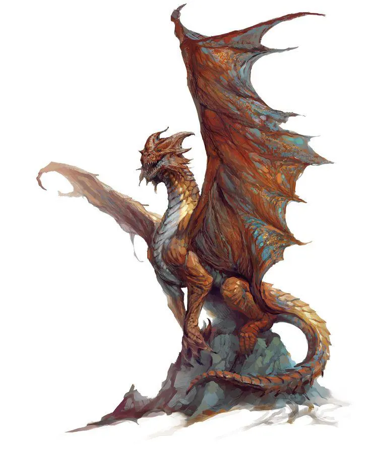

## Bloco de estatísticas: Dragão de Cobre Ancião

*Dragão Imenso, caótico e bom*

**Classe de Armadura** 21 (armadura natural)  
**Pontos de Vida** 350 (20d20 + 140)  
**Deslocamento** 12 m, escalada 12 m, voo 24 m

| FOR | DES | CON | INT | SAB | CAR |
| :---: | :---: | :---: | :---: | :---: | :---: |
| 27 (+8) | 12 (+1) | 25 (+7) | 20 (+5) | 17 (+3) | 19 (+4) |

**Testes de Resistência** Des +8, Con +14, Sab +10, Car +11  
**Perícias** Enganação +11, Furtividade +8, Percepção +17  
**Imunidade a Dano** ácido  
**Sentidos** percepção às cegas 18 m, visão no escuro 36 m, Percepção passiva 27  
**Idiomas** Comum, Dracônico  
**Nível de Desafio** 21 (33.000 XP)

***Resistência Lendária (3/Dia)***. Se o dragão falhar em um teste de resistência, ele pode escolher obter sucesso, no lugar.

### Ações

***Ataques Múltiplos***. O dragão pode usar sua Presença Aterradora, ele pode então, realizar três ataques: um com sua mordida e dois com suas garras.

***Mordida***. *Ataque Corpo-a-Corpo com Arma*: +15 para atingir, alcance 4,5 m, um alvo. *Acerto*: 19 (2d10 + 8) de dano perfurante.

***Garra***. *Ataque Corpo-a-Corpo com Arma*: +15 para atingir, alcance 3 m, um alvo. *Acerto*: 15 (2d6 + 8) de dano cortante.

***Cauda***. *Ataque Corpo-a-Corpo com Arma*: +15 para atingir, alcance 6 m, um alvo. *Acerto*: 17 (2d8 + 8) de dano de concussão.

***Presença Aterradora***. Cada criatura, à escolha do dragão, que esteja a até 36 metros do dragão e esteja ciente disso, deve ser bem sucedida num teste de resistência de Sabedoria CD 19 ou ficará amedrontada por 1 minuto. Uma criatura pode repetir o teste de resistência no final de cada um dos turnos dela, terminando o efeito sobre si, caso obtenha sucesso. Se o teste de resistência de uma criatura for bem sucedido ou caso o efeito termine sobre ela, a criatura ficará imune a Presença Aterradora do dragão pelas próximas 24 horas.

***Arma de Sopro (Recarrega 5–6)***. O dragão usa um dos seguintes tipos de armas de sopro.

***Sopro Ácido***. O dragão pode expelir ácido em uma linha com 27 metros de comprimento e 3 metro de largura. Cada criatura na linha deve ser bem sucedida num teste de resistência de Destreza CD 22, sofrendo 63 (14d8) de dano de ácido se falhar na resistência, ou metade desse dano caso obtenha sucesso.

***Sopro Retardante***. O dragão expele gás num cone de 27 metros. Cada criatura na área deve ser bem sucedida num teste de resistência de Constituição CD 22. Se falhar na resistência, a criatura não pode realizar reações, seu deslocamento é reduzido à metade e ela não pode realizar mais de um ataque por rodada. Além disso, a criatura pode usar ou um ação ou um ação bônus no turno dela, mas não ambas. Esse efeito dura por 1 minuto. A criatura pode repetir o teste de resistência em cada um dos turnos dela, terminando o efeito caso obtenha sucesso.

***Mudar Forma***. O dragão se metamorfoseia magicamente em um humanoide ou besta que possua um nível de desafio inferior ao seu próprio, ou volta para sua forma verdadeira. Ele reverte a sua forma verdadeira se morrer. Qualquer equipamento vestido ou carregado é absorvido ou usado pela nova forma (à escolha do dragão). Na nova forma, o dragão mantem sua tendência, pontos de vida, Dados de Vida, capacidade de fala, proficiências, Resistência Lendária, ações de covil e valores de Inteligência, Sabedoria e Carisma, assim como essa ação. Suas estatísticas e capacidades, no mais, são substituídas pelas da nova forma, exceto quaisquer características de classe ou ações lendárias dessa forma.

### Ações Lendárias

O dragão pode realizar 3 ações lendárias, escolhidas dentre as opções abaixo. Apenas uma ação lendária pode ser usada por vez e apenas no final do turno de outra criatura. O dragão recupera as ações lendárias gastas no começo do turno dele.

**Detectar**. O dragão realiza um teste de Sabedoria (Percepção).  
**Ataque com Cauda**. O dragão realiza um ataque de cauda.  
**Ataque com Asas (Custa 2 Ações).** O dragão bate suas asas. Cada criatura a até 4,5 metros do dragão deve ser bem sucedida num teste de resistência de Destreza CD 23 ou sofrerá 15 (2d6 + 8) de dano de concussão e cairá no chão. Após bater suas asas, o dragão pode voar até metade do seu deslocamento de voo.

## Bloco de estatísticas: Dragão de Cobre Adulto

*Dragão Enorme, caótico e bom*

**Classe de Armadura** 18 (armadura natural)  
**Pontos de Vida** 184 (16d12 + 80)  
**Deslocamento** 12 m, escalada 12 m, voo 24 m

| FOR | DES | CON | INT | SAB | CAR |
| :---: | :---: | :---: | :---: | :---: | :---: |
| 23 (+6) | 12 (+1) | 21 (+5) | 18 (+4) | 15 (+2) | 17 (+3) |

**Testes de Resistência** Des +6, Con +10, Sab +7, Car +8  
**Perícias** Enganação +8, Furtividade +6, Percepção +12  
**Imunidade a Dano** ácido  
**Sentidos** percepção às cegas 18 m, visão no escuro 36 m, Percepção passiva 22  
**Idiomas** Comum, Dracônico  
**Nível de Desafio** 14 (11.500 XP)

***Resistência Lendária (3/Dia)***. Se o dragão falhar em um teste de resistência, ele pode escolher obter sucesso, no lugar.

### Ações

***Ataques Múltiplos***. O dragão pode usar sua Presença Aterradora, ele pode então, realizar três ataques: um com sua mordida e dois com suas garras.

***Mordida***. *Ataque Corpo-a-Corpo com Arma*: +11 para atingir, alcance 3 m, um alvo. *Acerto*: 17 (2d10 + 6) de dano perfurante.

***Garra***. *Ataque Corpo-a-Corpo com Arma*: +11 para atingir, alcance 1,5 m, um alvo. *Acerto*: 13 (2d6 + 6) de dano cortante.

***Cauda***. *Ataque Corpo-a-Corpo com Arma*: +11 para atingir, alcance 4,5 m, um alvo. *Acerto*: 15 (2d8 + 6) de dano de concussão.

***Presença Aterradora***. Cada criatura, à escolha do dragão, que esteja a até 36 metros do dragão e esteja ciente disso, deve ser bem sucedida num teste de resistência de Sabedoria CD 16 ou ficará amedrontada por 1 minuto. Uma criatura pode repetir o

## Bloco de estatísticas: Dragão de Cobre Jovem

*Dragão Grande, caótico e bom*

**Classe de Armadura** 17 (armadura natural)  
**Pontos de Vida** 119 (14d10 + 42)  
**Deslocamento** 12 m, escalada 12 m, voo 24 m

| FOR | DES | CON | INT | SAB | CAR |
| :---: | :---: | :---: | :---: | :---: | :---: |
| 19 (+4) | 12 (+1) | 17 (+3) | 16 (+3) | 13 (+1) | 15 (+2) |

**Testes de Resistência** Des +4, Con +6, Sab +4, Car +5  
**Perícias** Enganação +5, Furtividade +4, Percepção +7  
**Imunidade a Dano** ácido  
**Sentidos** percepção às cegas 9 m, visão no escuro 36 m, Percepção passiva 17  
**Idiomas** Comum, Dracônico  
**Nível de Desafio** 7 (2.900 XP)

### Ações

***Ataques Múltiplos***. O dragão realiza três ataques: um com sua mordida e dois com suas garras. teste de resistência no final de cada um dos turnos dela, terminando o efeito sobre si, caso obtenha sucesso. Se o teste de resistência de uma criatura for bem sucedido ou caso o efeito termine sobre ela, a criatura ficará imune a Presença Aterradora do dragão pelas próximas 24 horas.

***Arma de Sopro (Recarrega 5–6)***. O dragão usa um dos seguintes tipos de armas de sopro.

***Sopro Ácido***. O dragão pode expelir ácido em uma linha com 18 metros de comprimento e 1,5 metro de largura. Cada criatura na linha deve ser bem sucedida num teste de resistência de Destreza CD 18, sofrendo 54 (12d8) de dano de ácido se falhar na resistência, ou metade desse dano caso obtenha sucesso.

***Sopro Retardante***. O dragão expele gás num cone de 18 metros. Cada criatura na área deve ser bem sucedida num teste de resistência de Constituição CD 18. Se falhar na resistência, a criatura não pode realizar reações, seu deslocamento é reduzido à metade e ela não pode realizar mais de um ataque por rodada. Além disso, a criatura pode usar ou um ação ou um ação bônus no turno dela, mas não ambas. Esse efeito dura por 1 minuto. A criatura pode repetir o teste de resistência em cada um dos turnos dela, terminando o efeito caso obtenha sucesso.

### Ações Lendárias

O dragão pode realizar 3 ações lendárias, escolhidas dentre as opções abaixo. Apenas uma ação lendária pode ser usada por vez e apenas no final do turno de outra criatura. O dragão recupera as ações lendárias gastas no começo do turno dele.

**Detectar**. O dragão realiza um teste de Sabedoria (Percepção).  
**Ataque com Cauda**. O dragão realiza um ataque de cauda.  
**Ataque com Asas (Custa 2 Ações).** O dragão bate suas asas. Cada criatura a até 3 metros do dragão deve ser bem sucedida num teste de resistência de Destreza CD 19 ou sofrerá 13 (2d6 + 6) de dano de concussão e cairá no chão. Após bater suas asas, o dragão pode voar até metade do seu deslocamento de voo.

***Mordida***. *Ataque Corpo-a-Corpo com Arma*: +7 para atingir, alcance 3 m, um alvo. *Acerto*: 15 (2d10 + 4) de dano perfurante.

***Garra***. *Ataque Corpo-a-Corpo com Arma*: +7 para atingir, alcance 1,5 m, um alvo. *Acerto*: 11 (2d6 + 4) de dano cortante.

***Arma de Sopro (Recarrega 5–6)***. O dragão usa um dos seguintes tipos de armas de sopro.

***Sopro Ácido***. O dragão pode expelir ácido em uma linha com 12 metros de comprimento e 1,5 metro de largura. Cada criatura na linha deve ser bem sucedida num teste de resistência de Destreza CD 14, sofrendo 40 (9d8) de dano de ácido se falhar na resistência, ou metade desse dano caso obtenha sucesso.

***Sopro Retardante***. O dragão expele gás num cone de 9 metros. Cada criatura na área deve ser bem sucedida num teste de resistência de Constituição CD 14. Se falhar na resistência, a criatura não pode realizar reações, seu deslocamento é reduzido à metade e ela não pode realizar mais de um ataque por rodada. Além disso, a criatura pode usar ou um ação ou um ação bônus no turno dela, mas não ambas. Esse efeito dura por 1 minuto. A criatura pode repetir o teste de resistência em cada um dos turnos dela, terminando o efeito caso obtenha sucesso.

## Bloco de estatísticas: Dragão de Cobre Filhote

*Dragão Médio, caótico e bom*

**Classe de Armadura** 16 (armadura natural)  
**Pontos de Vida** 22 (4d8 + 4)  
**Deslocamento** 9 m, escalada 9 m, voo 18 m

| FOR | DES | CON | INT | SAB | CAR |
| :---: | :---: | :---: | :---: | :---: | :---: |
| 15 (+2) | 12 (+1) | 13 (+1) | 14 (+2) | 11 (+0) | 13 (+1) |

**Testes de Resistência** Des +3, Con +3, Sab +2, Car +3  
**Perícias** Furtividade +4, Percepção +3  
**Imunidade a Dano** ácido  
**Sentidos** percepção às cegas 3 m, visão no escuro 18 m, Percepção passiva 14  
**Idiomas** Dracônico  
**Nível de Desafio** 1 (200 XP)

### Ações

***Mordida***. *Ataque Corpo-a-Corpo com Arma*: +4 para atingir, alcance 1,5 m, um alvo. *Acerto*: 7 (1d10 + 2) de dano perfurante.

***Arma de Sopro (Recarrega 5–6)***. O dragão usa um dos seguintes tipos de armas de sopro.

***Sopro Ácido***. O dragão pode expelir ácido em uma linha com 6 metros de comprimento e 1,5 metro de largura. Cada criatura na linha deve ser bem sucedida num teste de resistência de Destreza CD 11, sofrendo 18 (4d8) de dano de ácido se falhar na resistência, ou metade desse dano caso obtenha sucesso.

***Sopro Retardante***. O dragão expele gás num cone de 4,5 metros. Cada criatura na área deve ser bem sucedida num teste de resistência de Constituição CD 11. Se falhar na resistência, a criatura não pode realizar reações, seu deslocamento é reduzido à metade e ela não pode realizar mais de um ataque por rodada. Além disso, a criatura pode usar ou um ação ou um ação bônus no turno dela, mas não ambas. Esse efeito dura por 1 minuto. A criatura pode repetir o teste de resistência em cada um dos turnos dela, terminando o efeito caso obtenha sucesso.

### Dragão de Cobre

Os dragões de cobre são brincalhões, piadistas e charadistas incorrigíveis que vivem em colinas e planaltos rochosos. Apesar de sua natureza de temperamento gregário, eles possuem um veio avarento e mesquinho, e podem se tornar perigosos quando seus tesouros são ameaçados.

Um dragão de cobre possui carapaças lisas ao redor dos seus olhos, estendendo-se para trás em longos chifres que crescem numa série de segmentos sobrepostos. Suas protuberâncias malares voltadas para trás e cartilagens na mandíbula lhe dão um aspecto pensativo. Ao nascer, as escamas de um dragão de cobre tem uma coloração marrom escura com tons metálicos. Quando o dragão envelhece, suas escamas adquirem uma tonalidade mais acobreada, posteriormente adquirindo tonalidades de verde, com a idade. As pupilas de um dragão de cobre somem com a idade, e os olhos dos dragões de cobre mais velhos lembram brilhantes orbes azul-turquesa.

***Bons Anfitriões***. Um dragão de cobre aprecia o humor, uma boa piada, histórias engraçadas e charadas. Um dragão de cobre fica entediado com qualquer criatura que não gargalhe de suas piadas ou aceite suas brincadeiras com bom humor.

Dragões de cobre gostam particularmente de bardos. Um dragão pode escavar parte de seu covil como uma morada temporária para um bardo disposto a deliciar-se com histórias, enigmas e música. Para um dragão de cobre, tais companhias são tesouros a serem cobiçados.

***Cautelosos e Astutos***. Quando está montando seu tesouro, um dragão de cobre prefere tesouros da terra. Metais e pedras preciosas são os favoritos dessas criaturas.

Um dragão de cobre é prudente quando chega a mostrar seus pertences. Caso saiba que outras criaturas buscam um item específico de seu tesouro, um dragão de cobre não admitirá possuir tal item. Ao invés disso, ele pode enviar os caçadores de tesouro curiosos numa caça de mentirinha ao objeto enquanto ele assiste de longe, para o seu próprio divertimento.

### O Covil do Dragão de Cobre

Os dragões de cobre habitam em planaltos secos e alto de colinas, onde eles fazem seus covis em cavernas apertadas. Paredes falsas no covil escondem antecâmaras onde o dragão armazena minérios valiosos, objetos de arte e outras excentricidades que ele coletou ao longo de sua vida. Itens sem valor são colocados a mostra em cavernas abertas para atormentas caçadores de tesouro e engana-los de onde o tesouro real está escondido.

### Ações de Covil

No valor de iniciativa 20 (quebrando toda a sequência de iniciativa), o dragão realiza uma ação de covil fazendo um dos efeitos a seguir:

- O dragão escolhe um ponto no solo que ele possa ver, a até 36 metros dele. Espinhos de pedra brotam do chão num raio de 6 metros, centrado no ponto. O efeito, no mais, é idêntico a magia *crescer espinhos* e dura até o dragão usar essa ação de covil novamente ou até ele morrer.
- O dragão escolhe uma área de 3 metros quadrados no solo que ele possa ver, a até 36 metros dele. O solo na área tornasse lama com 90 centimetros de profundidade. Cada criatura no solo na área, quando a lama aparece, deve ser bem sucedida num teste de resistência de Destreza CD 15 ou afundará na lama e ficará impedida. Uma criatura pode usar uma ação para tentar realizar um teste de Força CD 15, libertando-se ou a outra criatura ao alcance, e terminando a condição de impedido caso obtenha sucesso. Mover-se 1,5 metro na lama requer 3 metros de movimento. Na contagem de iniciativa 20 na rodada seguinte, a lama endurece e a CD de Força para se libertar aumenta para 20.

### Efeitos Regionais

A região contendo o covil de um dragão de cobre lendário é deformada pela magia do dragão, o que cria um ou mais dos efeitos a seguir:

- Entalhes mágicos do rosto do dragão sorrindo, podem ser vistos feitos no terreno e objetos de pedra, a até 9 quilômetros do covil do dragão.
- Bestas Miúdas, como roedores e pássaros que normalmente são incapazes de falar, ganham a habilidade mágica de falar e entendem Dracônico a até 1,5 quilômetro do covil do dragão. Essas criaturas falam bem do dragão, mas não podem divulgar onde ele se encontra.
- Criaturas inteligentes a até 1,5 quilômetro do covil do dragão caem na gargalhada. Até assuntos sérios repentinamente podem diverti-las.

Se o dragão morrer, os entalhes mágicos desaparecem no decorrer de 1d10 dias. Os outros efeitos terminam imediatamente.

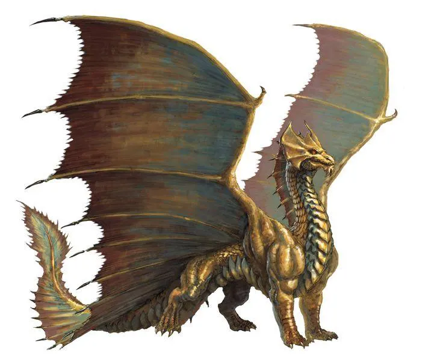

## Bloco de estatísticas: Dragão de Latão Ancião

*Dragão Imenso, caótico e bom*

**Classe de Armadura** 20 (armadura natural)  
**Pontos de Vida** 297 (17d20 + 119)  
**Deslocamento** 12 m, escavação 12 m, voo 24 m

| FOR | DES | CON | INT | SAB | CAR |
| :---: | :---: | :---: | :---: | :---: | :---: |
| 27 (+7) | 10 (+0) | 25 (+7) | 16 (+3) | 15 (+2) | 19 (+4) |

**Testes de Resistência** Des +6, Con +13, Sab +8, Car +10  
**Perícias** Furtividade +6, História +9, Percepção +14, Persuasão +10  
**Imunidade a Dano** fogo  
**Sentidos** percepção às cegas 18 m, visão no escuro 36 m, Percepção passiva 27  
**Idiomas** Comum, Dracônico  
**Nível de Desafio** 20 (25.000 XP)

***Resistência Lendária (3/Dia)***. Se o dragão falhar em um teste de resistência, ele pode escolher obter sucesso, no lugar.

### Ações

***Ataques Múltiplos***. O dragão pode usar sua Presença Aterradora, ele pode então, realizar três ataques: um com sua mordida e dois com suas garras.

***Mordida***. *Ataque Corpo-a-Corpo com Arma*: +14 para atingir, alcance 4,5 m, um alvo. *Acerto*: 19 (2d10 + 8) de dano perfurante.

***Garra***. *Ataque Corpo-a-Corpo com Arma*: +14 para atingir, alcance 3 m, um alvo. *Acerto*: 15 (2d6 + 8) de dano cortante.

***Cauda***. *Ataque Corpo-a-Corpo com Arma*: +14 para atingir, alcance 6 m, um alvo. *Acerto*: 17 (2d8 + 8) de dano de concussão.

***Presença Aterradora***. Cada criatura, à escolha do dragão, que esteja a até 36 metros do dragão e esteja ciente disso, deve ser bem sucedida num teste de resistência de Sabedoria CD 18 ou ficará amedrontada por 1 minuto. Uma criatura pode repetir o teste de resistência no final de cada um dos turnos dela, terminando o efeito sobre si, caso obtenha sucesso. Se o teste de resistência de uma criatura for bem sucedido ou caso o efeito termine sobre ela, a criatura ficará imune a Presença Aterradora do dragão pelas próximas 24 horas.

***Arma de Sopro (Recarrega 5–6)***. O dragão usa um dos seguintes tipos de armas de sopro.

***Sopro Flamejante***. O dragão pode expelir fogo em uma linha com 27 metros de comprimento e 3 metros de largura. Cada criatura na linha deve ser bem sucedida num teste de resistência de Destreza CD 21, sofrendo 56 (16d6) de dano de fogo se falhar na resistência, ou metade desse dano caso obtenha sucesso.

***Sopro Adormecente***. O dragão pode expelir gás do sono em um cone de 27 metros. Cada criatura na área deve ser bem sucedida num teste de resistência de Constituição CD 21 ou cairá inconsciente por 10 minutos. Esse efeito termina em uma criatura se ela sofrer dano ou se alguém usar uma ação para acorda-la.

***Mudar Forma***. O dragão se metamorfoseia magicamente em um humanoide ou besta que possua um nível de desafio inferior ao seu próprio, ou volta para sua forma verdadeira. Ele reverte a sua forma verdadeira se morrer. Qualquer equipamento vestido ou carregado é absorvido ou usado pela nova forma (à escolha do dragão). Na nova forma, o dragão mantem sua tendência, pontos de vida, Dados de Vida, capacidade de fala, proficiências, Resistência Lendária, ações de covil e valores de Inteligência, Sabedoria e Carisma, assim como essa ação. Suas estatísticas e capacidades, no mais, são substituídas pelas da nova forma, exceto quaisquer características de classe ou ações lendárias dessa forma.

### Ações Lendárias

O dragão pode realizar 3 ações lendárias, escolhidas dentre as opções abaixo. Apenas uma ação lendária pode ser usada por vez e apenas no final do turno de outra criatura. O dragão recupera as ações lendárias gastas no começo do turno dele.

**Detectar**. O dragão realiza um teste de Sabedoria (Percepção).  
**Ataque com Cauda**. O dragão realiza um ataque de cauda.  
**Ataque com Asas (Custa 2 Ações).** O dragão bate suas asas. Cada criatura a até 4,5 metros do dragão deve ser bem sucedida num teste de resistência de Destreza CD 22 ou sofrerá 15 (2d6 + 8) de dano de concussão e cairá no chão. Após bater suas asas, o dragão pode voar até metade do seu deslocamento de voo.

## Bloco de estatísticas: Dragão de Latão Adulto

*Dragão Enorme, caótico e bom*

**Classe de Armadura** 18 (armadura natural)  
**Pontos de Vida** 172 (15d12 + 75)  
**Deslocamento** 12 m, escavação 12 m, voo 24 m

| FOR | DES | CON | INT | SAB | CAR |
| :---: | :---: | :---: | :---: | :---: | :---: |
| 23 (+6) | 10 (+0) | 21 (+5) | 14 (+2) | 13 (+1) | 17 (+3) |

**Testes de Resistência** Des +5, Con +10, Sab +6, Car +8  
**Perícias** Furtividade +5, História +7, Percepção +11, Persuasão +8  
**Imunidade a Dano** fogo  
**Sentidos** percepção às cegas 18 m, visão no escuro 36 m, Percepção passiva 27  
**Idiomas** Comum, Dracônico  
**Nível de Desafio** 13 (10.000 XP)

***Resistência Lendária (3/Dia)***. Se o dragão falhar em um teste de resistência, ele pode escolher obter sucesso, no lugar.

### Ações

***Ataques Múltiplos***. O dragão pode usar sua Presença Aterradora, ele pode então, realizar três ataques: um com sua mordida e dois com suas garras.

***Mordida***. *Ataque Corpo-a-Corpo com Arma*: +11 para atingir, alcance 3 m, um alvo. *Acerto*: 17 (2d10 + 6) de dano perfurante.

***Garra***. *Ataque Corpo-a-Corpo com Arma*: +11 para atingir, alcance 1,5 m, um alvo. *Acerto*: 13 (2d6 + 6) de dano cortante.

***Cauda***. *Ataque Corpo-a-Corpo com Arma*: +11 para atingir, alcance 4,5 m, um alvo. *Acerto*: 15 (2d8 + 6) de dano de concussão.

***Presença Aterradora***. Cada criatura, à escolha do dragão, que esteja a até 36 metros do dragão e esteja ciente disso, deve ser

## Bloco de estatísticas: Dragão de Latão Jovem

*Dragão Grande, caótico e bom*

**Classe de Armadura** 17 (armadura natural)  
**Pontos de Vida** 110 (13d10 + 39)  
**Deslocamento** 12 m, escavação 12 m, voo 24 m

| FOR | DES | CON | INT | SAB | CAR |
| :---: | :---: | :---: | :---: | :---: | :---: |
| 19 (+4) | 10 (+0) | 17 (+3) | 12 (+1) | 11 (+0) | 15 (+2) |

**Testes de Resistência** Des +3, Con +6, Sab +3, Car +5  
**Perícias** Furtividade +3, Percepção +6, Persuasão +5  
**Imunidade a Dano** fogo  
**Sentidos** percepção às cegas 9 m, visão no escuro 36 m, Percepção passiva 16  
**Idiomas** Comum, Dracônico  
**Nível de Desafio** 6 (2.300 XP)

### Ações

***Ataques Múltiplos***. O dragão realiza três ataques: um com sua mordida e dois com suas garras. bem sucedida num teste de resistência de Sabedoria CD 16 ou ficará amedrontada por 1 minuto. Uma criatura pode repetir o teste de resistência no final de cada um dos turnos dela, terminando o efeito sobre si, caso obtenha sucesso. Se o teste de resistência de uma criatura for bem sucedido ou caso o efeito termine sobre ela, a criatura ficará imune a Presença Aterradora do dragão pelas próximas 24 horas.

***Arma de Sopro (Recarrega 5–6)***. O dragão usa um dos seguintes tipos de armas de sopro.

***Sopro Flamejante***. O dragão pode expelir fogo em uma linha com 18 metros de comprimento e 1,5 metros de largura. Cada criatura na linha deve ser bem sucedida num teste de resistência de Destreza CD 18, sofrendo 49 (13d6) de dano de fogo se falhar na resistência, ou metade desse dano caso obtenha sucesso.

***Sopro Adormecente***. O dragão pode expelir gás do sono em um cone de 18 metros. Cada criatura na área deve ser bem sucedida num teste de resistência de Constituição CD 18 ou cairá inconsciente por 10 minutos. Esse efeito termina em uma criatura se ela sofrer dano ou se alguém usar uma ação para acorda-la.

### Ações Lendárias

O dragão pode realizar 3 ações lendárias, escolhidas dentre as opções abaixo. Apenas uma ação lendária pode ser usada por vez e apenas no final do turno de outra criatura. O dragão recupera as ações lendárias gastas no começo do turno dele.

**Detectar**. O dragão realiza um teste de Sabedoria (Percepção).  
**Ataque com Cauda**. O dragão realiza um ataque de cauda.  
**Ataque com Asas (Custa 2 Ações).** O dragão bate suas asas. Cada criatura a até 3 metros do dragão deve ser bem sucedida num teste de resistência de Destreza CD 19 ou sofrerá 13 (2d6 + 6) de dano de concussão e cairá no chão. Após bater suas asas, o dragão pode voar até metade do seu deslocamento de voo.

***Mordida***. *Ataque Corpo-a-Corpo com Arma*: +7 para atingir, alcance 3 m, um alvo. *Acerto*: 15 (2d10 + 4) de dano perfurante.

***Garra***. *Ataque Corpo-a-Corpo com Arma*: +7 para atingir, alcance 1,5 m, um alvo. *Acerto*: 11 (2d6 + 4) de dano cortante.

***Arma de Sopro (Recarrega 5–6)***. O dragão usa um dos seguintes tipos de armas de sopro.

***Sopro Flamejante***. O dragão pode expelir fogo em uma linha com 12 metros de comprimento e 1,5 metros de largura. Cada criatura na linha deve ser bem sucedida num teste de resistência de Destreza CD 14, sofrendo 42 (12d6) de dano de fogo se falhar na resistência, ou metade desse dano caso obtenha sucesso.

***Sopro Adormecente***. O dragão pode expelir gás do sono em um cone de 9 metros. Cada criatura na área deve ser bem sucedida num teste de resistência de Constituição CD 14 ou cairá inconsciente por 10 minutos. Esse efeito termina em uma criatura se ela sofrer dano ou se alguém usar uma ação para acorda-la.

## Bloco de estatísticas: Dragão de Latão Filhote

*Dragão Médio, caótico e bom*

**Classe de Armadura** 16 (armadura natural)  
**Pontos de Vida** 16 (3d8 + 3)  
**Deslocamento** 9 m, escavação 9 m, voo 18 m

| FOR | DES | CON | INT | SAB | CAR |
| :---: | :---: | :---: | :---: | :---: | :---: |
| 15 (+2) | 10 (+0) | 13 (+1) | 10 (+0) | 11 (+0) | 13 (+1) |

**Testes de Resistência** Des +2, Con +3, Sab +2, Car +3  
**Perícias** Furtividade +2, Percepção +4  
**Imunidade a Dano** fogo  
**Sentidos** percepção às cegas 3 m, visão no escuro 18 m, Percepção passiva 14  
**Idiomas** Dracônico  
**Nível de Desafio** 1 (200 XP)

### Ações

***Mordida***. *Ataque Corpo-a-Corpo com Arma*: +4 para atingir, alcance 1,5 m, um alvo. *Acerto*: 7 (1d10 + 2) de dano perfurante.

***Arma de Sopro (Recarrega 5–6)***. O dragão usa um dos seguintes tipos de armas de sopro.

***Sopro Flamejante***. O dragão pode expelir fogo em uma linha com 6 metros de comprimento e 1,5 metros de largura. Cada criatura na linha deve ser bem sucedida num teste de resistência de Destreza CD 11, sofrendo 14 (4d6) de dano de fogo se falhar na resistência, ou metade desse dano caso obtenha sucesso.

***Sopro Adormecente***. O dragão pode expelir gás do sono em um cone de 4,5 metros. Cada criatura na área deve ser bem sucedida num teste de resistência de Constituição CD 11 ou cairá inconsciente por 10 minutos. Esse efeito termina em uma criatura se ela sofrer dano ou se alguém usar uma ação para acorda-la.

### Dragão de Latão

Os mais gregários dentre os dragões verdadeiros, os dragões de latão gostam de conversação, luz solar e climas quentes e secos.

A cabeça de um dragão de latão é definida por uma placa protetora larga que se expande de sua testa e dos pequenos chifres saindo de seu queixo. Uma crista percorre todo o seu pescoço e suas asas estendem-se até a ponta de sua cauda. As escamas de um dragão de latão filhote são mosqueadas e marrom escuras. Conforme envelhece, as escamas do dragão começam a brilhar, eventualmente adquirindo uma tonalidade quente e luminosa. Suas asas e cristas são mosqueadas de verde nas pontas, escurecendo com a idade. À medida que o dragão envelhece, suas pupilas desaparecem até seus olhos lembrarem orbes de metal derretido.

***Audaciosamente Comunicativo***. Um dragão de latão empreende conversações com milhares de criaturas ao longo de sua vida, acumulando informações úteis as quais ele irá compartilhar com prazer em troca de tesouros. Se uma criatura inteligente tentar sair da presença de um dragão de latão sem começar uma conversa, o dragão a seguirá. Caso a criatura tente fugir por magia ou força, o dragão responderá com um pouco de irritação, usando seu gás do sono para incapacitar a criatura. Quando acordar, a criatura se encontrará presa ao solo por enormes garras ou enterrada até o pescoço na areia enquanto a sede por um curto bate-papo do dragão é saciada.

Um dragão de latão confiará em criaturas que pareçam gostar de uma conversa tanto quanto ele, mas ele é esperto o suficiente para saber quando está sendo manipulado. Quando isso acontece, o dragão, geralmente, responde com gentileza, tratando a mutua trapaça como um jogo.

***Tesouros Valorizados***. Os dragões de latão cobiçam itens mágicos que os permitam conversar com personalidades interessantes. Uma arma telepata inteligente ou uma lâmpada mágica com um djinni preso dentro dela estão entre os maiores tesouros que um dragão de latão possa ter. Dragões de latão ocultam suas pilhas de tesouro debaixo de montes de areia ou em locais secretos longe de seus covis principais. Eles não tem problema para se lembrar de onde enterrou seus tesouros e, portanto, não precisa de mapas. Aventureiros e viajantes devem ficar atentos quando cruzarem com um baú escondido em um oásis ou um tesouro meio enterrado numa ruína no deserto, pois esses podem ser parte do tesouro de um dragão de latão.

### O Covil do Dragão de Latão

Os dragões de latão fazem seus covis tipicamente em ruínas, desfiladeiros ou cadeias de caverna com furos no teto para permitir a entrada de luz solar.

### Ações de Covil

No valor de iniciativa 20 (quebrando toda a sequência de iniciativa), o dragão realiza uma ação de covil fazendo um dos efeitos a seguir:

- Um forte vento circula o dragão. Cada criatura a até 18 metros dele, deve ser bem sucedida num teste de resistência de Força CD 15 ou será empurrada 4,5 metros para longe do dragão e derrubada no chão. Gases e vapores são dispersados pelo vendo e chamas desprotegidas são extintas. Chamas protegidas, como lanternas, tem 50 por cento de chance de serem extintas.
- Uma nuvem de areia surge numa esfera de 6 metros, centrada num ponto que o dragão possa ver, a até 36 metros dele. A nuvem espalhassem, dobrando esquinas. Cada criatura dentro deve ser bem sucedida num teste de resistência de Constituição CD 15 ou ficará cega por 1 minuto. Uma criatura pode repetir o teste de resistência no final de cada um dos turnos dela, terminando o efeito sobre si, caso obtenha sucesso.

### Efeitos Regionais

A região contendo o covil de um dragão de latão lendário é deformada pela magia do dragão, o que cria um ou mais dos efeitos a seguir:

- Rastros aparecem na areia a até 9 quilômetros do covil do dragão. Os rastros levam a abrigos seguros e a fontes de água escondidas, mas também leva para longe de áreas que o dragão prefere manter intocadas.
- Imagens de monstros Grandes ou menores assombram as areias do deserto a até 1,5 quilômetro do covil do dragão. Essas ilusões se movem e parecem reais, apesar de não poderem ferir. Uma criatura que examine uma imagem à distância pode dizer que ela é uma ilusão com um teste de Inteligência (Investigação) CD 20. Qualquer interação física com a imagem revelará que ela é uma ilusão, já que objetos passarão através dela.
- Sempre que uma criatura com Inteligência 3 ou superior chegar a mais de 9 metros de uma fonte de água a até 1,5 quilômetro do covil do dragão, o dragão ficará ciente da presença e localização da criatura.

Se o dragão morrer, rastros desaparecem no decorrer de 1d10 dias, mas os outros efeitos somem imediatamente.

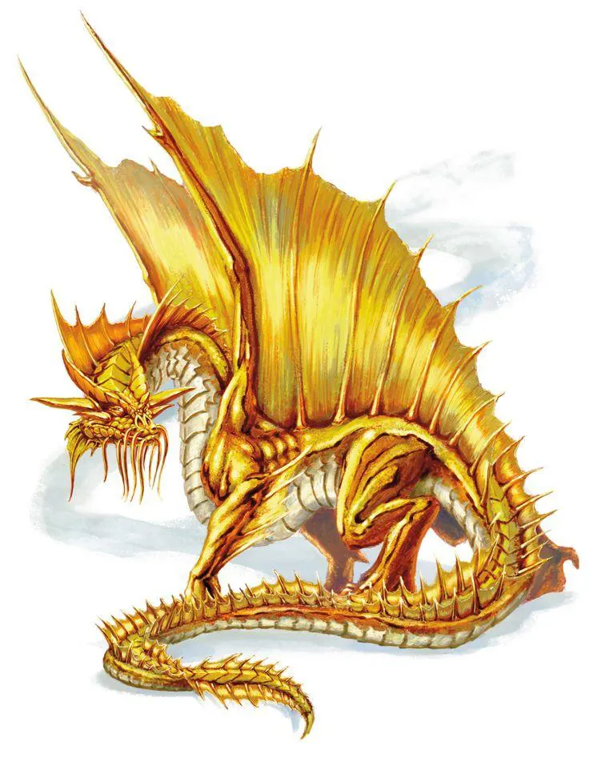

## Bloco de estatísticas: Dragão de Ouro Ancião

*Dragão Imenso, leal e bom*

**Classe de Armadura** 22 (armadura natural)  
**Pontos de Vida** 546 (28d20 + 252)  
**Deslocamento** 12 m, natação 12 m, voo 24 m

| FOR | DES | CON | INT | SAB | CAR |
| :---: | :---: | :---: | :---: | :---: | :---: |
| 30 (+10) | 14 (+2) | 29 (+9) | 18 (+4) | 17 (+3) | 28 (+9) |

**Testes de Resistência** Des +9, Con +16, Sab +10, Car +16  
**Perícias** Furtividade +9, Intuição +10, Percepção +17, Persuasão +16  
**Imunidade a Dano** fogo  
**Sentidos** percepção às cegas 18 m, visão no escuro 36 m, Percepção passiva 27  
**Idiomas** Comum, Dracônico  
**Nível de Desafio** 24 (62.000 XP)

***Anfíbio***. O dragão pode respirar ar e água.

***Resistência Lendária (3/Dia)***. Se o dragão falhar em um teste de resistência, ele pode escolher obter sucesso, no lugar.

### Ações

***Ataques Múltiplos***. O dragão pode usar sua Presença Aterradora, ele pode então, realizar três ataques: um com sua mordida e dois com suas garras.

***Mordida***. *Ataque Corpo-a-Corpo com Arma*: +17 para atingir, alcance 4,5 m, um alvo. *Acerto*: 21 (2d10 + 10) de dano perfurante.

***Garra***. *Ataque Corpo-a-Corpo com Arma*: +17 para atingir, alcance 3 m, um alvo. *Acerto*: 17 (2d6 + 10) de dano cortante.

***Cauda***. *Ataque Corpo-a-Corpo com Arma*: +17 para atingir, alcance 6 m, um alvo. *Acerto*: 19 (2d8 + 10) de dano de concussão.

***Presença Aterradora***. Cada criatura, à escolha do dragão, que esteja a até 36 metros do dragão e esteja ciente disso, deve ser bem sucedida num teste de resistência de Sabedoria CD 24 ou ficará amedrontada por 1 minuto. Uma criatura pode repetir o teste de resistência no final de cada um dos turnos dela, terminando o efeito sobre si, caso obtenha sucesso. Se o teste de resistência de uma criatura for bem sucedido ou caso o efeito termine sobre ela, a criatura ficará imune a Presença Aterradora do dragão pelas próximas 24 horas.

***Arma de Sopro (Recarrega 5–6)***. O dragão usa um dos seguintes tipos de armas de sopro.

***Sopro Flamejante***. O dragão expele fogo num cone de 27 metros. Cada criatura na área deve realiza um teste de resistência de Destreza CD 24, sofrendo 71 (13d10) de dano de fogo se falhar na resistência, ou metade desse dano caso obtenha sucesso.

***Sopro Enfraquecedor***. O dragão expele gás num cone de 27 metros. Cada criatura na área deve ser bem sucedida num teste de resistência de Força CD 24 ou terá desvantagem em jogadas de ataque baseadas em Força, testes de Força e testes de resistência de Força por 1 minuto. Uma criatura pode repetir o teste de resistência no final de cada um dos turnos dela, terminando o efeito sobre si, caso obtenha sucesso.

***Mudar Forma***. O dragão se metamorfoseia magicamente em um humanoide ou besta que possua um nível de desafio inferior ao seu próprio, ou volta para sua forma verdadeira. Ele reverte a sua forma verdadeira se morrer. Qualquer equipamento vestido ou carregado é absorvido ou usado pela nova forma (à escolha do dragão). Na nova forma, o dragão mantem sua tendência, pontos de vida, Dados de Vida, capacidade de fala, proficiências, Resistência Lendária, ações de covil e valores de Inteligência, Sabedoria e Carisma, assim como essa ação. Suas estatísticas e capacidades, no mais, são substituídas pelas da nova forma, exceto quaisquer características de classe ou ações lendárias dessa forma.

### Ações Lendárias

O dragão pode realizar 3 ações lendárias, escolhidas dentre as opções abaixo. Apenas uma ação lendária pode ser usada por vez e apenas no final do turno de outra criatura. O dragão recupera as ações lendárias gastas no começo do turno dele.

**Detectar**. O dragão realiza um teste de Sabedoria (Percepção).  
**Ataque com Cauda**. O dragão realiza um ataque de cauda.  
**Ataque com Asas (Custa 2 Ações).** O dragão bate suas asas. Cada criatura a até 4,5 metros do dragão deve ser bem sucedida num teste de resistência de Destreza CD 25 ou sofrerá 17 (2d6 + 10) de dano de concussão e cairá no chão. Após bater suas asas, o dragão pode voar até metade do seu deslocamento de voo.

## Bloco de estatísticas: Dragão de Ouro Adulto

*Dragão Enorme, leal e bom*

**Classe de Armadura** 19 (armadura natural)  
**Pontos de Vida** 256 (19d12 + 133)  
**Deslocamento** 12 m, natação 12 m, voo 24 m

| FOR | DES | CON | INT | SAB | CAR |
| :---: | :---: | :---: | :---: | :---: | :---: |
| 27 (+8) | 14 (+2) | 25 (+7) | 16 (+3) | 15 (+2) | 24 (+7) |

**Testes de Resistência** Des +8, Con +13, Sab +8, Car +13  
**Perícias** Furtividade +8, Intuição +8, Percepção +14, Persuasão +13  
**Imunidade a Dano** fogo  
**Sentidos** percepção às cegas 18 m, visão no escuro 36 m, Percepção passiva 24  
**Idiomas** Comum, Dracônico  
**Nível de Desafio** 17 (18.000 XP)

***Anfíbio***. O dragão pode respirar ar e água.

***Resistência Lendária (3/Dia)***. Se o dragão falhar em um teste de resistência, ele pode escolher obter sucesso, no lugar.

### Ações

***Ataques Múltiplos***. O dragão pode usar sua Presença Aterradora, ele pode então, realizar três ataques: um com sua mordida e dois com suas garras.

***Mordida***. *Ataque Corpo-a-Corpo com Arma*: +14 para atingir, alcance 3 m, um alvo. *Acerto*: 19 (2d10 + 8) de dano perfurante.

***Garra***. *Ataque Corpo-a-Corpo com Arma*: +14 para atingir, alcance 1,5 m, um alvo. *Acerto*: 15 (2d6 + 8) de dano cortante.

***Cauda***. *Ataque Corpo-a-Corpo com Arma*: +14 para atingir, alcance 4,5 m, um alvo. *Acerto*: 17 (2d8 + 8) de dano de concussão.

***Presença Aterradora***. Cada criatura, à escolha do dragão, que esteja a até 36 metros do dragão e esteja ciente disso, deve ser bem sucedida num teste de resistência de Sabedoria CD 21 ou ficará amedrontada por 1 minuto. Uma criatura pode repetir o teste de resistência no final de cada um dos turnos dela, terminando o efeito sobre si, caso obtenha sucesso. Se o teste de resistência de uma criatura for bem sucedido ou caso o efeito termine sobre ela, a criatura ficará imune a Presença Aterradora do dragão pelas próximas 24 horas.

## Bloco de estatísticas: Dragão de Ouro Jovem

*Dragão Grande, leal e bom*

**Classe de Armadura** 18 (armadura natural)  
**Pontos de Vida** 178 (17d10 + 85)  
**Deslocamento** 12 m, natação 12 m, voo 24 m

| FOR | DES | CON | INT | SAB | CAR |
| :---: | :---: | :---: | :---: | :---: | :---: |
| 23 (+6) | 14 (+2) | 21 (+5) | 16 (+3) | 13 (+1) | 20 (+5) |

**Testes de Resistência** Des +6, Con +9, Sab +5, Car +9  
**Perícias** Furtividade +6, Intuição +5, Percepção +9, Persuasão +9  
**Imunidade a Dano** fogo  
**Sentidos** percepção às cegas 9 m, visão no escuro 36 m, Percepção passiva 19  
**Idiomas** Comum, Dracônico  
**Nível de Desafio** 10 (5.900 XP)

***Anfíbio***. O dragão pode respirar ar e água.

### Ações

***Ataques Múltiplos***. O dragão realiza três ataques: um com sua mordida e dois com suas garras.

***Arma de Sopro (Recarrega 5–6)***. O dragão usa um dos seguintes tipos de armas de sopro.

***Sopro Flamejante***. O dragão expele fogo num cone de 18 metros. Cada criatura na área deve realiza um teste de resistência de Destreza CD 21, sofrendo 66 (12d10) de dano de fogo se falhar na resistência, ou metade desse dano caso obtenha sucesso.

***Sopro Enfraquecedor***. O dragão expele gás num cone de 18 metros. Cada criatura na área deve ser bem sucedida num teste de resistência de Força CD 21 ou terá desvantagem em jogadas de ataque baseadas em Força, testes de Força e testes de resistência de Força por 1 minuto. Uma criatura pode repetir o teste de resistência no final de cada um dos turnos dela, terminando o efeito sobre si, caso obtenha sucesso.

***Mudar Forma***. O dragão se metamorfoseia magicamente em um humanoide ou besta que possua um nível de desafio inferior ao seu próprio, ou volta para sua forma verdadeira. Ele reverte a sua forma verdadeira se morrer. Qualquer equipamento vestido ou carregado é absorvido ou usado pela nova forma (à escolha do dragão). Na nova forma, o dragão mantem sua tendência, pontos de vida, Dados de Vida, capacidade de fala, proficiências, Resistência Lendária, ações de covil e valores de Inteligência, Sabedoria e Carisma, assim como essa ação. Suas estatísticas e capacidades, no mais, são substituídas pelas da nova forma, exceto quaisquer características de classe ou ações lendárias dessa forma.

### Ações Lendárias

O dragão pode realizar 3 ações lendárias, escolhidas dentre as opções abaixo. Apenas uma ação lendária pode ser usada por vez e apenas no final do turno de outra criatura. O dragão recupera as ações lendárias gastas no começo do turno dele.

**Detectar**. O dragão realiza um teste de Sabedoria (Percepção).  
**Ataque com Cauda**. O dragão realiza um ataque de cauda.  
**Ataque com Asas (Custa 2 Ações).** O dragão bate suas asas. Cada criatura a até 3 metros do dragão deve ser bem sucedida num teste de resistência de Destreza CD 22 ou sofrerá 15 (2d6 + 8) de dano de concussão e cairá no chão. Após bater suas asas, o dragão pode voar até metade do seu deslocamento de voo.

***Mordida***. *Ataque Corpo-a-Corpo com Arma*: +10 para atingir, alcance 3 m, um alvo. *Acerto*: 17 (2d10 + 6) de dano perfurante.

***Garra***. *Ataque Corpo-a-Corpo com Arma*: +10 para atingir, alcance 1,5 m, um alvo. *Acerto*: 13 (2d6 + 6) de dano cortante.

***Arma de Sopro (Recarrega 5–6)***. O dragão usa um dos seguintes tipos de armas de sopro.

***Sopro Flamejante***. O dragão expele fogo num cone de 9 metros. Cada criatura na área deve realiza um teste de resistência de Destreza CD 17, sofrendo 55 (10d10) de dano de fogo se falhar na resistência, ou metade desse dano caso obtenha sucesso.

***Sopro Enfraquecedor***. O dragão expele gás num cone de 9 metros. Cada criatura na área deve ser bem sucedida num teste de resistência de Força CD 17 ou terá desvantagem em jogadas de ataque baseadas em Força, testes de Força e testes de resistência de Força por 1 minuto. Uma criatura pode repetir o teste de resistência no final de cada um dos turnos dela, terminando o efeito sobre si, caso obtenha sucesso.

## Bloco de estatísticas: Dragão de Ouro Filhote

*Dragão Médio, leal e bom*

**Classe de Armadura** 17 (armadura natural)  
**Pontos de Vida** 60 (8d8 + 24)  
**Deslocamento** 9 m, natação 9 m, voo 18 m

| FOR | DES | CON | INT | SAB | CAR |
| :---: | :---: | :---: | :---: | :---: | :---: |
| 19 (+4) | 14 (+2) | 17 (+3) | 14 (+2) | 11 (+0) | 16 (+3) |

**Testes de Resistência** Des +4, Con +5, Sab +2, Car +5  
**Perícias** Furtividade +4, Percepção +4  
**Imunidade a Dano** fogo  
**Sentidos** percepção às cegas 3 m, visão no escuro 18 m, Percepção passiva 14  
**Idiomas** Dracônico  
**Nível de Desafio** 3 (700 XP)

***Anfíbio***. O dragão pode respirar ar e água.

### Ações

***Mordida***. *Ataque Corpo-a-Corpo com Arma*: +6 para atingir, alcance 1,5 m, um alvo. *Acerto*: 9 (1d10 + 4) de dano perfurante.

***Arma de Sopro (Recarrega 5–6)***. O dragão usa um dos seguintes tipos de armas de sopro.

***Sopro Flamejante***. O dragão expele fogo num cone de 4,5 metros. Cada criatura na área deve realiza um teste de resistência de Destreza CD 13, sofrendo 22 (4d10) de dano de fogo se falhar na resistência, ou metade desse dano caso obtenha sucesso.

***Sopro Enfraquecedor***. O dragão expele gás num cone de 4,5 metros. Cada criatura na área deve ser bem sucedida num teste de resistência de Força CD 13 ou terá desvantagem em jogadas de ataque baseadas em Força, testes de Força e testes de resistência de Força por 1 minuto. Uma criatura pode repetir o teste de resistência no final de cada um dos turnos dela, terminando o efeito sobre si, caso obtenha sucesso.

### Dragão de Ouro

Os mais poderosos e majestosos dentre os dragões metálicos, os dragões de ouro são dedicados adversários do mal.

Um dragão de ouro tem uma face sagaz ungida por espinhos flexíveis semelhantes a bigodes. Seus chifres partem do seu nariz, passando pelos supercílios e duas cristas gêmeas adornam seu longo pescoço. As asas de um dragão de ouro, semelhantes às velas de navios, começam nos seus ombros e seguem até a ponta de sua cauda, permitindo que ele voe com um distinto movimento ondulado, como se nadasse no ar. Um dragão de ouro filhote tem escamas amarelo escuras com manchas metálicas. Essas manchas crescem à medida que o dragão amadurece. Conforme o dragão envelhece, suas pupilas desaparecem até seus olhos lembrarem possas de ouro derretido.

***Devorador de Fortunas***. Dragões de ouro podem comer praticamente tudo, mas eles preferem uma dieta que consiste de pérolas e gemas. Felizmente, um dragão de ouro não precisa empanturrar-se de tais bens para se sentir satisfeito. Tesouros presenteados que ele possa consumir são bem recebidos por um dragão de ouro, contanto que não sejam subornos.

***Metamorfos Reservados***. Os dragões de ouro são respeitados pelos outros dragões metálicos por sua sabedoria e justiça, mas eles são os mais distantes e sinistros dentre os dragões benignos. Eles valorizam sua privacidade ao ponto de raramente confraternizar com outros dragões, com exceção de seus parceiros e proles.

Dragões de ouro mais velhos podem assumir formas animais e humanoides. Raramente um dragão dourado irá revelar sua verdadeira forma. Disfarçado de pedinte, ele pode visitar com regularidade uma cidade para saber das fofocas locais, apadrinhando negociantes honestos e dando uma mão amiga de formas ocultas. Disfarçado como um animal, o dragão pode ficar amigo de uma criança perdida, um menestrel viajante ou de um taverneiro, servindo como um companheiro por dias ou até semanas.

***Mestre do Tesouro***. Um dragão de ouro mantem seu tesouro em um cofre bem protegido dentro de seu covil. Proteções mágicas colocadas no cofre tornam praticamente impossível remover quaisquer tesouros sem que o dragão fique sabendo.

### O Covil do Dragão de Ouro

Os dragões de ouro fazem seus lares em locais fora do caminho, onde eles possam fazer o que desejarem sem levantar suspeitas ou causar pânico. Muitos habitam próximo de lagos e rios idílicos, ilhas envoltas em brumas, complexos de cavernas escondidos atrás de cachoeiras, ou ruínas antigas.

### Ações de Covil

No valor de iniciativa 20 (quebrando toda a sequência de iniciativa), o dragão realiza uma ação de covil fazendo um dos efeitos a seguir; o dragão não pode usar o mesmo efeitos em duas rodadas consecutivas:

O dragão vislumbra o futuro, então, ele ganha

-  vantagem em jogadas de ataque, testes de habilidade e testes de resistência até a contagem de iniciativa 20, na próxima rodada. Uma criatura que o dragão possa ver a até 36 metros
-  dele, deve ser bem sucedida num teste de resistência de Carisma CD 15 ou será banida para o plano dos sonhos, um plano de existência diferente fruto da imaginação do dragão. Para escapar, a criatura deve usar uma ação para realizar um teste resistido de Carisma com o dragão. Se a criatura vencer, ela escapa do plano dos sonhos. Do contrário, o efeito termina na contagem de iniciativa 20, na rodada seguinte. Quando o efeito termina, a criatura reaparece no espaço onde estava, ou no espaço desocupado mais próximo se aquele estiver ocupado.

### Efeitos Regionais

A região contendo o covil de um dragão de ouro lendário é deformada pela magia do dragão, o que cria um ou mais dos efeitos a seguir:

- Sempre que uma criatura que possa compreender um idioma dormir ou entrar em estado de transe ou devaneio a até 9 quilômetros do covil do dragão, o dragão pode estabelecer um contato telepático com essa criatura e conversar com ela nos sonhos dela. A criatura lembrará da conversa com o dragão quando acordar.
- Bancos de belas brumas opalescentes manifestam-se a até 9 quilômetros do covil do dragão. As brumas não obscurecem nada. Ela assume formas assustadoras quando criaturas malignas estão perto do dragão ou de outras criaturas não-malignas nas brumas, avisando tais criaturas do perigo.
- Gemas e pérolas a até 1,5 quilômetro do covil do dragão brilham e reluzem, emitindo penumbra num raio de 1,5 metro.

Se o dragão morrer, esses efeitos terminam imediatamente.

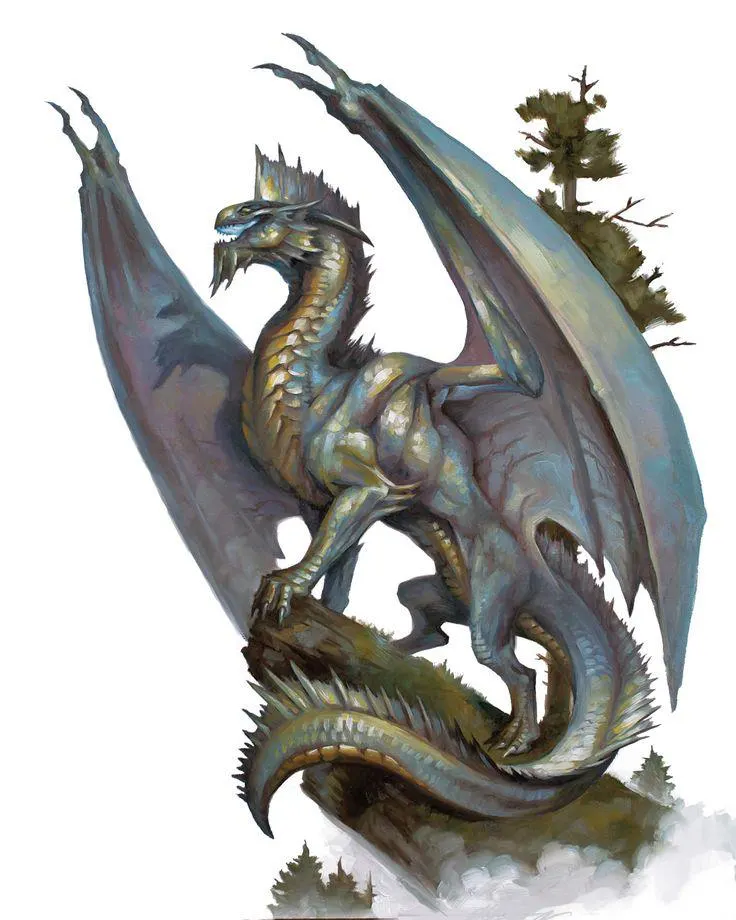

## Bloco de estatísticas: Dragão de Prata Ancião

*Dragão Imenso, leal e bom*

**Classe de Armadura** 22 (armadura natural)  
**Pontos de Vida** 487 (25d20 + 225)  
**Deslocamento** 12 m, voo 24 m

| FOR | DES | CON | INT | SAB | CAR |
| :---: | :---: | :---: | :---: | :---: | :---: |
| 30 (+10) | 10 (+0) | 29 (+9) | 18 (+4) | 17 (+2) | 23 (+6) |

**Testes de Resistência** Des +7, Con +16, Sab +9, Car +13  
**Perícias** Arcanismo +11, História +11, Furtividade +7, Percepção +16  
**Imunidade a Dano** frio  
**Sentidos** percepção às cegas 18 m, visão no escuro 36 m, Percepção passiva 26  
**Idiomas** Comum, Dracônico  
**Nível de Desafio** 23 (50.000 XP)

***Resistência Lendária (3/Dia)***. Se o dragão falhar em um teste de resistência, ele pode escolher obter sucesso, no lugar.

### Ações

***Ataques Múltiplos***. O dragão pode usar sua Presença Aterradora, ele pode então, realizar três ataques: um com sua mordida e dois com suas garras.

***Mordida***. *Ataque Corpo-a-Corpo com Arma*: +17 para atingir, alcance 4,5 m, um alvo. *Acerto*: 21 (2d10 + 10) de dano perfurante.

***Garra***. *Ataque Corpo-a-Corpo com Arma*: +17 para atingir, alcance 3 m, um alvo. *Acerto*: 17 (2d6 + 10) de dano cortante.

***Cauda***. *Ataque Corpo-a-Corpo com Arma*: +17 para atingir, alcance 6 m, um alvo. *Acerto*: 19 (2d8 + 10) de dano de concussão.

***Presença Aterradora***. Cada criatura, à escolha do dragão, que esteja a até 36 metros do dragão e esteja ciente disso, deve ser bem sucedida num teste de resistência de Sabedoria CD 21 ou ficará amedrontada por 1 minuto. Uma criatura pode repetir o teste de resistência no final de cada um dos turnos dela, terminando o efeito sobre si, caso obtenha sucesso. Se o teste de resistência de uma criatura for bem sucedido ou caso o efeito termine sobre ela, a criatura ficará imune a Presença Aterradora do dragão pelas próximas 24 horas.

***Arma de Sopro (Recarrega 5–6)***. O dragão usa um dos seguintes tipos de armas de sopro.

***Sopro Congelante***. O dragão expele uma explosão de gelo num cone de 27 metros. Cada criatura na área deve realiza um teste de resistência de Constituição CD 24, sofrendo 67 (15d8) de dano de frio se falhar na resistência, ou metade desse dano caso obtenha sucesso.

***Sopro Paralisante***. O dragão expele gás paralisante num cone de 27 metros. Cada criatura na área deve ser bem sucedida num teste de resistência de Constituição CD 24 ou ficará paralisada por 1 minuto. Uma criatura pode repetir o teste de resistência no final de cada um dos turnos dela, terminando o efeito sobre si, caso obtenha sucesso.

***Mudar Forma***. O dragão se metamorfoseia magicamente em um humanoide ou besta que possua um nível de desafio inferior ao seu próprio, ou volta para sua forma verdadeira. Ele reverte a sua forma verdadeira se morrer. Qualquer equipamento vestido ou carregado é absorvido ou usado pela nova forma (à escolha do dragão). Na nova forma, o dragão mantem sua tendência, pontos de vida, Dados de Vida, capacidade de fala, proficiências, Resistência Lendária, ações de covil e valores de Inteligência, Sabedoria e Carisma, assim como essa ação. Suas estatísticas e capacidades, no mais, são substituídas pelas da nova forma, exceto quaisquer características de classe ou ações lendárias dessa forma.

### Ações Lendárias

O dragão pode realizar 3 ações lendárias, escolhidas dentre as opções abaixo. Apenas uma ação lendária pode ser usada por vez e apenas no final do turno de outra criatura. O dragão recupera as ações lendárias gastas no começo do turno dele.

**Detectar**. O dragão realiza um teste de Sabedoria (Percepção).  
**Ataque com Cauda**. O dragão realiza um ataque de cauda.  
**Ataque com Asas (Custa 2 Ações).** O dragão bate suas asas. Cada criatura a até 4,5 metros do dragão deve ser bem sucedida num teste de resistência de Destreza CD 25 ou sofrerá 17 (2d6 + 10) de dano de concussão e cairá no chão. Após bater suas asas, o dragão pode voar até metade do seu deslocamento de voo.

## Bloco de estatísticas: Dragão de Prata Adulto

*Dragão Enorme, leal e bom*

**Classe de Armadura** 19 (armadura natural)  
**Pontos de Vida** 243 (18d12 + 126)  
**Deslocamento** 12 m, voo 24 m

| FOR | DES | CON | INT | SAB | CAR |
| :---: | :---: | :---: | :---: | :---: | :---: |
| 27 (+8) | 10 (+0) | 25 (+7) | 16 (+3) | 13 (+1) | 21 (+5) |

**Testes de Resistência** Des +5, Con +12, Sab +6, Car +10  
**Perícias** Arcanismo +8, História +8, Furtividade +5, Percepção +11  
**Imunidade a Dano** frio  
**Sentidos** percepção às cegas 18 m, visão no escuro 36 m, Percepção passiva 21  
**Idiomas** Comum, Dracônico  
**Nível de Desafio** 16 (15.000 XP)

***Resistência Lendária (3/Dia)***. Se o dragão falhar em um teste de resistência, ele pode escolher obter sucesso, no lugar.

### Ações

***Ataques Múltiplos***. O dragão pode usar sua Presença Aterradora, ele pode então, realizar três ataques: um com sua mordida e dois com suas garras.

***Mordida***. *Ataque Corpo-a-Corpo com Arma*: +13 para atingir, alcance 3 m, um alvo. *Acerto*: 19 (2d10 + 8) de dano perfurante.

***Garra***. *Ataque Corpo-a-Corpo com Arma*: +13 para atingir, alcance 1,5 m, um alvo. *Acerto*: 15 (2d6 + 8) de dano cortante.

***Cauda***. *Ataque Corpo-a-Corpo com Arma*: +13 para atingir, alcance 4,5 m, um alvo. *Acerto*: 17 (2d8 + 8) de dano de concussão.

***Presença Aterradora***. Cada criatura, à escolha do dragão, que esteja a até 36 metros do dragão e esteja ciente disso, deve ser bem sucedida num teste de resistência de Sabedoria CD 18 ou ficará amedrontada por 1 minuto. Uma criatura pode repetir o teste de resistência no final de cada um dos turnos dela, terminando o efeito sobre si, caso obtenha sucesso. Se o teste de resistência de uma criatura for bem sucedido ou caso o efeito termine sobre ela, a criatura ficará imune a Presença Aterradora do dragão pelas próximas 24 horas.

### Dragão de Prata

Os mais amigáveis e mais sociáveis dentre os dragões metálicos, os dragões de prata ajudam alegremente as criaturas boas necessitadas.

Um dragão de prata reluz como se fosse esculpido em metal puro, sua face dá um ar nobre devido aos seus olhos altos e seu queixo com cristas similares a uma barba em seu queixo espinhoso. Uma crista cresce de um espinho longo atrás de sua cabeça, seguindo do pescoço até a ponta da cauda. As escamas de um dragão de prata filhote tem um tom azul-acinzentado com reflexos prateados. Conforme o dragão aproxima-se da idade adulta, essa coloração gradualmente clareia até os escamas individuais se tornarem quase indistinguíveis. À medida que um dragão de prata envelhece, suas pupilas desaparecem até seus olhos lembrarem orbes de mercúrio.

***Dragões de Virtude***. Os dragões de prata acreditam que viver uma vida mortal envolve realizar boas coisas assegurando que suas ações não causem mal imerecido a outros seres racionais. Eles não tomam para si a responsabilidade de erradicar o mal, como os dragões de ouro e bronze fazem, mas eles irão se opor de boa vontade contra criaturas que ousem cometer atos malignos ou ferir os inocentes.

***Arma de Sopro (Recarrega 5–6)***. O dragão usa um dos seguintes tipos de armas de sopro.

***Sopro Congelante***. O dragão expele uma explosão de gelo num cone de 18 metros. Cada criatura na área deve realiza um teste de resistência de Constituição CD 20, sofrendo 58 (13d8) de dano de frio se falhar na resistência, ou metade desse dano caso obtenha sucesso.

***Sopro Paralisante***. O dragão expele gás paralisante num cone de 18 metros. Cada criatura na área deve ser bem sucedida num teste de resistência de Constituição CD 20 ou ficará paralisada por 1 minuto. Uma criatura pode repetir o teste de resistência no final de cada um dos turnos dela, terminando o efeito sobre si, caso obtenha sucesso.

***Mudar Forma***. O dragão se metamorfoseia magicamente em um humanoide ou besta que possua um nível de desafio inferior ao seu próprio, ou volta para sua forma verdadeira. Ele reverte a sua forma verdadeira se morrer. Qualquer equipamento vestido ou carregado é absorvido ou usado pela nova forma (à escolha do dragão). Na nova forma, o dragão mantem sua tendência, pontos de vida, Dados de Vida, capacidade de fala, proficiências, Resistência Lendária, ações de covil e valores de Inteligência, Sabedoria e Carisma, assim como essa ação. Suas estatísticas e capacidades, no mais, são substituídas pelas da nova forma, exceto quaisquer características de classe ou ações lendárias dessa forma.

### Ações Lendárias

O dragão pode realizar 3 ações lendárias, escolhidas dentre as opções abaixo. Apenas uma ação lendária pode ser usada por vez e apenas no final do turno de outra criatura. O dragão recupera as ações lendárias gastas no começo do turno dele.

**Detectar**. O dragão realiza um teste de Sabedoria (Percepção).  
**Ataque com Cauda**. O dragão realiza um ataque de cauda.  
**Ataque com Asas (Custa 2 Ações).** O dragão bate suas asas. Cada criatura a até 3 metros do dragão deve ser bem sucedida num teste de resistência de Destreza CD 21 ou sofrerá 15 (2d6 + 8) de dano de concussão e cairá no chão. Após bater suas asas, o dragão pode voar até metade do seu deslocamento de voo.

***Amigos das Raças Pequenas***. Os dragões de prata apreciam a companhia de outros dragões de prata. Suas únicas amizades verdadeiras fora da sua própria espécie nasce na companhia de humanoides, e muitos dragões de prata passam tanto tempo em formas humanoides quando em sua forma dracônica. Um dragão de prata adota uma personalidade humanoide benigna, como um velho sábio gentil ou uma jovem viajante e ele geralmente possui companheiros mortais com os quais ele constitui fortes amizades.

Dragões de prata devem se afastar de suas vidas humanoides com regularidade, retornando a suas formas verdadeiras para acasalar e constituir prole, ou para cuidar de seu tesouros e afazeres pessoais. Devido a muitos perderem a noção do tempo quando estão fora, eles às vezes retornam e descobrem que seus companheiros envelheceram ou morreram. Dragões de prata, muitas vezes, acabam por criar amizade com diversas gerações de humanoides de uma única família, como resultado.

***Respeito pela Humanidade***. Dragões de prata criam amizades com humanoides de todas as raças, mas raças com curta expectativa de vida, como os humanos despertam sua curiosidade de uma forma que as raças de vida longa, como os elfos e os anões não fazem. Os humanos tem um ímpeto e entusiasmo pela vida que os dragões de prata acham fascinante.

**História de Tesouros**. Dragões de prata adoram possuir relíquias da história humanoide. Isso inclui enormes pilhas de moedas que eles cobiçam, cunhadas pelos impérios humanoides caídos e atuais, assim como obras de arte e joias finas construídas por inúmeras raças. Outros tesouros que constituem sua fortuna podem incluir navios intactos, os restos mortais de reis e rainhas, tronos, as coroas de joias de antigos impérios, invenções e engenhocas e monólitos trazidos das ruínas de cidades caídas.

### O Covil do Dragão de Prata

Os dragões de prata habitam entre as nuvens, fazendo seus covis nos picos de montanhas reclusas. Apesar de muitos se sentirem confortáveis em complexos naturais de cavernas ou minas abandonadas, os dragões de prata cobiçam postos avançados perdidos de civilizações humanoides. Uma cidadela abandonada no topo de uma montanha ou uma torre remota erguida por um mago a muito morto é o tipo de covil que todo dragão de prata sonha em ter.

### Ações de Covil

No valor de iniciativa 20 (quebrando toda a sequência de iniciativa), o dragão realiza uma ação de covil fazendo um dos efeitos a seguir:

## Bloco de estatísticas: Dragão de Prata Jovem

*Dragão Grande, leal e bom*

**Classe de Armadura** 18 (armadura natural)  
**Pontos de Vida** 168 (16d10 + 80)  
**Deslocamento** 12 m, voo 24 m

| FOR | DES | CON | INT | SAB | CAR |
| :---: | :---: | :---: | :---: | :---: | :---: |
| 23 (+6) | 10 (+0) | 21 (+5) | 14 (+2) | 11 (+0) | 19 (+4) |

**Testes de Resistência** Des +4, Con +9, Sab +4, Car +8  
**Perícias** Arcanismo +6, História +6, Furtividade +4, Percepção +8  
**Imunidade a Dano** frio  
**Sentidos** percepção às cegas 9 m, visão no escuro 36 m, Percepção passiva 18  
**Idiomas** Comum, Dracônico  
**Nível de Desafio** 9 (5.000 XP)

### Ações

***Ataques Múltiplos***. O dragão realiza três ataques: um com sua mordida e dois com suas garras.

***Mordida***. *Ataque Corpo-a-Corpo com Arma*: +10 para atingir, alcance 3 m, um alvo. *Acerto*: 17 (2d10 + 6) de dano perfurante.

***Garra***. *Ataque Corpo-a-Corpo com Arma*: +10 para atingir, alcance 1,5 m, um alvo. *Acerto*: 13 (2d6 + 6) de dano cortante.

***Arma de Sopro (Recarrega 5–6)***. O dragão usa um dos seguintes tipos de armas de sopro.

***Sopro Congelante***. O dragão expele uma explosão de gelo num cone de 9 metros. Cada criatura na área deve realiza um teste de resistência de Constituição CD 17, sofrendo 54 (12d8) de dano de frio se falhar na resistência, ou metade desse dano caso obtenha sucesso.

***Sopro Paralisante***. O dragão expele gás paralisante num cone de 9 metros. Cada criatura na área deve ser bem sucedida num teste de resistência de Constituição CD 17 ou ficará paralisada por 1 minuto. Uma criatura pode repetir o teste de resistência no final de cada um dos turnos dela, terminando o efeito sobre si, caso obtenha sucesso.

- O dragão cria uma névoa como se ele tivesse conjurado

a magia *névoa obscurecente*. A névoa dura até a contagem de iniciativa 20, na próxima rodada.

- Um vento tremendamente frio avança pelo covil próximo do dragão. Cada criatura a até 36 metros do dragão deve ser bem sucedida num teste de resistência de Constituição CD 15 ou sofrerá 5 (1d10) de dano de frio. Gases e vapores são dispersados pelo vento e chamas desprotegidas são extintas. Chamas protegidas, como de lanternas, tem 50 por cento de chance de serem extintas.

### Efeitos Regionais

A região contendo o covil de um dragão de prata lendário é deformada pela magia do dragão, o que cria um ou mais dos efeitos a seguir:

- Uma vez por dia, o dragão pode alterar o clima num raio de 9 quilômetros, centrado em seu covil. O dragão não precisa estar do lado de fora; no mais, o efeito é idêntico a magia *controlar o clima*.
- A até 1,5 quilômetro do covil, ventos sustentam criaturas não-malignas que tenham caído devido a inação do dragão ou de seus aliados. Tais criaturas descem a uma taxa de 18 metros por rodada e não sofrem dano de queda.
- Se tiver dias ou mais tempo para trabalhar, o dragão pode fazer com que as nuvens e névoa dentro do seu covil fique tão sólida quanto rocha, formando estruturas e outros objetos que desejar.

Se o dragão morrer, as mudanças no clima voltam ao normal, como descrito na magia, e os outros efeitos desaparecem no decorrer de 1d10 dias.

## Bloco de estatísticas: Dragão de Prata Filhote

*Dragão Médio, leal e bom*

**Classe de Armadura** 17 (armadura natural)  
**Pontos de Vida** 45 (6d8 + 18)  
**Deslocamento** 9 m, voo 18 m

| FOR | DES | CON | INT | SAB | CAR |
| :---: | :---: | :---: | :---: | :---: | :---: |
| 19 (+4) | 10 (+0) | 17 (+3) | 12 (+1) | 11 (+0) | 15 (+2) |

**Testes de Resistência** Des +2, Con +5, Sab +2, Car +4  
**Perícias** Furtividade +2, Percepção +4  
**Imunidade a Dano** frio  
**Sentidos** percepção às cegas 3 m, visão no escuro 18 m, Percepção passiva 14  
**Idiomas** Dracônico  
**Nível de Desafio** 2 (450 XP)

### Ações

***Mordida***. *Ataque Corpo-a-Corpo com Arma*: +6 para atingir, alcance 1,5 m, um alvo. *Acerto*: 9 (1d10 + 4) de dano perfurante.

***Arma de Sopro (Recarrega 5–6)***. O dragão usa um dos seguintes tipos de armas de sopro.

***Sopro Congelante***. O dragão expele uma explosão de gelo num cone de 4,5 metros. Cada criatura na área deve realiza um teste de resistência de Constituição CD 13, sofrendo 18 (4d8) de dano de frio se falhar na resistência, ou metade desse dano caso obtenha sucesso.

***Sopro Paralisante***. O dragão expele gás paralisante num cone de 4,5 metros. Cada criatura na área deve ser bem sucedida num teste de resistência de Constituição CD 13 ou ficará paralisada por 1 minuto. Uma criatura pode repetir o teste de resistência no final de cada um dos turnos dela, terminando o efeito sobre si, caso obtenha sucesso.
