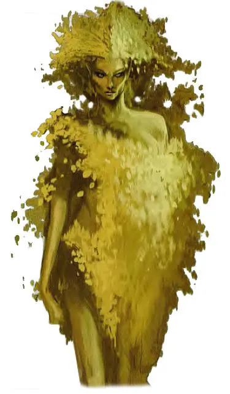

# Dríade

Viajantes que adentre uma floresta podem ter um vislumbre de uma forma feminina passando por detrás das árvores. Um riso ardente permeia o ar, levando aqueles que o ouvem mais fundo nas sombras esmeraldas.

***Presa às Árvores***. Fadas poderosas iram, certas vezes, conectar espíritos feéricos às árvores, transformando-os em dríades. Isso, às vezes, é feito como punição quando o espírito feérico se apaixona por um mortal e esse amor é proibido.

Uma dríade pode emergir de uma árvore e atravessar as terras através delas, mas a árvore continua sendo seu lar e a enraíza ao mundo. Enquanto a árvore permanecer sadia e ilesa, a dríade permanecerá eternamente jovem e encantadora. Se a árvore for ferida, ela sofre. Se a arvore for destruída, a dríade sucumbe a loucura.

***Fadas Reclusas***. As dríades agem como guardiãs do patrimônio de suas florestas. Tímidas e reclusas, elas observam os intrusos das árvores. Uma dríade atraída pela beleza de um estranho pode investigar mais de perto, talvez até tentando atrair o indivíduo para longe para enfeitiça-lo.

As dríades trabalham com outras criaturas silvestres para defender suas florestas. Unicórnios, entes e sátiros vivem ao lado delas, além de druidas que partilham da devoção das dríades às florestas que elas chamam de lar.

***Magia da Floresta***. As dríades podem falar com as plantas e animais. Elas podem se teletransportar de uma árvore para outra, atraindo invasores para longe dos seus bosques. Se pressionada, uma dríade pode seduzir humanoides com seus encantamentos, transformando inimigos em amigos. Elas também conhecem u punhado de magias úteis.

## Bloco de estatísticas: Dríade

*Fada Média, neutro*

**Classe de Armadura** 11 (16 com *pele de árvore*)  
**Pontos de Vida** 22 (5d8)  
**Deslocamento** 9 m

| FOR | DES | CON | INT | SAB | CAR |
| :---: | :---: | :---: | :---: | :---: | :---: |
| 10 (+0) | 12 (+1) | 11 (+0) | 14 (+2) | 15 (+2) | 18 (+4) |

**Perícias** Furtividade +5, Percepção +4  
**Sentidos** visão no escuro 18 m, Percepção passiva 14  
**Idiomas** Élfico, Silvestre  
**Nível de Desafio** 1 (200 XP)

***Caminhar em Árvores***. Uma vez por turno, a dríade pode usar 3 metros do seu deslocamento para entrar magicamente em uma árvore viva dentro do seu alcance e surgir de uma segunda árvore viva a até 18 metros da primeira, aparecendo em um espaço desocupado a 1,5 metro da segunda árvore. Ambas as árvores devem ser Grandes, ou maiores.

***Conjuração Inata***. A habilidade de conjuração de uma dríade é Carisma (CD de resistência de magia 14). A dríade pode conjurar, inatamente, as seguintes magias, sem necessidade de componentes materiais:

À vontade: *druidismo* 3/dia cada: *bom fruto, constrição* 1/dia cada: *bordão místico, passos sem pegadas, pele de árvore*

***Falar com Bestas e Plantas*** A dríade pode se comunicar com bestas e plantas como se compartilhassem um idioma.

***Resistência à Magia***. A dríade possui vantagem nos testes de resistência contra magias e outros efeitos mágicos.

### Ações

***Clava***. *Ataque Corpo-a-Corpo com Arma*: +2 para atingir (+6 para atingir com *bordão místico*), alcance 1,5 m, um alvo. *Acerto*: 2 (1d4) de dano de concussão, ou 8 (1d8 + 4) de dano de concussão com *bordão místico*.

***Encanto Feérico.*** A dríade afeta um humanoide ou besta que ela possa ver, a até 9 metros dela. Se o alvo puder ver a dríade, ele deve ser bem sucedido num teste de resistência de Sabedoria CD 14 ou ficará magicamente enfeitiçado. A criatura enfeitiçada reconhece a dríade como uma amiga confiável que deve ser atendida e protegida. Apesar do alvo não estar sob o controle da dríade, ele atende aos pedidos da dríade ou age da forma mais favorável que puder. Toda vez que a dríade ou seus aliados fizerem qualquer coisa nociva contra o alvo, ele poderá repetir o teste de resistência, terminando o efeito sobre si, caso obtenha sucesso. Do contrário, o efeito dura por 24 horas ou até a dríade morrer, estiver em um plano de existência diferente do alvo ou terminar o efeito com uma ação bônus. Se o teste de resistência do alvo for bem sucedido, ele fica imune ao Encanto Feérico da dríade pelas próximas 24 horas. A dríade não pode ter mais de um humanoide e até três bestas enfeitiçados ao mesmo tempo.
