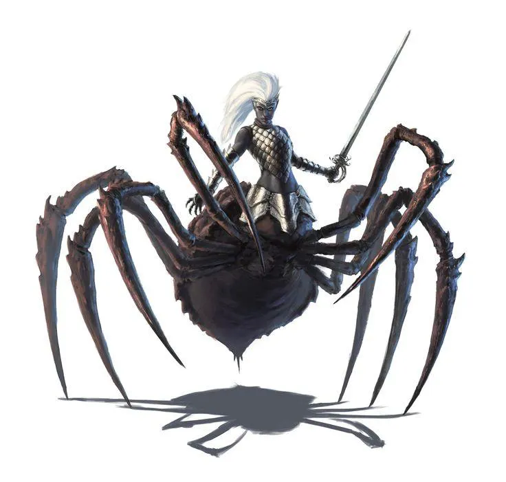

# Drider

Quando um drow mostra-se muito promissor, Lolth o convoca aos Fossos de Teias Demoníacas para um teste de fé e força. Aqueles que passam no teste sobem mais alto no conceito da Rainha Aranha. Aqueles que falham são transformados em driders – um horrendo híbrido de um drow com uma aranha gigante que serve como um lembrete vivo do poder de Lolth. Apenas os drow podem ser transformados em driders, e o poder para criar essas criaturas é exclusivo de Lolth.

***Marcados para o Resto da Vida***. Os drow transformados em driders voltam ao Plano Material como criaturas distorcidas e aviltadas. Guiados pela loucura, eles desaparecem adentro do Subterrâneo, tornando-se eremitas e caçadores, tanto vagando sozinhos quanto liderando bandos de aranhas gigantes.

Em raras ocasiões, um drider retorna aos limites da sociedade drow apesar da sua maldição, na maioria das vezes para cumprir algum voto ou vingança de longa data de sua vida anterior. Os drow temem e evitam os driders, tendo menos estima por eles até que pelos escravos. No entanto, eles toleram a presença dessas criaturas como representantes vivos da vontade de Lolth e um lembrete do destino que aguarda todos aqueles que falharem perante a Rainha Aranha.

> **Variação: Drider Conjurador**
>
> Os driders que eram conjuradores drow podem manter sua habilidade de conjurar magias. Tais driders, normalmente possuem uma habilidade de conjuração (15 ou 16) superior à dos outros driders. Além disso, o drider ganha o traço Conjuração. Um drider que foi um drow conjurador de magia divina, no entanto, teria uma Sabedoria de 16 (+3) e um traço de Conjuração como o seguinte.
>
> ***Conjuração***. O drider é um conjurador de 7° nível. Sua habilidade de conjuração é Sabedoria (CD de resistência de magia 14, +6 para atingir com ataques com magia). Ele possui as seguintes magias preparadas da lista de magias de clérigo:
>
> Truques (à vontade): *rajada de veneno, taumaturgia* 1° nível (4 espaços): *detectar magia, perdição, santuário* 2° nível (3 espaços): *imobilizar pessoa, silêncio* 3° nível (3 espaços): *clarividência, dissipar magia* 4° nível (3 espaços): *adivinhação, movimentação livre*

## Bloco de estatísticas: Drider

*Monstruosidade Grande, caótico e mau*

**Classe de Armadura** 19 (armadura natural)  
**Pontos de Vida** 123 (13d10 + 52)  
**Deslocamento** 9 m, escalada 9 m

| FOR | DES | CON | INT | SAB | CAR |
| :---: | :---: | :---: | :---: | :---: | :---: |
| 16 (+3) | 16 (+3) | 18 (+4) | 13 (+1) | 14 (+2) | 12 (+1) |

**Perícias** Furtividade +9, Percepção +5  
**Sentidos** visão no escuro 36 m, Percepção passiva 15  
**Idiomas** Élfico, Subcomum  
**Nível de Desafio** 6 (2.300 XP)

***Ancestralidade Feérica***. O drider possui vantagem em testes de resistência contra ser enfeitiçado e magias que possam colocar o drider para dormir.

***Andar em Teias***. O drider ignora as restrições de movimentos causadas por estar enredado.

***Conjuração Inata***. A habilidade de conjuração de um drider é Sabedoria (CD de resistência de magia 13). O drider pode conjurar, inatamente, as seguintes magias, sem necessidade de componentes materiais:

À vontade: *globos de luz* 3/dia cada: *escuridão, fogo das fadas*

***Escalada Aracnídea***. O drider pode escalar superfícies difíceis, incluindo andar de cabeça pra baixo em tetos, sem precisar realizar um teste de habilidade.

***Sensibilidade à Luz Solar***. Enquanto estiver sob luz solar, o drider tem desvantagem nas jogadas de ataque, assim como em testes de Sabedoria (Percepção) relacionados a visão.

### Ações

***Ataques Múltiplos***. O drider realiza três ataques, tanto com sua espada longa quanto com seu arco longo. Ele pode substituir um desses ataques por um ataque de mordida.

***Mordida***. *Ataque Corpo-a-Corpo com Arma*: +6 para atingir, alcance 1,5 m, uma criatura. *Acerto*: 5 (1d4 + 3) de dano perfurante mais 9 (2d8) de dano de veneno.

***Espada Longa***. *Ataque Corpo-a-Corpo com Arma*: +6 para atingir, alcance 1,5 m, um alvo. *Acerto*: 7 (1d8 + 3) de dano cortante, ou 8 (1d10 + 3) de dano cortante se usada com as duas mãos.

***Arco Longo***. *Ataque à Distância com Arma*: +6 para atingir, distância 45/180 m, um alvo. *Acerto*: 7 (1d8 + 3) de dano perfurante mais 4 (1d8) de dano de veneno.
