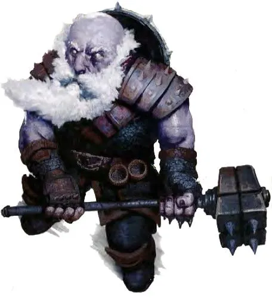

# Duergar

Os tirânicos duergar, também conhecidos como anões cinzentos, vivem em cidades fantásticas nas profundezas do Subterrâneo. Usando conhecimento anão ancestral e miríades escravizados, eles trabalham incansavelmente para expandir seus reinos subterrâneos.

A maioria dos duergar (incluindo as fêmeas) são carecas e tem cor de pele cinza pálida. Eles vestem roupas monocromáticas feitas para se mesclar às rochas, junto com joias simples que refletem seu comportamento severo e utilitário.

***De Escravos para Escravistas***. Os duergar foram anões, antes da ganância deles e aprofundamento infindável na terra leva-los ao contato com os devoradores de mentes. Mantidos cativos por gerações pelos ilitides, os anões, eventualmente, ganharam sua independência com a ajuda do deus maligno Laduguer. A escravidão os mudou para sempre, no entanto, enegrecendo seus espíritos tornando os duergar tão malignos quanto os tiranos de quem escaparam. Apesar de terem ganho sua liberdade, os duergar são criaturas sisudas, pessimistas e desconfiadas, sempre labutando e reclamando, sem memória do que significa ser feliz ou orgulhoso. Seus artesanatos e realizações são duradouros, mesmo assim, eles são desprovidos de entusiasmo ou senso artístico.

***Resistentes como Rocha***. Como os anões, os duergar possuem constituições fortes. Adicionado ao seu vigor físico eles tem uma incrível Fortitude mental, resultante do seu período como escravos dos ilitides. A mente de um duergar é uma fortaleza, capaz de livrar-se de encantamentos, ilusões e outras magias.

***Nascidos das Trevas***. O Subterrâneo é saturado de poderes mágicos estranhos, os quais os duergar absorveram ao longo de gerações de aprisionamento. Um duergar pode aumentar seu tamanho e força por um curto período, tornando-se um poderoso guerreiro do tamanho

## Bloco de estatísticas: Duergar

*Humanoide Médio (anão), leal e mau*

**Classe de Armadura** 16 (brunea, escudo)  
**Pontos de Vida** 26 (4d8 + 8)  
**Deslocamento** 7,5 m

| FOR | DES | CON | INT | SAB | CAR |
| :---: | :---: | :---: | :---: | :---: | :---: |
| 14 (+2) | 11 (+0) | 14 (+2) | 11 (+0) | 10 (+0) | 9 (–1) |

**Resistência a Dano** veneno  
**Sentidos** visão no escuro 36 m, Percepção passiva 10  
**Idiomas** Anão, Subcomum  
**Nível de Desafio** 1 (200 XP)

***Resistência Duergar***. O duergar tem vantagem em testes de resistência contra venenos, magias e ilusões, assim como para resistir a ser enfeitiçado ou paralisado.

***Sensibilidade à Luz Solar***. Enquanto estiver sob luz solar, o duergar tem desvantagem nas jogadas de ataque, assim como em testes de Sabedoria (Percepção) relacionados a visão.

### Ações

***Aumentar (Recarrega após um Descanso Curto ou Longo)***. Por 1 minuto, o duergar, magicamente aumenta de tamanho, juntamente com tudo que ele esteja vestindo ou carregando. Enquanto estiver aumentado, o duergar é Grande, dobrando os dados de dano de seus ataques com armas baseadas em Força (incluso nos ataques), e fazendo testes de Força e testes de resistência de Força com vantagem. Se o duergar não tiver espaço para ficar Grande, ele cresce até o máximo tamanho possível para o espaço disponível.

***Picareta de Guerra***. *Ataque Corpo-a-Corpo com Arma*: +4 para atingir, alcance 1,5 m, um alvo. *Acerto*: 6 (1d8 + 2) de dano perfurante, ou 11 (2d8 + 2) de dano perfurante enquanto estiver aumentado.

***Azagaia***. *Ataque Corpo-a-Corpo ou à Distância com Arma*: +4 para atingir, alcance 1,5 m ou 9/36 m, um alvo. *Acerto*: 5 (1d6 + 2) de dano perfurante, ou 9 (2d6 + 2) de dano perfurante enquanto estiver aumentado.

***Invisibilidade (Recarrega após um Descanso Curto ou Longo)***. O duergar, magicamente fica invisível até atacar, conjurar uma magia ou usar seu Aumentar, ou até sua concentração ser interrompida, até 1 hora (como se estivesse se concentrando em uma magia). Qualquer equipamento que o duergar esteja vestindo ou carregando fica invisível com ele.

de um ogro. Se ele enfrentar um adversário com quem não possa lutar, ou quando estiver espionando criaturas que se aproximam de seu território, ele pode com a mesma facilidade se tornar invisível para escapulir para a escuridão.

Eras passadas no Subterrâneo também aguçou a visão no escuro deles, permitindo que eles vejam o dobro da distância dos outros anões. Essa visão extremamente aguçada vem com um preço, no entanto, pois a visão de um duergar é comprometida pela luz solar.

***Mestre Infernal***. Asmodeu, o Senhor dos Nove Infernos, é conhecido por representar os deuses duergar a fim de cultivar o mal que transborda dos corações dos anões cinzentos. Ele oferece a eles orientação divina e vingança contra os inimigos deles enquanto exorta-os em direção de atos de tirania cada vez maiores, o tempo todo escondendo sua verdadeira identidade.
