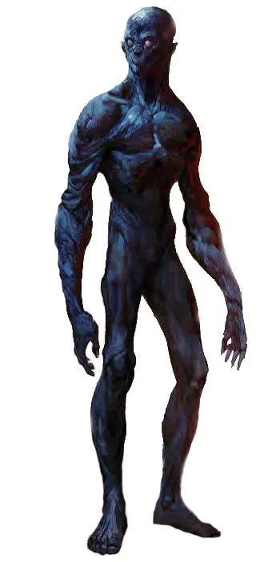

# Duplo

Duplos são metamorfos desleais que assumem a aparência de outros humanoides, escapando de perseguições ou atraindo vítimas para a morte através de enganação e disfarce. Poucas criaturas espalham pavor, suspeita e enganação melhor que os duplos. Encontrados em cada terra e cultura, eles podem assumir a aparência de qualquer indivíduo de qualquer espécie.

***Segredos Roubados***. A forma adotada por um duplo permite que ele se infiltre em praticamente qualquer grupo ou sociedade, mas a transformação dele não inclui os idiomas, maneirismos, memórias ou personalidade. Os duplos muitas vezes seguem ou capturam as criaturas que eles pretendem personificar, estudando-as e sondando suas mentes por segredos. Um duplo pode ler os pensamentos superficiais de uma criatura, permitindo

## Bloco de estatísticas: Duplo

*Monstruosidade Média (metamorfo), neutro*

**Classe de Armadura** 14  
**Pontos de Vida** 52 (8d8 + 16)  
**Deslocamento** 9 m

| FOR | DES | CON | INT | SAB | CAR |
| :---: | :---: | :---: | :---: | :---: | :---: |
| 11 (+0) | 18 (+4) | 14 (+2) | 11 (+0) | 12 (+1) | 14 (+2) |

**Perícias** Enganação +6, Intuição +4  
**Imunidade a Dano** enfeitiçado  
**Sentidos** visão no escuro 18 m, Percepção passiva 11  
**Idiomas** Comum  
**Nível de Desafio** 3 (700 XP)

***Metamorfo***. O duplo pode usar sua ação para se metamorfosear em um humanoide Pequeno ou Médio que ele veja, ou de volta a sua forma verdadeira. Suas estatísticas, além do tamanho, são as mesmas em todas as formas. Qualquer equipamento que ele esteja vestindo ou carregando não é transformado. Ele reverte a sua forma verdadeira se morrer.

***Emboscador***. Na primeira rodada de combate, o duplo tem vantagem nas jogadas de ataque contra qualquer criatura que ele surpreender.

***Ataque Surpresa***. Se o duplo surpreender uma criatura e atingi-la com um ataque durante a primeira rodada de combate, o alvo sofre 10 (3d6) de dano extra nesse ataque.

### Ações

***Ataques Múltiplos***. O duplo realiza dois ataques corpo-a-corpo.

***Pancada***. *Ataque Corpo-a-Corpo com Arma*: +6 para atingir, alcance 1,5 m, um alvo. *Acerto*: 7 (1d6 + 4) de dano de concussão.

***Ler Pensamentos***. O duplo, magicamente, lê os pensamentos superficiais de uma criatura a até 18 metros dele. O efeito pode penetrar barreiras, mas é bloqueada por 30 centímetros de rocha, 2,5 centímetros de metal comum ou uma fina camada de chumbo. Enquanto o alvo estiver ao alcance, o duplo pode continuar a ler seus pensamentos, contanto que a concentração do duplo não seja interrompida (como se estivesse se concentrando em uma magia). Enquanto estiver lendo a mente do alvo, o duplo tem vantagem em testes de Sabedoria (Intuição) e Carisma (Enganação, Intimidação e Persuasão) feitos contra o alvo.

que ele descubra o nome, desejos e medos da criatura, além de algumas memórias dispersas. Um duplo personificando uma criatura especifica como parte de uma conspiração duradoura, mantem seu sósia vivo e sob seu domínio por semanas, sondando a mente da vítima diariamente para aprender como se comportar e falar autenticamente.

***Vigaristas Hedonistas***. Os duplos trabalham sozinhos ou em pequenos grupos, com papeis no grupo mudando de trama em trama. Enquanto um duplo assume o lugar de um mercador ou nobre assassinado, os outros assumem uma série de identidades para assegurar as circunstâncias, atuando como parte da família ou servos enquanto vivem a vida de riquezas da vítima.

***Mutantes***. Os duplos são muito preguiçosos ou egoístas para criar seus filhos. Eles assumem formas masculinas atraentes para seduzir mulheres, deixando-as para criar seus descendentes. Uma criança dupla aparenta ser um membro normal da espécie da mãe, até ele alcançar a adolescência, a partir desse momento ele descobre sua verdadeira natureza e é levado a buscar outros de seu tipo para se juntarem.
