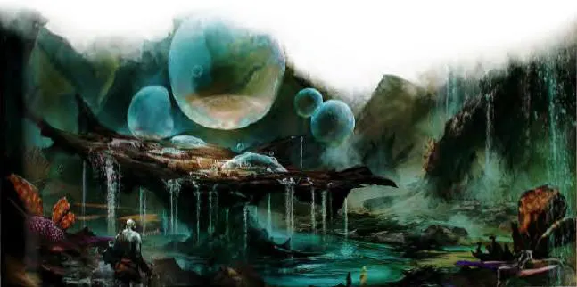
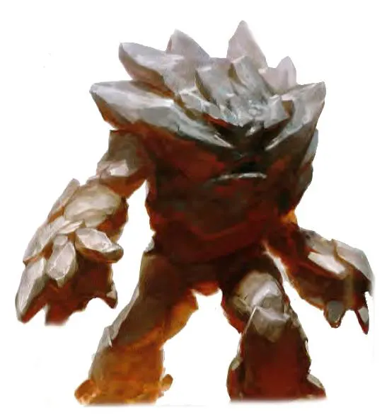
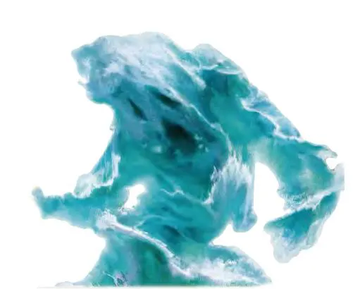
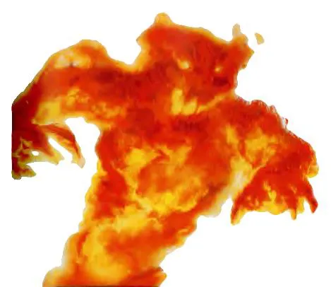

# Elementais

Os elementais são encarnações dos elementos que constituem o multiverso: água, ar, fogo e terra. Embora não sejam mais do que energia animada em seus planos de existência, eles podem ser convocador por conjuradores e seres poderosos para ganhar forma e realizar tarefas.

***Elementos Vivos***. Em seu plano natal, um elemental é uma força vital imaterial. Sua consciência só se manifesta em forma física quando focado pelo poder de magia. Um espírito selvagem de força elemental não possui desejos, exceto seguir o curso do elemento do seu plano nativo. Como as bestas do Plano Material, esses espíritos elementais não possuem sociedade ou cultura e pouca razão de ser.

***Conjurados por Magia***. Certas magias e itens mágicos podem conjurar um elemental, invocando-o dos Planos Interiores para o Plano Material. Os elementais, instintivamente, ficam ressentidos por serem tirados de seus planos nativos e forçados a servir. Uma criatura que invoque um elemental deve exercer sua força de vontade para controla-lo.

***Obrigado e Formado***. Magia poderosa pode vincular um espírito elemental a entrar em um material modelo que define um uso e função específicos. Caçadores invisíveis são elementais do ar vinculados a uma forma específica, assim como os elementais da água podem ser modelados em anomalias da água.

A força da magia e materiais que vinculam um elemental determinam o quão bem o elemental funciona em uma forma vinculada. Golens são espíritos elementais vinculados a formas físicas, porém, matérias mais frágeis como carne e barro não podem vincular poder elemental suficiente. Materiais resistentes como pedra e ferro requerem magia mais forte, consequentemente vinculando um elemental com mais segurança.

***Natureza Elemental***. Um elemental não precisa respirar, comer, beber ou dormir.

### Elemental da Água

Um elemental da água é uma onda coroante que flui pelo chão, tornando-se praticamente invisível quando se desloca através de um corpo de água maior. Ele engolfa as criaturas que se colocarem no seu caminho, enchendo as bocas e pulmões delas tão facilmente quanto apagam chamas.

### Elemental da Terra

Um elemental da terra arrasta-se como se fosse uma colina ambulante, braços similares à clavas de rocha chanfrada balançam aos seus lados. Sua cabeça e corpo consiste de terra e pedra, ocasionalmente com pedaços de metais, gemas e minerais brilhantes.

Os elementais da terra deslizam através de rocha e terra como se fossem líquidos. Criaturas terrestres tem bastante a temer de um elemental da terra, já que o elemental pode localizar a posição precisa de qualquer adversário que esteja em contato com chão sólido em seus arredores.

### Elemental do Ar

Um elemental do ar é uma nuvem afunilada de ar rodopiante com um vago semblante de um rosto. Apesar de gostarem de correr pelo solo, levando poeira e detritos consigo, eles também podem voar e atacar de cima.

Um elemental do ar pode se transformar em um ciclone voraz, criando um vendaval que arrebata as criaturas mesmo ao arremessa-las para longe.

### Elemental do Fogo

Uma forma vagamente humanoide tremula no centro desse incontrolável incêndio ambulante. Um elemental do fogo é uma força de devastação caprichosa. Pra onde quer que se mova, ele ateia fogo ao seu redor, tornando o mundo em cinzas, fumaça e brasas. A água pode parar seu progresso destrutivo, fazendo o elemental do fogo recuar, assobiando e fumaçando em dor e fúria.

## Bloco de estatísticas: Elemental da Água

*Elemental Grande, neutro*

**Classe de Armadura** 14  
**Pontos de Vida** 114 (12d10 + 48)  
**Deslocamento** 9 m, natação 27 m

| FOR | DES | CON | INT | SAB | CAR |
| :---: | :---: | :---: | :---: | :---: | :---: |
| 18 (+4) | 14 (+2) | 18 (+4) | 5 (–3) | 10 (+0) | 8 (–1) |

**Resistência a Dano** ácido; concussão, cortante e perfurante de ataques não-mágicos  
**Imunidade a Dano** veneno  
**Imunidade a Condição** agarrado, caído, envenenado, exausto, impedido, inconsciente, paralisado, petrificado  
**Sentidos** visão no escuro 18 m, Percepção passiva 10  
**Idiomas** Aquan  
**Nível de Desafio** 5 (1.800 XP)

***Forma de Água***. O elemental pode entrar no espaço de uma criatura hostil e ficar parado nele. Ele pode se mover através de um espaço de até 2,5 centímetros de espessura sem se espremer.

***Congelar***. Se o elemental sofrer dano de frio, ele congela parcialmente; seu deslocamento é reduzido em 6 metros até o final do seu próximo turno.

### Ações

***Ataques Múltiplos***. O elemental realiza dois ataques de pancada.

***Pancada***. *Ataque Corpo-a-Corpo com Arma*: +7 para atingir, alcance 1,5 m, um alvo. *Acerto*: 13 (2d8 + 4) de dano concussão.

***Engolfar (Recarrega 4–6)***. Cada criatura no espaço do elemental deve realizar um teste de resistência de Força CD 15. Se falhar, um alvo sofre 13 (2d8 + 4) de dano de concussão. Caso ele seja Grande ou menor, ele também fica agarrado (CD 14 para escapar). Até o agarrão acabar, o alvo fica impedido e incapaz de respirar a não ser que possa respirar na água. Se o teste de resistência for bem sucedido, o alvo é empurrado para fora do espaço do elemental. O elemental pode agarrar uma criatura Grande ou duas Médias ou menores ao mesmo tempo. No início de cada turno do elemental, cada criatura agarrada por ele sofre 13 (2d8 + 4) de dano de concussão. Uma criatura a até 1,5 metro do elemental pode puxar uma criatura ou objeto para fora dele ao usar uma ação para realizar um teste de Força CD 14 bem sucedido.

## Bloco de estatísticas: Elemental da Terra

*Elemental Grande, neutro*

**Classe de Armadura** 17 (armadura natural)  
**Pontos de Vida** 126 (12d10 + 60)  
**Deslocamento** 9 m, escavação 9 m

| FOR | DES | CON | INT | SAB | CAR |
| :---: | :---: | :---: | :---: | :---: | :---: |
| 20 (+5) | 8 (–1) | 20 (+5) | 5 (–3) | 10 (+0) | 5 (–3) |

**Vulnerabilidade a Dano** trovejante  
**Resistência a Dano** concussão, cortante e perfurante de ataques não-mágicos  
**Imunidade a Dano** veneno  
**Imunidade a Condição** agarrado, caído, envenenado, exausto, impedido, inconsciente, paralisado, petrificado  
**Sentidos** visão no escuro 18 m, sentido sísmico 18 m, Percepção passiva 10  
**Idiomas** Terran  
**Nível de Desafio** 5 (1.800 XP)

***Deslizar na Terra***. O elemental pode escavar através de terra e rocha não-mágica bruta. Enquanto faz isso, o elemental não perturba o material pelo qual se move.

***Monstro de Cerco***. O elemental causa o dobro do dano a objetos e estruturas.

### Ações

***Ataques Múltiplos***. O elemental realiza dois ataques de pancada.

***Pancada***. *Ataque Corpo-a-Corpo com Arma*: +8 para atingir, alcance 3 m, um alvo. *Acerto*: 14 (2d8 + 5) de dano concussão.

## Bloco de estatísticas: Elemental do Ar

*Elemental Grande, neutro*

**Classe de Armadura** 15  
**Pontos de Vida** 90 (12d10 + 24)  
**Deslocamento** 0 m, voo 27 m (planar)

| FOR | DES | CON | INT | SAB | CAR |
| :---: | :---: | :---: | :---: | :---: | :---: |
| 14 (+2) | 20 (+5) | 14 (+2) | 6 (–2) | 10 (+0) | 6 (–2) |

**Resistência a Dano** elétrico, trovejante; concussão, cortante e perfurante de ataques não-mágicos  
**Imunidade a Dano** veneno  
**Imunidade a Condição** agarrado, caído, envenenado, exausto, impedido, inconsciente, paralisado, petrificado  
**Sentidos** visão no escuro 18 m, Percepção passiva 10  
**Idiomas** Auran  
**Nível de Desafio** 5 (1.800 XP)

***Forma de Ar***. O elemental pode entrar no espaço de uma criatura hostil e ficar parado nele. Ele pode se mover através de um espaço de até 2,5 centímetros de espessura sem se espremer.

### Ações

***Ataques Múltiplos***. O elemental realiza dois ataques de pancada.

***Pancada***. *Ataque Corpo-a-Corpo com Arma*: +8 para atingir, alcance 1,5 m, um alvo. *Acerto*: 14 (2d8 + 5) de dano concussão.

***Vendaval (Recarrega 4–6)***. Cada criatura no espaço do elemental deve realizar um teste de resistência de Força CD 13. Se falhar, um alvo sofre 15 (3d8 + 2) de dano de concussão e é arremessado a até 6 metros do elemental em uma direção aleatória e cai no chão. Se um alvo arremessado atingir um objeto, como uma parede ou solo, ele sofre 3 (1d6) de dano de concussão para cada 3 metros que ele percorreu. Se o alvo for arremessado em outra criatura, a criatura deve ser bem sucedida num teste de Destreza CD 13 ou sofrerá a mesma quantidade de dano e cairá no chão. Se o teste de resistência for bem sucedido, o alvo sofre metade do dano de concussão e não é arremessado ou fica caído no chão.

## Bloco de estatísticas: Elemental do Fogo

*Elemental Grande, neutro*

**Classe de Armadura** 13  
**Pontos de Vida** 102 (12d10 + 36)  
**Deslocamento** 15 m

| FOR | DES | CON | INT | SAB | CAR |
| :---: | :---: | :---: | :---: | :---: | :---: |
| 10 (+0) | 17 (+3) | 16 (+3) | 6 (–2) | 10 (+0) | 7 (–2) |

**Resistência a Dano** concussão, cortante e perfurante de ataques não-mágicos  
**Imunidade a Dano** fogo, veneno  
**Imunidade a Condição** agarrado, caído, envenenado, exausto, impedido, inconsciente, paralisado, petrificado  
**Sentidos** visão no escuro 18 m, Percepção passiva 10  
**Idiomas** Ignan  
**Nível de Desafio** 5 (1.800 XP)

***Forma de Fogo***. O elemental pode se mover através de um espaço de até 2,5 centímetros de espessura sem se espremer. Uma criatura que toque o elemental ou o atinja com um ataque corpo-a-corpo a até 1,5 metro dele sofre 5 (1d1) de dano de fogo. Além disso, o elemental pode entrar no espaço de uma criatura hostil e ficar parado nele. Da primeira vez que ele entra no espaço de uma criatura em um turno, a criatura sofre 5 (1d10) de dano de fogo e pega fogo; até que alguém use uma ação para extinguir o fogo, a criatura sofre 5 (1d10) de dano de fogo no início de cada um dos turnos dela.

***Iluminação***. O elemental emite luz plena num raio de 9 metros e penumbra a 9 metros adicionais.

***Susceptibilidade à Água***. Para cada 1,5 metro que o elemental se mova na água, ou para cada 4 litros de água jogados nele, ele sofre 1 de dano de frio.

### Ações

***Ataques Múltiplos***. O elemental realiza dois ataques de toque.

***Toque***. *Ataque Corpo-a-Corpo com Arma*: +6 para atingir, alcance 1,5 m, um alvo. *Acerto*: 10 (2d6 + 3) de dano de fogo. Se o alvo for uma criatura ou objeto inflamável, ele se incendeia. Até que uma criatura use uma ação para extinguir o fogo, a criatura sofre 5 (1d10) de dano de fogo no início de cada um dos turnos dela.
