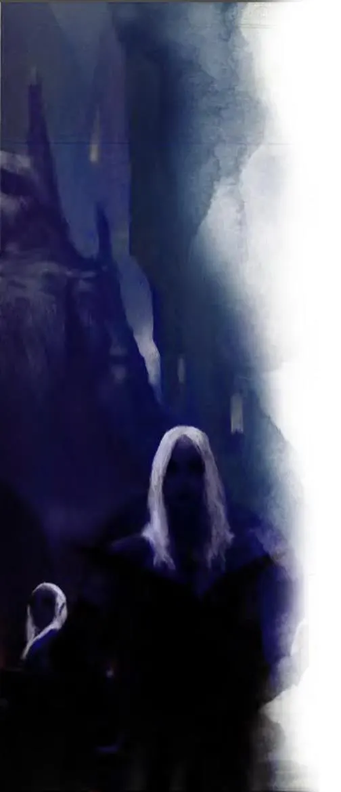
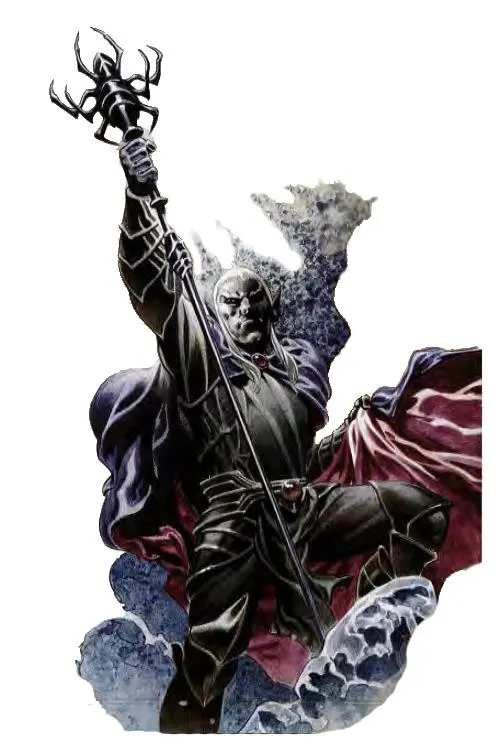

# Elfos: Drow

Dezenas de milhares de anos atrás, os elfos foram divididos, onde os de disposição benevolente lutaram contra os que eram egoístas e cruéis. A guerra entre a espécie élfica terminou quando os elfos bons baniram seus primos malignos para as profundezas subterrâneas. Aqui, nas cavernas escuras e infindáveis caminhos de passagens tortuosas, os elfos negros – drow – encontraram refúgio. Eles também encontraram liderança na única divindade élfica que não os esqueceu. Sob o comando dela, os elfos negros construíram um império no mundo subterrâneo.

***Filhos de Lolth***. Os drow veneram Lolth, uma divindade que reside no Abismo. Conhecida como Rainha Aranha ou Rainha Demoníaca das Aranhas, ela é a figura na qual os elfos negros se basearam para construir suas civilizações subterrâneas. O que quer que ela ordene, os drow fazem.

Os mais perversos dos elfos, os drow raramente são vistos na superfície do mundo. Embora eles conspirem para destruir os elfos que os baniram, os drow não se veem mais como exilados. Eles são os governantes destinados das trevas, e quando Lolth os comandar a se erguerem e destruírem sua espécie que habita a superfície, eles o farão.

***Criaturas das Trevas***. Os drow tem vivido no subsolo por tanto tempo que eles se adaptaram aos seus arredores e podem ver no escuro. No entanto, eles não conseguem mais permanecer sob a luz solar. Quando os escravos estão em falta no Subterrâneo, os drow enviam grupos de captura para a superfície para sequestrar humanoides para dentro da escuridão, trazendo-os de volta às suas cidades para serem torturados até a submissão. Além dessas excursões ocasionais, os drow se contentam em permanecer em seu reino subterrâneo, onde eles se sentem seguros e no controle.

***Cidades do Subterrâneo***. Os elfos negros construíram cidades fantásticas em enormes cavernas onde a comida e água são abundantes. A habilidade deles de esculpir rocha rivaliza a dos maiores artesões anões, apesar das estruturas deles manterem uma estética decididamente élfica. Apesar de parecerem delicados, os assentamentos drow são estruturalmente sólidos e extremamente resistentes. Os drow gostam de escavar enormes estalagmites e estalactites, criando torres habitáveis que se erguem do chão ao teto.

Uma cidade drow é uma metrópole alastrada cercada por altas muralhas. Visitantes não-drow devem conduzir seus negócios fora das muralhas sob olhos vigilantes. Os drow criam e mantem aranhas gigantes para ajudar a proteger suas cidades contra intrusos, mesmo quando elas encobrem a cidade em belas teias, criando laços de seda para prender os inimigos voadores que, de outra forma, sobem pelas muralhas.

***Magia Drow***. Da mesma forma que os drow se adaptaram a vida subterrânea, eles também adaptaram sua magia. Além de usar a magia para esculpir suas cidades na rocha, eles potencializam suas armas, criando novos itens mágicos perigosos e invocando demônios do Abismo. Os drow conjuradores são supremamente arrogantes e nunca hesitam em usar suas magias das formas mais detestáveis.

***Armas e Armaduras***. Os drow constroem armas feitas de Adamante, um metal duro, negro e sobrenatural. Os artesãos drow adornam suas armas e armaduras com filigranas de teias e temas aracnídeos e os arcanos, algumas vezes, imbuem itens com magia para aprimorar a efetividade deles. No entanto, essa magia some quando exposta à luz solar, então, as armas e armaduras mágicas drow raramente mantem seus bônus de aprimoramento e propriedades magicas quando trazidas à superfície.

> **Variação: Armas e Armaduras Mágicas Drow**
>
> Os drow muitas vezes vestem armaduras mágicas e carregam armas mágicas que perdem seus bônus de aprimoramento permanentemente quando expostas a luz solar por 1 hora ou mais. Um **drow** vestindo um *camisão de malha +1* e carregando uma *espada curta +1* tem CA 16 e +1 de bônus nas jogadas de ataque e dano nos ataques com espada curta. Um **drow guerreiro de elite** vestindo uma *armadura de couro* *batido +2* e carregando uma *espada curta +2* tem CA 20 e +2 de bônus nas jogadas de ataque e dano nos ataques com espada curta. Uma **drow sacerdotisa de Lolth** vestindo uma *brunea +3* tem CA 19.

***Políticas Acirradas***. As políticas drow são acirradas e cheias de intriga. Quando os drow trabalham juntos, é tipicamente para destruir adversários em comum e garantir sua própria sobrevivência, e tais alianças tem curta duração e são cheias de perigo.

A sociedade drow é dividida em casas nobres, cada uma governada por uma matriarca que busca aumentar o prestígio e poder de sua casa acima de todas as outras. Outros membros de alto escalão da casa são parentes de sangue, enquanto que as fileiras medianas são formadas por drow de famílias mais fracas que juraram fidelidade à casa maior. Agarrando-se precariamente aos degraus mais baixos da escada social de uma casa estão as casas de escravos, constituídas por drow de linhagem inferior e os ocasionais cativos não-drow.

***Governo Matriarcal***. Lolth, através de suas sacerdotisas fieis, dita as regras da sociedade drow, garantindo que suas ordens e tramas sejam concluídas. Já que Lolth é propensa a se manifestar no Plano Material e punir diretamente aqueles que a desobedecem, os drow aprenderam a ouvir o que ela diz e a fazer o que suas sacerdotisas ordenam.

Na sociedade drow, machos são subservientes às fêmeas. Um drow macho pode liderar uma patrulha no Subterrâneo ou um grupo de captura à superfície, mas ele responde a uma drow fêmea – ou a matrona de sua casa ou a uma das subordinadas dela, escolhida à dedo. Embora os drow machos possam preencher quase todas as funções na sociedade drow, eles não pode ser sacerdotes nem podem governar uma casa.

***Predileção por Venenos***. Destilado de aranhas venenosas e da flora do Subterrâneo, os venenos podem ser encontrados em abundância entre os drow, e ele tem um papel importante na cultura e políticas deles. Arcanos drow desenvolveram uma toxina viscosa que deixa os inimigos inconscientes. Os guerreiros drow cobrem suas lâminas e virotes de besta com esse veneno, ansiosos pelo interrogatório e tortura que virão após o combate.

### Drow Arcano

Drow machos privilegiados que não tem a força e poderio de combate para se tornarem guerreiros não tem outra alternativa que não buscar o estudo de magia. Para eles, é uma questão de sobrevivência. Drow fêmeas com uma afinidade natural para as artes arcanas também podem se tornar arcanas, apesar de serem bem menos comuns.

### Drow Guerreiro de Elite

Os guerreiros de elite drow defendem suas casas e seus superiores contra todos os inimigos, apesar de serem especializados em lutar contra anões, gnomos e elfos (incluindo outros drow). Eles frequentemente assaltam assentamentos na superfície sob o manto na noite, retornando para o Subterrâneo com prisioneiros e despojos rebocados antes de amanhecer.

Guerreiros de elite podem ser machos ou fêmeas.

### Drow Sacerdotisa de Lolth

Drow fêmeas com laços de sangue de uma casa nobre são moldadas e treinadas desde o nascimento a se tornarem sacerdotisas de Lolth. A Rainha Aranha não permite que drow machos mantenham tais posições.

Essas sacerdotisas executam as vontades da Rainha Aranha e, como resultado, elas adquirem poder e influência tremendos na sociedade drow. As mães matronas que governam as casas drow são as sacerdotisas mais poderosas de Lolth, mas elas devem constantemente equilibrar sua devoção à Rainha Aranha com a devoção às suas famílias.

## Bloco de estatísticas: Drow

*Humanoide Médio (elfo), neutro e mau*

**Classe de Armadura** 15 (camisão de malha)  
**Pontos de Vida** 13 (3d8)  
**Deslocamento** 9 m

| FOR | DES | CON | INT | SAB | CAR |
| :---: | :---: | :---: | :---: | :---: | :---: |
| 10 (+0) | 14 (+2) | 10 (+0) | 11 (+0) | 11 (+0) | 12 (+1) |

**Perícias** Furtividade +4, Percepção +2  
**Sentidos** visão no escuro 36 m, Percepção passiva 12  
**Idiomas** Élfico, Subcomum  
**Nível de Desafio** 1/4 (50 XP)

***Ancestralidade Feérica***. O drow possui vantagem em testes de resistência contra ser enfeitiçado e magias não podem colocar um drow para dormir.

***Conjuração Inata***. A habilidade de conjuração de um drow é Carisma (CD de resistência de magia 11). Ele pode conjurar, inatamente, as seguintes magias, sem necessidade de componentes materiais:

À vontade: *globos de luz* 3/dia cada: *escuridão, fogo das fadas*

***Sensibilidade à Luz Solar***. Enquanto estiver sob luz solar, o drow tem desvantagem nas jogadas de ataque, assim como em testes de Sabedoria (Percepção) relacionados a visão.

### Ações

***Ataques Múltiplos***. O drow realiza dois ataques de espada curta.

***Espada Curta***. *Ataque Corpo-a-Corpo com Arma*: +4 para atingir, alcance 1,5 m, um alvo. *Acerto*: 5 (1d6 + 2) de dano perfurante.

***Besta de Mão***. *Ataque à Distância com Arma*: +4 para atingir, distância 9/36 m, um alvo. *Acerto*: 5 (1d6 + 2) de dano perfurante e o alvo deve realizar um teste de resistência de Constituição CD 13 ou ficará envenenado por 1 hora. Se o alvo falhar no teste de resistência por 5 ou mais, ele também ficará inconsciente enquanto estiver envenenado dessa forma. O alvo acorda se sofrer dano ou se outra criatura usar uma ação para sacudi-lo até acordar.

## Bloco de estatísticas: Drow Arcano

*Humanoide Médio (elfo), neutro e mau*

**Classe de Armadura** 12 (15 com *armadura arcana*)  
**Pontos de Vida** 45 (10d8)  
**Deslocamento** 9 m

| FOR | DES | CON | INT | SAB | CAR |
| :---: | :---: | :---: | :---: | :---: | :---: |
| 9 (–1) | 14 (+2) | 10 (+0) | 17 (+3) | 13 (+1) | 12 (+1) |

**Perícias** Arcanismo +6, Enganação +5, Furtividade +5, Percepção +4  
**Sentidos** visão no escuro 36 m, Percepção passiva 12  
**Idiomas** Élfico, Subcomum  
**Nível de Desafio** 7 (2.900 XP)

***Ancestralidade Feérica***. O drow possui vantagem em testes de resistência contra ser enfeitiçado e magias não podem colocar um drow para dormir.

***Conjuração Inata***. A habilidade de conjuração de um drow é Carisma (CD de resistência de magia 12). Ele pode conjurar, inatamente, as seguintes magias, sem necessidade de componentes materiais:

À vontade: *globos de luz* 3/dia cada: *escuridão, fogo das fadas*

***Conjuração***. O drow é um conjurador de 10° nível. Sua habilidade de conjuração é Inteligência (CD de resistência de magia 14, +6 para atingir com ataques com magia). Ele possui as seguintes magias de mago preparadas:

Truques (à vontade): *imagem menor, mãos mágicas, rajada de* *veneno, raio de gelo* 1° nível (4 espaços): *armadura arcana, escudo arcano, mísseis* *mágicos, raio de bruxa* 2° nível (3 espaços): *alterar-se, passo nebuloso, teia* 3° nível (3 espaços): *voo, relâmpago* 4° nível (3 espaços): *invisibilidade maior, tentáculos negros de* *Evard* 5° nível (2 espaços): *névoa mortal*

***Sensibilidade à Luz Solar***. Enquanto estiver sob luz solar, o drow tem desvantagem nas jogadas de ataque, assim como em testes de Sabedoria (Percepção) relacionados a visão.

### Ações

***Cajado***. *Ataque Corpo-a-Corpo com Arma*: +2 para atingir, alcance 1,5 m, um alvo. *Acerto*: 2 (1d6 – 1) de dano de concussão ou 3 (1d8 – 1) de dano de concussão se usado com as duas mãos, mais 3 (1d6) de dano de veneno

***Invocar Demônio (1/Dia)***. O drow, magicamente, invoca um quasit, ou tenta invocar um demônio das sombras com 50 por cento de chance de sucesso. O demônio invocado aparece em um espaço desocupado a até 18 metros do invocador, e não pode invocar outros demônios. Ele permanece por 10 minutos, até o invocador morrer ou até seu invocador dispensa-lo com uma ação.

## Bloco de estatísticas: Drow Guerreiro de Elite

*Humanoide Médio (elfo), neutro e mau*

**Classe de Armadura** 18 (couro batido, escudo)  
**Pontos de Vida** 71 (11d8 + 22)  
**Deslocamento** 9 m

| FOR | DES | CON | INT | SAB | CAR |
| :---: | :---: | :---: | :---: | :---: | :---: |
| 13 (+1) | 18 (+4) | 14 (+2) | 11 (+0) | 13 (+1) | 12 (+1) |

**Testes de Resistência** Des +7, Con +5, Sab +4  
**Perícias** Furtividade +10, Percepção +4  
**Sentidos** visão no escuro 36 m, Percepção passiva 14  
**Idiomas** Élfico, Subcomum  
**Nível de Desafio** 5 (1.800 XP)

***Ancestralidade Feérica***. O drow possui vantagem em testes de resistência contra ser enfeitiçado e magias não podem colocar um drow para dormir.

***Conjuração Inata***. A habilidade de conjuração de um drow é Carisma (CD de resistência de magia 12). Ele pode conjurar, inatamente, as seguintes magias, sem necessidade de componentes materiais:

À vontade: *globos de luz* 3/dia cada: *escuridão, fogo das fadas*

***Sensibilidade à Luz Solar***. Enquanto estiver sob luz solar, o drow tem desvantagem nas jogadas de ataque, assim como em testes de Sabedoria (Percepção) relacionados a visão.

### Ações

***Ataques Múltiplos***. O drow realiza dois ataques de espada curta.

***Espada Curta***. *Ataque Corpo-a-Corpo com Arma*: +7 para atingir, alcance 1,5 m, um alvo. *Acerto*: 7 (1d6 + 4) de dano perfurante e 10 (3d6) de dano de veneno.

***Besta de Mão***. *Ataque à Distância com Arma*: +7 para atingir, distância 9/36 m, um alvo. *Acerto*: 7 (1d6 + 4) de dano perfurante e o alvo deve realizar um teste de resistência de Constituição CD 13 ou ficará envenenado por 1 hora. Se o alvo falhar no teste de resistência por 5 ou mais, ele também ficará inconsciente enquanto estiver envenenado dessa forma. O alvo acorda se sofrer dano ou se outra criatura usar uma ação para sacudi-lo até acordar.

### Reações

***Aparar***. O drow adiciona 3 à sua CA contra um ataque corpo-a-corpo que poderia atingi-lo. Para tanto, o drow deve poder ver o atacante e estar empunhando uma arma corpo-a-corpo.

## Bloco de estatísticas: Drow Sacerdotisa de Lolth

*Humanoide Médio (elfo), neutro e mau*

**Classe de Armadura** 16 (brunea)  
**Pontos de Vida** 71 (13d8 + 13)  
**Deslocamento** 9 m

| FOR | DES | CON | INT | SAB | CAR |
| :---: | :---: | :---: | :---: | :---: | :---: |
| 10 (+0) | 14 (+2) | 12 (+1) | 13 (+1) | 17 (+3) | 18 (+4) |

**Testes de Resistência** Con +4, Sab +6, Car +7  
**Perícias** Furtividade +5, Intuição +6, Percepção +6, Religião +4  
**Sentidos** visão no escuro 36 m, Percepção passiva 16  
**Idiomas** Élfico, Subcomum  
**Nível de Desafio** 8 (3.900 XP)

***Ancestralidade Feérica***. A drow possui vantagem em testes de resistência contra ser enfeitiçado e magias não podem colocar um drow para dormir.

***Conjuração Inata***. A habilidade de conjuração de uma drow é Carisma (CD de resistência de magia 15). Ele pode conjurar, inatamente, as seguintes magias, sem necessidade de componentes materiais:

À vontade: *globos de luz* 3/dia cada: *escuridão, fogo das fadas*

***Conjuração***. A drow é uma conjuradora de 10° nível. Sua habilidade de conjuração é Sabedoria (CD de resistência de magia 14, +6 para atingir com ataques com magia). A drow possui as seguintes magias de clérigo preparadas:

Truques (à vontade): *estabilizar, orientação, rajada de veneno,* *resistência, taumaturgia* 1° nível (4 espaços): *amizade animal, curar ferimentos, detectar* *veneno e doença, raio adoecente* 2° nível (3 espaços): *proteção contra veneno, restauração menor,* *teia* 3° nível (3 espaços): *conjurar animais* (2 aranhas gigantes)*,* *dissipar magia* 4° nível (3 espaços): *adivinhação, movimentação livre* 5° nível (2 espaços): *curar ferimentos em massa, praga de insetos*

***Sensibilidade à Luz Solar***. Enquanto estiver sob luz solar, a drow tem desvantagem nas jogadas de ataque, assim como em testes de Sabedoria (Percepção) relacionados a visão.

### Ações

***Ataques Múltiplos***. A drow realiza dois ataques com açoite.

***Açoite***. *Ataque Corpo-a-Corpo com Arma*: +5 para atingir, alcance 1,5 m, um alvo. *Acerto*: 5 (1d6 + 2) de dano perfurante mais 17 (5d6) de dano de veneno.

***Invocar Demônio (1/Dia)***. A drow, magicamente, invoca uma yochlol com 30 por cento de chance de sucesso. Se a tentativa fracassar, a drow sofre 5 (1d10) de dano psíquico. Do contrário, o demônio invocador aparece em um espaço desocupado a até 18 metros da invocadora, e não pode invocar outros demônios. Ele permanece por 10 minutos, até a invocadora morrer ou até sua invocadora dispensa-lo com uma ação.
