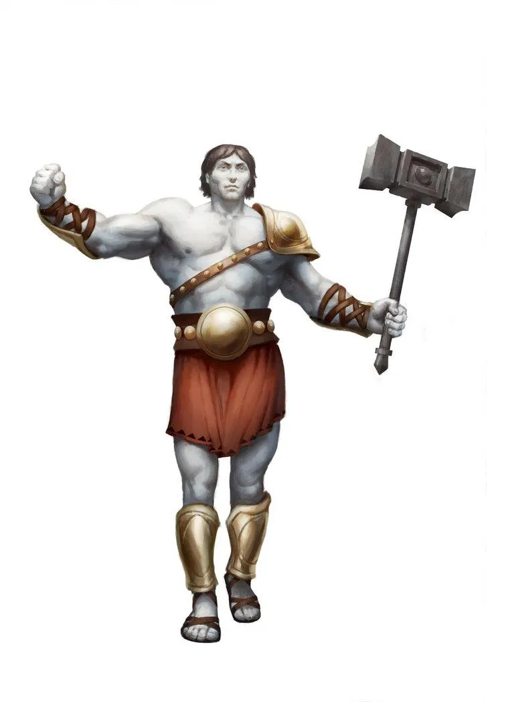

# Empírico

Empíricos são os filhos celestiais dos deuses dos Planos Superiores. Eles são universalmente belos, esculturais e autoconfiantes.

***Manifestação de Emoção***. Um empírico pode experimentar surtos de serenidade ou fúria similar a dos deuses. Ele pode afetar o ambiente a sua volta com seu humor. Quando um empírico está infeliz, as nuvens podem chorar lágrimas de água salgada, as flores silvestres nos prados a sua volta podem murchar, peixes mortos podem surgir nas margens de lagos e rios, ou uma floresta próxima pode perder as folhas de suas árvores. Quando um empírico está eufórico, a luz solar o segue por onde ele vai, pequenos animais brincam dentro de suas pegadas e pássaros preenchem o céu com suas canções agradáveis.

***Empíricos Malignos***. Alguns poucos empíricos foram para o lado do mal após se aventurarem nos Planos Inferiores e serem corrompidos, ou como resultado de serem amaldiçoados por deuses malignos. Um empírico maligno não consegue sobreviver por muito tempo nos Planos Superiores e, geralmente, foge para o Plano Material, onde ele pode governar um reino de mortais como um tirano indômito.

***Titãs Imortais***. Os empíricos não envelhecem, mas podem ser assassinados. Já que poucos empíricos podem conceber a própria morte, eles lutam destemidamente quando entram em uma batalha, recusando-se a crer que o fim está próximo, mesmo quando estão à beira da morte. Quando um empírico morre, seu espírito retorna para o seu plano natal. Lá, um dos parentes do empírico caído ressuscita-o, a não ser que tenha um bom motivo para não fazê-lo.

## Bloco de estatísticas: Empírico

*Celestial Enorme (titã), caótico e bom (75%) ou neutro e mau (25%)*

**Classe de Armadura** 22 (armadura natural)  
**Pontos de Vida** 313 (19d12 + 190)  
**Deslocamento** 15 m, natação 15 m, voo 15 m

| FOR | DES | CON | INT | SAB | CAR |
| :---: | :---: | :---: | :---: | :---: | :---: |
| 30 (+10) | 21 (+5) | 30 (+10) | 21 (+5) | 22 (+6) | 27 (+8) |

**Testes de Resistência** For +17, Int +12, Sab +13, Car +15  
**Perícias** Intuição +13, Persuasão +15  
**Imunidade a Dano** concussão, cortante e perfurante de ataques não-mágicos  
**Sentidos** visão verdadeira 36 m, Percepção passiva 16  
**Idiomas** todos  
**Nível de Desafio** 23 (50.000 XP)

***Arma Mágica***. Os ataques com armas do empírico são mágicos.

***Conjuração Inata***. A habilidade de conjuração de um empírico é Carisma (CD de resistência de magia 23, +15 para atingir com ataques de magia). Ele pode conjurar, inatamente, as seguintes magias, sem necessidade de componentes materiais:

À vontade: *andar na água, passos sem pegadas, respirar na água,* *restauração maior* 1/dia cada: *comunhão, dissipar o mal e bem, tempestade de fogo,* *terremoto, viagem planar* (pessoal apenas)

***Resistência à Magia***. O empírico possui vantagem nos testes de resistência contra magias e outros efeitos mágicos.

***Resistência Lendária (3/Dia)***. Se o empírico falhar em um teste de resistência, ele pode escolher obter sucesso, no lugar.

### Ações

***Marreta***. *Ataque Corpo-a-Corpo com Arma*: +17 para atingir, alcance 3 m, um alvo. *Acerto*: 31 (6d6 + 10) de dano de concussão. Se o alvo for uma criatura, ele deve ser bem sucedido num teste de resistência de Constituição CD 15, ou ficará atordoado até o final do próximo turno do empírico.

***Raio***. *Ataque à Distância com Magia*: +15 para atingir, distância 180 m, um alvo. *Acerto*: 24 (7d6) de dano de um dos seguintes tipos (à escolha do empírico): ácido, elétrico, energia, fogo, frio, radiante ou trovejante.

### Ações Lendárias

O empírico pode realizar 3 ações lendárias, escolhidas dentre as opções abaixo. Apenas uma ação lendária pode ser usada por vez e apenas no final do turno de outra criatura. O empírico recupera as ações lendárias gastas no começo do turno dele.

**Ataque**. O empírico realiza um ataque.  
**Incentivar**. O empírico incentiva todas as criaturas não-hostis a até 36 metros dele até o final do seu próximo turno. Criaturas incentivadas não podem ser amedrontadas ou enfeitiçadas, e elas ganham vantagem em testes de habilidade e testes de resistência até o final do próximo turno do empírico.  
**Ataque de Terremoto (Custa 2 Ações).** O empírico atinge o solo com sua marreta, iniciando um tremor de terra. Todas as outras criaturas no solo a até 18 metros do empírico devem ser bem sucedidas num teste de resistência de Força CD 25 ou cairão no chão.
