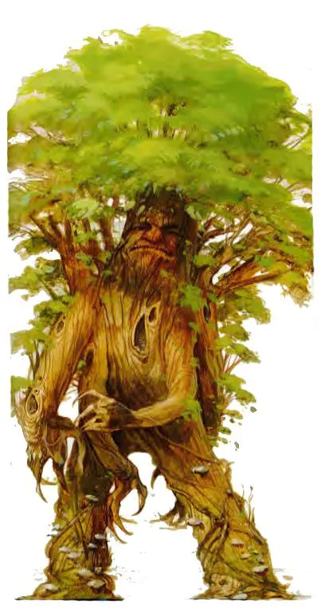

# Ente

Entes são árvores despertas que residem em florestas ancestrais. Apesar das entes preferirem passar os dias, meses e anos em contemplação silenciosa, elas protegerão ferozmente seus domínios florestais contra ameaças externas.

***A Árvore Adormecida Desperta***. Uma árvore destinada a se tornar uma ente medita por um longo ciclo de estações, vivendo normalmente por décadas ou séculos antes de perceber seu potencial. As árvores que despertam para isso, o fazem apenas sob circunstâncias especiais e em locais tocados por magia natural. As entes e poderosos druidas podem sentir quando uma árvore tem a faísca potencial e eles protegem tais árvores em bosques secretos enquanto se aproxima o momento delas

## Bloco de estatísticas: Ente

*Planta Enorme, caótico e bom*

**Classe de Armadura** 16 (armadura natural)  
**Pontos de Vida** 138 (12d12 + 60)  
**Deslocamento** 9 m

| FOR | DES | CON | INT | SAB | CAR |
| :---: | :---: | :---: | :---: | :---: | :---: |
| 23 (+6) | 8 (–1) | 21 (+5) | 12 (+1) | 16 (+3) | 12 (+1) |

**Resistência a Dano** concussão, perfurante  
**Vulnerabilidade a Dano** fogo  
**Sentidos** Percepção passiva 13  
**Idiomas** Comum, Druídico, Élfico, Silvestre  
**Nível de Desafio** 9 (5.000 XP)

***Aparência Falsa***. Enquanto a ente permanecer imóvel, ela é indistinguível de uma árvore comum.

***Monstro de Cerco***. A ente causa o dobro do dano a objetos e estruturas.

### Ações

***Ataques Múltiplos***. A ente realiza dois ataques de pancada.

***Pancada***. *Ataque Corpo-a-Corpo com Arma*: +10 para atingir, alcance 1,5 m, um alvo. *Acerto*: 16 (3d6 + 6) de dano de concussão.

***Animar Árvores (1/Dia)***. A ente, magicamente, anima uma ou duas árvores que ela possa ver, a até 18 metros dela. Essas árvores tem as mesmas estatísticas de uma ente, exceto pelo valor de Inteligência e Carisma que são 1, elas não podem falar e possuem apenas a opção de ataque de pancada. Uma árvore animada age como um aliado da ente. A árvore permanece animada por 1 dia ou até morrer; até a ente morrer ou estar a mais de 36 metros da árvore; ou até a ente usar uma ação bônus para transformar de volta em uma árvore inanimada. A árvore então, se enraíza, se possível.

despertarem. Durante o longo processo de despertar, uma árvore adquire traços similares a um rosto em sua casca, uma divisão do seu tronco inferior em pernas e longos galhos curvam-se para baixo para servir como seus braços. Quando ela está pronta, a árvore liberta suas pernas da terra enraizada e se une a seus companheiros para proteger sua floresta natal.

***Guardiões Lendários***. Após uma ente despertar, ela continua a crescer exatamente como faria se fosse uma árvore. As entes criadas das mais poderosas árvores podem alcançar tamanhos enormes à medida que desenvolvem um poder mágico inato sobre as plantas e animais. Tais entes podem animar plantas, usando-os para prender e aprisionar intrusos. Elas podem convocar criaturas selvagens para ajuda-las ou para carregar mensagem por longas distâncias.

***Protetoras da Natureza***. Mesmo depois de despertar, uma ente gasta a maior parte do seu tempo vivendo como uma árvore. Enquanto está enraizada, uma ente permanece ciente dos seus arredores e pode perceber os efeitos de eventos que aconteçam a quilômetros de distância, baseada em sutis mudanças nas redondezas.

Lenhadores que evitem derrubar árvores sadias e caçadores que levem apenas o que precisem da floresta não irão despertar a irá de uma ente. As criaturas descuidadas com o fogo, aqueles que envenenarem a floresta e aqueles que destruírem grandes árvores, especialmente uma árvore que estava próxima de despertar, enfrentam a fúria da ente.
