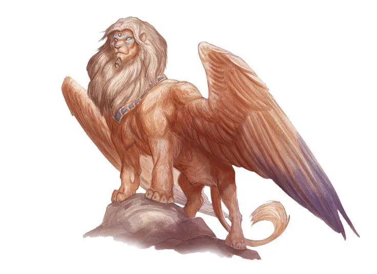
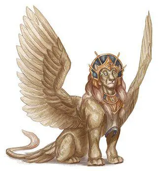

# Esfinges

Em isolação sagrada, uma esfinge guarda os segredos e tesouros dos deuses. Enquanto ela calmamente saúda cada grupo que vem a sua presença, os ossos dos suplicantes e caçadores de missões que fracassam em passar em seus testes jazem espalhados por seu covil. Suas longas asas balançam em seus flancos, seu corpo leonino pardo é ondulado por músculos e possui patas dianteiras poderosas o suficiente para partir um humanoide ao meio.

***Guardiões Divinos***. As esfinges testam o valor daqueles que buscam os tesouros dos deuses, tanto segredos esquecidos ou poderosas magias, quanto artefatos ou portais mágicos. As criaturas que escolhem enfrentar o teste de uma esfinge são vinculadas ao teste até a morte, e apenas os mais valorosos irão sobreviver a ele. Os restantes, a esfinge destrói.

Algumas esfinges são sumo sacerdotes dos deuses que os criaram, mas a maioria são apenas espírito encarnados, trazidos ao reino mortal por orações devotadas ou intervenção direta. Uma esfinge mantem sua vigília incansavelmente, não precisando dormir ou comer. Ela raramente se encontra com outros de sua espécie, não conhecendo outra vida que não a da sua missão sagrada.

***Testes Mágicos***. Os segredos e tesouros que uma esfinge guarda permanecem sob proteção divina, por isso, quando uma criatura falha no teste de uma esfinge, o caminho do objeto ou conhecimento que ela guarda desaparece. Mesmo que a esfinge seja atacada e derrotada, um caçador ainda irá falhar em adquirir o segredo que buscava – e irá ter como inimigo o deus que tinha a esfinge como sua guardiã.

Deuses benignos, às vezes, concedem a uma esfinge o poder de remover suplicantes que falharem nos seus testes, transportando-os para fora e garantindo que eles nunca mais encontre a esfinge novamente. No entanto, aqueles que falharem no teste de uma esfinge, geralmente encontram um fim terrível nas garras dela.

***Seres Extraplanares***. Os mortais que encontram esfinges, o fazem na maioria das vezes em tumbas e ruínas antigas, mas algumas esfinges podem ser acessadas em reinos extraplanares. Uma conversa com uma esfinge que comece entre escombros de muros de pedra pode, repentinamente, mudar para um local estranho, como um jogo de tabuleiro em tamanho real ou um penhasco assustador que deve ser escalado durante uma tempestade atroz. Algumas vezes, uma esfinge pode ser invocada de um espaço extradimensional similar, quando suplicantes a convocam do seu covil vazio. Apenas aqueles que a esfinge considere merecedores ganham acesso a esse reino.

***Esfinges Caídas***. Seja através do cansaço das eras, pelo arrependimento pela matança de inocentes, ou pelos sonhos de veneração de suplicantes que tentam barganhar o caminho para o conhecimento, algumas esfinges se libertam do seu comando divino. No entanto, mesmo que a tendência e lealdade de uma esfinge mude dessa forma, ela nunca deixará o local que ela guarda ou concederá seus segredos a qualquer um, exceto às criaturas que ela considere merecedoras.

### Androesfinge

Um androesfinge possui um cabeça humanoide masculina e o corpo de um leão. Áspero e abatido por fora, ele geralmente inicia uma conversa com insultos ou observações negativas. Por trás dessa rudez exterior, no entanto, um androesfinge possui um coração nobre. Ele não deseja mentir ou enganar, mas ele não concede informações facilmente, escolhendo suas palavras com tanta cuidado quanto guarda seus tesouros.

Um androesfinge testa a coragem e o valor dos suplicantes, não apenas forçando-os a completar missões, mas também com seu terrível rugido, que ecoa por quilômetros enquanto aterroriza e ensurdece as criaturas próximas. Aqueles que passam nos seus testes são recompensados com um *banquete de heróis*.

### Ginoesfinge

Uma ginoesfinge possui uma cabeça de humanoide feminina. Muitas possuem semblantes suntuosos de rainhas do mundo, mas algumas são marcadas por traços leoninos selvagens. Os olhos de uma ginoesfinge veem além do tempo e local presentes e penetra véus de invisibilidade e magia. Os suplicantes que olharem no fundo dos olhos dela podem acabar sendo magicamente deslocados, banidos para um plano longínquo onde um difícil julgamento os aguarda.

As ginoesfinges são bibliotecas virtuais de conhecimento e lendas. Elas fazem charadas e apresentam quebra-cabeças para testar a perspicácia dos suplicantes que chegam para aprender seus segredos. Algumas estão dispostas a barganhar com tais suplicantes por tesouros ou serviços.

### O Covil da Esfinge

Uma esfinge protege um templo, sepulcro ou câmara antigo, na qual estão escondidos segredos e tesouros divinos além do alcance dos mortais.

### Ações de Covil

No valor de iniciativa 20 (quebrando toda a sequência de iniciativa), a esfinge realiza uma ação de covil fazendo um dos efeitos a seguir; a esfinge não pode usar um efeito novamente até terminar um descanso curto ou longo:

- O fluxo do tempo é alterado de tal forma que cada criatura no covil jogue sua iniciativa novamente. A esfinge pode escolher não jogar novamente.
- Os efeitos do tempo são alterados de tal forma que cada criatura no covil deve ser bem sucedida num teste de resistência de Constituição CD 15 ou ficará 1d20 anos mais velha ou mais jovem (à escolha da esfinge), mas nunca mais jovem que 1 ano de idade. Uma magia *restauração maior* pode restaurar a idade normal de uma criatura.
- O fluxo do tempo dentro do covil é alterado de tal forma que tudo dentro do covil move-se dez anos atrás ou adiante (à escolha da esfinge). Apenas a esfinge fica imediatamente ciente da mudança do tempo. Uma magia *desejo* pode trazer o conjurador e até sete outras criaturas designadas pelo conjurador de volta para o seu tempo normal.
- A esfinge envia a si mesma e a até sete outras criaturas em seu covil para outro plano de existência. Enquanto estiver fora de seu covil, a esfinge não poderá usar ações de covil, mas ela pode voltar para seu covil com a ação bônus no seu turno, levando até sete criaturas com ela.

## Bloco de estatísticas: Androesfinge

*Monstruosidade Grande, leal e neutro*

**Classe de Armadura** 17 (armadura natural)  
**Pontos de Vida** 199 (19d10 + 95)  
**Deslocamento** 12 m, voo 18 m

| FOR | DES | CON | INT | SAB | CAR |
| :---: | :---: | :---: | :---: | :---: | :---: |
| 22 (+6) | 10 (+0) | 20 (+5) | 16 (+3) | 18 (+4) | 23 (+6) |

**Testes de Resistência** Des +6, Con +11, Int +9, Sab +10  
**Perícias** Arcanismo +9, Percepção +10, Religião +15  
**Resistência a Dano** psíquico; concussão, cortante e perfurante de ataques não-mágicos  
**Imunidade a Condição** amedrontado, enfeitiçado  
**Sentidos** visão verdadeira 36 m, Percepção passiva 20  
**Idiomas** Comum, Esfíngico  
**Nível de Desafio** 17 (18.000 XP)

***Arma Mágica***. Os ataques com armas da esfinge são mágicos.

***Conjuração***. A esfinge é uma conjuradora de 12° nível. Sua habilidade de conjuração é Sabedoria (CD de resistência de magia 18, +10 para atingir com ataques com magia). Ela não precisa de quaisquer componentes materiais para conjurar suas magias. A esfinge possui as seguintes magias de clérigo preparadas:

Truques (à vontade): *chama sagrada, estabilizar, taumaturgia* 1° nível (4 espaços): *comando, detectar bem e mal, detectar magia* 2° nível (3 espaços): *restauração menor, zona da verdade* 3° nível (3 espaços): *dissipar magia, idiomas* 4° nível (3 espaços): *banimento, movimentação livre* 5° nível (2 espaços): *coluna de chamas, restauração maior* 6° nível (1 espaço): *banquete de heróis*

***Inescrutável***. A esfinge é imune a qualquer efeito que possa sentir suas emoções ou ler seus pensamentos, assim como qualquer magia de adivinhação que ela renegue. Testes de Sabedoria (Intuição) feitos para determinar as intenções ou sinceridade de uma esfinge são feitos com desvantagem.

### Ações

***Ataques Múltiplos***. O esfinge realiza dois ataques com garra.

***Garra***. *Ataque Corpo-a-Corpo com Arma*: +12 para atingir, alcance 1,5 m, um alvo. *Acerto*: 17 (2d10 + 6) de dano cortante.

***Rugido (3/Dia)***. A esfinge emite um rugido mágico. Cada vez que ela rugir antes de terminar um descanso longo, o rugido é mais alto e o efeito é diferente, como detalhado abaixo. Cada criatura a até 150 m da esfinge que seja capaz de ouvir o rugido dela, deve realizar um teste de resistência

***Primeiro Rugido***. Cada criatura que falhar num teste de resistência de Sabedoria CD 18 fica amedrontada por 1 minuto. Uma criatura amedrontada pode repetir o teste de resistência no final de cada um dos turnos dela, terminando o efeito sobre se, caso obtenha sucesso.

***Segundo Rugido***. Cada criatura que falhar num teste de resistência de Sabedoria CD 18 fica surda e amedrontada por 1 minuto. Uma criatura amedrontada fica paralisada e pode repetir o teste de resistência no final de cada um dos turnos dela, terminando o efeito sobre se, caso obtenha sucesso.

***Terceiro Rugido***. Cada criatura realiza num teste de resistência de Constituição CD 18. Se falhar na resistência, uma criatura sofre 44 (8d10) de dano trovejante e é derrubada no chão. Se obtiver sucesso, a criatura sofre metade desse dano e não será derrubada.

### Ações Lendárias

A esfinge pode realizar 3 ações lendárias, escolhidas dentre as opções abaixo. Apenas uma ação lendária pode ser usada por vez e apenas no final do turno de outra criatura. A esfinge recupera as ações lendárias gastas no começo do turno dele.

**Ataque de Garra**. A esfinge realiza um ataque de garra.  
**Teletransporte (Custa 2 Ações)**. A esfinge magicamente se teletransporta, junto com todo o equipamento que esteja vestindo ou carregando, até 36 metros para um local desocupado que ela possa ver.  
**Conjura uma Magia (Custa 3 Ações).** A esfinge conjura uma magia da sua lista de magias preparadas, usando um espaço de magia, como normal.

## Bloco de estatísticas: Ginoesfinge

*Monstruosidade Grande, leal e neutro*

**Classe de Armadura** 17 (armadura natural)  
**Pontos de Vida** 136 (16d10 + 48)  
**Deslocamento** 12 m, voo 18 m

| FOR | DES | CON | INT | SAB | CAR |
| :---: | :---: | :---: | :---: | :---: | :---: |
| 18 (+4) | 15 (+2) | 16 (+3) | 18 (+4) | 18 (+4) | 18 (+4) |

**Perícias** Arcanismo +12, História +12, Percepção +8, Religião +8  
**Resistência a Dano** concussão, cortante e perfurante de ataques não-mágicos  
**Imunidade a Dano** psíquico  
**Imunidade a Condição** amedrontado, enfeitiçado  
**Sentidos** visão verdadeira 36 m, Percepção passiva 18  
**Idiomas** Comum, Esfíngico  
**Nível de Desafio** 11 (7.200 XP)

***Arma Mágica***. Os ataques com armas da esfinge são mágicos.

***Conjuração***. A esfinge é uma conjuradora de 9° nível. Sua habilidade de conjuração é Inteligência (CD de resistência de magia 16, +8 para atingir com ataques com magia). Ela não precisa de quaisquer componentes materiais para conjurar suas magias. A esfinge possui as seguintes magias de mago preparadas:

Truques (à vontade): *ilusão menor, mãos mágicas, prestidigitação* 1° nível (4 espaços): *detectar magia, identificação, escudo arcano* 2° nível (3 espaços): *escuridão, localizar objetos, sugestão* 3° nível (3 espaços): *dissipar magia, idiomas, remover maldição* 4° nível (3 espaços): *banimento, invisibilidade maior* 5° nível (2 espaços): *conhecimento lendário*

***Inescrutável***. A esfinge é imune a qualquer efeito que possa sentir suas emoções ou ler seus pensamentos, assim como qualquer magia de adivinhação que ela renegue. Testes de Sabedoria (Intuição) feitos para determinar as intenções ou sinceridade de uma esfinge são feitos com desvantagem.

### Ações

***Ataques Múltiplos***. O esfinge realiza dois ataques com garra.

***Garra***. *Ataque Corpo-a-Corpo com Arma*: +8 para atingir, alcance 1,5 m, um alvo. *Acerto*: 13 (2d8 + 4) de dano cortante.

### Ações Lendárias

A esfinge pode realizar 3 ações lendárias, escolhidas dentre as opções abaixo. Apenas uma ação lendária pode ser usada por vez e apenas no final do turno de outra criatura. A esfinge recupera as ações lendárias gastas no começo do turno dele.

**Ataque de Garra**. A esfinge realiza um ataque de garra.  
**Teletransporte (Custa 2 Ações)**. A esfinge magicamente se teletransporta, junto com todo o equipamento que esteja vestindo ou carregando, até 36 metros para um local desocupado que ela possa ver.  
**Conjura uma Magia (Custa 3 Ações).** A esfinge conjura uma magia da sua lista de magias preparadas, usando um espaço de magia, como normal.
