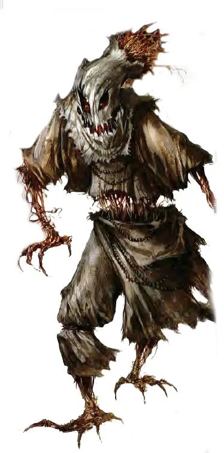

# Espantalho

Na época da colheita, quando a morte revisita o mundo crepuscular e as flores do verão murcham, misteriosos espantalhos tecem uma vigília silenciosa sobre os campos vazios. Com uma paciência imortal, essas sentinelas estoicas mantem seus postos através dos ventos, tormentas e enchentes, vinculados ao comando do seu mestre, ansiosos para aterrorizar suas presas com seu rosto de saco e rasgar vítimas com suas garras afiadas como navalhas.

***Constructos Alimentados por Espíritos***. Um espantalho é animado ao se vincular um espírito de uma criatura maligna assassinada, concedendo a ele propósito e mobilidade. É essa presença misteriosa do além-morte que permite que o espantalho inspire medo naqueles que o observam. As bruxas e feiticeiros muitas vezes vinculam espantalhos a espíritos de demônios, mas qualquer espírito maligno serve. Embora aspectos da personalidade do espírito possam emergir, o espírito de um espantalho não recobra as memórias que tinha quando era uma criatura, e será focado apenas em servir seu criador. Caso o seu criador morra, o espantalho habitando o espantalho pode ou continuar a seguir seus últimos comandos, ou buscar vingança pela morte de seu criador ou destruir a si mesmo.

***Natureza de Constructo***. Um espantalho não precisa respirar, comer, beber ou dormir.

## Bloco de estatísticas: Espantalho

*Constructo Médio, caótico e mau*

**Classe de Armadura** 11  
**Pontos de Vida** 36 (8d8)  
**Deslocamento** 9 m

| FOR | DES | CON | INT | SAB | CAR |
| :---: | :---: | :---: | :---: | :---: | :---: |
| 11 (+0) | 13 (+1) | 11 (+0) | 10 (+0) | 10 (+0) | 13 (+1) |

**Vulnerabilidade a Dano** fogo  
**Resistência a Dano** concussão, cortante e perfurante de ataques não-mágicos  
**Imunidade a Dano** veneno  
**Imunidade a Condição** amedrontado, enfeitiçado, envenenado, exausto, inconsciente, paralisado  
**Sentidos** visão no escuro 18 m, Percepção passiva 10  
**Idiomas** compreende o idioma do seu criador, mas não pode falar  
**Nível de Desafio** 1 (200 XP)

***Aparência Falsa***. Enquanto o espantalho se mantiver imóvel, ele é indistinguível de um espantalho comum e inanimado.

### Ações

***Ataques Múltiplos***. O espantalho realiza dois ataques com garra.

***Garra***. *Ataque Corpo-a-Corpo com Arma*: +3 para atingir, alcance 1,5 m, um alvo. *Acerto*: 6 (2d4 + 1) de dano cortante. Se o alvo for uma criatura, ela deve ser bem sucedida num teste de resistência de Sabedoria CD 11 ou ficará amedrontada até o final do próximo turno do espantalho.

***Olhar Aterrorizante***. O espantalho afeta uma criatura que ele possa ver a até 9 metros dele. Se o alvo puder ver o espantalho, ele deve ser bem sucedido num teste de resistência de Sabedoria CD 11 ou ficará magicamente amedrontado até o final do próximo turno do espantalho. O alvo amedrontado fica paralisado.
