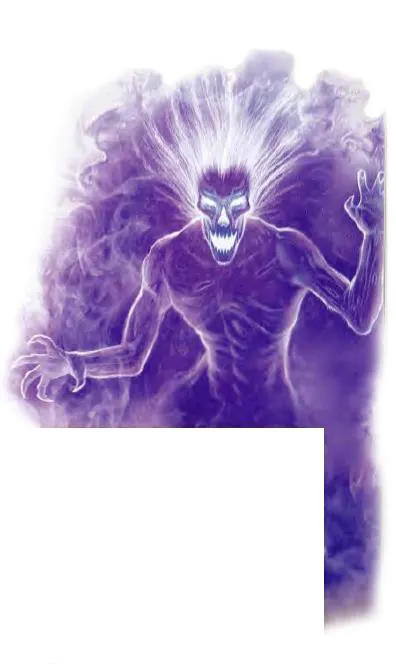

# Espectro

Um espectro é o incontrolável espírito furioso de um humanoide que foi impedido de passar para a vida após a morte. Os espectros não tem mais conexões com quem ou o que eles eram, ainda assim estão condenados a vagar pelo mundo para sempre. Alguns são criados quando magia negra ou o toque de uma aparição ceifa a alma de um corpo vivo.

***Além da Redenção***. Quando o negócio inacabado de um fantasma se completa, ele pode finalmente descansar. Um descanso ou redenção parecido não aguarda um espectro. Ele é condenado ao Plano Material, ele só termina o esquecimento que traz com a destruição de sua alma. Até lá, ele segue em sua vida solitária em locais abandonados, continuando esquecido através das eras no mundo.

***Ódio Imortal***. As criaturas vivas lembram ao espectro que a vida está além do seu alcance. O mero vislumbre dos vivos infligem o espectro com tristeza e ira, que só pode ser amenizadas pela destruição dessas vidas. Um espectro mata rapidamente e sem piedade, apenas por privar outros da vida pode dar a ele um pouco de satisfação. No entanto, independentemente quantas vidas ele extinga, um espectro sempre sucumbirá ao seu ódio e tristeza.

***Habitantes das Trevas***. A luz solar representa uma fonte de vida que nenhum espectro imagina poder apagar, e ela causa-lhes dor. Quando a noite cai, eles deixam os locais do seu descanso final à procura de criaturas vivas para matar, sabendo que poucas armas podem feri-los em retribuição. Aos primeiros raios do amanhecer, eles voltam para a escuridão, onde eles permanecem até a noite cair novamente.

***Natureza Morta-Viva***. Um espectro não precisa respirar, comer, beber ou dormir.

> **Variação: Poltergeist**
>
> Um poltergeist é um tipo diferente de espectro – o confuso espírito invisível de um indivíduo que não tem a menor ideia de como morreu. Um poltergeist expressa sua raiva ao arremessar criaturas e objetos usando o poder de sua psique abalada. Um poltergeist tem nível de desafio 2 (450 XP) e ganha os seguintes traços adicionais:
>
> ***Invisibilidade***. O poltergeist é invisível. O poltergeist tem as seguintes opções de ação no lugar do Drenar Vida do espectro:
>
> ***Pancada Energética***. *Ataque Corpo-a-Corpo com Arma*: +4 para atingir, alcance 1,5 m, um alvo. *Acerto*: 10 (3d6) de dano energia.
>
> ***Impulso Telecinético***. O poltergeist afeta uma criatura ou objeto solto a até 9 metros dele. Uma criatura deve ser Média ou menor para ser afetada por essa mágica e um objeto não pode pesar mais de 75 quilos. Se o alvo for uma criatura, o poltergeist realiza um teste de Carisma resistido por um teste de Força do alvo. Se o poltergeist vencer o teste resistido, ele arremessa o alvo a até 9 metros em qualquer direção, incluindo para cima. Se o alvo entrar em contato com uma superfície sólida ou objeto pesado, ele sofre 1d6 de dano para cada 3 metros movidos. Se o alvo for um objeto que não esteja sendo vestido ou carregado, o poltergeist o arremessa a até 9 metros em qualquer direção. O poltergeist pode usar o objeto como uma arma à distância, atacando uma criatura no caminho do objeto (+4 para atingir) e causando 5 (2d4) de dano de concussão se acertar.

## Bloco de estatísticas: Espectro

*Morto-vivo Médio, caótico e mau*

**Classe de Armadura** 12  
**Pontos de Vida** 22 (5d8)  
**Deslocamento** 0 m, voo 15 m (planar)

| FOR | DES | CON | INT | SAB | CAR |
| :---: | :---: | :---: | :---: | :---: | :---: |
| 1 (–5) | 14 (+2) | 10 (+0) | 10 (+0) | 10 (+0) | 11 (+0) |

**Resistência a Dano** ácido, elétrico, fogo, frio, trovejante; concussão, perfurante e cortante de armas não-mágica  
**Imunidade a Dano** necrótico, veneno  
**Imunidade a Condição** agarrado, caído, enfeitiçado, envenenado, exausto, impedido, inconsciente, paralisado, petrificado  
**Sentidos** visão no escuro 18 m, Percepção passiva 10  
**Idiomas** compreende todos os idiomas que conhecia em vida, mas não pode falar  
**Nível de Desafio** 1 (200 XP)

***Movimento Incorpóreo***. O espectro pode se mover através de criaturas e objetos como se eles fossem terreno difícil. Ele sofre 5 (1d10) de dano de energia se terminar seu turno dentro de um objeto.

***Sensibilidade à Luz Solar***. Enquanto estiver sob luz solar, o espectro tem desvantagem nas jogadas de ataque, assim como em testes de Sabedoria (Percepção) relacionados a visão.

### Ações

***Drenar Vida***. *Ataque Corpo-a-Corpo com Magia*: +4 para atingir, alcance 1,5 m, uma criatura. *Acerto*: 10 (3d6) de dano necrótico. O alvo deve ser bem sucedido num teste de resistência de Constituição CD 10 ou seu máximo de pontos de vida será reduzido em um valor igual ao dano sofrido. Essa redução dura até o alvo terminar um descanso longo. O alvo morre se esse efeito reduzir seu máximo de pontos de vida a 0.
