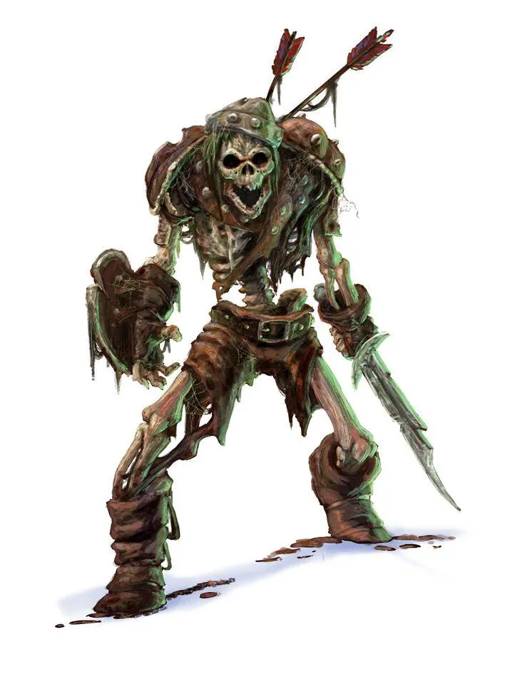
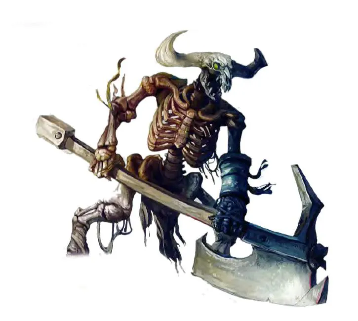

# Esqueletos

Os esqueletos erguem-se quando animados por magia negra. Eles ouvem as invocações dos conjuradores que os convocam de suas tumbas de pedra e antigos campos de batalha, ou erguem-se por si sós por meio de agitações de energia necromântica ou pela presença de mal corruptor.

***Animar Mortos-Vivos***. Seja qual for a força sinistra que despertou um esqueleto, ela infunde seus ossos com vitalidade negra, aderindo junta a junta e remontando membros desmantelados. Essa energia motiva um esqueleto a se mover e pensar de forma rudimentar, embora apenas como uma imitação simples da forma como se comportava em vida. Um esqueleto animado não mantem qualquer conexão com seu passado, apesar de se ressuscitar um esqueleto restaura seu corpo e alma, banindo o ódios espírito morto-vivo que está o controlando.

Enquanto a maioria dos esqueletos são os restos animados de humanos e outros humanoides mortos, esqueletos mortos-vivos podem ser criados a partir dos ossos de qualquer criatura diferente de humanoides, erguendo o hospedeiro em formas únicas aterrorizantes.

***Servos Obedientes***. Esqueletos erguidos através de magia estão vinculados à vontade de seus criadores. Eles seguem as ordens ao pé da letra, nunca questionando as tarefas dadas por seu mestre, independentemente das consequências. Devido a sua interpretação literal dos comandos e da obediência cega, os esqueletos dificilmente se adaptam a mudanças circunstanciais. Eles não podem ler, falar, sentir ou se comunicar de qualquer forma, exceto através de acenos, balançando suas cabeças ou apontando. Mesmo assim, esqueletos são capazes de cumprir uma variedade de tarefas de complexidade relativa.

Um esqueleto pode lutar com armas e vestir armaduras, pode carregar e disparar uma catapulta ou trabuco, escalar uma escada de cerco, formar uma parede de escudos ou derramar óleo fervente. No entanto, ele deve receber instruções cuidadosas explicando como tais tarefas devem ser executadas.

Apesar de não possuírem o intelecto que tinha em vida, os esqueletos não são estúpidos. Antes de quebrar seus membros tentando abrir caminho através de uma porta de ferro, um esqueleto tentará a maçaneta primeiro. Se isso não funcionar, ele buscará outro caminho através ou em volta do obstáculo.

***Comportamentos Habituais***. Esqueletos independentes temporariamente ou permanentemente livres do controle de um mestre, às vezes pantominam ações de suas vidas passadas, seus ossos imitam os hábitos comportamentais de seu eu vivo passado. O esqueleto de um mineiro pode erguer uma picareta e começar a minerar em muros de pedra. O esqueleto de um guarda pode se manter em posição em uma porta aleatória. O esqueleto de um dragão pode se deitar numa pilha de tesouros, enquanto que o esqueleto de um cavalo arranca grama que ele não pode comer. Deixado sozinho em um salão de baile, os esqueletos de nobres podem continuar uma dança inacabada eternamente.

Quando esqueletos encontram criaturas vivas, a energia necromântica que os guia, impele-os a matar, a não ser que eles tenha sido comandados por seus mestres a não fazê-lo. Eles atacam sem misericórdia e lutam até serem destruídos, já que esqueletos possuem pouco senso próprio e ainda menos senso de autopreservação.

***Natureza Morta-Viva***. Um esqueleto não precisa respirar, comer, beber ou dormir.

## Bloco de estatísticas: Esqueleto

*Morto-vivo Médio, leal e mau*

**Classe de Armadura** 13 (restos de armadura)  
**Pontos de Vida** 13 (2d8 + 4)  
**Deslocamento** 9 m

| FOR | DES | CON | INT | SAB | CAR |
| :---: | :---: | :---: | :---: | :---: | :---: |
| 10 (+0) | 14 (+2) | 15 (+2) | 6 (–2) | 8 (–1) | 5 (–3) |

**Vulnerabilidade a Dano** concussão  
**Imunidade a Dano** veneno  
**Imunidade a Condição** envenenado, exausto  
**Sentidos** visão no escuro 18 m, Percepção passiva 9  
**Idiomas** compreende todos os idiomas que conhecia em vida, mas não pode falar  
**Nível de Desafio** 1/4 (50 XP)

### Ações

***Espada Curta***. *Ataque Corpo-a-Corpo com Arma*: +4 para atingir, alcance 1,5 m, um alvo. *Acerto*: 5 (1d6 + 2) de dano perfurante.

***Arco Curto***. *Ataque à Distância com Arma*: +4 para atingir, distância 24/96 m, um alvo. *Acerto*: 5 (1d6 + 2) de dano perfurante.

## Bloco de estatísticas: Esqueleto de Minotauro

*Morto-vivo Grande, leal e mau*

**Classe de Armadura** 12 (armadura natural)  
**Pontos de Vida** 67 (9d10 + 18)  
**Deslocamento** 12 m

| FOR | DES | CON | INT | SAB | CAR |
| :---: | :---: | :---: | :---: | :---: | :---: |
| 18 (+4) | 11 (+0) | 15 (+2) | 6 (–2) | 8 (–1) | 5 (–3) |

**Vulnerabilidade a Dano** concussão  
**Imunidade a Dano** veneno  
**Imunidade a Condição** envenenado, exausto  
**Sentidos** visão no escuro 18 m, Percepção passiva 9  
**Idiomas** compreende todos os idiomas que conhecia em vida, mas não pode falar  
**Nível de Desafio** 2 (450 XP)

***Investida***. Se o esqueleto se mover, pelo menos, 3 metros em linha reta até um alvo e então atingi-lo com um ataque de chifre no mesmo turno, o alvo sofre 9 (2d8) de dano perfurante extra. Se o alvo for uma criatura, ela deve ser bem sucedida num teste de resistência de Força CD 14 ou será empurrado 3 metros e cairá no chão.

### Ações

***Machado Grande***. *Ataque Corpo-a-Corpo com Arma*: +6 para atingir, alcance 1,5 m, um alvo. *Acerto*: 17 (2d12 + 4) de dano cortante.

***Chifre***. *Ataque Corpo-a-Corpo com Arma*: +6 para atingir, alcance 1,5 m, um alvo. *Acerto*: 13 (2d8 + 4) de dano perfurante.

## Bloco de estatísticas: Esqueleto de Cavalo de Guerra

*Morto-vivo Grande, leal e mau*

**Classe de Armadura** 13 (restos de armadura)  
**Pontos de Vida** 22 (3d10 + 6)  
**Deslocamento** 18 m

| FOR | DES | CON | INT | SAB | CAR |
| :---: | :---: | :---: | :---: | :---: | :---: |
| 18 (+4) | 12 (+1) | 15 (+2) | 2 (–4) | 8 (–1) | 5 (–3) |

**Vulnerabilidade a Dano** concussão  
**Imunidade a Dano** veneno  
**Imunidade a Condição** envenenado, exausto  
**Sentidos** visão no escuro 18 m, Percepção passiva 9  
**Idiomas** compreende todos os idiomas que conhecia em vida, mas não pode falar  
**Nível de Desafio** 1/2 (100 XP)

### Ações

***Cascos***. *Ataque Corpo-a-Corpo com Arma*: +6 para atingir, alcance 1,5 m, um alvo. *Acerto*: 11 (2d6 + 4) de dano de concussão.
