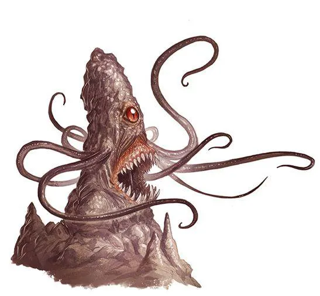

# Estrangulador

Vivendo em cavernas e grutas por todo o Subterrâneo, estranguladores vorazes devoram tudo que eles conseguem pegar e agarrar. Um estrangulador come qualquer criatura, desde bestas do Subterrâneo até aventureiros e seus equipamentos.

Um estrangulador tem a aparência de uma estalagmite ou estalactite, o que muitas vezes permite que eles ataquem de surpresa. A criatura pode se mover lentamente, usando centenas de cílios grudentos sob sua base. Ele escala muros de cavernas e as rochas no teto, encontrando a melhor posição de onde atacar.

Caçadores do Subterrâneo. O estrangulador é uma forma evoluída, adulta de perfurador, que partilha da aparência de rocha e táticas de caça. Um estrangulador pode permanecer parado por horas, fechando seu único olho para se parecer com nada mais que uma formação rochosa mundana. As criaturas que se aproximarem muito serão surpreendidas quando o olho se abrir e gavinhas pegajosas se lançarem para agarra-las. O estrangulador então, faz terríveis sons guturais enquanto se enrola em suas vítimas relutantes, trazendo-as para perto para a mordida fatal de seus dentes pétreos.

Um estrangulador pode digerir qualquer coisa que ele coma, exceto platina, gemas e itens mágicos, os quais podem as vezes ser recuperados da garganta da criatura após sua morte. Os sucos gástricos de um estrangulador também são valiosos, tendo um alto valor para os alquimistas que os utilizam como solventes.

***Gavinhas Enfraquecedoras***. Um estrangulador possui seis protuberâncias ao longo de seu corpo, das quais se estendem gavinhas pegajosas que se aderem a tudo que tocam. Cada gavinha libera farpas finas como cabelo que penetram na carne das criaturas e drenam sua força, então a vítima pode resistir fracamente enquanto o estrangulador a enrola. Se uma gavinha for cortada ou partida, o estrangulador produz uma nova para substitui-la.

## Bloco de estatísticas: Estrangulador

*Monstruosidade Grande, neutro e mau*

**Classe de Armadura** 20 (armadura natural)  
**Pontos de Vida** 93 (11d10 + 33)  
**Deslocamento** 3 m, escalada 3 m

| FOR | DES | CON | INT | SAB | CAR |
| :---: | :---: | :---: | :---: | :---: | :---: |
| 18 (+4) | 8 (–1) | 17 (+3) | 7 (–2) | 16 (+3) | 6 (–2) |

**Perícias** Furtividade +5, Percepção +6  
**Sentidos** visão no escuro 18 m, Percepção passiva 16  
**Idiomas** –  
**Nível de Desafio** 5 (1.800 XP)

***Aparência Falsa***. Enquanto o estrangulador se mantiver imóvel, ele é indistinguível de um formação de caverna comum, como uma estalagmite.

***Gavinhas Aderentes***. O estrangulador pode ter até seis gavinhas ao mesmo tempo. Cada gavinha pode ser atacada (CA 20; 10 pontos de vida; imunidade a dano de veneno e psíquico). Destruir uma gavinha não causa dano ao estrangulador, que pode estender uma substituta para a gavinha no próximo turno dele. Uma gavinha também pode ser partida, se uma criatura usar uma ação e for bem sucedida num teste de Força CD 15 contra ela.

***Escalada Aracnídea***. O estrangulador pode escalar superfícies difíceis, incluindo andar de cabeça para baixo em tetos, sem precisar realizar um teste de habilidade.

### Ações

***Ataques Múltiplos***. O estrangulador realiza quatro ataques com suas gavinhas, usa seu molinete e realiza um ataque com sua mordida.

***Mordida***. *Ataque Corpo-a-Corpo com Arma*: +7 para atingir, alcance 1,5 m, um alvo. *Acerto*: 22 (4d8 + 4) de dano perfurante.

***Gavinha***. *Ataque Corpo-a-Corpo com Arma*: +7 para atingir, alcance 15 m, uma criatura. *Acerto*: o alvo é agarrado (CD 15 para escapar). Enquanto o agarrão durar, o alvo está impedido e tem desvantagem em testes de Força e testes de resistência de Força e o estrangulador não pode usar a mesma gavinha em outro alvo.

***Molinete***. O estrangulador puxa cada criatura agarrada por ele 7,5 metros em sua direção.
