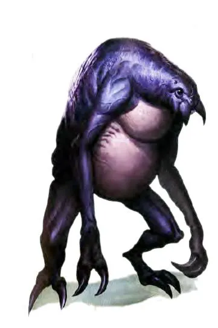

# Ettercap

Os ettercaps são aranhas humanoides que cuidam, alimentam e vigiam aranhas da mesma forma que um pastor faz com um rebanho de ovelhas. Eles vivem nas profundezas de florestas remotas.

Finos fios de seda são secretados de glândulas no abdômen de um ettercap, permitindo que ele lance fios grudentos de teia para prender, aprisionar ou estrangular suas vítimas. Ele também pode usar essas teias para criar armadilhas e redes elaboradas, que geralmente infestam seus covis.

***Assassinos Silenciosos***. Quando viajantes e exploradores aventuram-se no território de um ettercap, ele os embosca. Alguns encontram seu fim vagando cegamente para as armadilhas ou seções de floresta infestadas por teias. Outros, o ettercap estrangula com fios de teia ou envenena com sua mordida peçonhenta.

***Espoliadores Silvestres***. Apesar de viverem em locais selvagens, os ettercaps não desejam viver em harmonia com a natureza. Uma floresta infestada de ettercaps se transforma em um local sombrio, cheio de teias e infestado por aranhas gigantes, insetos gigantes e outros predadores sinistros. As criaturas que vagarem muito adentro de tais florestas, rapidamente se perdem no labirinto de teias que balançam com os ossos e tesouros perdidos das vítimas dos ettercaps.

***Inimigos das Fadas***. Os ettercaps são inimigos naturais das criaturas feéricas. As criaturas detestáveis criam teias para apanhar sprites e pixies, os quais eles devoram avidamente, e irão envolver a árvore de uma dríade por teias em uma tentativa vã de apanhar a dríade. Do contrário, fadas tímidas irão, as vezes, irão se aproximar de forasteiros para pedir ajudar para lidar com uma infestação de ettercaps, já que estão mal equipadas para lidar por si só com as criaturas malévolas.

> **Variação: Garrote de Teia**
>
> Alguns ettercaps gostam de estrangular suas presas usando garrotes feitos de teias. Um ettercap armado dessa forma ganha a seguinte opção de ação, a qual ele usa no lugar de suas garras.
>
> ***Garrote de Teia***. *Ataque Corpo-a-Corpo com Arma*: +4 para atingir, alcance 1,5 m, uma criatura Média ou Pequena contra a qual o ettercap tenha vantagem na jogada de ataque. *Acerto*: 4 (1d4 + 2) de dano de concussão e o alvo está agarrado (CD 12 para escapar). Até essa agarrão terminar, o alvo não consegue respirar e o ettercap tem vantagem nas jogadas de ataque contra ele.

## Bloco de estatísticas: Ettercap

*Monstruosidade Média, neutro e mau*

**Classe de Armadura** 13 (armadura natural)  
**Pontos de Vida** 44 (8d8 + 8)  
**Deslocamento** 9 m, escalada 9 m

| FOR | DES | CON | INT | SAB | CAR |
| :---: | :---: | :---: | :---: | :---: | :---: |
| 14 (+2) | 15 (+2) | 13 (+1) | 7 (–2) | 12 (+1) | 8 (–1) |

**Perícias** Furtividade +4, Percepção +3, Sobrevivência +3  
**Sentidos** visão no escuro 18 m, Percepção passiva 13  
**Idiomas** –  
**Nível de Desafio** 2 (450 XP)

***Andar na Teia***. A yochlol ignora as restrições de movimento causadas por estar enredada.

***Escalada Aracnídea***. O ettercap pode escalar superfícies difíceis, incluindo andar de cabeça para baixo em tetos, sem precisar realizar um teste de habilidade.

***Sentido de Teia***. Enquanto estiver em contato com uma teia, o ettercap sabe a localização exata de qualquer outra criatura em contato com a mesma teia.

### Ações

***Ataques Múltiplos***. O ettercap realiza dois ataques: um com sua mordida e um com suas garras.

***Mordida***. *Ataque Corpo-a-Corpo com Arma*: +4 para atingir, alcance 1,5 m, uma criatura. *Acerto*: 6 (1d8 + 2) de dano perfurante mais 4 (1d8) de dano de veneno. O alvo deve ser bem sucedido em um teste de resistência de Constituição CD 11 ou ficará envenenado por 1 minuto. A criatura pode repetir o teste de resistência no final de cada um dos turnos dela, terminando o efeito sobre si caso obtenha sucesso.

***Garras***. *Ataque Corpo-a-Corpo com Arma*: +4 para atingir, alcance 1,5 m, um alvo. *Acerto*: 7 (2d4 + 2) de dano cortante.

***Teia (Recarrega 5–6)***. *Ataque à Distância com Arma*: +4 para atingir, distância 9/18 m, uma criatura Grande ou menor. *Acerto*: A criatura fica impedida pela teia. Com uma ação, a criatura impedida pode realizar um teste de Força CD 11, escapando da teia se for bem sucedida. O efeito termina se a teia for destruída. A teia tem CA 10, 5 pontos de vida, imunidade a dano psíquico, de veneno e de concussão e vulnerabilidade a dano de fogo.
