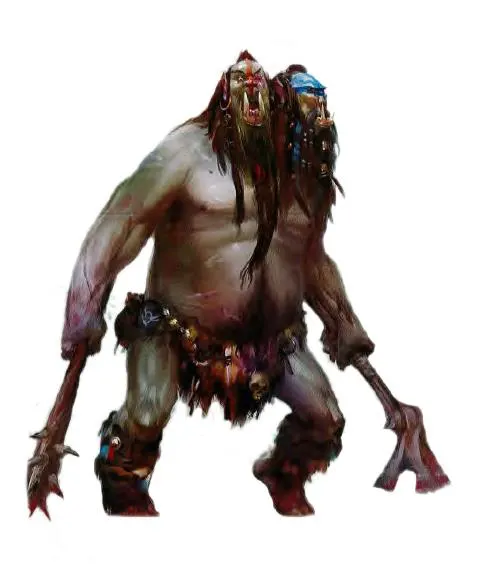

# Ettin

## Bloco de estatísticas: Ettin

*Gigante Grande, caótico e mau*

**Classe de Armadura** 12 (armadura natural)  
**Pontos de Vida** 85 (10d10 + 30)  
**Deslocamento** 12 m

| FOR | DES | CON | INT | SAB | CAR |
| :---: | :---: | :---: | :---: | :---: | :---: |
| 21 (+5) | 8 (–1) | 17 (+3) | 6 (–2) | 10 (+0) | 8 (–1) |

**Perícias** Percepção +4  
**Sentidos** visão no escuro 18 m, Percepção passiva 14  
**Idiomas** Gigante, Orc  
**Nível de Desafio** 4 (1.100 XP)

***Duas Cabeças***. O ettin tem vantagem em testes de Sabedoria (Percepção) e testes de resistência para não ser amedrontado, atordoado, cegado, enfeitiçado, ensurdecido e derrubado inconsciente.

***Vigilante***. Quando uma das cabeças do ettin dorme, a outra está acordada.

### Ações

***Ataques Múltiplos***. O ettin realiza dois ataques: um com seu machado de guerra e um com sua maça estrela.

***Machado de Guerra***. *Ataque Corpo-a-Corpo com Arma*: +7 para atingir, alcance 1,5 m, um alvo. *Acerto*: 14 (2d8 + 5) de dano cortante.

***Maça Estrela***. *Ataque Corpo-a-Corpo com Arma*: +7 para atingir, alcance 1,5 m, um alvo. *Acerto*: 14 (2d8 + 5) de dano perfurante.

Um ettin é um gigante de duas cabeças imundo com as características rudes de um orc. Ele nunca toma banho se isso puder ajuda-lo, e sua pele grossa normalmente está encrustada por uma grossa camada de terra e sujeira debaixo das peles fedorentas que ele veste. Seus longos cabelos pegajosos se embaraçam em seus rostos, e um hálito horrendo parte de bocas cheias de dentes tortos e presas.

***Dupla Personalidade***. As cabeças gêmeas de um ettin são dois indivíduos presos no mesmo corpo brutal. Cada cabeça tem sua própria mentalidade, personalidade e nome, e possui preferências e peculiaridades únicas. Presas desde o nascimento, ambas as mentes raramente experimentam privacidade ou solidão. Essa familiaridade cria desprezo e um ettin maltrata e discuti consigo mesmo constantemente, com suas duas cabeças fazendo ofensas constantes enquanto a outra rebate.

Quando outras criaturas se referem a um ettin, elas combinam seus dois nomes para formar um único nome composto que se aplique a toda a criatura. Caso um ettin tenha uma cabeça chamada Hargle e a outras chamada Vargle, outras criaturas chamarão o ettin de Harglevargle.

***Vidas Solitárias***. Por mais que um ettin discuta consigo mesmo, ele é ainda menos tolerante a outros ettins, já que uma conversa entre dois ettins quase sempre equivale a uma competição de gritos entre uma multidão de quatro cabeças beligerantes. A maioria dos ettins são criaturas solitárias como resultado, tolerando uns aos outros apenas para reprodução.

As cabeças gêmeas de um ettin são sempre do mesmo gênero, combinando com o corpo. As fêmeas são o gênero dominante entre os ettins e elas iniciam os rituais de acasalamento dos ettins. Após encontrar uma toca adequada, a ettin fêmea caça e conquista um macho, que cuida e alimenta-a durante os seis meses de gestação. Quando a criança nasce, o ettin macho é liberado de seu serviço. Quando a criança está velha o suficiente para caçar sozinha, a mãe a manda embora e abandona a toca.

***Duas Cabeças são Melhores que Uma***. Quando está focado em um propósito de benefício mutuo ou unidos contra uma ameaça em comum, um ettin pode resolver suas diferenças de personalidade e dedicar-se totalmente a tarefa. Um ettin luta com uma arma em cada mão, realizando ataques duplos direcionados por suas respectivas cabeças. Quando um ettin dorme, uma de suas cabeças permanece alerta, ganhando seu momento de privacidade e mantendo dois olhos abertos em qualquer criatura que perturbe sua preciosa solidão.

***Laços Orcs***. Em antigos dialetos do idioma Comum, a palavra “ettin” é traduzida como “gigante feio”. Lendas contam sobre orcs que certa vez foram parar em um templo de Demogorgon, e a mágica nele os transformou em escárnios gigantes do Príncipe dos Demônio de duas cabeças. Levadas à beira da loucura, essas criaturas espalharam-se pelas terras selvagens, tornando-se os primeiros ettins.

Qualquer que seja a verdade sobre a origem dos ettins, os orcs tratam-nos como primos distantes, e tribos orcs geralmente aliciam ettins para servirem como guardas, batedores e saqueadores. Um ettin não é particularmente leal aos seus domadores orcs, mas os orcs podem ganha-los com a promessa de comida e espólios.
