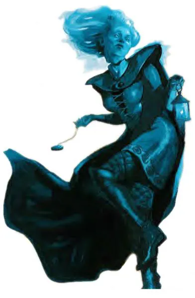

# Fantasma

Um fantasma é a alma de uma criatura que já foi viva, obrigada a assombrar um local, criatura ou objeto especifico que era significante em sua vida.

***Negócios Inacabados***. Um fantasma anseia por completar alguma tarefa não resolvida da sua vida. Ele pode buscar vingar a sua própria morte, cumprir um juramento ou transmitir uma mensagem para a pessoa amada. Um fantasma pode não perceber que está morto e continuar a rotina diária de sua vida. Outros são impelidos por maldade ou rancor, como um fantasma que se recusa a descansar até que cada membro de uma certa família ou organização esteja morto.

O caminho certo para livrar uma área de um fantasma é resolver seu negócio inacabado. Um fantasma pode ser destruído com mais facilidade invocando uma fraqueza ligada à sua vida anterior. O fantasma de uma pessoa torturada até a morte pode ser morto novamente com o implemento dessa tortura. O fantasma de um jardineiro pode se tornar vulnerável quanto exposto a uma forte fragrância floral.

***Manifestações Fantasmagóricas***. Sensações de profunda tristeza, solidão e saudade emanam dos locais onde as assombrações fantasmagóricas ocorrem. Sons estranhos ou um silêncio sobrenatural criam uma atmosfera inquietante. Pontos frios dentro de quartos aquecidos por chamas. Um fedor asfixiante pode se infiltrar na área, objetos inanimados podem se mover por vontade própria e cadáveres podem erguer-se de suas covas. O fantasma não tem controle sobre essas manifestações; elas simplesmente ocorrem.

***Natureza Morta-Viva***. Um fantasma não precisa respirar, comer, beber ou dormir.

## Bloco de estatísticas: Fantasma

*Morto-vivo Médio, qualquer tendência*

**Classe de Armadura** 11  
**Pontos de Vida** 45 (10d8)  
**Deslocamento** 0 m, voo 12 m (planar)

| FOR | DES | CON | INT | SAB | CAR |
| :---: | :---: | :---: | :---: | :---: | :---: |
| 7 (–2) | 13 (+1) | 10 (+0) | 10 (+0) | 12 (+1) | 17 (+3) |

**Resistência a Dano** ácido, elétrico, fogo, trovejante; concussão, perfurante e cortante de armas não-mágica  
**Imunidade a Dano** frio, necrótico, veneno  
**Imunidade a Condição** agarrado, caído, enfeitiçado, envenenado, exausto, impedido, inconsciente, paralisado, petrificado  
**Sentidos** visão no escuro 18 m, Percepção passiva 11  
**Idiomas** todos os idiomas que conhecia em vida  
**Nível de Desafio** 4 (1.100 XP)

***Movimento Incorpóreo***. O fantasma pode se mover através de criaturas e objetos como se eles fossem terreno difícil. Ele sofre 5 (1d10) de dano de energia se terminar seu turno dentro de um objeto.

***Visão Etérea***. O fantasma pode ver a até 18 metros no Plano Etéreo quando está no Plano Material, e vice-versa.

### Ações

***Toque Degradante***. *Ataque Corpo-a-Corpo com Magia*: +5 para atingir, alcance 1,5 m, um alvo. *Acerto*: 17 (4d6 + 3) de dano necrótico.

***Forma Etérea***. O fantasma pode acessar o Plano Etéreo do Plano Material, ou vice-versa. Ele é invisível no Plano Material enquanto estiver na Fronteira Etérea, e vice-versa, além de não poder afetar ou ser afetado por nada no outro plano.

***Aspecto Horripilante***. Cada criatura não morta-viva a até 18 metros do fantasma que puder vê-la, deve ser bem sucedida num teste de resistência de Sabedoria CD 13 ou ficará amedrontada por 1 minuto. Se o teste de resistência falhar por 5 ou mais, o alvo também envelhece 1d4 x 10 anos. Um alvo amedrontado pode repetir o teste de resistência no final de cada um dos seus turnos, terminando o efeito sobre si, se obtiver sucesso. Se o alvo for bem sucedido no teste, ou o se o efeito terminar nele, ele fica imune ao Aspecto Horripilante do fantasma pelas próximas 24 horas. O efeito de envelhecimento pode ser revertido pela magia *restauração maior*, mas apenas nas primeiras 24 horas do ocorrido.

***Possessão (Recarrega 6)***. Um humanoide que o fantasma possa ver a até 1,5 metro dele, deve ser bem sucedido num teste de resistência de Carisma CD 13 ou será possuído pelo fantasma; o fantasma então, desaparece, e o alvo é incapacitado e perde controle sobre seu corpo. O fantasma agora controla o corpo, mas não priva o alvo de sua consciência. O fantasma não pode ser alvo de qualquer ataque, magia ou outro efeito, exceto um que expulse mortos-vivos, e ele mantem sua tendência, Inteligência, Sabedoria, Carisma e imunidade a ser amedrontado e enfeitiçado. No mais, usa as estatísticas do alvo possuído, mas não ganha acesso aos conhecimentos, características de classe ou proficiências do alvo. A possessão dura até o corpo cair a 0 pontos de vida, o fantasma termina-la com uma ação bônus ou ele ser expulso ou forçado a sair por um efeito como da magia *dissipar o bem e* *mal*. Quando a possessão acabar, o fantasma reaparecerá num espaço desocupado a 1,5 metro do corpo. O alvo é imune a Possessão do fantasma pelas próximas 24 horas após ser bem sucedido no teste de resistência ou após a possessão acabar.
