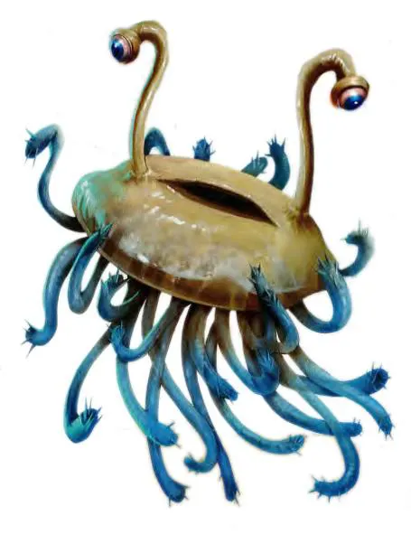

# Flumph

Os misteriosos flumphs vagam pelo Subterrâneo, impulsionados pelo ar pelos jatos cujo som lhes deu seu nome. Um flumph brilha levemente, refletindo seu humor pela sua cor. Rosa claro significa feliz, azul escuro é tristeza, verde expressa curiosidade e carmesim é raiva.

***Inteligentes e Sábios***. Os flumphs se comunicam telepaticamente. Apesar de se parecerem com águas-vivas, os flumphs são seres racionais de grande inteligência e sabedoria, possuindo conhecimentos avançados de religião, filosofia, matemática e incontáveis outros assuntos.

Os flumphs são sensíveis aos estados emocionais das criaturas próximas. Se os pensamentos de uma criatura sugerirem bondade, ele seguirá a criatura. Quando encontrar criaturas que exalem maldade, o flumph fugirá.

***Sifões Psiônicos***. Os flumphs se alimentam da energia mental de criaturas psiônicas através de sifões, e eles podem ser encontrados espreitando próximo de comunidades de devoradores de mentes, aboletes, githyanki e githzerai. Como parasitas passivos, eles pegam apenas a energia mental que precisam, e a maioria das criaturas não sentem qualquer perda ou desconforto de tal alimentação.

Consumir energia psiônica revela os pensamentos e emoções das criaturas das quais os flumphs se alimentam. Já que tantas dessas criaturas são malignas, os flumphs são expostos a pensamentos, emoções e anseios que adoecem sua natureza pura. Quando os flumphs encontram aventureiros de coração bom, eles avidamente compartilhas os segredos obscuros que aprenderam na esperança de se livrar da sua fonte de energia maligna, mesmo que fazer isso signifique que precisarão buscar novas fontes de nutrição.

***Sociedade Flumph***. Os flumphs vivem em grupos complexos e organizados chamados claustros, nos quais cada flumph tem um lugar e propósito. Esses grupos harmoniosos não precisam de líderes, já que todos os flumphs contribuem do jeito que podem.

## Bloco de estatísticas: Flumph

*Aberração Pequena, leal e bom*

**Classe de Armadura** 12  
**Pontos de Vida** 7 (2d6)  
**Deslocamento** 1,5 m, voo 9 m

| FOR | DES | CON | INT | SAB | CAR |
| :---: | :---: | :---: | :---: | :---: | :---: |
| 6 (–2) | 15 (+2) | 10 (+0) | 14 (+2) | 14 (+2) | 11 (+0) |

**Perícias** Arcanismo +4, História +4, Religião +4  
**Vulnerabilidade a Dano** psíquico  
**Sentidos** visão no escuro 18 m, Percepção passiva 12  
**Idiomas** compreende Subcomum mas não pode falar, telepatia 18 m  
**Nível de Desafio** 1/8 (25 XP)

***Deficiência Caído***. Se o flumph for derrubado, role um dado. Se o resultado for ímpar, o flumph cai de cabeça para baixo e fica incapacitado. No final de cada um dos seus turnos, o flumph pode realizar um teste de resistência de Destreza CD 10, se desvirando e terminando a condição de incapacitado, caso obtenha sucesso.

***Manto Telepático***. O flumph é imune a qualquer efeito que possa sentir suas emoções ou ler seus pensamentos, assim como magias de adivinhação.

***Telepatia Avançada***. O flumph pode perceber o conteúdo de qualquer comunicação telepática usada a até 18 metros dele, e ele não pode ser surpreendido por criaturas que tenham qualquer forma de telepatia.

### Ações

***Gavinhas***. *Ataque Corpo-a-Corpo com Arma*: +4 para atingir, alcance 1,5 m, uma criatura. *Acerto*: 4 (1d4 + 2) de dano perfurante mais 2 (1d4) de dano de ácido. No final de cada um dos seus turnos, o alvo deve ser bem sucedido num teste de resistência de Constituição CD 10, sofrendo 2 (1d4) de dano de ácido se fracassar ou terminando o ácido recorrente se obtiver sucesso. Uma magia *restauração menor* conjurada no alvo também termina o dano de ácido recorrente.

***Rajada Fedorenta (1/Dia)***. Cada criatura num cone de 4,5 metros originado do flumph, deve ser bem sucedida num teste de resistência de Destreza CD 10 ou será coberta por um líquido mal cheiroso. Uma criatura coberta exala um fedor terrível por 1d4 horas. Ela fica envenenada enquanto o fedor durar e outras criaturas ficam envenenadas enquanto estiverem a 1,5 metro da criatura coberta. Uma criatura pode remover o fedor sobre si usando um descanso curto para se banhar em água, álcool ou vinagre.
