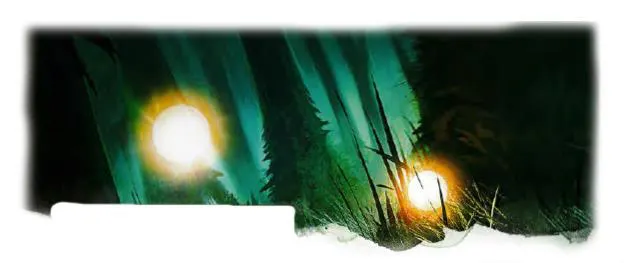

# Fogo-Fátuo

## Bloco de estatísticas: Fogo-Fátuo

*Morto-vivo Miúdo, caótico e mau*

**Classe de Armadura** 19  
**Pontos de Vida** 22 (9d4)  
**Deslocamento** 0 m, voo 15 m (planar)

| FOR | DES | CON | INT | SAB | CAR |
| :---: | :---: | :---: | :---: | :---: | :---: |
| 1 (–5) | 28 (+9) | 10 (+0) | 13 (+1) | 14 (+2) | 11 (+0) |

**Imunidade a Dano** elétrico, veneno  
**Resistência a Dano** ácido, fogo, frio, necrótico, trovejante; concussão, perfurante e cortante de ataques não-mágicos  
**Imunidade a Condição** agarrado, caído, envenenado, exausto, impedido, inconsciente, paralisado  
**Sentidos** visão no escuro 36 m, Percepção passiva 12  
**Idiomas** os idiomas que ele conhecia em vida  
**Nível de Desafio** 2 (450 XP)

***Consumir Vida***. Com uma ação bônus, o fogo-fátuo pode afetar uma criatura que ele possa ver, a até 1,5 metro dele, que esteja com 0 pontos e vida, mas ainda viva. O alvo deve ser bem sucedido num teste de resistência de Constituição CD 10 contra essa magia, ou morrerá. Se o alvo morrer, o fogo-fátuo recupera 10 (3d6) pontos de vida.

***Efêmero***. O fogo-fátuo não pode carregar ou vestir nada.

***Iluminação Variável***. O fogo-fátuo emite luz brilhante num raio entre 1,5 e 6 metros e penumbra em uma quantidade de metros adicionais igual ao raio escolhido. O fogo-fátuo pode alterar o raio com uma ação bônus.

***Movimento Incorpóreo***. O fogo-fátuo pode se mover através de criaturas e objetos como se eles fossem terreno difícil. Ela sofre 5 (1d10) de dano de energia se terminar seu turno dentro de um objeto.

### Ações

***Choque***. *Ataque Corpo-a-Corpo com Arma*: +3 para atingir, alcance 1,5 m, um alvo. *Acerto*: 5 (1d6 + 2) de dano perfurante.

***Invisibilidade***. O fogo-fátuo e sua luz, magicamente se tornam invisíveis até ele atacar ou usar seu Consumir Vida, ou até a concentração acabar (como se estivesse se concentrando em uma magia).

Os fogos-fátuos são pequenas bolas de luz malévolas que assombram locais solitários e campos de batalha, vinculados por destino obscuro ou magia negra para se alimentar de medo e desespero.

***Esperança e Danação***. Os fogos-fátuos se parecem com luzes de lanternas sacudindo-se à distância, apesar de poderem escolher alterar suas cores ou apagarem completamente. Quando eles ativam suas luzes, os fogos-fátuos oferecem esperança, para as criaturas a procura de segurança que os seguem.

Os fogos-fátuos atraem criaturas desatentas para poços de areia movediça, covis de monstros e outros locais perigosos para que possam se alimentar do sofrimento de suas presas e deleitar-se com seus gritos mortais. Um ser maligno que seja alvo de um fogo-fátuo pode acabar se tornando um fogo também, seu espírito miserável coalesce acima do seu corpo sem vida como uma chama bruxuleante.

***Consumidos pelo Desespero***. Os fogos-fátuos são as almas de seres malignos que pereceram em agonia ou miséria enquanto vagavam por terras abandonadas permeadas por magia poderosa. Eles se desenvolvem em pântanos alagados e campos de batalha cheios de ossos onde o peso opressor da tristeza é ainda mais pesado que o denso nevoeiro e neblina. Presos nesses locais desolados de esperança e memórias perdidas, os fogos-fátuos atraem outras criaturas para destinos sinistros e se alimentam de sua miséria.

Agentes do Mal. Os fogos-fátuos raramente falam, mas quando o fazem, suas vozes parecem com sussurros suaves ou distantes. Nos domínios miseráveis assombrados por eles, os fogos-fátuos apavoram as vizinhanças. Bruxas, oni, dragões negros e cultistas malignos trabalham com os fogos-fátuos para trazer criaturas para emboscadas. Enquanto seus aliados malignos cercam e chacinam as criaturas, os fogos-fátuos flutuam sobre eles, bebendo da agonia do último suspiro e saboreando a sensação enquanto a luz da vida se esvai dos olhos da criatura.

***Natureza Morta-Viva***. Um fogo-fátuo não precisa respirar, comer, beber ou dormir.
