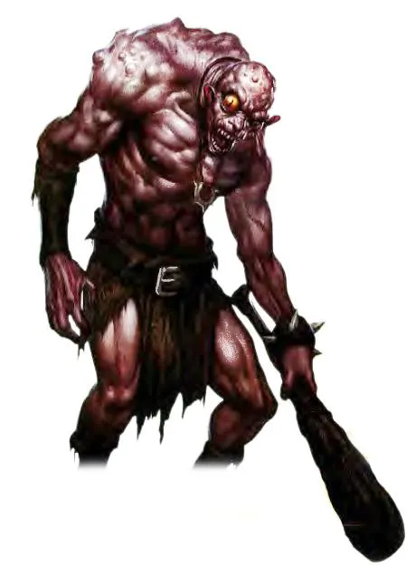

# Fomori

## Bloco de estatísticas: Fomori

*Gigante Enorme, caótico e mau*

**Classe de Armadura** 14 (armadura natural)  
**Pontos de Vida** 149 (13d12 + 65)  
**Deslocamento** 9 m

| FOR | DES | CON | INT | SAB | CAR |
| :---: | :---: | :---: | :---: | :---: | :---: |
| 23 (+6) | 10 (+0) | 20 (+5) | 9 (–1) | 14 (+2) | 6 (–2) |

**Perícias** Furtividade +3, Percepção +8  
**Sentidos** visão no escuro 18 m, Percepção passiva 18  
**Idiomas** Gigante, Subcomum  
**Nível de Desafio** 8 (3.900 XP)

### Ações

***Ataques Múltiplos***. O fomori realiza dois ataques com sua clava grande ou realiza uma ataque com sua clava grande e usa seu Olho Mal uma vez.

***Clava Grande***. *Ataque Corpo-a-Corpo com Arma*: +9 para atingir, alcance 4,5 m, um alvo. *Acerto*: 19 (3d8 + 6) de dano de concussão.

***Olho Mal***. O fomori magicamente força uma criatura que ele possa ver, a até 18 metros dele, a realizar um teste de resistência de Carisma CD 14. A criatura sofre 27 (6d8) de dano psíquico se falhar na resistência ou metade desse dano, caso obtenha sucesso.

***Maldição do Olho Mal (Recarrega após um Descanso Curto ou***

***Longo)***. Com uma olhada, o fomori usa seu Olho Mal, mas com um fracasso na resistência, a criatura também é amaldiçoada com deformidades mágicas. Enquanto estiver deformada, a criatura tem seu deslocamento reduzido à metade e tem desvantagem em testes de habilidade, testes de resistência e jogadas de ataque baseadas em Força ou Destreza. A criatura transformada pode repetir o teste de resistência sempre que terminar um descanso longo, terminando o efeito com um sucesso.

Os mais hediondos e perversos de toda a espécie gigante são os ímpios fomoris, cujos corpos deformados refletem suas condutas vis. Alguns tem traços faciais distribuídos aleatoriamente ao redor de suas enrugadas cabeças deformadas. Outros possuem membros de tamanhos e formatos desproporcionais ou emitem terríveis urros a cada vez que respiram através de suas bocas deformadas. A aparência horrenda deles raramente evoca simpatia, no entanto, foram os próprios fomoris que selaram seu destino através do mal que permeia seus corações e mentes.

***Maldição das Fadas***. Os elfos lembram-se de quando os fomoris estavam entre as raças mais belas, possuindo mentes brilhantes e habilidades mágicas incomparáveis. Sua perfeição física não se estendeu aos seus corações, no entanto, enquanto o desejo por mágica e poder os consumia.

Os fomoris decidiram conquistar Faéria e escravizar seus habitantes, reivindicando a magia dessas criaturas para si próprios. Quando as fadas se uniram para defender seu reino, os fomoris lutaram contra elas e foram alvo de uma terrível maldição.

Um por um, os gigantes caíram enquanto seus corpos eram distorcidos para refletir seus corações malignos. Privados de sua graça e poderes mágicos, os horrores infelizes fugiram da luz, mergulhando nas profundezas do mundo para nutrir seu ódio. Com seus destinos amaldiçoados, eles tramam todo o tempo contra as fadas que os injustiçaram.

***Gigantes do Subterrâneo***. Os fomoris vivem em cavernas assustadoramente belas no Subterrâneo, raramente se aventurando na superfície. Seus covis tem fontes abundantes de água, peixes e florestas de cogumelos, assim como os trabalhadores escravizados que mantem os fomoris alimentados. Maldade e depravação são os pilares da sociedade fomori, na qual o gigante mais forte e cruel comanda. Os fomoris marcam seus territórios com os corpos de seus inimigos, pintando os muros de suas cavernas com o sangue e costurando membros e partes de corpos juntos para escarniar as criaturas que eles mataram.

***Carne Arruinada, Mentes Malignas***. As deformidades acometidas aos fomoris os impede de arremessar rochas como os outros gigantes, ou de vestir qualquer coisa além de pedaços de pano. No entanto, a posição grotesca de seus olhos, narizes e orelhas dão aos fomoris habilidades perceptivas apuradas, tornando-os difíceis de surpreender ou emboscar.

A ganância e maldade dos fomoris reside no coração de sua degeneração e queda, e continua a afligi-los. Os fomoris fazem alianças com outras criaturas quando é conveniente, mas eles são desleais por natureza e traem seus aliados por capricho.

***Maldição do Olho Mal***. Os fomoris podem passar sua maldição para outros usando o poder chamado olho mal – o último vestígio da habilidade de conjuração excepcional dos gigantes que eles foram. Uma criatura amaldiçoada pelo olho mal de um fomori é magicamente retorcida e deformada, adquirindo um vislumbre da dor e malícia que consumiu essa raça maligna.
