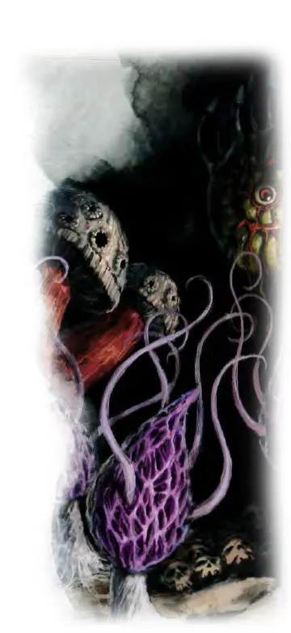

# Fungos

No céu de pedra chanfrada e noite perpétua, o Subterrâneo é o lar de todos os tipos de fungos. Tomando o lugar das plantas no reino subterrâneo, os fungos são vitais para a sobrevivência de muitas espécies subterrâneas, provendo nutrientes e abrigo na imperdoável escuridão.

Os fungos nascem em matéria orgânica, então rompendo essa matéria e consumindo-a, alimentando-se de imundície e cadáveres. Conforme amadurecem, os fungos expelem esporos que se espalham com a mais leve brisa para originar novos fungos.

Não precisando de luz solar ou calor para crescer, os fungos prosperam em cada canto e fenda do Subterrâneo. Transformados pela magia que permeia o reino abaixo da terra, fungos do Subterrâneo geralmente desenvolvem potentes mecanismos e defesa ou habilidades de mimetismo e ataque. As espécimes maiores podem se espalhar para criar vastas florestas subterrâneas onde incontáveis criaturas vivem e se alimentam.

### Esporo de Gás

Os primeiros esporos de gás dizem ter sido originados de observadores mortos, cujas corpos volumosos alimentaram um fungo parasítico com magia aberrante. Tendo a muito se adaptado em uma criatura planta única, um esporo de gás cresce rápida e propositadamente para fora de qualquer cadáver, criando uma coisa de aparência malévola similar à do habitante mais temido do Subterrâneo.

***Forma de Olho Tirano***. Um esporo de gás é um fungo esférico cheio de ar que lembra um observador à distância, apesar de sua natureza se tornar muito mais óbvia ao se aproxima dele. O monstro possui um “olho” central cego e rizomas crescem ao longo de sua superfície, lembrando superficialmente os olhos secundários de um observador.

***Explosão da Morte***. Um esporo de gás é uma casca vazia cheia de gás mais leve que o ar, permitindo que ele flutue como um observador faz. Perfurando-se a casca com o mais fraco dos ataques faz a criatura estourar, liberando uma nuvem de esporos mortais. Uma criatura que inale os esporos torna-se hospedeiro deles, e geralmente morre em um dia. Seu corpo então se torna o local de desova de onde novos esporos de gás se erguerão.

***Memórias do Observador***. Um esporo de gás que brote do cadáver de um observador, as vezes, carrega as memórias do seu parente falecido. Quando o esporo de gás explode, seus esporos mortais lançam essas lembranças pelo ar. Qualquer criatura que inale os esporos e sobreviva, herda uma ou mais dos fragmentos de memórias do observador e pode ganhar informações úteis sobre o covil do antigo observador e outros locais e criaturas próximos relevantes.

### Fungo Violeta

Esse cogumelo de cor púrpura usa antenas similares à raízes que crescem de sua base para rastejar pelo solo cavernoso. Os quatro talos que emergem da massa central de um fungo violeta são usados para chicotear suas presas, apodrecendo a carne com o mero toque. Qualquer criatura morta por um fungo violeta se decompõe rapidamente. Um novo fungo violeta brota da massa cadavérica, chegando ao seu tamanho máximo em 2d6 dias.

### Guinchador

Um guinchador é um cogumelo do tamanho de um humano que emite guinchos agudos para afastar as criaturas que os perturbam. Outras criaturas usam esses fungos como um alarme para sinalizar a aproximação de presas e várias raças inteligentes do Subterrâneo cultivam guinchadores nos arredores de suas comunidades para desencorajar intrusos.

## Bloco de estatísticas: Esporo de Gás

*Planta Grande, imparcial*

**Classe de Armadura** 5  
**Pontos de Vida** 1 (1d10 – 4)  
**Deslocamento** 0 m, voo 3 m (planar)

| FOR | DES | CON | INT | SAB | CAR |
| :---: | :---: | :---: | :---: | :---: | :---: |
| 5 (–3) | 1 (–5) | 3 (–4) | 1 (–5) | 1 (–5) | 1 (–5) |

**Imunidade a Dano**  
**Imunidade a Condição** amedrontado, caído, cego, envenenado, paralisado, surdo  
**Sentidos** percepção às cegas 9 m (cego além desse raio), Percepção passiva 5  
**Idiomas** –  
**Nível de Desafio** 1/2 (100 XP)

***Explosão da Morte***. O esporo de gás explode quando cai a 0 pontos de vida. Cada criatura a até 6 metros dele deve ser bem sucedida num teste de resistência de Constituição CD 15 ou sofrerá 10 (3d6) de dano de veneno e será infectada por uma doença, caso falhe na resistência. As criaturas imunes a condição envenenado são imunes a essa doença. Esporos invadem o sistema da criatura infectada, matando-a em uma quantidade de horas igual a 1d12 + o valor de Constituição da criatura, a não ser que a doença seja removida. Na metade desse período, a criatura fica envenenada pelo resto da duração. Após a criatura morrer, ela libera 2d4 esporos de gás Miúdos que crescem até seu tamanho máximo em 7 dias.

***Semelhança Misteriosa***. O esporo de gás é similar a um observador. Uma criatura que veja o esporo de gás pode discernir sua verdadeira natureza com um teste de Inteligência (Natureza) CD 15, bem sucedido.

### Ações

***Toque***. *Ataque Corpo-a-Corpo com Arma*: +0 para atingir, alcance 1,5 m, uma criatura. *Acerto*: 1 de dano de veneno e a criatura deve ser bem sucedida num teste de resistência de Constituição CD 10 ou será infectada pela doença descrita no traço Explosão da Morte.

## Bloco de estatísticas: Fungo Violeta

*Planta Média, imparcial*

**Classe de Armadura** 5  
**Pontos de Vida** 18 (4d8)  
**Deslocamento** 1,5 m

| FOR | DES | CON | INT | SAB | CAR |
| :---: | :---: | :---: | :---: | :---: | :---: |
| 3 (–4) | 1 (–5) | 10 (+0) | 1 (–5) | 3 (–4) | 1 (–5) |

**Imunidade a Condição** amedrontado, cego, surdo  
**Sentidos** percepção às cegas 9 m (cego além desse raio), Percepção passiva 6  
**Idiomas** –  
**Nível de Desafio** 1/4 (50 XP)

***Aparência Falsa***. Enquanto o fungo violeta permanecer imóvel, ele é indistinguível de um fungo comum.

### Ações

***Ataques Múltiplos***. O fungo realiza 1d4 ataques de Toque Decompositor.

***Toque Decompositor***. *Ataque Corpo-a-Corpo com Arma*: +2 para atingir, alcance 3 m, uma criatura. *Acerto*: 4 (1d8) de dano necrótico.

## Bloco de estatísticas: Guinchador

*Planta Média, imparcial*

**Classe de Armadura** 5  
**Pontos de Vida** 13 (3d8)  
**Deslocamento** 0 m

| FOR | DES | CON | INT | SAB | CAR |
| :---: | :---: | :---: | :---: | :---: | :---: |
| 1 (–5) | 1 (–5) | 10 (+0) | 1 (–5) | 3 (–4) | 1 (–5) |

**Imunidade a Condição** amedrontado, cego, surdo  
**Sentidos** percepção às cegas 9 m (cego além desse raio), Percepção passiva 6  
**Idiomas** –  
**Nível de Desafio** 0 (10 XP)

***Aparência Falsa***. Enquanto o guinchador permanecer imóvel, ele é indistinguível de um fungo comum.

### Ações

***Guincho***. Quando luz plena ou uma criatura está a até 9 metros de um guinchador, ele emite um guincho audível a até 90 metros dele. O guinchador continua a guinchar até a perturbação se afastar do seu alcance e por mais 1d4 turnos do guinchador depois disso.
