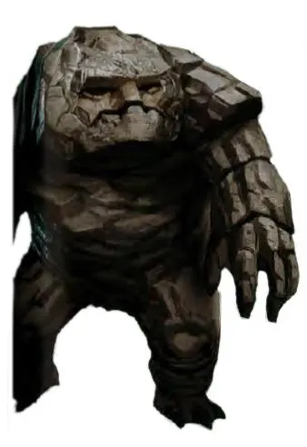

# Galeb Duhr

O galeb duhr é uma criatura similar a um pedregulho com apêndices atarracados que agem como braços e pernas. Ele possui a habilidade de animar as rochas e pedregulhos a sua volta, e por isso, é geralmente encontrado em terrenos rochosos.

Magia poderosa permite que um conjurador invoque um galeb duhr do Plano da Terra. Alguns galeb duhr também se formam naturalmente em locais tocados por esse plano. O galeb duhr é imbuído com mais inteligência que a maioria dos elementais, permitindo que ele avalie melhor ameaças e se comunique com criaturas que entre a área que eles guardam.

***Guardião de Pedra***. Um galeb duhr não envelhece ou precisa de sustento, fazendo deles excelentes sentinelas. Um druida poderoso pode incumbir um galeb duhr de proteger um círculo de pedra ou uma colina sagrada. Outro galeb duhr pode ser criado para proteger uma tumba subterrânea ou a torre de um mago. Quando desejar, o galeb duhr pode mudar sua aparência para se parecer com um pedregulho comum, permanecendo perfeitamente parado por anos a fio.

## Bloco de estatísticas: Galeb Duhr

*Elemental Médio, neutro*

**Classe de Armadura** 16 (armadura natural)  
**Pontos de Vida** 85 (9d8 + 45)  
**Deslocamento** 4,5 m (9 m rolando, 18 m rolando ladeira abaixo)

| FOR | DES | CON | INT | SAB | CAR |
| :---: | :---: | :---: | :---: | :---: | :---: |
| 20 (+5) | 14 (+2) | 20 (+5) | 11 (+0) | 12 (+1) | 11 (+0) |

**Resistência a Dano** concussão, perfurante e cortante de ataques não-mágicos  
**Imunidade a Dano** veneno  
**Imunidade a Condição** envenenado, exausto, paralisado, petrificado  
**Sentidos** visão no escuro 18 m, sentido sísmico 18 m, Percepção passiva 11  
**Idiomas** Terran  
**Nível de Desafio** 6 (2.300 XP)

***Aparência Falsa***. Enquanto o galeb duhr permanecer imóvel, ele é indistinguível de um pedregulho comum.

***Investida Rolante***. Se o galeb duhr rolar, pelo menos, 6 metros em linha reta até um alvo e então atingi-lo com um ataque de pancada no mesmo turno, o alvo sofre 7 (2d6) de dano de concussão extra. Se o alvo for uma criatura, ele deve ser bem sucedido num teste de resistência de Força CD 16 ou será derrubado no chão.

### Ações

***Pancada***. *Ataque Corpo-a-Corpo com Arma*: +8 para atingir, alcance 1,5 m, um alvo. *Acerto*: 12 (2d6 + 5) de dano de concussão.

***Animar Pedregulhos (1/Dia)***. O galeb duhr, magicamente, anima até dois pedregulhos que ele possa ver, a até 18 metros dele. Um pedregulho tem as estatísticas iguais às do galeb duhr, exceto por ter Inteligência 1 e Carisma 1, não poder ser amedrontado ou enfeitiçado e não possuir essa opção de ação. Um pedregulho permanece animado enquanto o galeb duhr mantiver a concentração, até 1 minuto (como se estivesse se concentrando em uma magia).

Um galeb duhr está vinculado permanentemente ao Plano Material, por isso, quando ele morre, ele não retorna para o Plano da Terra. Ele possui uma memória excelente e fica mais que feliz por compartilhar informações sobre o seu ambiente com as criaturas que ele não considere como ameaças.

***Conexão com Pedras***. Um galeb duhr pode se tornar uno com a terra a sua volta, permitindo que ele imbua as rochas e pedregulhos próximos com uma centelha de vida. O galeb duhr usa seu animar pedregulhos para afugentar invasores e defender o que quer que ele tenha sido incumbido de proteger. Quando ele precisa se aproximar desses invasores, ele se encolhe adquirindo um formado esférico e rola a um ritmo furioso.
