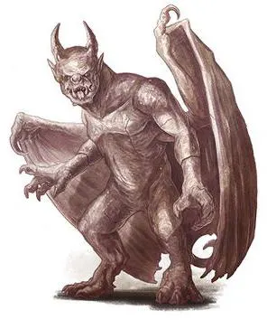

# Gárgula

## Bloco de estatísticas: Gárgula

*Elemental Médio, caótico e mau*

**Classe de Armadura** 15 (armadura natural)  
**Pontos de Vida** 52 (7d8 + 21)  
**Deslocamento** 9 m, voo 18 m

| FOR | DES | CON | INT | SAB | CAR |
| :---: | :---: | :---: | :---: | :---: | :---: |
| 15 (+2) | 11 (+0) | 16 (+3) | 6 (–2) | 11 (+0) | 7 (–2) |

**Resistência a Dano** concussão, perfurante e cortante de ataques não-mágicos que não sejam de adamante  
**Imunidade a Dano** veneno  
**Imunidade a Condição** envenenado, exausto, petrificado  
**Sentidos** visão no escuro 18 m, Percepção passiva 10  
**Idiomas** Terran  
**Nível de Desafio** 2 (450 XP)

***Aparência Falsa***. Enquanto o gárgula permanecer imóvel, ele é indistinguível de uma estátua inanimada.

### Ações

***Ataques Múltiplos***. O gárgula realiza dois ataques: um com sua mordida e um com suas garras.

***Mordida***. *Ataque Corpo-a-Corpo com Arma*: +4 para atingir, alcance 1,5 m, um alvo. *Acerto*: 5 (1d6 + 2) de dano perfurante.

***Garras***. *Ataque Corpo-a-Corpo com Arma*: +4 para atingir, alcance 1,5 m, um alvo. *Acerto*: 5 (1d6 + 2) de dano cortante.

Os gárgulas empoleirados no topo de grandes construções são inspirados por essas malévolas criaturas elementais da terra que lembram estátuas demoníacas grotescas. Um gárgula espreita entre as alvenarias e ruínas, enquanto permanece parado como qualquer escultura de pedra, e se delicia com o terror que cria quando se liberta de sua pose suspensa, assim como com a dor que causa em suas vítimas.

***Pedra Animada***. Os gárgulas se predem a falésias e montanhas, ou poleiros em bordas de cavernas subterrâneas. Eles assombram telhados de cidades, empoleirados como abutres entre altos arcos de pedra e contrafortes de castelos e catedrais, e eles conseguem ficar tão imóveis que parecem inanimados. Capaz de manter esse estado por anos, um gárgula se mostra uma sentinela ideal.

***Reputação Mortal***. Os gárgulas tem a reputação de crueldade. Estátuas esculpidas para se assemelhar aos gárgulas aparecem na arquitetura de inúmeras culturas para espantar invasores. Apesar de tais esculturas serem meramente decorativas, os gárgulas reais podem se misturar entre elas para emboscar vítimas desatentas. Um gárgula pode aliviar o tédio de sua vigília ao capturar e torturar pássaros e roedores, mas sua longa espera apenas aumenta sua ânsia por ferir criaturas racionais.

Servos Cruéis. Os gárgulas são facilmente inspirados pela astúcia de um mestre inteligente. Eles apreciam tarefas simples como guardar a casa de um mestre, torturar e matar invasores e qualquer outra coisa que envolva mínimo esforço e máxima dor e carnificina.

Os gárgulas, às vezes, servem aos demônios por sua propensão ao caos e destruição desenfreados. Conjuradores poderosos também podem facilmente recrutar gárgulas guardiões para manter vigília sob seus portões e muros. Os gárgulas tem a paciência e fortitude da rocha, e servirão mesmo o mestre mais cruel por anos sem contestar.

***Natureza Elemental***. Um gárgula não precisa respirar, comer, beber ou dormir.

> **Fragmentos de Mal Elemental**
>
> Enquanto Ogrémoch, o Príncipe maligno Elemental da Terra, anda sobre seu reino pétreo, ele deixa fragmentos de rocha partida em seu rastro. Imbuídos com lascas de senciência, esses fragmentos vibram com a essência do príncipe elemental, se desenvolvendo ao passar dos anos em formações rochosas vagamente humanoides que adquirem, finalmente, as formas rígidas e cruéis de gárgulas. Ogrémoch não cria os gárgulas deliberadamente, mas eles são uma manifestação física de sua maldade. Os gárgulas são escárnios dos elementais do ar que Ogrémoch despreza. Eles são criaturas pesadas de pedra viva, ainda assim capazes de voar. Como seu criador, eles possuem um ódio fundamental por seres elementais do ar, aarakocra em particular, e apreciam cada oportunidade de destruir tais criaturas. Em seu plano natal, os gárgulas esculpem motes de terra que Ogrémoch choca em Aaqa, o domínio dos aarakocra e dos benevolentes Duques do Vento que o povo pássaro serve no Plano Elemental do Ar.
