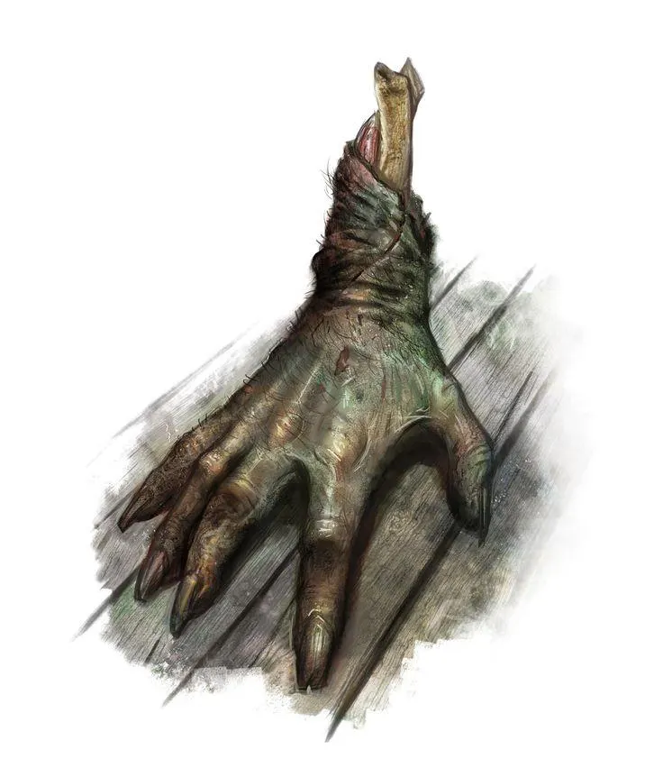

# Garra Rastejante

## Bloco de estatísticas: Garra Rastejante

*Morto-vivo Miúdo, neutro e mau*

**Classe de Armadura** 12  
**Pontos de Vida** 2 (1d4)  
**Deslocamento** 6 m, escalada 6 m

| FOR | DES | CON | INT | SAB | CAR |
| :---: | :---: | :---: | :---: | :---: | :---: |
| 13 (+1) | 14 (+2) | 11 (+0) | 5 (–3) | 10 (+0) | 4 (–3) |

**Imunidade a Dano** veneno  
**Imunidade a Condição** enfeitiçado, envenenado, exausto  
**Sentidos** percepção às cegas 9 m (cego além desse raio), Percepção passiva 10  
**Idiomas** compreende Comum, mas não pode falar  
**Nível de Desafio** 0 (10 XP)

***Imunidade à Expulsão***. A garra é imune a efeitos que expulsem mortos-vivos.

### Ações

***Garra***. *Ataque Corpo-a-Corpo com Arma*: +3 para atingir, alcance 1,5 m, um alvo. *Acerto*: 3 (1d4 + 1) de dano de concussão ou cortante (à escolha da garra).

As garras rastejantes são as mãos amputadas de assassinos animadas por magia negra para que possam continuar a matar. Magos e bruxos das trevas usam as garras rastejantes como mãos extras em seus trabalhos.

***Origens Mágicas***. Através de rituais necromânticos sombrios, a força vital de um assassino é vinculada a sua mão decepada, assombrando e animando-a. Caso o espírito do assassino morto já tenha se manifestado como outra criatura morta-viva, se o assassino tenha retornado dos mortos, ou se o espírito tenha a muito ido para outro plano, o ritual fracassa.

O ritual invocado para criar a garra rastejante funciona melhor com uma mão recentemente decepada de um assassino. Com essa finalidade, ritualistas e seus servos, frequentam execuções públicas para ter acesso a mãos adequadas, ou para barganhar com assassinos e torturadores.

***Sob Controle do Criador***. Uma garra rastejante não pode ser expulsa nem pode ser controlado por magias que controlam mortos-vivos. Esses monstros imundos estão totalmente vinculados à vontade do seu criador, o qual pode se concentrar na garra para controlar mentalmente cada ação dela. Se o criador da garra rastejante não comanda-la, ela segue seu último comando da melhor forma possível.

Os comandos dados à garra rastejante devem ser simples. Uma garra não pode ser ordenada a encontrar e matar uma pessoa, pois as limitações de seus sentidos e inteligência impedem que ela rastreie e selecione indivíduos específicos. No entanto, um comando para matar todas as criaturas em um local especifico funcionaria. Uma garra rastejante pode facilmente sentir os contornos de chaves e maçanetas, rastejando de sala em sala em uma matança cega.

***Inteligência Maligna***. Uma garra rastejante possui um pouco do intelecto e memórias do indivíduo de quem era uma parte viva. O ódio, inveja ou ganância que guiava essa pessoa a matar permanece, no entanto, é amplificado pelo estado fragmentado torturante da garra. Deixada pelos seus próprios meios, uma garra rastejante imita e recria os mesmos atos assassinos que cometeu em vida.

***Garras Vivas***. Se a garra rastejante for animada da mão decepada de um assassino ainda vivo, o ritual vincula a garra à alma do assassino. A mão desencarnada pode então retornar para o antigo membro, sua carne morta-viva se liga ao braço vivo de onde foi decepada.

Feito tudo novamente, o assassino age como se a mão nunca tivesse sido amputada e o ritual nunca tivesse acontecido. Quando a garra rastejante se separar novamente, o corpo vivo entra em coma. Destruir a garra rastejante enquanto ela estiver fora do corpo, mata o assassino. No entanto, matar o assassino não produz efeito na garra rastejante.

***Natureza Morta-Viva***. Uma garra rastejante não precisa respirar, comer, beber ou dormir.
