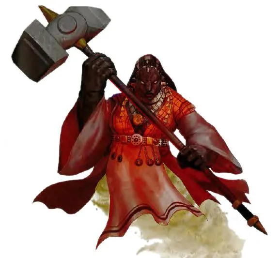
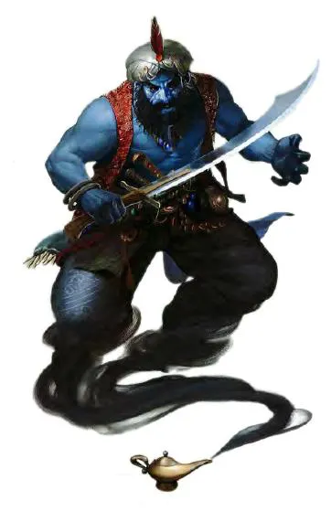
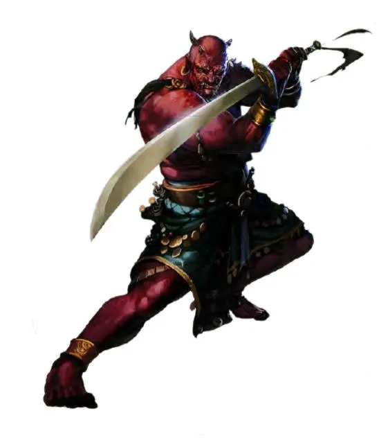
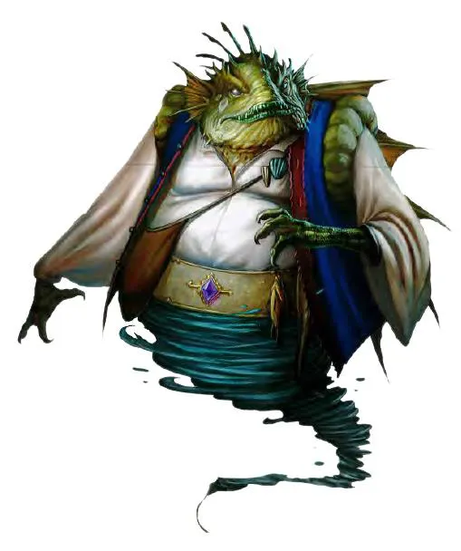

# Gênios

Os gênios são criaturas elementais raras vindas das histórias e lendas. Apenas alguns poucos podem ser encontrados no Plano Material. O resto reside nos Planos Elementais, onde eles governam suntuosos palácios e são atendidos por servos que os veneram.

Os gênios são tão brilhantes quanto poderosos, tão orgulhosos quanto majestosos. Arrogantes e decadentes, eles possuem um senso profundo de direito que derroque do conhecimento de que poucas criaturas, além dos deuses e outros gênios, podem desafiar o poder deles.

***Criaturas dos Elementos***. Um gênio nasce quando a alma de uma criatura viva racional é mesclada a matéria primordial de um plano elemental. Apenas sob raras circunstâncias uma alma infundida por um elemento coalesce em uma forma manifestada, criando um gênio.

Um gênio geralmente não mantem qualquer conexão com a alma que o formou. Aquela força vital é um bloco de construção que determina a forma do gênio e gênero aparente, assim como um ou dois traços de personalidade chave. Apesar de lembrarem seres humanoides, os gênios são espíritos elementais com formas físicas. Eles não acasalam com outros gênios para produzir uma nova prole de gênios, assim, todos os novos gênios nascem da mesma infusão misteriosa de energia espiritual e poder elemental. Um gênio com uma conexão mais forte a sua alma mortal pode conseguir gerar um filho com um mortal, embora tais criar sejam raras.

Quando um gênio perece, ele não deixa nada para trás, exceto o que ele estava vestindo ou carregando, junto com um pequeno vestígio do seu elemento nativo: uma pilha de pó, uma lufada de vento, um lampejo de fogo e fumaça ou uma poça de água e espuma.

***Governe ou Seja Governado***. Escravos mortais servem para validar o poder e elevada autoafirmação dos gênios. Uma centena de vozes lisonjeiras são como música aos ouvidos de um gênio, enquanto que duas centenas de escravos mortais ajoelhados aos seus pés são a prova que ele é seu senhor e mestre. Os gênios veem os escravos como propriedades vivas, e um gênio sem propriedades não significa nada para sua própria espécie. Como resultado, muitos gênios estimam seus escravos, tratando-os como membros honrados de suas casas. Gênios malignos ameaçam e abusam de seus escravos gratuitamente, mas nunca ao ponto de deixar seus escravos imprestáveis.

Contrastando com seu amor por escravos, a maioria dos gênios detestam ser obrigados a servir. Um gênio obedece à vontade de outrem apenas quando subornado ou compelido por magia. Todos os gênios comandam o poder do seu elemento nativo, mas alguns raros também possuem o poder de conceder desejos. Por ambas razões, magos mortais muitas vezes buscam obrigar gênios a servi-los.

***Nobreza Decadente***. Gênios nobres são os mais raros de sua espécie. Eles são usados para conseguir o que querem, e aprenderam a negociar sua habilidade de conceder desejos para alcançar os objetos que eles desejam. Essa indulgência constante os tornou decadentes, enquanto seu poder supremo sobre a realidade os tornou orgulhosos e arrogantes. Seus vastos palácios transbordam de maravilhas e delícias sensórias além da imaginação.

Os gênios nobres cultivam a ciúme e a inveja dos outros gênios, afirmando sua superioridade a cada oportunidade. Outros gênios respeitam a influência dos gênios nobres, sabendo o qual insensato é desafiar uma criatura que pode alterar a realidade como capricho. Um gênio não tem qualquer obrigação para com um gênio nobre, no entanto, e irá, às vezes, escolher desafiar a vontade de um gênio nobre e arriscar as consequências.

***O Poder da Adoração***. Os gênios reconhecem os deuses como entidades poderosas, mas não tem desejo de provoca-los ou adora-los. Eles consideram a bajulação e chiado intermináveis dos devotos religiosos cansativos – exceto quando é direcionado a eles por seus escravos adoradores.

Seus poderes miraculosos, a grandeza de suas moradas e a quantidade de seus escravos permite que alguns gênios enganem-se ao acreditar que são tão poderosos quanto os deuses. Alguns vão tão longe ao ponto de exigir que os mortais de outros reinos – até mesmo continentes ou mundos inteiros – ajoelhem-se perante eles.

### Dao

Os dao são gênios gananciosos e maliciosos do Plano Elemental da Terra. Eles se enfeitam com joias feitas de gemas preciosas e metais raros, e quando voam, a parte inferior de seus corpos tornasse uma coluna de areia rodopiante. Um dao não está feliz, a não ser que seja invejado por outros dao.

***Tudo que Reluz***. Os dao vivem em complexos de tuneis tortuosos e cavernas com veios brilhantes de minérios, no Plano Elemental da Terra. Essas construções labirínticas são expandidas continuamente conforme os dao escavam e remodelam a rocha ao seu redor. Os dao não se importam com a pobreza ou infortúnio dos outros. Um dao pode polvilhar pó de gemas e pó de ouro sobre sua comida para elevar a experiência de comer, devorando suas riquezas da mesma forma que os mortais consomem especiarias preciosas.

***Senhores da Terra***. Um dao nunca ajuda um mortal a não ser que tenha algo a ganhar, preferivelmente tesouros. Dentre os gênios, os dao estão em termos de eloquência e negociação iguais aos efreet, mas eles não sentem nada além de desprezo pelos djinn e os marids. Outras raças nativas do Plano Elemental da Terra evitam os dao, que estão sempre buscando novos escravos para minerar nos complexos labirínticos de suas ilhas de terra flutuantes.

***Escravistas Orgulhosos***. Os dao negociam os melhores escravos que o dinheiro pode comprar, forçando-os a trabalhar em perigosos reinos subterrâneos que desmoronam com terremotos.

Tanto quanto gostam de escravizar outros, os dao odeiam ser escravizados. Magos poderosos são conhecidos por atrair os dao para o Plano Material e aprisiona-los no confinamento de gemas mágicas ou fracos de ferro. Infelizmente para os dao, sua ganância os torna relativamente fáceis para os magos de lograr seus serviços.

### Djinni

Gênios orgulhosos e sensuais do Plano Elemental do Ar, os djinn são humanoides atraentes, altos e musculosos com pele azulada e olhos negros. Eles vestem sedas arejadas e cintilantes, concebidas tanto para o conforto quanto para exibir suas musculaturas.

***Esteta Aéreo***. Os djinn governam ilhas flutuantes envoltas em nuvens e cobertas por enormes pavilhões, ou com maravilhosos prédios, pátios, fontes e jardins sobre elas. Criaturas de conforto e bem-estar, os djinn apreciam frutas suculentas, vinhos pungentes, perfumes finos e boa música.

***Mestres do Vento***. Mestres do ar, os djinn cavalgam em poderosos vendavais que eles criam e direcionam aos caprichos, e que podem até mesmo levar passageiros. As criaturas que se colocarem contra o djinni são atacadas por ventos e trovões, mesmo enquanto o djinni gira para longe do vendo se for superado em combate. Quando um djinni voa, a parte inferior do seu corpo se torna uma coluna de ar rodopiante.

***Servidores Consentidos***. Os djinn acreditam que a servidão é uma questão de destino, e que nenhum ser pode contestar a mão do destino. Como resultado, de todos os gênios, os djinn são os mais submissos a servidão, apesar de nunca gostarem dela. Os djinn tratam seus escravos mais como servos merecedores de gentileza e proteção, e eles se livram deles com relutância.

Um mortal que deseje o curto serviço de um djinni pode roga-lo por presentes finos, os usar de lisonja para suborna-lo a cooperar. Magos poderosos, no entanto, são capazes de abrir mão de tais sutilezas, caso possam convoca-los, obriga-los a servir ou aprisionar um djinni usando magia. Serviços longos prazo desagradam o djinni e o aprisionamento é imperdoável. Os djinn se ressentem de magos cruéis que aprisionam sua espécie em garrafas, fracos de metal e instrumentos de sopro através das eras. A traição, particularmente por um mortal o qual o djinni confiava, é um ato vil remediado apenas através de vingança mortal.

### Efreeti

Gênios brutais do Plano Elemental do Fogo, os efreet são mestres das chamas, imunes a fogo e capazes de cria-lo com um capricho. Cafetãs de seda fina e robes damascos cobrem sua pele vermelho-magma ou negro-carvão, e eles se enfeitam com braceletes, correntes e anéis de cobre ou ouro todos ornamentados com joias. Quando um efreeti voa, a parte inferior do seu corpo se transforma numa coluna de fumaça e cinzas.

***Arrogantes e Cruéis***. Os efreet são enganadores, astutos e cruéis ao ponto da desumanidade. Eles detestam ser forçados a servir e são implacáveis na busca de vingança contra as criaturas que tenham os injustiçado. Os efreet não se veem por este prisma, naturalmente, e consideram sua raça como justa e ordenada, mesmo quando admitem seu sentimento elevado de interesse próprio.

***Escravistas Detestáveis***. Os efreet veem todas as outras criaturas como inimigos ou servos em potencial. Eles assaltam o Plano Material e os planos elementais em busca de escravos, os quais eles capturam e trazem de volta para seu lares no Plano Elemental do Fogo. Os efreet governam como tiranos opressores, promovendo apenas a crueldade entre seus escravos. Aos seus capatazes são dados chicotes para ajudar a manter da casta de escravos na linha.

***Assaltantes Planares***. A maioria dos efreet reside no Plano Elemental do Fogo, tanto em grandes fortalezas de vidro negro e basalto abobadadas rodeadas por agitados lagos de fogo, quanto na fabulosa Cidade de Bronze. Além disso, postos militares efreet lotados com seus asseclas e escravos podem ser encontrados espalhados pelos planos.

No Plano Material, os efreet habitam em regiões escaldantes como vulcões e nas extensões ardentes dos desertos do mundo. O amor deles pelo deserto os coloca em conflito com os djinn que cavalgam vendavais desérticos e com os dao ligados a terra. Os efreet desprezam profundamente os marids, com os quais eles mantem um conflito impetuoso ao longo da história de ambas as raças.

### Marid

Vindos do Plano Elemental da Água, os marids são os mais maravilhosos da casta de gênios. Apesar de todos os gênios possuírem grande poder, mesmos os mais inferiores dos marids se veem como claramente superiores aos djinn voadores, aos dao terrestres e aos efreet fumegantes.

Grandes e aquáticos, os marids são uma visão estranha de se contemplar, particularmente quando vestidos com seus trajes finamente costurados e calças coloridas que eles adoram. Eles falam com vozes suaves como a brisa marinha ou tão sonoros quanto as ondas tempestuosas que se chocam com os arrecifes rochosos. Ao voar, a parte inferior dos seus corpos se transformam em colunas de água espumante.

***Senhores da Água***. A água é o elemento nativo do marid, e esse gênio pode manipular a água de praticamente todas as maneiras que desejar. Um marid pode andar na água e respirar naturalmente abaixo de sua superfície. Ele pode criar água ou moldar nuvens de nevoeiro e névoa a partir do vapor no ar. Ele pode até mesmo transformar-se em névoa, ou usar a água como uma arma para golpear seus adversários.

***Lares dos Marids***. Os marids são raros no Plano Material. Eles habitam fortalezas de corais imponentes e majestosas localizadas no Plano Elemental da Água. Essas cidadelas flutuam nas profundezas do plano e contem câmaras opulentas, cheias de ar onde os escravos e convidados residem.

Um marid não gasta muito com seus escravos, tendo-os simplesmente para manter a posição de propriedade. Os marids fazem de tudo para obter escravos especializados, e não evitarão em sequestrar artistas, animadores ou contadores de histórias mortais para usa-los em suas cortes.

***Hierarcas Egoístas***. Todos os marids detém um título de nobreza, e a raça é cheia de xás, sultões, emirs e xeiques. Muitos desses títulos são meramente pretensões por parte da auto importância dos marids.

Os marids tratam todos os outros – incluindo outros gênios – como inferiores em diversos graus, variando de primos pobres a pequenos aborrecimentos. Eles toleram os djinn, não gostam dos dao e detestam os efreet.

Os humanoides estão entre as mais inferiores das criaturas que os marids podem tolerar, embora, por vezes, lidem com magos poderosos e líderes excepcionais quase que em pé de igualdade. Fazer isso, às vezes, tem se provado como um equívoco, já que os magos tem conseguido aprisionar os marids em conchas, frascos e garrafas ao longo das eras. Suborno e lisonja são os melhores meios de se lidar com os marids, já que um mortal servil é uma criatura que sabe o seu lugar.

***Narradores Extravagantes***. Os marids são campeões em narração, cujas lendas favoritas enfatizam o poderio dos marids em geral e do orador em particular. Como gênios imaginativos, eles mentem frequentemente e criativamente. Eles nem sempre são maliciosos em suas mentiras, mas enfeitam suas fantasias adequadamente. Os marids consideram um crime para um ser inferior interromper um dos seus contos, e ofender um marid é o modo certo de invocar sua ira.

## Bloco de estatísticas: Dao

*Elemental Grande, neutro e mau*

**Classe de Armadura** 18 (armadura natural)  
**Pontos de Vida** 187 (15d10 + 105)  
**Deslocamento** 9 m, escavação 9 m, voo 9 m

| FOR | DES | CON | INT | SAB | CAR |
| :---: | :---: | :---: | :---: | :---: | :---: |
| 23 (+6) | 12 (+1) | 24 (+7) | 12 (+1) | 13 (+1) | 14 (+2) |

**Testes de Resistência** Int +5, Sab +5, Car +6  
**Imunidade a Condição** petrificado  
**Sentidos** visão no escuro 36 m, Percepção passiva 11  
**Idiomas** Terran  
**Nível de Desafio** 11 (7.200 XP)

***Conjuração Inata***. A habilidade de conjuração de um dao é Carisma (CD de resistência de magia 14, +6 para atingir com ataques de magia). Ele pode conjurar, inatamente, as seguintes magias, sem necessidade de componentes materiais:

À vontade: *detectar bem e mal, detectar magia, moldar rochas* 3/dia cada: *criar passagem, idiomas, mover terra* 1/dia cada: *assassino fantasmagórico, conjurar elemental* (elemental da terra apenas), *forma gasosa, invisibilidade,* *muralha de pedra, viagem planar*

***Deslizar na Terra***. O dao pode escavar através de terra e rocha não-mágica bruta. Enquanto faz isso, o dao não perturba o material pelo qual se move.

***Morte Elemental***. Se o dao morrer, seu corpo se desintegra em pó cristalino, deixando para trás apenas o equipamento que o dao estava vestindo ou carregando.

***Estabilidade***. O dao tem vantagem em testes de resistência de Força e Destreza feitos contra efeitos que possam derruba-lo no chão.

### Ações

***Ataques Múltiplos***. O dao realiza dois ataques com punho ou dois ataques com malho.

***Punho***. *Ataque Corpo-a-Corpo com Arma*: +10 para atingir, alcance 1,5 m, um alvo. *Acerto*: 15 (2d8 + 6) de dano de concussão.

***Malho***. *Ataque Corpo-a-Corpo com Arma*: +10 para atingir, alcance 1,5 m, um alvo. *Acerto*: 20 (4d6 + 6) de dano de concussão. Se o alvo for uma criatura Enorme ou menor, ele deve ser bem sucedido num teste de Força CD 18 ou será derrubado no chão.

## Bloco de estatísticas: Djinni

*Elemental Grande, caótico e bom*

**Classe de Armadura** 17 (armadura natural)  
**Pontos de Vida** 161 (14d10 + 84)  
**Deslocamento** 9 m, voo 27 m

| FOR | DES | CON | INT | SAB | CAR |
| :---: | :---: | :---: | :---: | :---: | :---: |
| 21 (+5) | 15 (+2) | 22 (+6) | 15 (+2) | 16 (+3) | 20 (+5) |

**Testes de Resistência** Des +6, Sab +7, Car +9  
**Imunidade a Dano** elétrico, trovejante  
**Sentidos** visão no escuro 36 m, Percepção passiva 13  
**Idiomas** Auran  
**Nível de Desafio** 11 (7.200 XP)

***Conjuração Inata***. A habilidade de conjuração de um djinni é Carisma (CD de resistência de magia 17, +9 para atingir com ataques de magia). Ele pode conjurar, inatamente, as seguintes magias, sem necessidade de componentes materiais:

À vontade: *detectar bem e mal, detectar magia, onda trovejante* 3/dia cada: *criar alimentos* (pode criar vinho ao invés de água), *idiomas, muralha de vento* 1/dia cada: *conjurar elemental* (elemental do ar apenas), *criação,* *forma gasosa, imagem maior, invisibilidade, viagem planar*

### Variação: Poderes de Gênio

Os gênios tem uma variedade de capacidades mágicas, incluindo magias. Alguns poucos tem poderes ainda maiores que permitem a eles alterar suas aparências e a natureza da realidade.

***Disfarces***. Alguns gênios podem se disfarçar através de ilusão para se passar por outras criaturas de forma similar. Tais gênios podem, inatamente, conjurar a magia *disfarçar-se*, à vontade, geralmente com uma duração maior que a da magia normal. Gênios mais poderosos podem conjurar a magia *metamorfose* *verdadeira* de uma a três vezes por dia, possivelmente com uma duração maior que da magia normal. Tais gênios podem mudar apenas sua própria forma, mas existem alguns raros que podem usar a magia em outras criaturas e objetos também.

***Desejos***. O poder dos gênios de conceder desejos é lendário entre os mortais. Apenas os gênios mais poderosos, como os que estão entre a nobreza, podem fazê-lo. Um gênio em particular que tenha esse poder pode conceder entre um e três desejos para uma criatura que não seja um gênio. Uma vez que o gênio tenha concedido seu limite de desejos, ele não poderá mais conceder desejos novamente por um período de tempo (geralmente 1 ano), e as leis cósmicas determinam que o mesmo gênio pode gastar seu limite de desejos com uma criatura especifica apenas uma vez na existência dessa criatura. Para ter um desejo concedido, uma criatura deve estar a até 18 metros do gênio e indicar um efeito desejado para ele. O gênio pode então, conjurar a magia *desejo* em nome da criatura para fazer o efeito. A depender da natureza do gênio, ele pode tentar perverter a intenção do desejo explorando a contextualização pobre do desejo. A perversão da redação geralmente é um meio de trazer benefícios ao gênio.

***Morte Elemental***. Se o djinni morrer, seu corpo se desintegra em uma brisa quente, deixando para trás apenas o equipamento que o djinni estava vestindo ou carregando.

### Ações

***Ataques Múltiplos***. O djinni realiza três ataques com cimitarra.

***Cimitarra***. *Ataque Corpo-a-Corpo com Arma*: +9 para atingir, alcance 1,5 m, um alvo. *Acerto*: 12 (2d6 + 5) de dano cortante mais 3 (1d6) de dano elétrico ou trovejante (à escolha do djinni).

***Criar Vendaval***. Um cilindro de 1,5 metro de raio, 9 metros de altura de ar rodopiante se forma magicamente em um ponto que o djinni possa ver, a até 36 metros dele. O vendaval dura enquanto o djinni mantiver a concentração (como se estivesse se concentrando em uma magia). Qualquer criatura além do djinni que entrar no vendaval deve ser bem sucedida num teste de resistência de Força CD 18 ou ficará impedida por ele. O djinni pode mover o vendaval até 18 metros com uma ação, e as criaturas impedidas pelo vendaval se movem com ele. O vendaval terminar se o djinni o perder de vista. Uma criatura pode usar sua ação para libertar uma criatura impedida pelo vendaval, incluindo a si próprio, sendo bem sucedida num teste de Força CD 18. Se o teste for bem sucedido, a criatura não estará mais impedida e se move para o espaço mais próximo fora do vendaval.

## Bloco de estatísticas: Efreeti

*Elemental Grande, leal e mau*

**Classe de Armadura** 17 (armadura natural)  
**Pontos de Vida** 200 (16d10 + 112)  
**Deslocamento** 12 m, voo 18 m

| FOR | DES | CON | INT | SAB | CAR |
| :---: | :---: | :---: | :---: | :---: | :---: |
| 22 (+6) | 12 (+1) | 24 (+7) | 16 (+3) | 15 (+2) | 16 (+3) |

**Testes de Resistência** Int +7, Sab +6, Car +7  
**Imunidade a Dano** fogo  
**Sentidos** visão no escuro 36 m, Percepção passiva 12  
**Idiomas** Ignan  
**Nível de Desafio** 11 (7.200 XP)

***Conjuração Inata***. A habilidade de conjuração de um efreeti é Carisma (CD de resistência de magia 15, +7 para atingir com ataques de magia). Ele pode conjurar, inatamente, as seguintes magias, sem necessidade de componentes materiais:

À vontade: *detectar magia* 3/dia cada: *aumentar/reduzir, idiomas* 1/dia cada: *conjurar elemental* (elemental do fogo apenas), *forma gasosa, imagem maior, invisibilidade, muralha de fogo,* *viagem planar*

***Morte Elemental***. Se o efreeti morrer, seu corpo se desintegra em um clarão de fogo e fumaça, deixando para trás apenas o equipamento que o efreeti estava vestindo ou carregando.

### Ações

***Ataques Múltiplos***. O efreeti realiza dois ataques com cimitarra ou usa seu Arremessar Chamas duas vezes.

***Cimitarra***. *Ataque Corpo-a-Corpo com Arma*: +10 para atingir, alcance 1,5 m, um alvo. *Acerto*: 13 (2d6 + 6) de dano cortante mais 7 (2d6) de dano de fogo.

***Arremessar Chamas***. *Ataque à Distância com Magia*: +7 para atingir, distância 36 m, um alvo. *Acerto*: 17 (5d6) de dano de fogo.

## Bloco de estatísticas: Marid

*Elemental Grande, caótico e neutro*

**Classe de Armadura** 17 (armadura natural)  
**Pontos de Vida** 229 (17d10 + 136)  
**Deslocamento** 9 m, natação 27 m, voo 18 m

| FOR | DES | CON | INT | SAB | CAR |
| :---: | :---: | :---: | :---: | :---: | :---: |
| 22 (+6) | 12 (+1) | 26 (+8) | 18 (+4) | 17 (+3) | 18 (+4) |

**Testes de Resistência** Des +5, Sab +7, Car +8  
**Imunidade a Dano** ácido, elétrico, frio  
**Sentidos** percepção às cegas 9 m, visão no escuro 36 m, Percepção passiva 13  
**Idiomas** Aquan  
**Nível de Desafio** 11 (7.200 XP)

***Anfíbio***. O marid pode respirar ar e água.

***Conjuração Inata***. A habilidade de conjuração de um marid é Carisma (CD de resistência de magia 16, +8 para atingir com ataques de magia). Ele pode conjurar, inatamente, as seguintes magias, sem necessidade de componentes materiais:

À vontade: *criar ou destruir água, detectar bem e mal, detectar* *magia, névoa obscurecente, purificar alimentos* 3/dia cada: *andar na água, idiomas, respirar na água* 1/dia cada: *conjurar elemental* (elemental da água apenas), *controlar a água, forma gasosa, invisibilidade, viagem planar*

***Morte Elemental***. Se o marid morrer, seu corpo se desintegra em um explosão de água e espuma, deixando para trás apenas o equipamento que o marid estava vestindo ou carregando.

### Ações

***Ataques Múltiplos***. O marid realiza dois ataques com tridente.

***Tridente***. *Ataque Corpo-a-Corpo com Arma*: +10 para atingir, alcance 1,5 m ou distância 6/18 m, um alvo. *Acerto*: 13 (2d6 + 6) de dano perfurante ou 15 (2d8 + 6) de dano perfurante se usado com duas mãos para realizar ataques corpo-a-corpo.

***Jato de Água***. O marid, magicamente dispara água numa linha de 18 metros de comprimento por 1,5 metro de largura. Cada criatura na linha deve realizar um teste de resistência de Destreza CD 16. Se fracassar, um alvo sofre 21 (6d6) de dano de concussão e, se for Enorme ou menor, é empurrado 6 metros para longe do marid e é derrubado no chão. Caso obtenha sucesso, um alvo sofre metade do dano, mas não é nem empurrado nem derrubado no chão.
