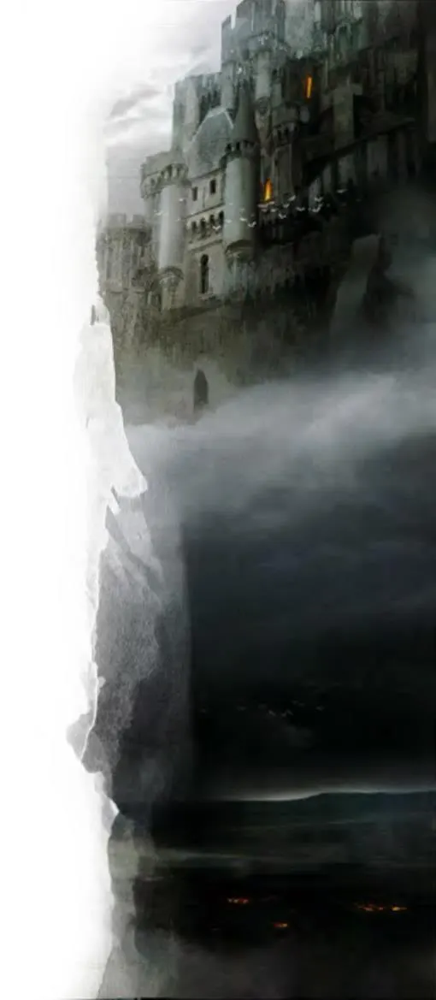
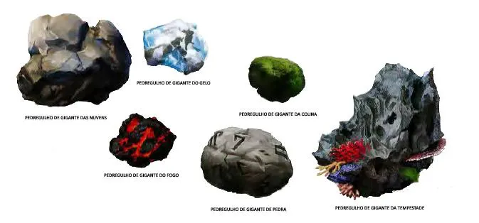
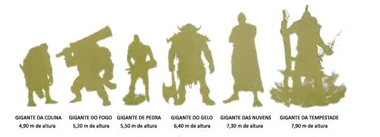
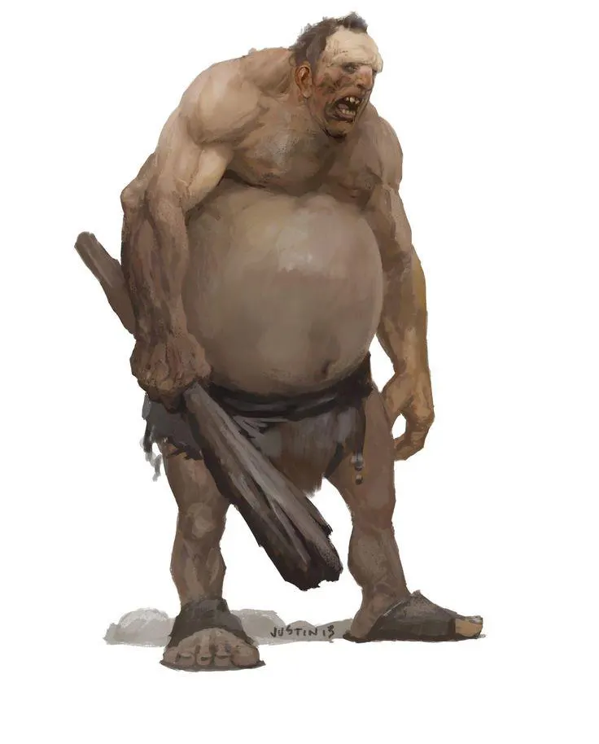
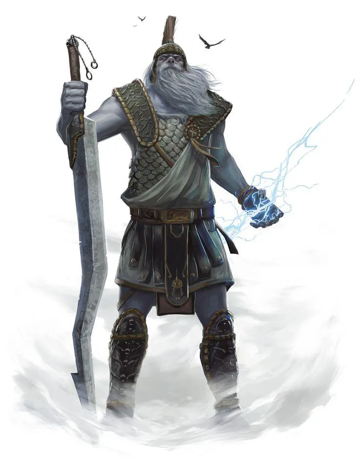
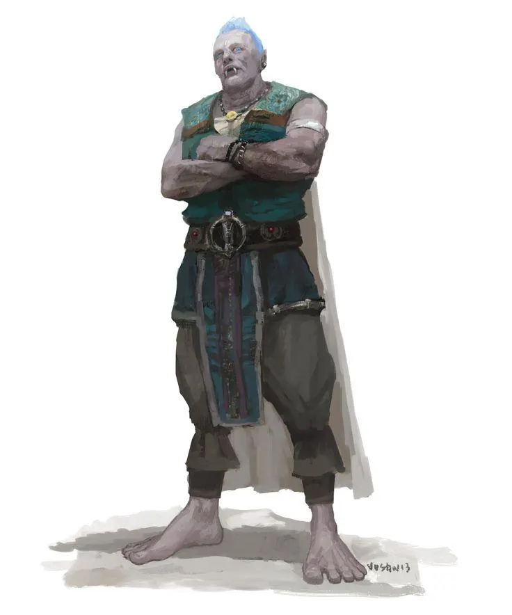
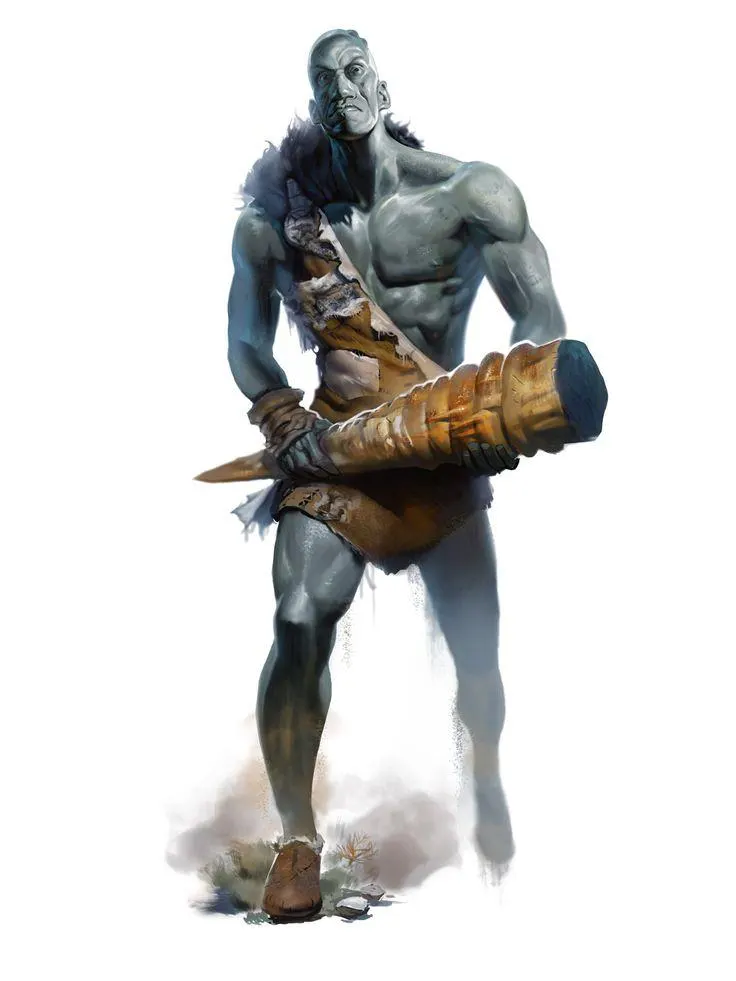
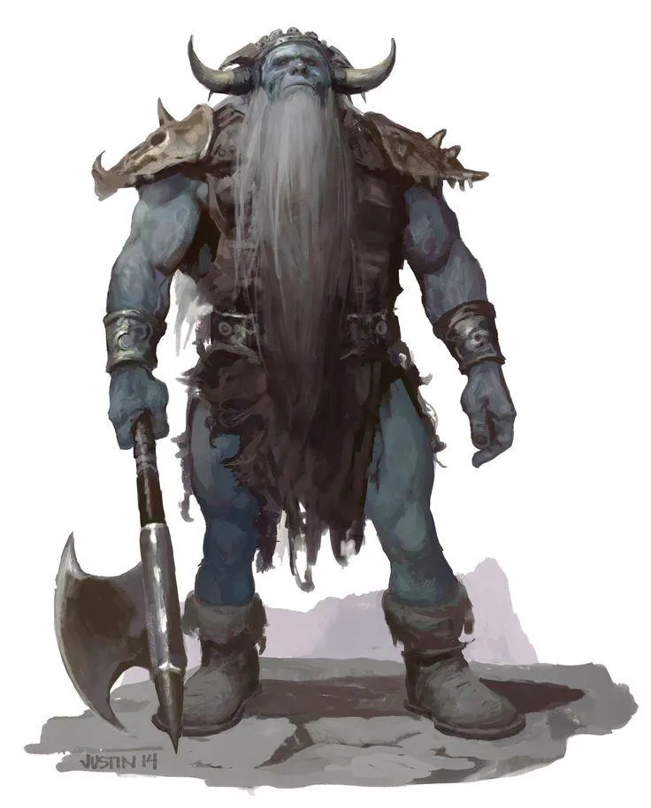
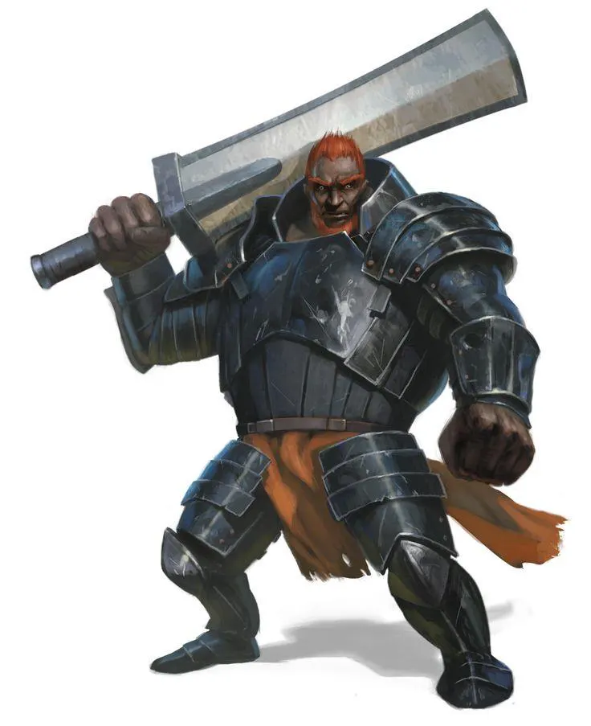

# Gigantes

Impérios antigos certa vez produziram uma enorme sombra sobre o mundo que tremeu sob os pés dos gigantes. Naqueles dias perdidos, essas figuras muito altas eram matadores de dragões, sonhadores, construtores e reis, mas sua espécie perdeu a glória tempos atrás. No entanto, mesmo divididos em clãs isolados espalhados pelo mundo, os gigantes mantém os costumes e tradições antigos.

***Antigos como Lendas***. Em regiões remotas do mundo, os últimos resquícios de plintos, monólitos e estátuas dos grandes impérios gigantes abaixam suas cabeças na desolação obscura. Onde, certa vez, esses impérios se expandiram por todas as terras, agora os gigantes habitam em tribos e clãs isolados.

Os gigantes são quase tão antigos quanto os dragões, que ainda eram jovens quando os pesados pés dos gigantes abalaram as fundações do mundo pela primeira vez. Conforme se espalhavam pelas novas terras, gigantes e dragões lutaram amargas guerras geracionais que quase levaram ambos os lados ao fim. Nenhum gigante vivo se lembra o que deu início a esse conflito, mas mitos e contos da gloriosa aurora da raça ainda são cantados em suas casas e castelos vilipendiando os anciões primitivos. Os gigantes e os dragões continuam a guardar ressentimentos mútuos, e é raro que se encontrem ou ocupem o mesmo espaço sem uma luta.

### O Ordenamento

Cada uma das raças de gigante primárias – o da colina, da tempestade, das nuvens, de pedra, do fogo e do gelo – estão relacionados por elementos em comum da história, religião e cultura. Eles veem uns aos outros como parentes, mantendo qualquer animosidade inerente ao território e ambição no mínimo.

Os gigantes pertencem a uma casta estruturada chamada o ordenamento. Baseado em classes sociais e extremamente organizado, o ordenamento atribui uma posição social a cada gigante. Ao compreender seu lugar no ordenamento, um gigante sabe quais outros gigantes são inferiores ou superiores a ele, já que dois gigantes nunca são iguais. Cada uma das raças de gigante analisa uma combinação diferente de perícias ou qualidades para determinar o ordenamento. Os gigantes fazem da excelência dessas qualidades o propósito de suas vidas.

Nos níveis mais altos do ordenamento, as raças dos gigantes também são ordenadas de acordo com o prestígio. Os gigantes da tempestade são os mais elevados no ordenamento, seguidos pelos gigantes das nuvens, gigantes do fogo, gigantes do gelo, gigantes de pedra, gigantes da colina e, finalmente, os de parentesco gigante como os fomoris, ettins e ogros.

Independentemente da classificação de um gigante entre sua própria rapa, o chefe de uma tribo de gigantes da colina é inferior ao mais reles dos gigantes de pedra. O gigante de posição mais baixa de qualquer tipo é superior ao de posição mais alta de um tipo inferior. Não é considerado ruim desrespeitar ou mesmo trair um gigante de outro tipo, mas meramente rude.

### Gigante da Colina

Os gigantes da colina são brutamontes egoístas e estúpidos que caçam, forrageiam e assaltam em constante busca por comida. Eles debandam através das colinas e florestas devorando tudo que podem, tiranizando criaturas menores para alimentá-los. A preguiça e estupidez deles poderia ter a muito levado ao fim deles, se não fosse por seus tamanhos e forças formidáveis.

***Primitivos***. Os gigantes da colina vivem em colinas e vales montanhosos pelo mundo, congregando em casas feitas de madeira rústica ou em aglomerados de cabanas bem protegidas de barro e vime. Suas peles são bronzeadas devido a suas vidas gastas lenhando, subindo e descendo as encostas montanhosas e cochilando sob o sol. Suas armas são árvores arrancadas e rochas retiradas da terra. O suor de seus corpos contribui para o mal cheiro das pelagens de animais rudes que eles vestem, parcamente costuradas com cabelo e fios de couro.

***Maior Significa Melhor***. No mundo dos gigantes da colina, humanoides e animais são presas fáceis que podem ser caçadas impunimente. Criaturas como dragões e outros gigantes são adversários resistentes. Os gigantes da colina igualam o tamanho com poder.

Os gigantes da colina não percebem que seguem um ordenamento. Eles sabem apenas que outros gigantes são maiores e mais fortes que eles, o que significa que eles devem obedece-los. Um chefe de tribo de gigantes da colina é geralmente o gigante mais alto e gordo que ainda seja capaz de se mover. Apenas em raras ocasiões que um gigante da colina com mais cérebro que músculos usará sua esperteza para adquirir o favorecimento de gigantes de posição mais elevada, astutamente subvertendo a ordem social.

***Comedores Vorazes***. Não tendo mais nada com que se ocupar, os gigantes da colina comem quase sempre que podem. Um gigante da colina caça e forrageia sozinho ou na companhia de um lobo atroz, assim não tendo que compartilhar nada com outros membros da tribo. O gigante come qualquer coisa que não seja obviamente letal, como criaturas conhecidas por serem venenosas. Carne podre é uma ótima pedida, da mesma forma, plantas em decomposição e até lama.

Os agricultores temem e detestam os gigantes da colina. Enquanto que um predador como um ankheg irá escavar pelos campos e comer uma ou duas vacas antes de ir embora, um gigante da colina irá comer um rebanho inteiro de gado antes de partir para as ovelhas, cabras e galinhas, então partindo para as frutas, vegetais e grãos. Se uma família de agricultores estiver ao alcance, o gigante pode lancha-los também.

***Estúpidos e Letais***. A habilidade dos gigantes da colina de digerir praticamente tudo tem permitido que eles sobrevivam por eras como selvagens, comendo e se reproduzindo nas colinas como animais. Eles nunca precisaram se adaptar e mudar, por isso suas mentes e emoções permanecem simplórias e subdesenvolvidas.

Sem cultura própria, os gigantes da colina copiam as tradições de criaturas que eles consigam observar por um tempo antes de comê-los. Eles não pensam no seu próprio tamanho e força, no entanto. Tribos de gigantes da colina tentando imitar elfos já chegaram a derrubar florestas inteiras tentando viver nas árvores. Outros tentando tomar cidades ou vilas humanoides foram apenas até as portas e janelas das construções, arrancando as paredes e tetos ao tentar entrar.

Durante uma conversa, os gigantes da colina são broncos e diretos, e eles tem pouca noção de enganação. Um gigante da colina pode ser enganado a fugir de outro gigante se uma quantidade de camponeses se cobrirem com mantas e ficarem uns sobre os ombros dos outros segurando uma abóbora gigante pintada como cabeça. Usar a razão com um gigante da colina é inútil, apesar de criaturas espertas poderem, às vezes, encorajar um gigante a realizar ações que as beneficiem.

***Valentões Furiosos***. Um gigante da colina que sinta que está sendo enganado, insultado ou feito de tolo liberará sua fúria terrível em qualquer coisa que encontrar. Mesmo depois de ter esmagado aqueles que o ofenderam até virarem papa, o gigante atacará até sua fúria cessar, ele encontrar algo mais interessante ou sua fome aumentar.

Se um gigante da colina se proclamar rei de um território onde outros humanoides vivem, ele governará estritamente através de terror e tirania. Suas decisões mudam com seu humor e, caso ele se esqueça do título ao qual se nomeou, ele poderá devorar seus súditos por capricho.

### Gigante da Tempestade

Os gigantes da tempestade são videntes contemplativos que vivem em locais bem afastados da civilização mortal. A maioria são pálidos com peles e cabelos roxo-acinzentados, e olhos brilhantes cor de esmeralda. Alguns raros gigantes da tempestade possuem pele violeta, com cabelos violeta-escuro ou azul-escuro e olhos cinza-prateados ou púrpuros. Eles são benevolentes e sábios, a não ser se irritados, quando a resposta da fúria de um gigante da tempestade pode afetar o destino de milhares.

***Reis-Profetas Distantes***. Os gigantes da tempestade vivem em refúgios isolados bem acima da superfície do mundo ou abaixo do mar onde eles ficam além do alcance da maioria das criaturas. Alguns fazem suas moradas em castelos no topo de nuvens tão alto que dragões voando parecem pontinhos abaixo. Outros vivem em picos de montanhas que perfuram as nuvens. Alguns ocupam palácios cobertos por algas e corais no fundo do oceano ou em fortalezas sombrias em fendas submarinas.

***Oráculos de Destaque***. Os gigantes da tempestade recordam da glória dos antigos impérios gigantes forjados pelo deu Annam. Eles buscam restaurar o que foi perdido quando esses impérios ruíram. Eles não competem por posição no ordenamento, mas vivem os séculos de sua existência em isolamento contemplativo, observando o céu estrelado e as profundezas do oceano a procura de sinais, símbolos e presságios do favor de Annam.

Os gigantes da tempestade veem os eventos do mundo de uma perspectiva mais ampla. Eles podem predizer a ascensão e queda de reis e impérios, ver os começos e fins de fortunas e desastres, e encontrar os padrões de eventos aparentemente não relacionados. Ao ler presságios e profetizar, os gigantes da tempestade aprendem vastos segredos anteriormente desconhecidos e descobrem conhecimentos praticamente esquecidos.

Reis ascenderão e cairão, guerras serão vencidas e perdidas, e o bem e mal se engajarão em conflito. Os gigantes da tempestade tem observado esses eventos da forma que os deuses mortais por muitas vidas, e eles sabem que não faz sentido intervir. Mesmo assim, um gigante da tempestade pode, voluntariamente, revelar certos segredos para seres benevolentes que visitem seus remotos domínios com uma finalidade especifica. Tais criaturas devem falar e agir respeitosamente, já que, um gigante da tempestade que tenha sua raiva desperta torna-se uma força de destruição absoluta.

***Vidas Solitárias***. Os gigantes da tempestade se comunicam raramente com outros de sua espécie. Eles o fazem, geralmente, para comparar sinais e presságios ou se envolver em raros namoros. Gigantes da tempestade pais ficam juntos para criar uma criança até a maturidade, depois retornando para a isolação solitária que eles estimam.

Algumas culturas humanoides veneram gigantes da tempestade como se eles fossem deuses menores, criando mitos e histórias sobre as façanhas e vasto conhecimento dos gigantes. Um gigante da tempestade é governado pelos ditames de sua consciência, não por quaisquer leis culturais ou códigos de honra. Como tal, um gigante da tempestade que subverta sua mente por ganancia ou adquire gosto por poder mesquinho, pode facilmente se tornar uma terrível ameaça.

### Gigante das Nuvens

Os gigantes das nuvens vivem vidas extravagantes bem acima do mundo, mostrando pouca preocupação com as questões de outras raças exceto com os divertimentos. Eles são musculosos com peles claras e possuem cabelos prateados ou azulados.

***Altos e Poderosos***. Os gigantes das nuvens estão espalhados pelos ventos, abrangendo vastas áreas do mundo. Em momentos de necessidade, famílias de gigantes das nuvens espalhadas se unem como um clã unificado. No entanto, eles raramente conseguem fazê-lo rapidamente.

Sintonizados com a magia dos seus domínios aéreos, os gigantes das nuvens são capazes de se transformar em névoa e criar nuvens de nevoeiro esvoaçante. Eles residem em castelos nos picos de altas montanhas, ou em nuvens sólidas onde certa vez mantiveram seus feudos. Ainda embelezando os céus na ocasião, essas nuvens mágicas são os restos duradouros dos impérios perdidos dos gigantes.

Conjuradores mais competentes que a maioria dos outros gigantes, alguns gigantes das nuvens podem controlar o clima, trazendo tormentas e redirecionando os ventos quase tão bem quanto seus primos, os gigantes da tempestade.

***Príncipes Opulentos***. Apesar dos gigantes das nuvens estarem abaixo dos gigantes da tempestade no ordenamento, os reclusos gigantes da tempestade raramente se engajam com o resto da raça gigante. Como resultado, muitos gigantes das nuvens se enxergam como tendo a mais alta posição e poder dentre as raças gigantes. Eles ordenam gigantes menores a buscar riquezas e artes em seu nome, contratando gigantes do fogo como ferreiros e artífices, e usando gigantes do gelo como salteadores, incursores e saqueadores. Os estúpidos gigantes da colina servem como brutamontes e linha de frente de combate – as vezes lutando pela diversão dos gigantes das nuvens. Um gigante da nuvem pode ordenar gigantes da colina ou do gelo a saquear terras humanoides próximas, o que eles consideram um imposto justo por sua contínua benevolência.

Em seus cumes de montanhas e nuvens sólidas, os gigantes das nuvens mantem jardins extraordinários. Uvas do tamanho de maçãs crescem neles, junto com maçãs do tamanho de abóboras e abóboras do tamanho de carruagens. Das sementes errantes desses jardins, contos de casas de produção enormes e feijões mágicos se espalharam pelo reino mortal.

Assim como humanoides nobres mantem um ninho para falcões de caça, os gigantes das nuvens mantem grifos, perytons e wyverns como suas próprias bestas de caça. Tais criaturas também patrulham os jardins dos gigantes das nuvens durante a noite, junto com predadores treinados como ursos-coruja e leões.

***Filhos do Trapaceiro***. O deus patrono e pai dos gigantes das nuvens é Memnor, o Trapaceiro, o mais astuto e esperto dentre as divindades gigantes. Os gigantes das nuvens alinham-se de acordo com os aspectos e façanhas de Memnor que eles mais admirem, onde gigantes das nuvens malignos imitam a falsidade e auto interesse dele e os gigantes das nuvens bondosos imitam o intelecto e discurso eloquente dele. Membros de família geralmente tendem a uma mesma direção.

***Riqueza e Poder***. Um gigante das nuvens adquire sua posição no ordenamento pelo tesouro que acumula, a riqueza que ele veste e os presentes que concede a outros gigantes das nuvens. Porém, valor é apenas uma parte da avaliação. As extravagâncias que um gigante das nuvens veste ou coloca em seu lar também devem ser belas e maravilhosas. Sacos de ouro ou gemas valem menos para um gigante das nuvens que as joias que podem ser feitas com esses materiais, criando tesouros que trazem estima a casa de um gigante das nuvens.

Ao invés de roubarem uns dos outros ou lutarem por tesouros, os gigantes das nuvens são apostadores inveterados com uma fome por altos riscos e altas recompensas. Eles frequentemente apostam qual resultado eventos nominalmente fora de seu controle podem ter, como a vida de criaturas menores. Posições no ordenamento e resgates de reis podem ser ganhos ou perdidos em apostas sobre os triunfos militares de nações humanoides. Ganhar uma aposta por ter interferido no conflito causa a perda da aposta, mas essa artimanha só é considerada trapaça se for descoberta. Do contrário, é esperteza em honra a Memnor.

### Gigante de Pedra

Os gigantes de pedra são reclusos, quietos e pacíficos contato que sejam deixados em paz. Suas peles cinza-granito, traços magro e olhos negros fundos, dotam os gigantes de pedra com um semblante severo. Eles são criaturas reservadas, escondendo suas vidas e arte do mundo.

***Habitantes de um Mundo de Pedra***. Cavernas isoladas são os lares dos gigantes de pedra. Complexos de caverna são suas cidades, túneis rochosos suas estradas e córregos subterrâneos suas hidrovias. Cadeias de montanhas isoladas são seus continentes, com as vastas extensões de terra entre a vista como oceanos que os gigantes de pedra raramente cruzam.

Em suas cavernas escuras e quietas, os gigantes de pedra, calados, desbastam entalhes elaborados, medindo o tempo com o eco do gotejamento de água das poças na caverna. Em câmaras mais profundas do assentamento de um gigante de pedra, longe do barulho dos morcegos ou das passadas das rondas dos ursos da caverna companheiros dos gigantes, estão locais sagrados onde o silêncio e a escuridão são completos. A rocha assume sua qualidade mais sagrada nessas catedrais cavernosas, seus pilares e colunas são escavados com uma beleza que envergonharia até os lendários anões arquitetos de pedra.

***Escultores e Videntes***. Dentre os gigantes de pedra, a classificação artista é a maior das virtudes. Eles criam murais intrincados, murais alastrados com pinturas pelas paredes das cavernas, e uma grande variedade de disciplinas artísticas. Eles consideram a escultura em pedra como a maior das perícias.

Os gigantes de pedra esforçam-se para desenhar formas na pedra bruta, que eles acreditam ter inspiração significativa para seu deus, Skoraeus Ossos de Pedra. Os gigantes escolhem os melhores escultores da tribo como seus líderes, xamãs e profetas. As mãos sagradas de tais gigantes tornam-se as mãos do deus quando trabalham.

Atletas Graciosos. Apesar de seu tamanho e musculatura, os gigantes de pedra são ágeis e graciosos. Arremessadores de rochas competentes adquirem posições elevadas na classificação do ordenamento dos gigantes, testando e demonstrando sua habilidade de arremessar e pegar enormes pedregulhos. Tais gigantes assumem as fileiras frontais quando uma tribo precisa defender seu lar ou atacar seus inimigos. No entanto, mesmo no combate, a arte é a chave. Um gigante de pedra arremessando uma rocha não realiza apenas um feito de força bruta, mas também de atletismo e equilíbrio impressionante.

***Sonhadores sob o Céu***. Os gigantes de pedra veem o mundo de fora de suas casas no subsolo como um reino de sonhos onde nada é totalmente verdade ou real. Eles se comportam na superfície do mundo da forma como os humanoides se comportariam em seus próprios sonhos, dando pouca importância para seus atos e nunca acreditando completamente no que veem ou ouvem. Uma promessa feita acima do solo não precisa ser cumprida. Insultos podem ser feitos sem necessidade de desculpas. Matar presas ou seres racionais não é motivo de culpa no mundo dos sonhos abaixo do céu.

Os gigantes de pedra sem graça atlética ou perícia artística habitam às margens da sociedade, servindo como guardiões das fronteiras da tribo ou caçadores vagantes. Quando invasores adentram demais no território montanhoso de um clã de gigantes da montanha, esses guardiões saúdam-nos com pedras arremessadas e chuvas de lascas de pedra. Os sobreviventes de tais encontros espalham contos da violência dos gigantes de pedra, sem perceber o quão pouco esses brutos que habitam o mundo irreal dos sonhos se parecem com seus parentes quietos e artísticos.

### Gigante do Fogo

Mestres artífices e guerreiros organizados, os gigantes do fogo habitam entre vulcões, rios de lava e montanhas rochosas. Eles são brutamontes militaristas impiedosos cuja maestria no trabalho em metal é lendária.

***Forjados no Fogo***. As fortalezas dos gigantes do fogo são construídas em torno e dentro de vulcões ou preto de cavernas cheias de lava. O calor escaldantes de suas casas alimenta as forjas dos gigantes do fogo, e faz o ferro das muralhas de sua fortaleza incandescer num laranja reconfortante. Em terras distantes do calor vulcânico, os gigantes do fogo mineram o carvão para queimar. Ferreiros tradicionais ocupam lugares de honra em suas terras, e as fortalezas rochosas dos gigantes constantemente cospem colunas de fumaça e fuligem. Em postos mais remotos, os gigantes do fogo queimam madeira para manter suas forjas acessas, desmatando léguas de terras em todas as direções.

Os gigantes do fogo evitam o frio tanto quanto seus primos os gigantes do gelo odeiam o calor. Eles se adaptam a ambientes frios com esforço, mantendo o fogo de suas lareiras sempre acesso e vestindo roupas de lã e peles pesadas para se manterem aquecidos.

***Peritos Marciais***. Desde o nascimento, um gigante do fogo é ensinado a abraçar um legado de guerra. No berço, seus pais entoam canções de batalha. Quando criança, os gigantes de fogo brincam de guerra, arremessando pedras incandescentes uns nos outros através das margens de rios de magma. Nos anos seguintes, treinamento marcial formal torna-se parte integrante da vida nas fortalezas e reinos subterrâneos de fumaça e cinzas dos gigantes. As canções dos gigantes do fogo são hinos de batalhas perdidas e vencidas, enquanto que suas danças são formações marciais com batidas de pés que soam como marteladas de ferreiros em seus salões fuliginosos.

Da mesma forma que os gigantes do fogo passam seu conhecimento de construção de geração para geração, a renomada proeza de combate deles não vem de fúria selvagem, mas de disciplina e formação intermináveis. Os inimigos cometem o erro de subestimar os gigante do fogo baseados em seus modos rudes, aprendendo muito tarde que esses gigantes vivem para o combate e podem ser estrategistas astutos.

***Senhores Feudais***. Os humanoides conquistados em guerra tornam-se servos dos gigantes do fogo. Os servos trabalham nas fazendas e campos nas periferias dos salões e fortalezas dos gigantes do fogo, erguendo campos de pecuária e colheita cuja recompensa é praticamente toda entregue aos reis gigantes do fogo.

Os artífices gigantes do fogo trabalham através de intuição e experiência ao invés de escrita e aritmética. Embora poucos gigantes do fogo deem valor a tais frivolidades, eles às vezes mantem escravos na corte que são versados em tais perícias. Os servos não destinados a corte ou aos campos (especialmente anões) são levados para os reinos montanhosos dos gigantes do fogo para minerar metais e pedras preciosas das profundezas da terra.

Os gigantes do fogo na parte inferior do ordenamento gerenciam os túneis das minas e os escravos que labutam nelas, alguns dos quais sobrevivem ao trabalho pesado e perigoso por muito tempo. Apesar dos gigantes do fogo serem peritos na engenharia dos túneis de minas e na coleta de minérios, eles dão pouca importância à segurança de seus escravos, fundindo e trabalhando em cima dos materiais que esses escravos produzem.

***Artesãos Talentosos***. Os gigantes do fogo tem uma reputação terrível como soldados e conquistadores, e por sua habilidade de queimar, pilhar e destruir. Ainda dentre os gigantes, os gigantes do fogo produzem os maiores artífices e artistas. Eles dominam os trabalhos de fundição e forja, da mesma forma que fazem na engenharia de metais e pedras, e a qualidade da arte deles é mostrada mesmo nos seus instrumentos de destruição e em suas armas de guerra.

Os gigantes do fogo esforçam-se para construir as fortalezas mais resistentes e as armas de cerco mais potentes. Eles fazem experimentos com ligas para criar a armadura mais resistente, depois forjam as espadas que possam perfura-las. Tais trabalhos requerem músculos e cérebros em igual medida, e os gigantes do fogo em altas posições no ordenamento tendem a ser os mais espertos e fortes de sua espécie.

### Gigante do Gelo

Salteadores gigantescos das terras congeladas além da civilização, os gigantes do gelo são guerreiro durões e ferozes, que sobrevivem dos espólios de seus saques e pilhagens. Eles respeitam apenas a força bruta e perícia em combate, demonstrando ambas com suas cicatrizes e troféus macabros que eles arrancam de seus inimigos.

***Corações de Gelo***. Os gigantes do gelo são criaturas de gelo e neve. Seus cabelos e barbas são brancos ou azuis claro, emaranhados com geadas e tilintando com gelo. Sua carne é tão azul quanto o gelo glacial.

Os gigantes do gelo habitam em altos picos e fendas glaciais onde o sol tem seu semblante dourado escondido pelo inverno. As colheitas não crescem em suas terras natais geladas e eles possuem poucos rebanhos, além dos que eles capturam em seus assaltos contra as terras civilizadas. Eles fazem as caçadas na tundra e nas montanhas, mas não cozinham essa caça, já que a carne de uma presa recente está suficientemente quente para o paladar deles.

***Saqueadores da Tormenta***. As cornetas de guerra dos gigantes do gelo urram conforme eles marcham de suas fortalezas de gelo e fendas glaciais em meio à nevasca uivante. Quando essa tempestade se acalma, vilas e casas jazem em ruínas, os corvos mergulham para se alimentar dos cadáveres de quaisquer criaturas tolas ou desafortunadas o suficiente para se colocar no caminho dos gigantes.

Estalagens e tavernas sofrem o peso do dano, com suas adegas evisceradas e seus barris de cevada e hidromel perdidos. Os ferreiros são igualmente prejudicados, com seu ferro e aço confiscados. Curiosamente, as casas de agiotas e cidadãos ricos não são perturbadas, pois os saqueadores veem pouca utilidade em moedas e bugigangas. Os gigantes do gelo estimam gemas e joias grandes o suficiente para serem vestidas e notadas. No entanto, mesmo esses tesouros são geralmente guardados para oportunidades de comércio com outros gigantes mais adeptos da forja de armas e armaduras de metal.

***Governantes pela Força***. Os gigantes do gelo respeitam a força bruta acima de tudo, e a posição de um gigante do gelo no ordenamento depende de evidências de

> **Deuses Gigantes**
>
> Quando os antigos impérios gigantes ruíram, Annam, pai de todos os gigantes, abandonou suas crianças e o mundo. Ele jurou nunca mais olhar para qualquer um, até que os gigantes retornassem à sua glória e recuperassem seu direito de primogenitura como governantes do mundo. Como resultado, os gigantes não oram por Annam, mas por suas crianças divinas, juntamente com uma série de deuses-heroicos e vilões divinos que formam o panteão gigante. Superiores entre esses deuses estão as crianças de Annam, cujos filhos representam cada tipo de gigante: Stronmaus para os gigantes da tempestade, Memnor para os gigantes das nuvens, Skoraeus Ossos de pedra para os gigantes de pedra, Thrym para os gigantes do gelo, Surtur para os gigantes do fogo e Grolantor para os gigantes da colina. Nem todos os gigantes reverenciam automaticamente o deus primário de sua espécie, no entanto. Muitos gigantes da tempestade bons se recusam a venerar o traiçoeiro Memnor, e um gigante da tempestade que habite em montanhas geladas do norte pode prestar homenagem a Thrym ao invés de Stronmaus. Outros gigantes sentem uma estranha conexão com as filhas de Annam, que incluem Hiatea, a caçadora e protetora do lar; Iallanis, deusa do amor e da paz; e Diancastra, uma charlatã impetuosa e arrogante. Alguns gigantes abandonaram seus próprios deuses e acabaram sendo presas de cultistas demoníacos, prestando homenagem a Bafomé ou a Kostchtchie. Venera-los ou a qualquer outra divindade não-gigante é um grande pecado contra o ordenamento, e é praticamente certo que fazê-lo torne um gigante em um pária.

força física, como musculatura superior, cicatrizes de batalhas de renome ou troféus feitos de corpos de inimigos mortos. Tarefas como caçar, educar as crianças e construir são dadas para gigantes baseadas em sua força e vigor físicos.

Quando gigantes do gelo de clãs diferentes se encontram e a posição deles é pouco clara, eles lutam pela dominância. Tais encontros podem lembrar festivais onde os gigantes apoiam seus campeões, fazendo vanglorias e desafios vigorosos. Em outro momento, a cerimônia informal pode se tornar um salve-se quem puder caótico onde ambos os clãs investem para o combate corporal que derruba árvores, parte o gelo em lagos congelados e causa avalanches nas encostas de montanhas nevadas.

***Faça Guerra, Não Posses***. Embora os gigantes do gelo consideram que a elaboração servil de mercadorias está abaixo deles, escultura e marroquinaria são perícias valorizadas. Eles fazem suas vestes das pelagens e ossos de bestas, e esculpem ossos ou marfim em joias e empunhaduras de armas e ferramentas. Eles reutilizam as armas e armaduras de adversários menores, encordoando escudos para formar bruneas e amarrando lâminas de espadas à hastes de madeira para fazer lanças gigantes. Os maiores troféus de batalha vem de dragões conquistados e os maiores gigantes de gelo jalrs vestem armaduras de escamas de dragão ou empunham picaretas e malhos feitos de dentes ou garras de dragões.

## Bloco de estatísticas: Gigante da Colina

*Gigante Enorme, caótico e mau*

**Classe de Armadura** 13 (armadura natural)  
**Pontos de Vida** 105 (10d12 + 40)  
**Deslocamento** 12 m

| FOR | DES | CON | INT | SAB | CAR |
| :---: | :---: | :---: | :---: | :---: | :---: |
| 21 (+5) | 8 (–1) | 19 (+4) | 5 (–3) | 9 (–1) | 6 (–2) |

**Perícias** Percepção +2  
**Sentidos** Percepção passiva 12  
**Idiomas** Gigante  
**Nível de Desafio** 5 (1.800 XP)

### Ações

***Ataques Múltiplos***. O gigante realiza dois ataques com clava grande.

***Clava Grande***. *Ataque Corpo-a-Corpo com Arma*: +8 para atingir, alcance 3 m, um alvo. *Acerto*: 18 (3d8 + 5) de dano de concussão.

***Pedra***. *Ataque à Distância com Arma*: +8 para atingir, distância 18/72 m, um alvo. *Acerto*: 21 (3d10 + 5) de dano de concussão.

## Bloco de estatísticas: Gigante da Tempestade

*Gigante Enorme, caótico e bom*

**Classe de Armadura** 16 (brunea)  
**Pontos de Vida** 230 (20d12 + 100)  
**Deslocamento** 15 m, natação 15 m

| FOR | DES | CON | INT | SAB | CAR |
| :---: | :---: | :---: | :---: | :---: | :---: |
| 29 (+9) | 14 (+2) | 20 (+5) | 16 (+3) | 18 (+4) | 18 (+4) |

**Testes de Resistência** For +14, Con +10, Sab +9, Car +9  
**Perícias** Arcanismo +8, Atletismo +14, História +8, Percepção +9  
**Resistência a Dano** frio  
**Imunidade a Dano** elétrico, trovejante  
**Sentidos** Percepção passiva 19  
**Idiomas** Comum, Gigante  
**Nível de Desafio** 13 (10.000 XP)

***Anfíbio***. O gigante pode respirar ar e água.

***Conjuração Inata***. A habilidade de conjuração do gigante é Carisma (CD de resistência de magia 17). Ele pode conjurar, inatamente, as seguintes magias, sem necessidade de componentes materiais:

À vontade: *detectar magia, levitação, luz, queda suave* 3/dia cada: *controlar o clima, respirar na água*

### Ações

***Ataques Múltiplos***. O gigante realiza dois ataques com espada grande.

***Espada Grande***. *Ataque Corpo-a-Corpo com Arma*: +14 para atingir, alcance 3 m, um alvo. *Acerto*: 30 (6d6 + 9) de dano cortante.

***Pedra***. *Ataque à Distância com Arma*: +14 para atingir, distância 18/72 m, um alvo. *Acerto*: 35 (4d12 + 9) de dano de concussão.

***Golpe de Relâmpago (Recarrega 5–6)***. O gigante arremessa um relâmpago mágico num ponto que ele possa ver, a até 150 metros dele. Cada criatura a até 3 metros do ponto deve realizar um teste de resistência de Destreza CD 17, sofrendo 54 (12d8) de dano elétrico se falhar na resistência, ou metade desse dano caso obtenha sucesso.

## Bloco de estatísticas: Gigante das Nuvens

*Gigante Enorme, neutro e bom (50%) ou neutro e mau (50%)*

**Classe de Armadura** 14 (armadura natural)  
**Pontos de Vida** 200 (16d12 + 96)  
**Deslocamento** 12 m

| FOR | DES | CON | INT | SAB | CAR |
| :---: | :---: | :---: | :---: | :---: | :---: |
| 27 (+8) | 10 (+0) | 22 (+6) | 12 (+1) | 16 (+3) | 16 (+3) |

**Testes de Resistência** Con +10, Sab +7, Car +7  
**Perícias** Intuição +7, Percepção +7  
**Sentidos** Percepção passiva 17  
**Idiomas** Comum, Gigante  
**Nível de Desafio** 9 (5.000 XP)

***Faro Aguçado***. O gigante tem vantagem em testes de Sabedoria (Percepção) relacionados ao olfato.

***Conjuração Inata***. A habilidade de conjuração do gigante é Carisma (CD de resistência de magia 15). Ele pode conjurar, inatamente, as seguintes magias, sem necessidade de componentes materiais:

À vontade: *detectar magia, luz, névoa obscurecente* 3/dia cada: *passo nebuloso, queda suave, telecinésia, voo* 1/dia cada: *controlar o clima, forma gasosa*

### Ações

***Ataques Múltiplos***. O gigante realiza dois ataques com maça estrela.

***Maça Estrela***. *Ataque Corpo-a-Corpo com Arma*: +12 para atingir, alcance 3 m, um alvo. *Acerto*: 21 (3d8 + 8) de dano perfurante.

***Pedra***. *Ataque à Distância com Arma*: +12 para atingir, distância 18/72 m, um alvo. *Acerto*: 30 (4d10 + 8) de dano de concussão.

## Bloco de estatísticas: Gigante de Pedra

*Gigante Enorme, neutro*

**Classe de Armadura** 17 (armadura natural)  
**Pontos de Vida** 126 (11d12 + 55)  
**Deslocamento** 12 m

| FOR | DES | CON | INT | SAB | CAR |
| :---: | :---: | :---: | :---: | :---: | :---: |
| 23 (+6) | 15 (+2) | 20 (+5) | 10 (+0) | 12 (+1) | 9 (–1) |

**Testes de Resistência** Des +5, Con +8, Sab +4  
**Perícias** Atletismo +12, Percepção +4  
**Sentidos** visão no escuro 18 m, Percepção passiva 14  
**Idiomas** Gigante  
**Nível de Desafio** 7 (2.900 XP)

***Camuflagem de Rocha***. O gigante tem vantagem em testes de Destreza (Furtividade) feitos para se esconder em terreno rochoso.

### Ações

***Ataques Múltiplos***. O gigante realiza dois ataques com clava grande.

***Clava Grande***. *Ataque Corpo-a-Corpo com Arma*: +9 para atingir, alcance 3 m, um alvo. *Acerto*: 19 (3d8 + 6) de dano de concussão.

***Pedra***. *Ataque à Distância com Arma*: +9 para atingir, distância 18/72 m, um alvo. *Acerto*: 28 (4d10 + 6) de dano de concussão.

### Reações

***Apanhar Pedra***. Se uma pedra ou objeto similar for arremessado no gigante, ele pode, com um teste de resistência de Destreza CD 10, bem sucedido, apanhar o projétil sem sofrer qualquer dano de concussão dele.

## Bloco de estatísticas: Gigante do Fogo

*Gigante Enorme, leal e mau*

**Classe de Armadura** 18 (placas)  
**Pontos de Vida** 162 (13d12 + 78)  
**Deslocamento** 9 m

| FOR | DES | CON | INT | SAB | CAR |
| :---: | :---: | :---: | :---: | :---: | :---: |
| 25 (+7) | 9 (–1) | 23 (+6) | 10 (+0) | 14 (+2) | 13 (+1) |

**Testes de Resistência** Des +3, Con +10, Car +5  
**Perícias** Atletismo +11, Percepção +6  
**Imunidade a Dano** fogo  
**Sentidos** Percepção passiva 16  
**Idiomas** Gigante  
**Nível de Desafio** 9 (5.000 XP)

### Ações

***Ataques Múltiplos***. O gigante realiza dois ataques com espada grande.

***Espada Grande***. *Ataque Corpo-a-Corpo com Arma*: +11 para atingir, alcance 3 m, um alvo. *Acerto*: 28 (6d6 + 7) de dano cortante.

***Pedra***. *Ataque à Distância com Arma*: +11 para atingir, distância 18/72 m, um alvo. *Acerto*: 29 (4d10 + 7) de dano de concussão.

## Bloco de estatísticas: Gigante do Gelo

*Gigante Enorme, neutro e mau*

**Classe de Armadura** 15 (armadura de retalhos)  
**Pontos de Vida** 138 (12d12 + 60)  
**Deslocamento** 12 m

| FOR | DES | CON | INT | SAB | CAR |
| :---: | :---: | :---: | :---: | :---: | :---: |
| 23 (+6) | 9 (–1) | 21 (+5) | 9 (–1) | 10 (+0) | 12 (+1) |

**Testes de Resistência** Con +8, Sab +3, Car +4  
**Perícias** Atletismo +9, Percepção +3  
**Imunidade a Dano** frio  
**Sentidos** Percepção passiva 13  
**Idiomas** Gigante  
**Nível de Desafio** 8 (3.900 XP)

### Ações

***Ataques Múltiplos***. O gigante realiza dois ataques com machado grande.

***Machado Grande***. *Ataque Corpo-a-Corpo com Arma*: +9 para atingir, alcance 3 m, um alvo. *Acerto*: 25 (3d12 + 6) de dano cortante.

***Pedra***. *Ataque à Distância com Arma*: +9 para atingir, distância 18/72 m, um alvo. *Acerto*: 28 (4d10 + 6) de dano de concussão.
