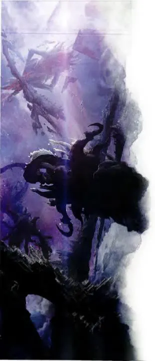
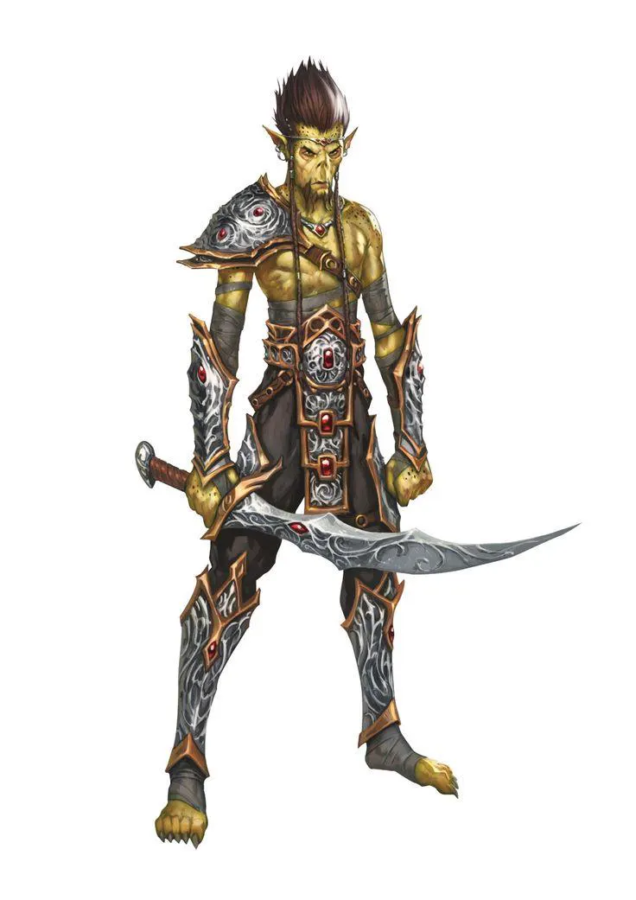
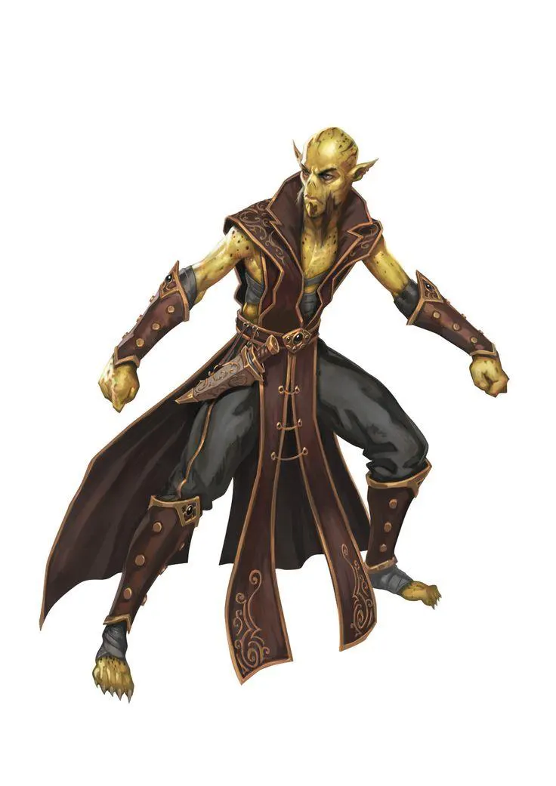

# Gith

O bélico githyanki e o contemplativo githzerai são pessoas diferentes – duas culturas que se desprezam profundamente. Antes de existirem os githyanki ou os githzerai, essas criaturas eram uma única raça escravizada pelos devoradores de mentes. Apesar de terem tentando derrubar seus mestres inúmeras vezes, suas rebeliões foram repetitivamente esmagadas até uma grande líder chamada Gith surgir.

Após muito derramamento de sangue, Gith e seus seguidores se livrou das amarras dos seus mestres ilitides, mas outro líder chamado Zerthimon apareceu ao final da batalha. Zerthimon desafiou as motivações de Gith, alegando que a liderança marcial dela e seu desejo estrito de vingança não acrescentava nada além de outra forma de escravidão para o povo dela. Uma rixa surgiu entre os seguidores de cada líder, e eles eventualmente se tornaram as duas raças cuja inimizade perdura até hoje.

Se essa criaturas altas e magras eram pacificas ou selvagens, cultas ou primitivas antes dos devoradores de mentes os escravizarem e muda-los, ninguém pode dizer. Nem mesmo o nome original da raça se manteve desse período distante.

### Githyanki

Os githyanki saquearam incontáveis mundos do convés de seus navios astrais e das costas de dragões vermelhos. Plumas, contas, gemas e metais preciosos decoram suas armaduras e armas – as lendárias espadas prateadas com as quais eles cortam seus inimigos. Desde que ganharam sua liberdade dos devoradores de mentes, os githyanki se tornaram conquistadores impiedosos sob a liderança da sua temida rainha-lich, Vlaakith.

***Saqueadores Astrais***. Os githyanki desprezam todas as outras raças, empreendendo saques devastadores que os tiram de seus fortes no Plano Astral para os cantos mais longínquos do multiverso. A guerra é a expressão derradeira da cultura githyanki, e seus impiedosos olhos negros não conhecem misericórdia. Após um assalto, eles deixam para os sobreviventes arrasados comida e recursos suficientes para durarem com dificuldade. Depois, os githyanki retornam para os seus adversários conquistados, saqueando-os novamente e novamente.

***Seguidores de Gith***. Em seu próprio idioma, githyanki significa “seguidores de Gith”. Sob a orientação de Gith, os githyanki estratificaram-se em uma sociedade militarista, com um sistema de casta rigoroso, dedicado à luta contínua contra as vítimas e inimigos jurados de sua raça. Quando o líder deles, Gith, pereceu, ela foi substituída por sua conselheira morta-viva, Vlaakith. A rainha-lich proibiu adoração de todos os seres, exceto dela mesma.

De todos os seus inimigos, o mais odiado dos githyanki são seus antigos mestres, os devoradores de mentes. Seus parentes mais próximos, os githzerai, são os segundos no grau de inimizade. Todas as outras criaturas são tratadas com simples desprezo pelos githyanki, cuja orgulho xenofóbico define sua visão das raças inferiores.

***Espadas Prateadas***. Em tempos antigos, cavaleiros gith criaram armas especiais para combater seus mestres devoradores de mentes. Essas espadas prateadas canalizam a força de vontade do portador, causando tanto dano psíquico quanto físico. Um githyanki não pode se tornar um cavaleiro até dominar uma disciplina singular

necessária para trazer tal lâmina à existência. Uma espada prateada é equivalente a uma espada grande, e tem as propriedades de uma *espada grande +3* nas mãos do seu criador.

Aos olhos dos githyanki, cada *espada prateada* é uma relíquia inestimável e uma obra de arte. Cavaleiros githyanki irão caçar e destruir qualquer não-githyanki que ouse carregar ou empunhar uma espada prateada, recuperando-a para seu povo.

***Cavaleiros de Dragões Vermelhos***. Na revolta contra os ilitides, Gith procurou aliados. Sua conselheira Vlaakith apelou para Tiamat, a deusa das espécies malignas de dragão, e Gith se aventurou nos Nove Infernos para se encontrar com ela. Apenas Tiamat sabe agora o que se passou entre elas, mas Gith voltou para o Plano Astral com o consorte da Rainha Dragão, Ephelomon, que proclamou que sua espécie agiria para sempre como aliada dos githyanki. Nem todos os dragões vermelhos honram a aliança feita há muito tempo atrás, mas a maioria, pelo menos, não considera os githyanki como seus inimigos.

***Posto Avançado no Reino Mortal***. Já que as criaturas que habitam o Plano Astral não envelhecem, os githyanki estabelecem creches em áreas remotas do Plano Material para criar seus filhos. Similares à academias militares, essas creches treinam jovens githyanki para aprimorar suas habilidades psíquicas e combativas. Quando um githyanki se torna um adulto e mata um devorador de mentes como parte do rito sagrado de passagem, ele adquire permissão para se juntar com seu povo no Plano Astral.

### Githzerai

Filósofos focados e ascetas austeros, os githzerai perseguem vidas de ordem rígida. Magros e musculosos, eles vestem roupas sem adornos ou ornamentos, mantendo seu próprio conselho e confiando em poucas criaturas de fora de sua própria espécie. Tendo dado as costas a espécie bélica githyanki, os githzerai mantem um estilo de vida estritamente monástico, vivendo em ilhas de ordem no vasto mar do caos que é o plano do Limbo.

***Adeptos Psiônicos***. Os progenitores dos githzerai se adaptaram a – e foram transformados por – um ambiente psíquico imposto a eles por seus senhores ilitides. Sob os ensinamentos de Zerthimon, que convenceu seu povo a abandonar as ambições belicosas de Gith, os githzerai focaram sua energia mental na criação de barreiras físicas e psíquicas para protege-los contra ataques, psiquismo ou seja o que for. A luta é particular para um githzerai, que usa sua mente para pasmar e incapacitar oponentes, deixando-os vulneráveis para a punição física.

***Ordem em Meio ao Caos***. Os githzerai vivem voluntariamente no coração do caos no Limbo – um plano distorcido e volúvel suscetível a manipulação e subjugação de mentes githzerai fortes o suficiente para domina-lo. O Limbo é um redemoinho de matéria prima e energia, seu terreno é uma tormenta de rochas e terra carregados por torrentes de líquido turvo, fustigado por fortes ventos, atingido por fogo e congelado por muralhas de gelo esmagadoras.

As forças do Limbo reagem a senciência, no entanto. Usando o poder de suas mentes, os githzerai domam os elementos caóticos do plano, fazendo-os sossegarem em formas fixas e habitáveis e criando oásis e santuários dentro do turbilhão.

Os monastérios-fortalezas dos githzerai permanecem resolutos contra o caos que os rodeia, virtualmente impenetráveis ao tumulto de suas redondezas, porquê os githzerai assim o querem. Cada monastério é comandado por monges que impõem um cronograma rigoroso de cantos, refeições, treinamentos em artes marciais e devoções de acordo com suas próprias filosofias. Atrás de suas muralhas psionicamente fortificadas, os githzerai abraçam o pensamento, aprendizado, poder psiônico, ordem e disciplina acima de todas as outras coisas.

A hierarquia social dos githzerai é baseada no mérito, e aqueles githzerai que sejam os mais sábios ensinam e os mais treinados no combate físico e mental tornam-se líderes. Os githzerai reverenciam grandes heróis e professores do passado, copiando as virtudes dessas figuras na sua vida cotidiana.

***Discípulos de Zerthimon***. Os githzerai reverenciam Zerthimon, o fundador da raça. Apesar de Gith ter conquistado a liberdade do seu povo, Zerthimon viu que ela era imprópria para liderar. Ele acreditava que o belicismo dela iria em breve torna-la uma tirana nada melhor que os devoradores de mentes.

Monges githzerai habilidosos que melhor exemplificam os ensinamentos e princípios de Zerthimon são chamados de Zerths. Esses monges poderosos e disciplinados podem transportar seus corpos de um plano para outro usando apenas o poder de suas mentes.

***Além do Limbo***. Apesar dos githzerai raramente lidarem com os reinos além do Limbo, monges de outras raças com treinamento avançado, às vezes, buscam os monastérios githzerai e tentam ser admitidos como estudantes. Mais raro ainda, é um mestre githzerai estabelecer um monastério escondido no Plano Material para treinar jovens githzerai ou para espalhar a filosofia e ensinamentos de Zerthimon.

Tão disciplinados quando são, os githzerai nunca esqueceram seu longo aprisionamento pelos devoradores de mentes. Como uma devoção especial, eles organizaram *rrakkmas* – grupos de caçada a ilitides – para outros planos, não retornando para seus monastérios enquanto não matarem pelo menos tantos ilitides quanto são os caçadores no grupo.

## Bloco de estatísticas: Cavaleiro Githyanki

*Humanoide Médio (gith), leal e mau*

**Classe de Armadura** 18 (placas)  
**Pontos de Vida** 91 (14d8 + 28)  
**Deslocamento** 9 m

| FOR | DES | CON | INT | SAB | CAR |
| :---: | :---: | :---: | :---: | :---: | :---: |
| 16 (+3) | 14 (+2) | 15 (+2) | 14 (+2) | 14 (+2) | 15 (+2) |

**Testes de Resistência** Con +5, Int +5, Sab +5  
**Sentidos** Percepção passiva 12  
**Idiomas** Gith  
**Nível de Desafio** 8 (3.900 XP)

***Conjuração Inata (Psionismo)***. A habilidade de conjuração do githyanki é Inteligência (CD de resistência de magia 13, +5 para atingir com ataques com magia). Ele pode conjurar, inatamente, as seguintes magias, sem necessidade de componentes materiais:

À vontade: *mãos mágicas* (a mão é invisível) 3/dia cada: *dificultar detecção* (pessoal apenas), *idiomas, passo* *nebuloso, salto* 1/dia cada: *telecinésia, viagem planar*

### Ações

***Ataques Múltiplos***. O githyanki realiza dois ataques com sua espada grande prateada.

***Espada Grande Prateada***. *Ataque Corpo-a-Corpo com Arma*: +9 para atingir, alcance 1,5 m, um alvo. *Acerto*: 13 (2d6 + 6) de dano cortante mais 10 (3d6) de dano psíquico. Esse é um ataque com arma mágica. Num acerto crítico contra um alvo com um corpo astral (como na magia projeção astral), o githyanki pode cortar o cordão prateado que liga o alvo ao seu corpo material, ao invés de causar dano.

## Bloco de estatísticas: Guerreiro Githyanki

*Humanoide Médio (gith), leal e mau*

**Classe de Armadura** 17 (meia-armadura)  
**Pontos de Vida** 49 (9d8 + 9)  
**Deslocamento** 9 m

| FOR | DES | CON | INT | SAB | CAR |
| :---: | :---: | :---: | :---: | :---: | :---: |
| 15 (+2) | 14 (+2) | 12 (+1) | 13 (+1) | 13 (+1) | 10 (+0) |

**Testes de Resistência** Con +3, Int +3, Sab +3  
**Sentidos** Percepção passiva 11  
**Idiomas** Gith  
**Nível de Desafio** 3 (700 XP)

***Conjuração Inata (Psionismo)***. A habilidade de conjuração do githyanki é Inteligência (CD de resistência de magia 11). Ele pode conjurar, inatamente, as seguintes magias, sem necessidade de componentes materiais:

À vontade: *mãos mágicas* (a mão é invisível) 3/dia cada: *dificultar detecção* (pessoal apenas), *passo nebuloso,* *salto*

### Ações

***Ataques Múltiplos***. O githyanki realiza dois ataques com sua espada grande.

***Espada Grande Prateada***. *Ataque Corpo-a-Corpo com Arma*: +4 para atingir, alcance 1,5 m, um alvo. *Acerto*: 9 (2d6 + 2) de dano cortante mais 7 (2d6) de dano psíquico.

## Bloco de estatísticas: Monge Githzerai

*Humanoide Médio (gith), leal e neutro*

**Classe de Armadura** 14  
**Pontos de Vida** 38 (7d8 + 7)  
**Deslocamento** 9 m

| FOR | DES | CON | INT | SAB | CAR |
| :---: | :---: | :---: | :---: | :---: | :---: |
| 12 (+1) | 15 (+2) | 12 (+1) | 13 (+1) | 14 (+2) | 10 (+0) |

**Testes de Resistência** For +3, Des +4, Int +3, Sab +4  
**Perícias** Intuição +4, Percepção +4  
**Sentidos** Percepção passiva 14  
**Idiomas** Gith  
**Nível de Desafio** 2 (450 XP)

***Conjuração Inata (Psionismo)***. A habilidade de conjuração do githzerai é Sabedoria (CD de resistência de magia 12). Ele pode conjurar, inatamente, as seguintes magias, sem necessidade de componentes materiais:

À vontade: *mãos mágicas* (a mão é invisível) 3/dia cada: *escudo arcano, queda suave, salto, ver o invisível*

***Defesa Psíquica***. Enquanto o githzerai não estiver usando armadura ou empunhando escudo, ele inclui seu modificador de Sabedoria na sua CA.

### Ações

***Ataques Múltiplos***. O githzerai realiza dois golpes desarmados.

***Golpe Desarmado***. *Ataque Corpo-a-Corpo com Arma*: +4 para atingir, alcance 1,5 m, um alvo. *Acerto*: 6 (1d8 + 2) de dano de concussão mais 9 (2d8) de dano psíquico. Esse é um ataque com arma mágica.

## Bloco de estatísticas: Zerth Githzerai

*Humanoide Médio (gith), leal e neutro*

**Classe de Armadura** 17  
**Pontos de Vida** 84 (13d8 + 26)  
**Deslocamento** 9 m

| FOR | DES | CON | INT | SAB | CAR |
| :---: | :---: | :---: | :---: | :---: | :---: |
| 13 (+1) | 18 (+4) | 15 (+2) | 16 (+3) | 17 (+3) | 12 (+1) |

**Testes de Resistência** For +4, Des +7, Int +6, Sab +6  
**Perícias** Arcanismo +6, Intuição +6, Percepção +6  
**Sentidos** Percepção passiva 16  
**Idiomas** Gith  
**Nível de Desafio** 6 (2.300 XP)

***Conjuração Inata (Psionismo)***. A habilidade de conjuração do githzerai é Sabedoria (CD de resistência de magia 14, +6 para atingir com ataques com magia). Ele pode conjurar, inatamente, as seguintes magias, sem necessidade de componentes materiais:

À vontade: *mãos mágicas* (a mão é invisível) 3/dia cada: *escudo arcano, queda suave, salto, ver o invisível* 1/dia cada: *assassino fantasmagórico, viagem planar*

***Defesa Psíquica***. Enquanto o githzerai não estiver usando armadura ou empunhando escudo, ele inclui seu modificador de Sabedoria na sua CA.

### Ações

***Ataques Múltiplos***. O githzerai realiza dois golpes desarmados.

***Golpe Desarmado***. *Ataque Corpo-a-Corpo com Arma*: +7 para atingir, alcance 1,5 m, um alvo. *Acerto*: 11 (2d6 + 4) de dano de concussão mais 13 (3d8) de dano psíquico. Esse é um ataque com arma mágica.
