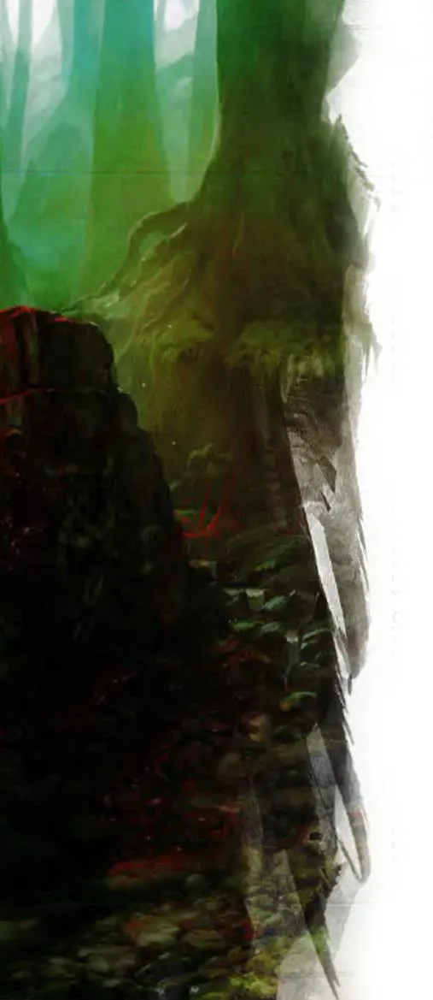
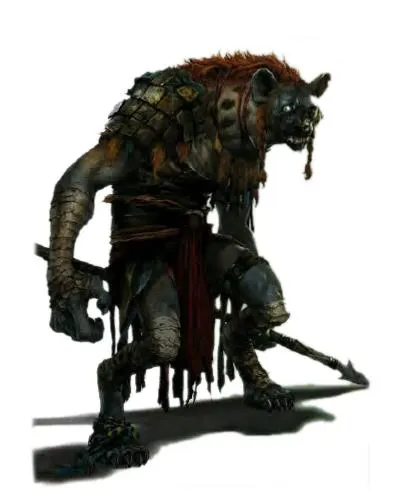

# Gnolls

Os gnolls são humanoides bestiais que atacam assentamentos ao longo das fronteiras e margens da civilização sem aviso, chacinando suas vítimas e devorando a carne delas.

***Origem Demoníaca***. A origem dos gnolls remonta de uma época em que o lorde demônio Yeenoghu encontrou seu caminho para o Plano Material e investido freneticamente. Matilhas de hienas comuns seguiram-no em seu despertar, devorando os cadáveres mortos pelo lorde demônio. Essas hienas foram transformadas nos primeiros gnolls, seguindo Yeenoghu até que ser banido de volta para o Abismo. Os gnolls, em seguida, espalharam-se por toda face do mundo, sendo uma lembrança terrível de poder demoníaco.

***Destruidores Nômades***. Os gnolls são perigosos porque eles atacam aleatoriamente. Eles surgem de qualquer lugar, saqueando e chacinando, então vão pra outro lugar. Eles atacam como uma praga de insetos, pilhando assentamentos e vão embora pouco antes de arrasar as construções, destroçar cadáveres e contaminar o solo. Os gnolls escolhem alvos frágeis para suas investidas. Guerreiros armadurados enfurnados em um castelo fortificado irão sobreviver a uma horda enfurecida de gnolls incólumes, mesmo quando as cidades, vilas e fazendas que rodeiam o castelo tenham sido incendiadas e seu povo chacinado e devorado.

Os gnolls raramente constroem estruturas permanentes ou criam qualquer coisa de valor duradouro. Eles não fazem armas ou armaduras, mas obtém tais itens dos corpos de suas vítimas mortas, costurando orelhas, dentes, escalpos e outros troféus de seus adversários em suas armaduras de miscelâneas.

***Sede de Sangue***. Nenhuma bondade ou compaixão reside no coração de um gnoll. Como um demônio, falta neles qualquer coisa parecida com uma consciência, e eles não podem ser ensinados ou coagidos a deixar de lado suas tendências destrutivas. O frenesi sanguinário dos gnolls torna-os inimigos de todos, e quando eles não tem um inimigo em comum, lutam entre si. Mesmo os orcs mais selvagens evitam se aliar com gnolls.

### Gnoll Líder de Matilha

O alfa de uma matilha de gnolls é o líder de matilha, comandando através da força e esperteza. Um líder de matilha adquire os melhores espólios, alimentos, bugigangas de valor e itens mágicos da matilha de gnolls. Ele enfeita seu corpo com brincos brutais e troféus grotescos, tingindo sua pelagem com símbolos demoníacos, esperando que Yeenoghu torne-o invulnerável.

### Gnoll Presa de Yeenoghu

Os gnolls celebram suas vitórias realizando rituais demoníacos e fazendo oferendas de sangue a Yeenoghu. Às vezes, o lorde demônio recompensa seus adoradores permitindo que um deles seja possuído por um espírito demoníaco. Marcado como favorito de Yeenoghu, o receptor sortudo torna-se uma presa de Yeenoghu, o escolhido do Senhor Gnoll. De uma forma muito parecida pela qual Yeenoghu criou os primeiros gnolls, uma hiena que se banqueteie de um oponente morto por uma presa é afligida por uma terrível transformação, tornando-se um gnoll totalmente adulto. A depender da quantidade de hienas na região, uma presa de Yeenoghu pode levar a um incrível aumento da população de gnolls. Encontrar e matar a presa é a única forma de manter a população sob controle.

## Bloco de estatísticas: Gnoll

*Humanoide Médio (gnoll), caótico e mau*

**Classe de Armadura** 15 (gibão de peles, escudo)  
**Pontos de Vida** 22 (5d8)  
**Deslocamento** 9 m

| FOR | DES | CON | INT | SAB | CAR |
| :---: | :---: | :---: | :---: | :---: | :---: |
| 14 (+2) | 12 (+1) | 11 (+0) | 6 (–2) | 10 (+0) | 7 (–2) |

**Sentidos** visão no escuro 18 m, Percepção passiva 10  
**Idiomas** Gnoll  
**Nível de Desafio** 1/2 (100 XP)

***Frenesi***. Quando o gnoll reduz uma criatura a 0 pontos de vida com um ataque corpo-a-corpo no seu turno, ele pode realizar uma ação bônus para se mover até metade do seu deslocamento e realizar um ataque de mordida.

### Ações

***Mordida***. *Ataque Corpo-a-Corpo com Arma*: +4 para atingir, alcance 1,5 m, uma criatura. *Acerto*: 4 (1d4 + 2) de dano perfurante.

***Lança***. *Ataque Corpo-a-Corpo ou à Distância com Arma*: +4 para atingir, alcance 1,5 m ou distância 6/18 m, um alvo. *Acerto*: 5 (1d6 + 2) de dano perfurante ou 6 (1d8 + 2) de dano perfurante se usada com as duas mãos para realizar um ataque corpo-a-corpo.

***Arco Longo***. *Ataque à Distância Arma*: +3 para atingir, distância 45/180 m, um alvo. *Acerto*: 5 (1d8 + 1) de dano perfurante.

## Bloco de estatísticas: Gnoll Líder de Matilha

*Humanoide Médio (gnoll), caótico e mau*

**Classe de Armadura** 15 (camisão de malha)  
**Pontos de Vida** 49 (9d8 + 9)  
**Deslocamento** 9 m

| FOR | DES | CON | INT | SAB | CAR |
| :---: | :---: | :---: | :---: | :---: | :---: |
| 16 (+3) | 14 (+2) | 13 (+1) | 8 (–1) | 11 (+0) | 9 (–1) |

**Sentidos** visão no escuro 18 m, Percepção passiva 10  
**Idiomas** Gnoll  
**Nível de Desafio** 2 (450 XP)

***Frenesi***. Quando o gnoll reduz uma criatura a 0 pontos de vida com um ataque corpo-a-corpo no seu turno, ele pode realizar uma ação bônus para se mover até metade do seu deslocamento e realizar um ataque de mordida.

### Ações

***Ataques Múltiplos***. O gnoll realiza dois ataques, ambos ou com sua glaive ou com seu arco longo, e usa seu Incitar Frenesi se puder.

***Mordida***. *Ataque Corpo-a-Corpo com Arma*: +5 para atingir, alcance 1,5 m, uma criatura. *Acerto*: 5 (1d4 + 3) de dano perfurante.

***Glaive***. *Ataque Corpo-a-Corpo com Arma*: +5 para atingir, alcance 3 m, um alvo. *Acerto*: 8 (1d10 + 3) de dano cortante.

***Arco Longo***. *Ataque à Distância Arma*: +4 para atingir, distância 45/180 m, um alvo. *Acerto*: 6 (1d8 + 2) de dano perfurante.

***Incitar Frenesi (Recarrega 5–6)***. Uma criatura que o gnoll possa ver a até 9 metros dele, pode usar sua reação para realizar um ataque corpo-a-corpo se puder ouvir o gnoll e possua o traço Frenesi.

## Bloco de estatísticas: Gnoll Presa de Yeenoghu

*Humanoide Médio (gnoll), caótico e mau*

**Classe de Armadura** 14 (gibão de peles)  
**Pontos de Vida** 65 (10d8 + 20)  
**Deslocamento** 9 m

| FOR | DES | CON | INT | SAB | CAR |
| :---: | :---: | :---: | :---: | :---: | :---: |
| 17 (+3) | 15 (+2) | 15 (+2) | 10 (+0) | 11 (+0) | 13 (+1) |

**Testes de Resistência** Con +4, Sab +2, Car +3  
**Sentidos** visão no escuro 18 m, Percepção passiva 10  
**Idiomas** Abissal, Gnoll  
**Nível de Desafio** 4 (1.100 XP)

***Frenesi***. Quando o gnoll reduz uma criatura a 0 pontos de vida com um ataque corpo-a-corpo no seu turno, ele pode realizar uma ação bônus para se mover até metade do seu deslocamento e realizar um ataque de mordida.

### Ações

***Ataques Múltiplos***. O gnoll realiza três ataques: um com sua mordida e dois com suas garras.

***Mordida***. *Ataque Corpo-a-Corpo com Arma*: +5 para atingir, alcance 1,5 m, uma criatura. *Acerto*: 6 (1d6 + 3) de dano perfurante e o alvo deve ser bem sucedido num teste de resistência de Constituição CD 12 ou sofrerá 7 (2d6) de dano de veneno.

***Garra***. *Ataque Corpo-a-Corpo com Arma*: +5 para atingir, alcance 1,5 m, uma criatura. *Acerto*: 7 (1d8 + 3) de dano cortante.
