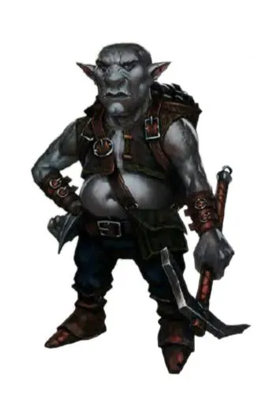

# Gnomo das Profundezas (Svirfneblin)

## (Svirfneblin)

Gnomos das profundezas, ou svirfneblin, vivem muito abaixo da superfície do mundo em labirintos tortuosos e cavernas esculpidas. Eles sobrevivem por causa de sua furtividade, esperteza e tenacidade. Sua pele acinzentada permite que eles se mesclem às paredes rochosas ao seu redor. Eles também são surpreendentemente pesados e fortes para seu tamanho. Um adulto comum pesa entre 50 e 60 quilos e mede 90 centímetros de altura.

Um enclave de svirfneblin típico ontem várias centenas de gnomos das profundezas e é altamente fortificado. Túneis secretos levam para o assentamento, e os gnomos das profundezas usam essas rotas de evacuação quando o enclave está sob ataque.

***Tarefas Estabelecidas por Gênero***. Svirfneblin machos são carecas, enquanto que as fêmeas tem cabelos acinzentados pegajosos. Tradicionalmente, as fêmeas comandam os enclaves enquanto que os machos vasculham os arredores em busca de inimigos e depósitos de pedras preciosas.

## Bloco de estatísticas: Gnomo das Profundezas (Svirfneblin)

*Humanoide Pequeno (gnomo), neutro e bom*

**Classe de Armadura** 15 (camisão de malha)  
**Pontos de Vida** 16 (3d6 + 6)  
**Deslocamento** 6 m

| FOR | DES | CON | INT | SAB | CAR |
| :---: | :---: | :---: | :---: | :---: | :---: |
| 15 (+2) | 14 (+2) | 14 (+2) | 12 (+1) | 10 (+0) | 9 (–1) |

**Perícias** Furtividade +4, Investigação +3, Percepção +2  
**Sentidos** visão no escuro 36 m, Percepção passiva 12  
**Idiomas** Gnômico, Terran, Subcomum  
**Nível de Desafio** 1/2 (100 XP)

***Camuflagem Rochosa***. O gnomo possui vantagem em testes de Destreza (Furtividade) feitos para se esconder em terreno rochoso.

***Conjuração Inata***. A habilidade de conjuração do gnomo é Inteligência (CD de resistência de magia 11). Ele pode conjurar, inatamente, as seguintes magias, sem necessidade de componentes materiais:

À vontade: *dificultar detecção* (pessoal apenas) 1/dia cada: *cegueira/surdez, disfarçar-se, nublar*

***Esperteza Gnômica***. O gnomo possui vantagem em testes de resistência de Inteligência, Sabedoria e Carisma contra magia.

### Ações

***Picareta de Guerra***. *Ataque Corpo-a-Corpo com Arma*: +4 para atingir, alcance 1,5 m, um alvo. *Acerto*: 6 (1d8 + 2) de dano perfurante.

***Dardo Envenenado***. *Ataque à Distância com Arma*: +4 para atingir, distância 9/36 m, uma criatura. *Acerto*: 4 (1d4 + 2) de dano perfurante, e o alvo deve ser bem sucedido num teste de resistência de Constituição CD 12 ou ficará envenenado por 1 minuto. O alvo pode repetir o teste de resistência no final de cada um dos turnos dele, terminando o efeito sobre se, caso obtenha sucesso.

***Mineradores de Pedras Preciosas***. Os svirfneblin valorizam gemas, especialmente os rubis, os quais eles extraem de minas bem profundas no Subterrâneo. A caçada por gemas geralmente os leva a conflitos com observadores, drow, kuo-toa, duergar e devoradores de mentes. De todos os inimigos naturais deles, os que os gnomos das profundezas mais temem e desprezam são os homicidas e adoradores de demônios dos drow.

***Amigos da Terra***. Os gnomos das profundezas são geralmente encontrados na companhia de criaturas do Plano Elemental da Terra. Alguns svirfneblin podem invocar tais criaturas. Criaturas da terra guardam os assentamentos svirfneblin, especialmente xorns atraídos para servir com a promessa de receberem gemas como alimento.
