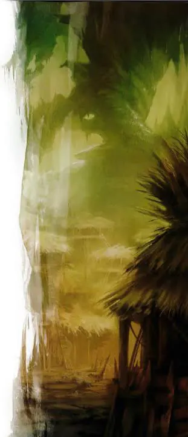
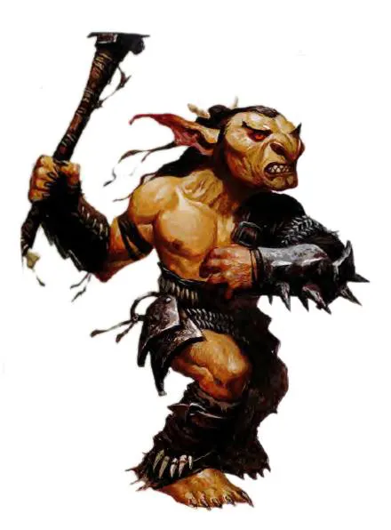

# Goblins

Goblins são humanoides pequenos, egoístas e de coração negro que vivem em cavernas, minas abandonadas, masmorras despojadas e outros ambientes lúgubres. Individualmente fracos, os goblins andam em grandes – às vezes devastadoras – quantidades. Eles anseiam por poder e regularmente abusam de qualquer autoridade que adquiram.

***Goblinoides***. Os goblins pertencem a uma família de criaturas chamadas goblinoides. Seus primos maiores, hobgoblins e bugbear, gostam de intimidar os goblins até a submissão. Os goblins são preguiçosos e indisciplinados, fazendo deles péssimos servos, trabalhadores ou guardas.

***Júbilo Malicioso***. Motivados por ganância e malícia, os goblins não conseguem deixar de comemorar as poucas vezes que eles estão no controle. Eles dançam e aprontam alegremente quando a vitória é deles. Depois de terminar seus festejos, os goblins deliciam-se com o tormento de outras criaturas e abraçam todo tipo de maldade.

***Líderes e Seguidores***. Os goblins são comandados pelos mais fortes e espertos dentre eles. Um chefe goblin pode comandar um único covil, enquanto que um rei ou rainha goblin (que não é nada além de um chefe goblin glorificado) governa centenas de goblins, espalhados por diversos covis para garantir a sobrevivência da tribo. Os chefes goblins são depostos facilmente, e muitas tribos goblin são tomadas por hobgoblins senhores da guerra ou bugbears comandantes.

***Covis Desafiadores***. Os goblins infestam seus covis com alarmes designados para sinalizar a chegada de intrusos. Esses covis também estão repletos de túneis apertados e tocas que criaturas de tamanho humano não podem adentrar, mas nos quais os goblins podem rastejar com facilidade, permitindo que eles fujam ou deem a volta e surpreendam seus inimigos.

***Mascotes Ratos e Lobos de Montaria***. Os goblins possuem uma afinidade com ratos e lobos, criando-os para servir como companheiros e montarias, respectivamente. Como ratos, os goblins evitam a luz do sol e dormem no subterrâneo durante o dia. Como lobos, eles caçam em matilhas, que se tornam mais ousadas pela quantidade. Quando caçam das costas de lobos, os goblins usam táticas de atacar e correr.

***Adoradores de Maglubiyet***. Maglubiyet o Todo Poderoso, o Senhor das Profundezas e da Escuridão, é o grande deus dos goblinoides. Idealizado pela maioria dos goblins como um goblin guerreiro de 3,35 metros de altura com pele negra e com chamas emergindo dos olhos, ele é venerado não por adoração, mas por medo. Os goblins acreditam que quando morrem em batalha, seus espíritos se juntam as fileiras do exército de Magluiyet no plano do Aqueronte. Esse é um “privilégio” que a maioria dos goblins abominam, temendo a tirania eterna do Todo Poderoso mais que a própria morte.

## Bloco de estatísticas: Chefe Goblin

*Humanoide Pequeno (goblinoide), neutro e mau*

**Classe de Armadura** 17 (camisão de malha, escudo)  
**Pontos de Vida** 21 (6d6)  
**Deslocamento** 9 m

| FOR | DES | CON | INT | SAB | CAR |
| :---: | :---: | :---: | :---: | :---: | :---: |
| 10 (+0) | 14 (+2) | 10 (+0) | 10 (+0) | 8 (–1) | 10 (+0) |

**Perícias** Furtividade +6  
**Sentidos** visão no escuro 18 m, Percepção passiva 9  
**Idiomas** Comum, Goblin  
**Nível de Desafio** 1 (200 XP)

***Escapada Ágil***. O goblin pode realizar a ação de Desengajar ou Esconder-se com uma ação bônus em cada um dos seus turnos.

### Ações

***Ataques Múltiplos***. O goblin realiza dois ataques com sua cimitarra. O segundo ataque tem desvantagem.

***Cimitarra***. *Ataque Corpo-a-Corpo com Arma*: +4 para atingir, alcance 1,5 m, um alvo. *Acerto*: 5 (1d6 + 2) de dano cortante.

***Azagaia***. *Ataque Corpo-a-Corpo ou à Distância com Arma*: +2 para atingir, alcance 1,5 m ou distância 9/36 m, um alvo. *Acerto*: 3 (1d6) de dano perfurante.

### Reações

***Redirecionar Ataque.*** Quando uma criatura que o goblin possa ver o escolhe para atacar, o goblin escolhe outro goblin a até 1,5 metro dele. Os dois goblins trocam de lugar, e o goblin escolhido torna-se o alvo do ataque, no lugar.

## Bloco de estatísticas: Goblin

*Humanoide Pequeno (goblinoide), neutro e mau*

**Classe de Armadura** 15 (armadura de couro, escudo)  
**Pontos de Vida** 7 (2d6)  
**Deslocamento** 9 m

| FOR | DES | CON | INT | SAB | CAR |
| :---: | :---: | :---: | :---: | :---: | :---: |
| 8 (–1) | 14 (+2) | 10 (+0) | 10 (+0) | 8 (–1) | 8 (–1) |

**Perícias** Furtividade +6  
**Sentidos** visão no escuro 18 m, Percepção passiva 9  
**Idiomas** Comum, Goblin  
**Nível de Desafio** 1/4 (50 XP)

***Escapada Ágil***. O goblin pode realizar a ação de Desengajar ou Esconder-se com uma ação bônus em cada um dos seus turnos.

### Ações

***Cimitarra***. *Ataque Corpo-a-Corpo com Arma*: +4 para atingir, alcance 1,5 m, um alvo. *Acerto*: 5 (1d6 + 2) de dano cortante.

***Arco Curto***. *Ataque à Distância com Arma*: +4 para atingir, distância 24/96 m, um alvo. *Acerto*: 5 (1d6 + 2) de dano perfurante.
