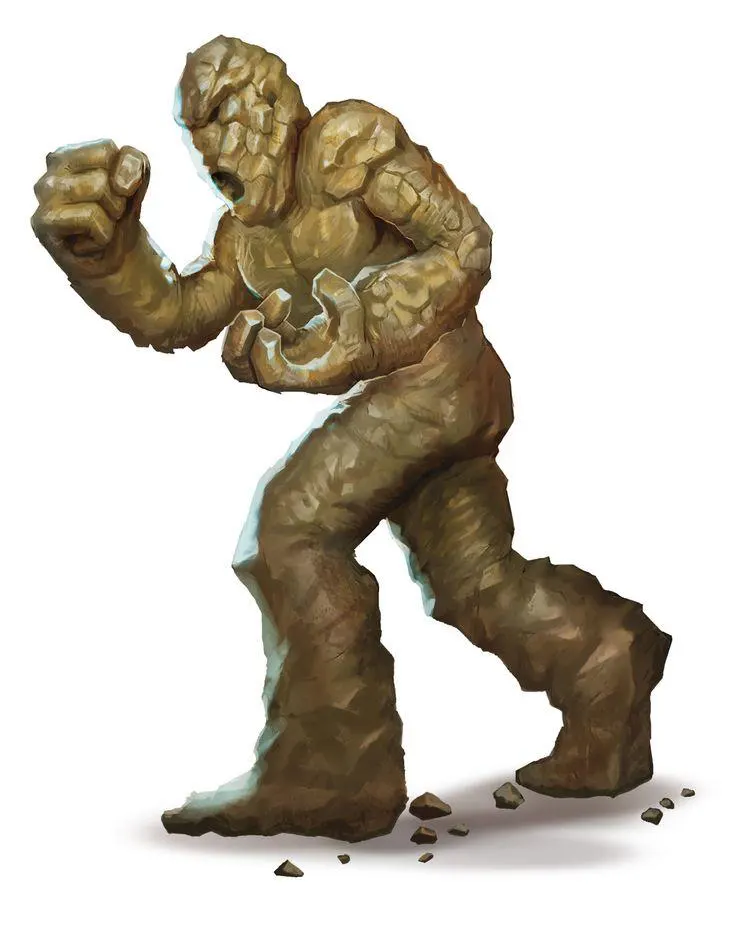
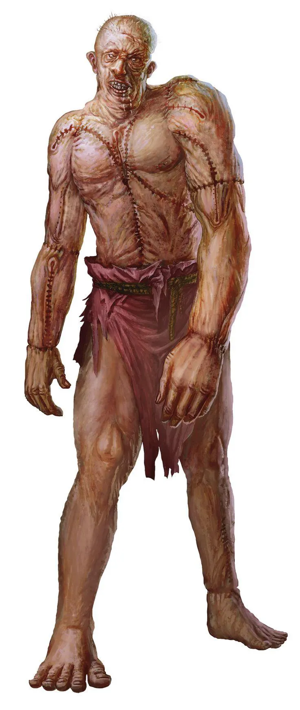
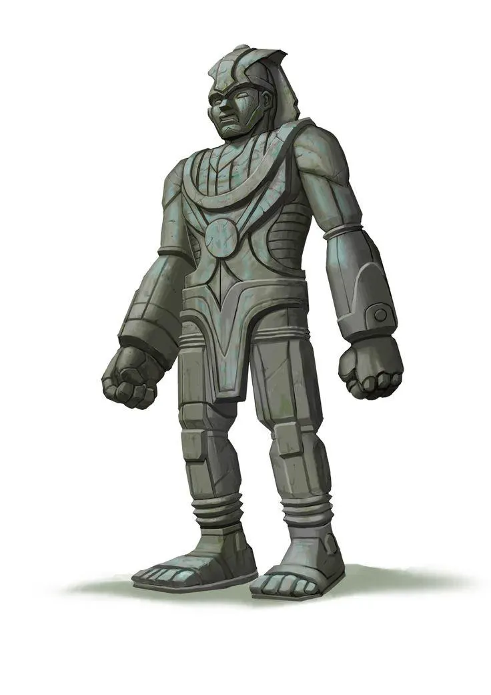
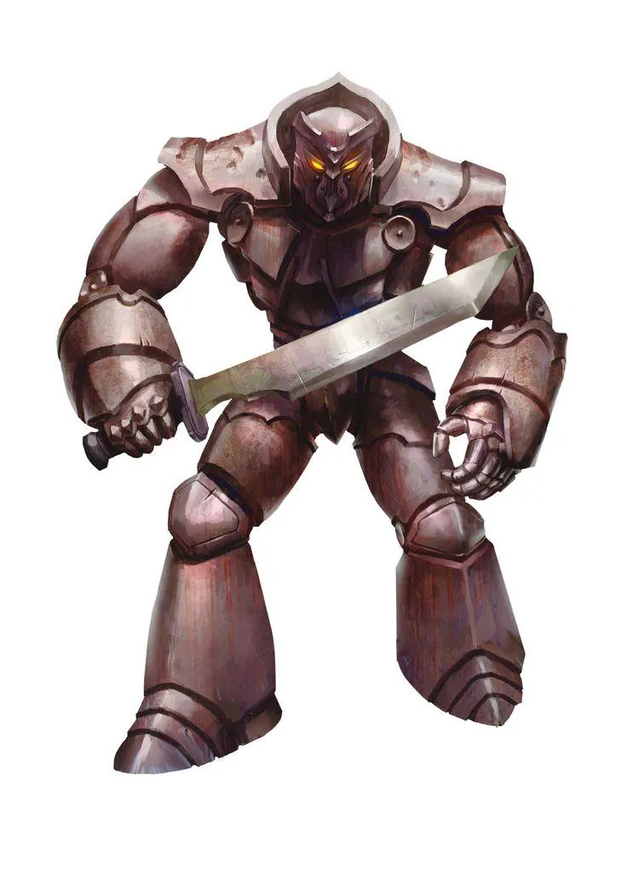

# Golens

Golens são feitos de materiais simples – barro, carne e ossos, ferro ou pedra – mas eles possuem poder e durabilidade surpreendentes. Um golem não possui ambições ou necessidades de sustento, não sentem dor e desconhecem o remorso. Uma força destruidora irrefreável, ele existe para seguir as ordens do seu criador, e protege ou ataque como seu criador denominou.

Para criar um golem, um dos requisitos é um *manual* *dos golens* (veja o *Guia do Mestre*). As ilustrações e instruções abrangentes no manual detalham o processo de criação de um golem de um tipo em particular.

***Espírito Elemental em Forma Material***. A construção de um golem começa com a construção do seu corpo, exigindo grande perícia no ofício de escultura, lapidação, forja ou cirurgia. Algumas vezes o criador de um golem é um mestre da arte, mas geralmente o indivíduo que deseja um golem pode designar mestres artesãos para fazer o trabalho.

Após a construção do corpo de barro, carne, ferro ou pedra, o criador do golem infunde-o com um espírito do Plano Elemental da Terra. Essa pequena centelha de vida não possui memória, personalidade ou história. Ela tem apenas o ímpeto simples de se mover e obedecer. Esse processo vincula o espírito ao corpo artificial e o submete à vontade do criador do golem.

***Guardiões Eternos***. Os golens podem guardar locais sagrados, tumbas e câmaras de tesouro muito tempo depois da morte de seus criadores, continuando a cumprir as tarefas designadas por toda a eternidade enquanto sacodem os danos físicos e ignoram todos, exceto os causados pelas magias mais potentes.

Um golem pode ser criado com um amuleto especial ou outro item que permita que o possuidor do item controle o golem. Assim, os golens cujos criadores estão mortos há muito tempo podem ser aproveitados para servir um novo mestre.

***Obediência Cega***. Quando seu criador ou possuidor está próximo para comanda-lo, um golem executa suas ordens com perfeição. Se o golem for deixado sem instruções ou estiver incapacitado, ele continua a seguir as últimas ordens da melhor forma possível. Quando não puder cumprir suas ordens, um golem pode reagir violentamente – ou ficar parado e não fazer nada. Um golem que receba ordens conflitantes, às vezes, alterna entre elas.

Um golem não pode pensar ou agir por si mesmo. Apesar de compreender seus comandos perfeitamente, ele não possui entendimento de linguagem além da compreensão, e não pode ser argumentado ou enganado por palavras.

***Natureza de Constructo***. Um golem não precisa respirar, comer, beber ou dormir.

### Golem de Barro

Esculpido a partir do barro, esse golem volumoso tem sua cabeça e ombros acima da maioria das criaturas de tamanho humano. Ele tem forma humana, mas suas proporções são diferentes.

Golens de barro geralmente são dotados de propósito divino pelos sacerdotes de muita fé. Porém, o barro é um recipiente muito frágil para a força vital. Se o golem sofrer dano, o espírito elemental vinculado a ele pode se libertar. Tal golem fica fora de controle, esmagando tudo ao seu redor até ser destruído ou totalmente reparado.

### Golem de Carne

Um golem de carne é retalho macabro de partes de corpos humanoides costurados e parafusados em um brutamontes musculoso imbuído com uma força formidável. Seu cérebro é capaz de raciocinar simploriamente, embora seus pensamentos não sejam mais sofisticados que os de uma criança. O tecido muscular do golem responde ao poder da eletricidade, revigorando a criatura com vitalidade e força. Encantamentos poderosos protegem a pele do golem, defletindo magias e praticamente todos os ataques, exceto os das armas mais potentes.

Um golem de carne cambaleia numa postura de articulações rígidas, como se não controlasse seu corpo completamente. Sua carne morta não é o recipiente ideal para um espírito elemental, que por vezes urra incoerentemente para desabafar sua indignação. Se o espírito se libertar da vontade do criador, o golem fica furioso até ser acalmado, ou até sua carcaça de carne ser destruída ou completamente curada.

### Golem de Ferro

O mais poderoso dos golens, o golem de ferro é um gigante maciço feito de metal pesado. O formato de um golem de ferro pode ser trabalhado em qualquer forma, apesar da maioria ser construído para se parecer com uma armadura gigante. Seus punhos podem destruir criaturas com um único golpe, e seus passos pesados tremem o chão abaixo dos seus pés. Os golens de ferro empunham lâminas enormes para estender seu alcance, e todos podem expelir nuvens de veneno mortíferas.

O corpo de um golem de ferro é pintado com tinturas e misturas raras. Enquanto os outros golens possuem fraquezas inerentes aos materiais ou ao poder dos espíritos elementais presos dentro deles, os golens de ferro foram feitos para serem quase indestrutíveis. Seus corpos de ferro aprisionam os espíritos que os guiam, e são suscetíveis apenas a armas imbuídas com magia ou com a força do adamante.

### Golem de Pedra

Os golens de pedra mostram grande variedade em forma e constituição, cortados e esculpidos em pedra para se parecerem com altas estátuas impressionantes. Apesar da maioria possuir traços humanoides, os golens de pedra podem ser esculpidos em qualquer formato que o escultor puder imaginar. Golens de pedra antigos encontrados em tumbas lacradas ou ao lado de portões de cidades perdidas, algumas vezes tem o formato de bestas gigantes.

Como outros golens, os golens de pedra são praticamente impenetráveis por magias ou armas comuns. As criaturas que lutam com um golem de pedra podem sentir o fluxo do tempo ser retardado ao seu redor, quase como se fossem eles próprios feitos de pedra.

## Bloco de estatísticas: Golem de Barro

*Constructo Grande, imparcial*

**Classe de Armadura** 14 (armadura natural)  
**Pontos de Vida** 133 (14d10 + 56)  
**Deslocamento** 6 m

| FOR | DES | CON | INT | SAB | CAR |
| :---: | :---: | :---: | :---: | :---: | :---: |
| 20 (+5) | 9 (–1) | 18 (+4) | 3 (–4) | 8 (–1) | 1 (–5) |

**Imunidade a Dano** ácido, psíquico, veneno; concussão, cortante e perfurante de ataques não-mágicos que não sejam de adamante  
**Imunidade a Condição** amedrontado, enfeitiçado, envenenado, exausto, paralisado, petrificado  
**Sentidos** visão no escuro 18 m, Percepção passiva 9  
**Idiomas** compreende os idiomas do seu criador, mas não pode falar  
**Nível de Desafio** 9 (5.000 XP)

***Absorção de Ácido***. Sempre que o golem for alvo de dano de ácido, ele não sofre qualquer dano e, ao invés disso, recupera uma quantidade de pontos de vida igual ao dano de ácido causado.

***Arma Mágica***. Os ataques de armas do golem são mágicos.

***Forma Imutável***. O golem é imune a qualquer magia ou efeito que poderia alterar sua forma.

***Fúria***. Sempre que o golem começar um turno com 60 pontos de vida ou menos, role um d6. Num resultado 6, o golem entra em fúria. Em cada um dos seus turnos enquanto estiver em fúria, o golem ataca a criatura mais próxima que ele possa ver. Se não houver uma criatura próxima o bastante para se mover e atacar, o golem atacará um objeto, de preferência um objeto menor que ele. Quando o golem entrar em fúria, ele continuará assim até ser destruído ou recuperar todos os seus pontos de vida.

***Resistência à Magia***. O golem possui vantagem nos testes de resistência contra magias e outros efeitos mágicos.

### Ações

***Ataques Múltiplos***. O golem realiza dois ataques de pancada.

***Pancada***. *Ataque Corpo-a-Corpo com Arma*: +8 para atingir, alcance 1,5 m, um alvo. *Acerto*: 16 (2d10 + 5) de dano de concussão. Se o alvo for uma criatura, ele deve ser bem sucedido num teste de resistência de Constituição CD 15 ou terá seu máximo de pontos de vida reduzido por um valor igual ao dano sofrido. O alvo morre se caso esse ataque reduza seu máximo de pontos de vida a 0. A redução dura até ser removida pela *magia restauração* maior ou outra mágica.

***Velocidade (Recarrega 5–6)***. Até o final do seu próximo turno, o golem magicamente recebe +2 de bônus na CA, tem vantagem em testes de resistência de Destreza e pode usar seu ataque de pancada com uma ação bônus.

## Bloco de estatísticas: Golem de Carne

*Constructo Médio, neutro*

**Classe de Armadura** 9  
**Pontos de Vida** 93 (11d8 + 44)  
**Deslocamento** 9 m

| FOR | DES | CON | INT | SAB | CAR |
| :---: | :---: | :---: | :---: | :---: | :---: |
| 19 (+4) | 9 (–1) | 18 (+4) | 6 (–2) | 10 (+0) | 5 (–3) |

**Imunidade a Dano** elétrico, veneno; concussão, cortante e perfurante de ataques não-mágicos que não sejam de adamante  
**Imunidade a Condição** amedrontado, enfeitiçado, envenenado, exausto, paralisado, petrificado  
**Sentidos** visão no escuro 18 m, Percepção passiva 10  
**Idiomas** compreende os idiomas do seu criador, mas não pode falar  
**Nível de Desafio** 5 (1.800 XP)

***Absorção de Eletricidade***. Sempre que o golem for alvo de dano elétrico, ele não sofre qualquer dano e, ao invés disso, recupera uma quantidade de pontos de vida igual ao dano elétrico causado.

***Arma Mágica***. Os ataques de armas do golem são mágicos.

***Aversão a Fogo***. Se o golem sofrer dano de fogo, ele terá desvantagem nas jogadas de ataque e testes de habilidade até o final do seu próximo turno.

***Forma Imutável***. O golem é imune a qualquer magia ou efeito que poderia alterar sua forma.

***Fúria***. Sempre que o golem começar um turno com 40 pontos de vida ou menos, role um d6. Num resultado 6, o golem entra em fúria. Em cada um dos seus turnos enquanto estiver em fúria, o golem ataca a criatura mais próxima que ele possa ver. Se não houver uma criatura próxima o bastante para se mover e atacar, o golem atacará um objeto, de preferência um objeto menor que ele. Quando o golem entrar em fúria, ele continuará assim até ser destruído ou recuperar todos os seus pontos de vida. O criador do golem, se estiver a até 18 metros do golem enfurecido, pode tentar acalma-lo falando firmemente e persuasivamente. O golem deve ser capaz de ouvir o criador, que deve usar uma ação para realizar um teste de Carisma (Persuasão) CD 15. Caso sofra dano enquanto ainda esteja com 40 pontos de vida ou menos, o golem pode entrar em fúria novamente.

***Resistência à Magia***. O golem possui vantagem nos testes de resistência contra magias e outros efeitos mágicos.

### Ações

***Ataques Múltiplos***. O golem realiza dois ataques de pancada.

***Pancada***. *Ataque Corpo-a-Corpo com Arma*: +7 para atingir, alcance 1,5 m, um alvo. *Acerto*: 13 (2d8 + 4) de dano de concussão.

## Bloco de estatísticas: Golem de Ferro

*Constructo Grande, imparcial*

**Classe de Armadura** 20 (armadura natural)  
**Pontos de Vida** 210 (20d10 + 100)  
**Deslocamento** 9 m

| FOR | DES | CON | INT | SAB | CAR |
| :---: | :---: | :---: | :---: | :---: | :---: |
| 24 (+7) | 9 (–1) | 20 (+5) | 3 (–4) | 11 (+0) | 1 (–5) |

**Imunidade a Dano** fogo, psíquico, veneno; concussão, cortante e perfurante de ataques não-mágicos que não sejam de adamante  
**Imunidade a Condição** amedrontado, enfeitiçado, envenenado, exausto, paralisado, petrificado  
**Sentidos** visão no escuro 18 m, Percepção passiva 10  
**Idiomas** compreende os idiomas do seu criador, mas não pode falar  
**Nível de Desafio** 16 (15.000 XP)

***Absorção de Fogo***. Sempre que o golem for alvo de dano de fogo, ele não sofre qualquer dano e, ao invés disso, recupera uma quantidade de pontos de vida igual ao dano de fogo causado.

***Arma Mágica***. Os ataques de armas do golem são mágicos.

***Forma Imutável***. O golem é imune a qualquer magia ou efeito que poderia alterar sua forma.

***Resistência à Magia***. O golem possui vantagem nos testes de resistência contra magias e outros efeitos mágicos.

### Ações

***Ataques Múltiplos***. O golem realiza dois ataques corpo-a-corpo.

***Pancada***. *Ataque Corpo-a-Corpo com Arma*: +13 para atingir, alcance 1,5 m, um alvo. *Acerto*: 20 (3d8 + 7) de dano de concussão.

***Espada***. *Ataque Corpo-a-Corpo com Arma*: +13 para atingir, alcance 3 m, um alvo. *Acerto*: 23 (3d10 + 7) de dano cortante.

***Sopro Venenoso (Recarrega 6)***. O golem expele gás venenoso num cone de 4,5 metros. Cada criatura na área deve realizar um teste de resistência de Constituição CD 19, sofrendo 45 (10d8) de dano de veneno se falhar na resistência, ou metade desse dano caso obtenha sucesso.

## Bloco de estatísticas: Golem de Pedra

*Constructo Grande, imparcial*

**Classe de Armadura** 17 (armadura natural)  
**Pontos de Vida** 178 (17d10 + 85)  
**Deslocamento** 9 m

| FOR | DES | CON | INT | SAB | CAR |
| :---: | :---: | :---: | :---: | :---: | :---: |
| 22 (+6) | 9 (–1) | 20 (+5) | 3 (–4) | 11 (+0) | 1 (–5) |

**Imunidade a Dano** psíquico, veneno; concussão, cortante e perfurante de ataques não-mágicos que não sejam de adamante  
**Imunidade a Condição** amedrontado, enfeitiçado, envenenado, exausto, paralisado, petrificado  
**Sentidos** visão no escuro 18 m, Percepção passiva 10  
**Idiomas** compreende os idiomas do seu criador, mas não pode falar  
**Nível de Desafio** 10 (5.900 XP)

***Arma Mágica***. Os ataques de armas do golem são mágicos.

***Forma Imutável***. O golem é imune a qualquer magia ou efeito que poderia alterar sua forma.

***Resistência à Magia***. O golem possui vantagem nos testes de resistência contra magias e outros efeitos mágicos.

### Ações

***Ataques Múltiplos***. O golem realiza dois ataques de pancada.

***Pancada***. *Ataque Corpo-a-Corpo com Arma*: +10 para atingir, alcance 1,5 m, um alvo. *Acerto*: 19 (3d8 + 6) de dano de concussão.

***Lentidão (Recarrega 5–6)***. O golem afeta uma ou mais criaturas que ele possa ver a até 3 metros dele. Cada alvo deve realizar um teste de resistência de Sabedoria CD 17 contra essa magia. Se falhar na resistência, um alvo não poderá usar reações, seu deslocamento é reduzido à metade e ele não pode realizar mais de um ataque por turno. Além disso, o alvo só pode realizar uma ação ou uma ação bônus num turno, mas não ambas. Esse efeito dura por 1 minuto. Um alvo pode repetir o teste de resistência no final de cada um dos turnos dele, terminando o efeito sobre si com um sucesso.
