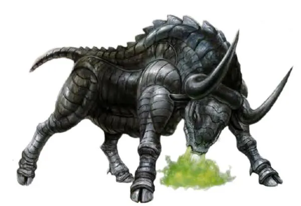

# Gorgon

## Bloco de estatísticas: Gorgon

*Monstruosidade Grande, imparcial*

**Classe de Armadura** 19 (armadura natural)  
**Pontos de Vida** 114 (12d10 + 48)  
**Deslocamento** 12 m

| FOR | DES | CON | INT | SAB | CAR |
| :---: | :---: | :---: | :---: | :---: | :---: |
| 20 (+5) | 11 (+0) | 18 (+4) | 2 (–4) | 12 (+1) | 7 (–2) |

**Perícias** Percepção +4  
**Imunidade a Condição** petrificado  
**Sentidos** visão no escuro 18 m, Percepção passiva 14  
**Idiomas** –  
**Nível de Desafio** 5 (1.800 XP)

***Investida Atropeladora***. Se o gorgon se mover, pelo menos, 6 metros em linha reta até uma criatura e então atingi-la com um ataque de chifre no mesmo turno, o alvo deve ser bem sucedido num teste de resistência de Força CD 16, ou cairá no chão. Se o alvo for derrubado, o gorgon pode realizar um ataque com seus cascos contra ele, com uma ação bônus.

### Ações

***Chifre***. *Ataque Corpo-a-Corpo com Arma*: +8 para atingir, alcance 1,5 m, um alvo. *Acerto*: 18 (2d12 + 5) de dano perfurante.

***Cascos***. *Ataque Corpo-a-Corpo com Arma*: +8 para atingir, alcance 1,5 m, um alvo. *Acerto*: 16 (2d10 + 5) de dano de concussão.

***Sopro Petrificante (Recarrega 5–6)***. O gorgon expele gás petrificante num cone de 3 metros. Cada criatura na área deve ser bem sucedida num teste de resistência de Constituição CD 13. Se fracassar na resistência, um alvo começa a virar pedra e fica impedido. O alvo impedido deve repetir o teste de resistência no final do próximo turno dele. Se obtiver sucesso, o efeito acaba sobre ele. Se fracassar, o alvo fica petrificado até ser liberto pela magia *restauração maior* ou outra mágica.

Poucas criaturas que encontraram um gorgon viveram para contar. O corpo dele é coberto por placas de ferro e suas narinas fumegam um vapor esverdeado.

***Estrutura Horripilante***. As placas de ferro de um gorgon variam desde o preto-aço até o prata reluzente, mas essa armadura natural não interfere em seus movimentos ou mobilidade de forma alguma. O óleo do seu corpo lubrifica sua armadura. Um gorgon doente ou inativo acumula ferrugem como se fosse fungo ou sarna. Quando um gorgon enferrujado se move, suas placas rangem quando se esfregam.

***Predador Monstruoso***. Quando um gorgon avista uma presa em potencial, ele investe fazendo um barulho medonho de metal contra metal. Quando o gorgon atinge, ele pulveriza o adversário e arremessa-o, então atropela-o até a morte com seus cascos cruéis. Cercado por muitos adversários, o gorgon exala seu vapor mortal para eliminar as criaturas que ele toca ao transforma-las em pedra. Quando se enfurece, ele esmaga suas presas petrificadas até os escombros e usa seus poderosos dentes para triturar a pedra até o pó que lhe provê nutrientes. O entrecruzamento de trilhas pisoteadas e árvores derrubadas que rodeiam o covil de um gorgon, é coberto pelos fragmentos dos oponentes despedaçados que o gorgon não devorou.
