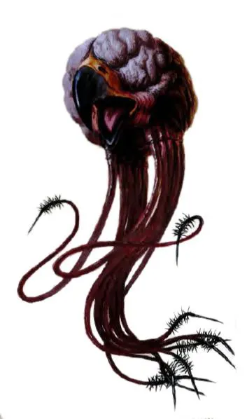

# Grell

Um grell lembra um cérebro bulboso flutuante com um grande bico afiado. Seus dez longos tentáculos são feitos de centenas de músculos anelares cobertos por um couro fibroso. Espinhos afiados envolvem a ponta de cada tentáculo e injetam veneno paralisante. O grell pode retrair parcialmente os espinhos nos seus tentáculos para agarrar ou manipular objetos que ele não deseje perfurar ou rasgar.

Os grells não possuem olhos e flutuam por meio de um tipo de levitação. Eles possuem uma audição aguçada, e sua pele é sensível às vibrações e campos elétricos permitindo que eles detectem a presença de criaturas e objetos em suas imediações. A habilidade da criatura de manipular a eletricidade para sentir e se mover, também permite que ela absorva eletricidade sem se ferir.

Apesar de ser solitário por natureza, alguns grells se reúnem em pequenos grupos chamados conluios.

***Emboscadores Flutuantes***. Um grell prefere emboscar criaturas solitárias ou retardatários, planando silenciosamente próximo do teto de uma passagem ou caverna até que um alvo adequado passa por baixo, quando ele desce rapidamente e envolve a presa com seus tentáculos. Depois ele flutua para o seu covil com a criatura paralisada em sua posse.

***Alienígenas Devoradores***. Os grells são predadores alienígenas que agrupam as outras criaturas em três categorias: comestíveis, não-comestíveis e Grandes Devoradores (as raras criaturas que podem caçar um grell). Os grells não sentem remorso em atacar as criaturas que eles classifiquem como comestíveis, incluindo humanoides. Eles tendem a evitar criaturas maiores que eles tenham pouca esperança em carregar.

Um grell, certas vezes, irá permitir que aventureiros entrem em guerra com outros monstros que habitem os complexos de masmorras que eles chamam de lar, ficando fora do caminho dos aventureiros enquanto eles dão cabo de ameaças maiores, esperando o momento certo de atacar.

## Bloco de estatísticas: Grell

*Aberração Média, neutro e mau*

**Classe de Armadura** 12  
**Pontos de Vida** 55 (10d8 + 10)  
**Deslocamento** 3 m, voo 9 m (planar)

| FOR | DES | CON | INT | SAB | CAR |
| :---: | :---: | :---: | :---: | :---: | :---: |
| 15 (+2) | 14 (+2) | 13 (+1) | 12 (+1) | 11 (+0) | 9 (–1) |

**Perícias** Furtividade +6, Percepção +4  
**Imunidade a Dano** elétrico  
**Imunidade a Condição** caído, cego  
**Sentidos** percepção às cegas 18 m (cego além desse raio), Percepção passiva 14  
**Idiomas** Grell  
**Nível de Desafio** 3 (700 XP)

### Ações

***Ataques Múltiplos***. O grell realiza dois ataques: um com seus tentáculos e um com seu bico.

***Tentáculos***. *Ataque Corpo-a-Corpo com Arma*: +4 para atingir, alcance 3 m, uma criatura. *Acerto*: 7 (1d10 + 2) de dano perfurante e o alvo deve ser bem sucedido num teste de resistência de Constituição CD 11 ou ficará envenenado por 1 minuto. O alvo envenenado fica paralisado e pode repetir o teste de resistência no final de cada um dos turnos dele, terminando o efeito com um sucesso. O alvo também fica agarrado (CD 15 para escapar). Se o alvo for Médio ou menor, ele também fica impedido enquanto o agarrão durar. Enquanto estiver agarrando um alvo, o grell tem vantagem nas jogadas de ataque contra ele e não pode usar esse ataque contra outros alvos. Quando o grell se mover, qualquer alvo Médio ou pequeno que ele esteja agarrando, se move com ele.

***Bico***. *Ataque Corpo-a-Corpo com Arma*: +4 para atingir, alcance 1,5 m, uma criatura. *Acerto*: 7 (2d4 + 2) de dano perfurante.
