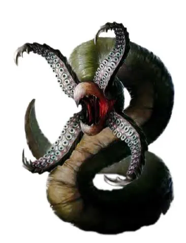

# Grick

## Bloco de estatísticas: Grick

*Monstruosidade Média, neutro*

**Classe de Armadura** 14 (armadura natural)  
**Pontos de Vida** 27 (6d8)  
**Deslocamento** 9 m, escalada 9 m

| FOR | DES | CON | INT | SAB | CAR |
| :---: | :---: | :---: | :---: | :---: | :---: |
| 14 (+2) | 14 (+2) | 11 (+0) | 3 (–4) | 14 (+2) | 5 (–3) |

**Resistência a Dano** concussão, cortante e perfurante de ataques não-mágicos  
**Sentidos** visão no escuro 18 m, Percepção passiva 12  
**Idiomas** –  
**Nível de Desafio** 2 (450 XP)

***Camuflagem Rochosa***. O grick possui vantagem em testes de Destreza (Furtividade) feitos para se esconder em terreno rochoso.

### Ações

***Ataques Múltiplos***. O grick realiza um ataque com seus tentáculos. Se o ataque atingir, ele pode fazer um ataque de bico contra o mesmo alvo.

***Tentáculos***. *Ataque Corpo-a-Corpo com Arma*: +4 para atingir, alcance 1,5 m, um alvo. *Acerto*: 9 (2d6 + 2) de dano cortante.

***Bico***. *Ataque Corpo-a-Corpo com Arma*: +4 para atingir, alcance 1,5 m, um alvo. *Acerto*: 5 (1d6 + 2) de dano perfurante.

## Bloco de estatísticas: Grick Alfa

*Monstruosidade Grande, neutro*

**Classe de Armadura** 18 (armadura natural)  
**Pontos de Vida** 75 (10d10 + 20)

**Deslocamento** 9 m, escalada 9 m

| FOR | DES | CON | INT | SAB | CAR |
| :---: | :---: | :---: | :---: | :---: | :---: |
| 18 (+4) | 16 (+3) | 15 (+2) | 4 (–4) | 14 (+2) | 9 (–1) |

**Resistência a Dano** concussão, cortante e perfurante de ataques não-mágicos  
**Sentidos** visão no escuro 18 m, Percepção passiva 12  
**Idiomas** –  
**Nível de Desafio** 7 (2.900 XP)

***Camuflagem Rochosa***. O grick possui vantagem em testes de Destreza (Furtividade) feitos para se esconder em terreno rochoso.

### Ações

***Ataques Múltiplos***. O grick realiza dois ataques: um com sua cauda e um com seus tentáculos. Se o ataque atingir, ele pode fazer um ataque de bico contra o mesmo alvo.

***Cauda***. *Ataque Corpo-a-Corpo com Arma*: +7 para atingir, alcance 3 m, um alvo. *Acerto*: 11 (2d6 + 4) de dano de concussão.

***Tentáculos***. *Ataque Corpo-a-Corpo com Arma*: +7 para atingir, alcance 3 m, um alvo. *Acerto*: 22 (4d8 + 4) de dano cortante.

***Bico***. *Ataque Corpo-a-Corpo com Arma*: +7 para atingir, alcance 3 m, um alvo. *Acerto*: 13 (2d8 + 4) de dano perfurante.

O grick é uma criatura em forma de verme que aguarda furtivamente, mesclando-se as rocas das cavernas e grutas que eles assombram. Apenas quando a presa se aproxima ele ataca por trás, seus quatro tentáculos farpados se desenrolam para revelar seu enorme bico faminto.

***Predadores Passivos***. Os gricks raramente caçam. Ao invés disso, eles arrastam seus corpos borrachudos para lugares onde criaturas passem regularmente, espreitando fora da vista em meio aos escombros e detritos rochosos, se espremendo em tocas, buracos ou fendas, escalando parapeitos ou se enrolando em volta de estalactites para cair sobre presas desatentas. Um grick devora virtualmente qualquer coisa que se mova, exceto outros gricks. Ele ataca a presa mais próxima, agarrando uma criatura caída com seus tentáculos e arrastando-a para devora-la em paz.

***Emboscadores Errantes***. Os gricks permanecem em uma área até que todo o estoque de alimento diminua, geralmente porque criaturas racionais tornam-se cientes da presença deles e planejam rotas alternativas em torno de seus covis. Quando as presas são escassas no Subterrâneo, os gricks se aventuram na superfície para caçar no ambiente selvagem, espreitando nas árvores ou nos parapeitos de encostas. Um bando de gricks geralmente é liderado por um único alfa enorme e bem alimentado em torno do qual os outros se reúnem.

***Espólios da Chacina***. Com o tempo, os covis dos grick acumulam posses largadas de pesas inteligentes, e guias experientes sabem observar esses sinais indicadores. Exploradores do Subterrâneo, às vezes, bloqueiam as rotas que levam a um covil de um grick para deixá-los morrer de fome, então coletam os bens das criaturas tolas que eles vitimaram.
