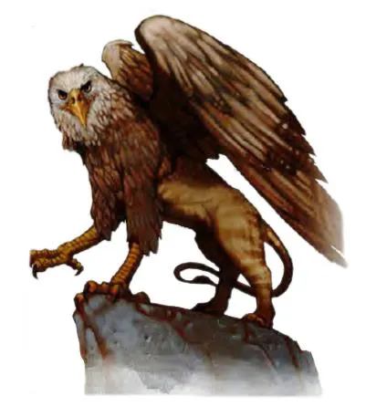

# Grifo

## Bloco de estatísticas: Grifo

*Monstruosidade Grande, imparcial*

**Classe de Armadura** 12  
**Pontos de Vida** 59 (7d10 + 21)  
**Deslocamento** 9 m, voo 24 m

| FOR | DES | CON | INT | SAB | CAR |
| :---: | :---: | :---: | :---: | :---: | :---: |
| 18 (+4) | 15 (+2) | 16 (+3) | 2 (–4) | 13 (+1) | 8 (–1) |

**Perícias** Percepção +5  
**Sentidos** visão no escuro 18 m, Percepção passiva 15  
**Idiomas** –  
**Nível de Desafio** 2 (450 XP)

***Visão Aguçada***. O grifo tem vantagem em testes de Sabedoria (Percepção) relacionados à visão.

### Ações

***Ataques Múltiplos***. O grifo realiza dois ataques: um com seu bico e um com suas garras.

***Bico***. *Ataque Corpo-a-Corpo com Arma*: +6 para atingir, alcance 1,5 m, um alvo. *Acerto*: 8 (1d8 + 4) de dano perfurante.

***Garras***. *Ataque Corpo-a-Corpo com Arma*: +6 para atingir, alcance 1,5 m, um alvo. *Acerto*: 11 (2d6 + 4) de dano cortante.

Os grifos são carnívoros aviários ferozes com musculosos corpos de leões e a cabeça, patas dianteiras e asas de águias. Quando atacam, os grifos são tão rápidos e mortais quanto as águias, mesmo quanto golpeiam com a selvageria, força e graça de um leão.

***Devoradores de Cavalos***. Os grifos caçam em pequenos bandos, voando alto sobre as planícies e florestas próximos das encostas rochosas onde ficam seus ninhos. Animais de rebanho e cavalos são as presas que anseiam acima de todas as outras, apesar deles também caçarem e matarem hipogrifos. Quando avista cavalos, um grifo guincha para alertar seus companheiros de bando, que descem rapidamente em direção a presa.

Esses cavalos de montaria ou de rebanho apavorados com o grito estridente do grifo, preparam-se para a luta sangrenta que inevitavelmente acontecerá. Um grifo ignora o cavaleiro de um cavalo quando possível, e um cavaleiro que abandone sua montaria ou um pastor que libere um ou dois cavalos, pode escapar ileso enquanto o grifo ataca sua presa escolhida. Cavaleiros que tentem proteger seus cavalos atraem toda a fúria de um grifo atacante.

***Habitantes do Céu***. Os grifos fazem seus ninhos em altas encostas rochosas, construindo-os com gravetos, folhas e os ossos de suas presas. Uma vez que tenham estabelecido seu território, os grifos permanecem na área até que todo o estoque de alimento seja exaurido.

Agressivos e territorialistas, os grifos se engajam em combates aéreos brutais para defender seus ninhos, rasgando e retalhando as asas de intrusos voadores para envia-los numa espiral da morte até o solo. As criaturas que escalarem até o covil de um grifo são arrancados do penhasco e devorados, ou são derrubados das alturas para caírem em direção a morte.

***Montarias Treinadas***. Um grifo criado desde o ovo, pode ser treinado para servir como montaria. Porém, esse treinamento pode requerer muito tempo, gastos (a maior parte com a alimentação pesada da criatura) e ser perigoso. Treinadores experientes acostumados com a ferocidade lendária dos grifos são praticamente os únicos capazes de criar essas criaturas em segurança.

Uma vez treinado, um grifo é uma montaria feroz e leal. Ele se vincula a um mestre por toda vida, voando para a morte para proteger seu cavaleiro. Um grifo de montaria mantem seu apetite voraz por carne de cavalo, e um mestre sensato garantirá que um grifo esteja satisfeito com outras presas enquanto passa por terras civilizadas.
