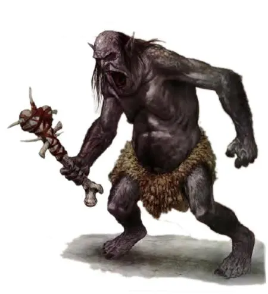

# Grimlock

Os degenerados grimlocks subterrâneos já foram humanos, mas sua adoração pelos devoradores de mentes, ao longo de gerações no Subterrâneo, os transformou em monstros canibais cegos muito tempo atrás.

***Cultistas Aviltados***. O império dos devoradores de mentes havia se espalhado por muitos mundos, escravizando incontáveis raças. Dentre essas, estavam culturas humanas cujos alto sacerdotes foram subvertidos pelos devoradores de mentes através de seus poderes insidiosos de controle de mente. Esses líderes gradualmente direcionaram a fé de seus seguidores para os ilitides, os quais eles veneram como divindades blasfemas.

Com o tempo, os rituais desses humanos escravizados criaram cultistas canibais fervorosos que consideram os ilitides comedores de cérebro como um santíssimo sacramento. Os ilitides comandaram seus adoradores a abduzir outras criaturas racionais para serem sacrificadas. Após o cérebro da vítima ser consumido, os devoradores de mentes dão o corpo sem vida para seus cultistas.

***Caçadores Cegos***. Quando o governo dos devoradores de mentes ruiu, seus cultistas enfrentaram guerras constantes contra os inimigos deles, as mesmas criaturas que haviam sido suas vítimas. Os cultos fugiram para os domínios do Subterrâneo dos seus deuses ilitides. Por gerações em seus reinos obscuros, os cultistas aprenderam a utilizar seus outros sentidos para sobreviver. Com o tempo, seus olhos atrofiaram e se fecharam, deixando para trás orbitas oculares cobertas.

Os ouvidos de um grimlock captam a mais leve passada ou sussurro que ecoe pelas passagens rochosas. Ele pode falar em tons muito baixos para a maioria dos outros humanoides ouvirem. O cheiro de suor, carne e sangue desperta seu apetite, e ele pode rastrear tais cheiros como um cão de caça. Para aprimorar seus sentidos, os grimlocks deixam rastros de sangue, pilhas de esterco ou as vísceras de vítimas mortas em locais distantes de seus covis. Quando intrusos passam por essas áreas, eles carregam o cheiro imundo consigo, deixando os grimlocks cientes de sua aproximação.

Para a maioria das criaturas, a cegueira é um enorme obstáculo. Para um grimlock, com seus outros sentidos apurados, a cegueira é uma bênção. Um grimlock não é enganado por ilusões visuais ou percepções equivocadas. Ele é implacável enquanto caça sua presa.

***Guerra Infindável***. Os grimlocks continuam a venerar os devoradores de mentes, servindo-os sempre que podem. Os grimlocks também recordam da guerra que os levou aos subterrâneos. Para eles, essa guerra nunca acabou. Eles continuam a retornar a superfície do mundo para abduzir prisioneiros para seus mestres ilitides.

## Bloco de estatísticas: Grimlock

*Humanoide Médio (grimlock), neutro e mau*

**Classe de Armadura** 11  
**Pontos de Vida** 11 (2d8 + 2)  
**Deslocamento** 9 m

| FOR | DES | CON | INT | SAB | CAR |
| :---: | :---: | :---: | :---: | :---: | :---: |
| 16 (+3) | 12 (+1) | 12 (+1) | 9 (–1) | 8 (–1) | 6 (–2) |

**Perícias** Atletismo +5, Furtividade +3, Percepção +3  
**Imunidade a Condição** cego  
**Sentidos** percepção às cegas 9 m ou 3 m quando estiver surdo (cego além desse raio), Percepção passiva 13  
**Idiomas** Subcomum  
**Nível de Desafio** 1/4 (50 XP)

***Sentido Cego***. O grimlock não pode usar sua percepção às cegas enquanto estiver surdo ou incapaz de cheirar.

***Audição e Olfato Aguçados***. O grimlock tem vantagem em testes de Sabedoria (Percepção) relacionados à audição e ao olfato.

***Camuflagem Rochosa***. O grimlock possui vantagem em testes de Destreza (Furtividade) feitos para se esconder em terreno rochoso.

### Ações

***Clava de Osso com Cravos***. *Ataque Corpo-a-Corpo com Arma*: +5 para atingir, alcance 1,5 m, um alvo. *Acerto*: 5 (1d4 + 3) de dano de concussão mais 2 (1d4) de dano perfurante.
