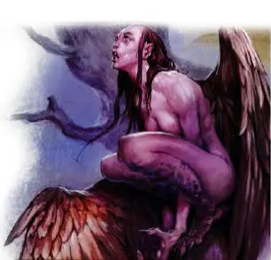

# Harpia

Se satisfazendo com o sofrimento e morte, a sádica harpia está sempre caçando presas. Sua doce canção já atraiu incontáveis aventureiros para a morte, trazendo-os para perto da harpia para serem mortos e devorados.

Uma harpia combina o corpo, pernas e asas de um abutre com o dorso, braços e cabeça de uma humana. Suas garras assustadoras e clavas de osso tornam-na uma ameaça formidável em combate, e seus olhos refletem a maldade absoluta de sua alma.

***Maldição Divina***. Muito tempo atrás, uma elfa que vagava por uma floresta ouviu um canto de pássaro tão puro e saudável que ela foi às lágrimas. Seguindo a música, ela chegou a uma clareira onde encontrou um belo e jovem elfo que também havia feito uma pausa para ouvir o canto do pássaro. Esse era Fenmarel Mestarine, um deus elfo recluso. Sua presença divina levou o coração dela quando ele partiu, desaparecendo entre as árvores como se nunca estivesse ali.

Apesar da elfa ter procurado pela floresta e chamado pelo estranho, ela não encontrou qualquer sinal de sua passagem. Levada ao desespero pela saudade, ela implorou aos deuses por ajuda. Aerdrie Faenya, a deusa élfica do céu, ouviu a súplica da elfa e decidiu ajuda-la. Ela apareceu como o pássaro cuja canção havia fascinado o deus proscrito, então ensinou a canção de beleza e sedução para a elfa.

Quando o canto dela falhou em atrair Fenmarel Mestarine para seu lado, a elfa amaldiçoou os deuses, invocando um terrível poder e transformando-a na primeira harpia. A magia da maldição fez efeito tanto no espírito da elfa quanto em seu corpo, tornando os desejos por amor em fome por carne, mesmo quando sua bela canção continua a atrair as criaturas para o seu abraço mortal.

***Canção da Harpia***. Ouvir a canção de uma harpia é como ouvir uma música mais bela que qualquer outra coisa no mundo. Um viajante que sucumba ao efeito fascinante do canto é compelido a ir em direção da sua fonte. Uma harpia, às vezes, enfeitiça suas vítimas antes de atacar, mas o uso mais eficiente de sua canção é atrair suas presas para penhascos, para poços de areia movediça ou abismos mortais. As criaturas presas ou incapacitadas tornam-se alvos fáceis para a ira da harpia.

***Covardes Sádicas***. As harpias assombram falésias costeiras e outros locais perigosos para criaturas não-voadoras. As harpias não tem qualquer interesse em uma luta justa, e elas nunca atacam sem que tenham uma vantagem clara. Se uma luta se voltar contra elas, elas não tem a capacidade de se adaptar e irão fugir famintas ao invés de arriscar um combate direto.

Quando atacam, as harpias brincam com a comida, deliciando-se com a “música” que suas vítimas fazem quando gritam. Uma harpia leva tempo para desmembrar um adversário indefeso e pode passar dias torturando uma vítima antes do fim misericordioso.

***Coletoras Horripilantes***. As harpias pegam bugigangas brilhantes, objetos de valor e outros troféus de suas vítimas, às vezes, lutando umas com as outras pelo direito de pegar os prêmios escolhidos. Quando nenhum objeto de valor for encontrado, uma harpia pegará cabelo, ossos ou partes do corpo para fazer seu ninho. O covil de uma harpia geralmente fica escondido em ruínas remotas, onde os aventureiros podem descobrir tesouros valiosos e mágica escondida sob pilhas nojentas de vísceras.

## Bloco de estatísticas: Harpia

*Monstruosidade Média, caótico e mau*

**Classe de Armadura** 11  
**Pontos de Vida** 38 (7d8 + 7)  
**Deslocamento** 6 m, voo 12 m

| FOR | DES | CON | INT | SAB | CAR |
| :---: | :---: | :---: | :---: | :---: | :---: |
| 12 (+1) | 13 (+1) | 12 (+1) | 7 (–2) | 10 (+0) | 13 (+1) |

**Sentidos** Percepção passiva 10  
**Idiomas** Comum  
**Nível de Desafio** 1 (200 XP)

### Ações

***Ataques Múltiplos***. A harpia realiza dois ataques: um com suas garras e um com sua clava.

***Garras***. *Ataque Corpo-a-Corpo com Arma*: +3 para atingir, alcance 1,5 m, um alvo. *Acerto*: 6 (2d4 + 1) de dano cortante.

***Clava***. *Ataque Corpo-a-Corpo com Arma*: +3 para atingir, alcance 1,5 m, um alvo. *Acerto*: 3 (1d4 + 1) de dano de concussão.

***Canção Sedutora***. A harpia canta uma melodia mágica. Cada humanoide e gigante a até 90 metros dela que puder ouvir a canção, deve ser bem sucedido num teste de resistência de Sabedoria CD 11 ou ficará enfeitiçado até a canção terminar. A harpia deve usar uma ação bônus no turno dela para continuar a cantar. Ela pode parar de cantar a qualquer momento. A canção termina se a harpia for incapacitada. Enquanto estiver enfeitiçado pela harpia, um alvo está incapacitado e ignora a canção de outras harpias. Se o alvo enfeitiçado estiver a mais de 1,5 metro da harpia, ele irá realizar a ação de Disparada para se mover para próximo da harpia pela rota mais direta. Ele não evita ataques de oportunidade, mas antes de se mover para terreno prejudicial, como lava ou um fosso, e a qualquer momento que sofra dano de outra fonte diferente da harpia, um alvo pode repetir o teste de resistência. Uma criatura também pode repetir o teste de resistência no final de cada um dos turnos dele. Se o teste de resistência de uma criatura for bem sucedido, o efeito termina sobre ela. Um alvo que seja bem sucedido na resistência fica imune a canção dessa harpia pelas próximas 24 horas.
