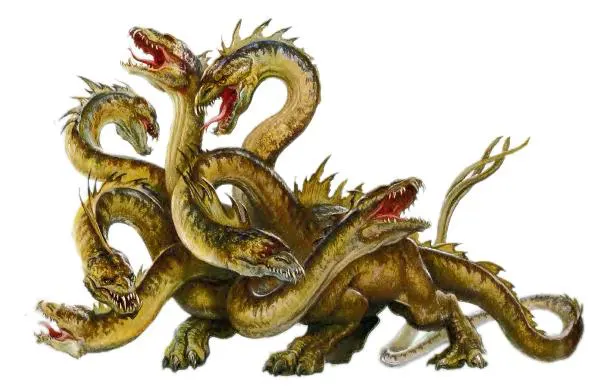

# Hidra

A hidra é um horror reptiliano com um corpo crocodiliano e múltiplas cabeças com longos pescoços de serpente. Apesar de suas cabeças poderem ser decepadas, a hidra magicamente regenera-as em um curto tempo. Uma espécie típica tem cinco cabeças.

Na aurora do tempo, Tiamat, a Rainha dos Dragões Malignos, matou um deus dragão rival chamado Lernaea e lançou seu sangue pelo multiverso. Cada gota que caiu no mundo deu origem a uma hidra de múltiplas cabeças consumida por uma fome tão grande quanto o ódio do deus morto. Grandes campeões ficaram conhecidos por testar sua coragem contra essas criaturas terríveis.

***Fome Eterna***. Como um monstro voraz e esfomeado, uma hidra despedaça e dilacera suas presas em um frenesi faminto. Quando uma hidra tiver acabado com toda a comida de um território e rechaçado qualquer criatura esperta o suficiente para evita-la, ela parte para buscar seu almoço em outro lugar. A fome de uma hidra é tão grande que se ela não puder se alimentar, ela se virará contra si mesma, e suas cabeças atacarão umas às outras enquanto a criatura se devora viva.

***Moradoras de Água Resistentes***. As hidras são nadadoras naturais, vivendo em rios, em beira de lagos, em águas rasas oceânicas e em pântanos húmidos. Uma hidra raramente precisa se abrigar contra os elementos, por isso ela normalmente não possui um covil. Apenas em climas mais frios as hidras buscam a proteção de cavernas e ruínas para abriga-las.

Quando uma hidra dorme, pelo menos uma de suas cabeças permanece acordada e alerta, tornando a criatura difícil de ser surpreendida.

## Bloco de estatísticas: Hidra

*Monstruosidade Enorme, imparcial*

**Classe de Armadura** 15 (armadura natural)  
**Pontos de Vida** 172 (15d12 + 75)  
**Deslocamento** 9 m, natação 9 m

| FOR | DES | CON | INT | SAB | CAR |
| :---: | :---: | :---: | :---: | :---: | :---: |
| 20 (+5) | 12 (+1) | 20 (+5) | 2 (–4) | 10 (+0) | 7 (–2) |

**Perícias** Percepção +6  
**Sentidos** visão no escuro 18 m, Percepção passiva 16  
**Idiomas** –  
**Nível de Desafio** 8 (3.900 XP)

***Cabeças Reativas***. Para cada cabeça que a hidra possua acima de uma, ela tem uma reação extra que pode ser usada apenas para ataques de oportunidade.

***Múltiplas Cabeças***. A hidra possui cinco cabeças. Enquanto ela possuir mais de uma cabeça, ela terá vantagem em testes de resistência para não ser amedrontada, atordoada, cegada, enfeitiçada, ensurdecida e inconsciente. Sempre que a hidra sofrer 25 ou mais dano em um único turno, uma de suas cabeças morre. Se todas as suas cabeças morrerem, a hidra morre. No final de cada um dos turnos dela, duas cabeças crescem para cada cabeça dela que tenha morrido no turno anterior, a não ser que ela tenha sofrido dano de fogo desde o último turno dela. A hidra recupera 10 pontos de vida para cada cabeça que crescer dessa forma.

***Prender a Respiração***. A hidra pode prender sua respiração por 1 hora.

***Vigilante***. Enquanto a hidra dorme, pelo menos uma de suas cabeças permanece acordada.

### Ações

***Ataques Múltiplos***. O hidra realiza uma quantidade de ataques de mordida igual à quantidade de cabeças que ela possua.

***Mordida***. *Ataque Corpo-a-Corpo com Arma*: +8 para atingir, alcance 3 m, um alvo. *Acerto*: 10 (1d10 + 5) de dano perfurante.
