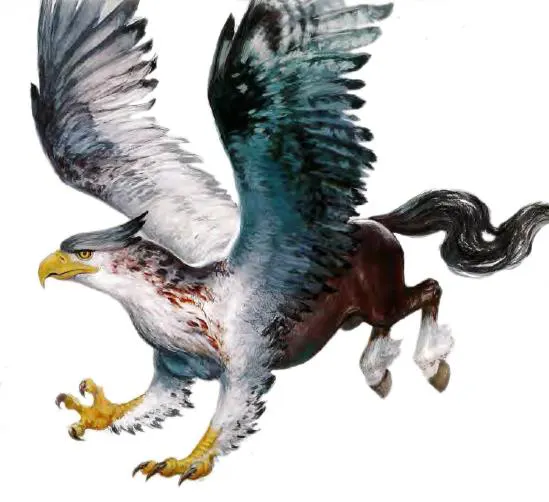

# Hipogrifo

Uma besta de origens mágicas perdida na história, um hipogrifo possui as asas e membros anteriores de uma águia, os quartos traseiros de um cavalo e a cabeça combinando os traços de ambos animais.

Reclusos e onívoros, os hipogrifos fazem parceiros pra toda vida e raramente se aventuram a mais do que alguns quilômetros de seus ninhos. Quando está defendendo seus parceiro ou filhos, um hipogrifo luta até a morte. Os hipogrifos não colocam ovos, mas dão à luz a filhotes vivos.

Dragões, grifos e wyverns adoram a carne de hipogrifo e frequentemente caçam essas criaturas.

***Montarias Aladas***. Um hipogrifo criado em cativeiro pode ser treinado para ser um companheiro e montaria leal. De todas as criaturas que podem servir como montarias aladas, os hipogrifos estão entre as mais fáceis de treinar e entre as mais leais quando treinadas apropriadamente.

## Bloco de estatísticas: Hipogrifo

*Monstruosidade Grande, imparcial*

**Classe de Armadura** 11  
**Pontos de Vida** 19 (3d10 + 3)  
**Deslocamento** 12 m, voo 18 m

| FOR | DES | CON | INT | SAB | CAR |
| :---: | :---: | :---: | :---: | :---: | :---: |
| 17 (+3) | 13 (+1) | 13 (+1) | 2 (–4) | 12 (+1) | 8 (–1) |

**Perícias** Percepção +5  
**Sentidos** Percepção passiva 15  
**Idiomas** –  
**Nível de Desafio** 1 (200 XP)

***Visão Aguçada***. O hipogrifo tem vantagem em testes de Sabedoria (Percepção) relacionados à visão.

### Ações

***Ataques Múltiplos***. O hipogrifo realiza dois ataques: um com seu bico e um com suas garras.

***Bico***. *Ataque Corpo-a-Corpo com Arma*: +5 para atingir, alcance 1,5 m, um alvo. *Acerto*: 8 (1d10 + 3) de dano perfurante.

***Garras***. *Ataque Corpo-a-Corpo com Arma*: +5 para atingir, alcance 1,5 m, um alvo. *Acerto*: 10 (2d6 + 3) de dano cortante.
