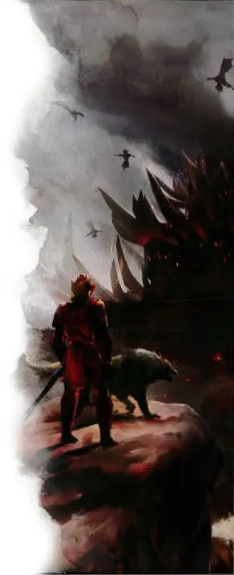
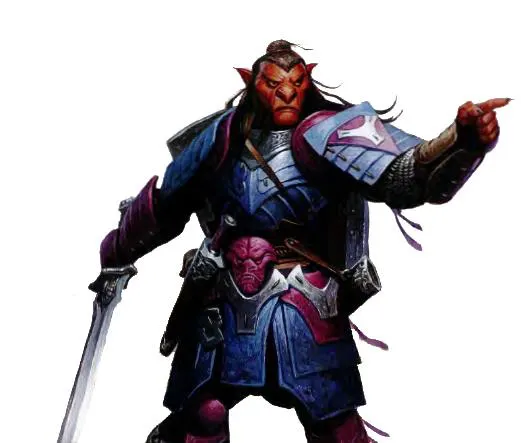

# Hobgoblins

Trompas de guerra soam, pedras voam de catapultas e o estrondo de mil botas pisoteando ecoam pela terra enquanto os hobgoblins marcham para a batalha. Do outro lado da fronteira da civilização, colônias e colonos devem lidar com esses humanoides agressivos, cuja sede de conquista nunca é satisfeita.

Os hobgoblins tem pele laranja-escuro ou vermelho alaranjada, e cabelos variando do vermelho amarronzado escuro ao preto acinzentado. Olhos amarelos ou marrom-escuros espreitam abaixo de suas sobrancelhas salientes, e suas bocas largas ostentam dentes afiados e amarelados. Um hobgoblin macho terá um nariz largo azul ou vermelho, que simboliza virilidade e poder entre a espécie goblin. Os hobgoblins podem viver tanto quanto humanos, apesar do amor deles pela guerra e batalha signifique que poucos consigam.

***Goblinoides***. Os hobgoblins pertencem a família das criaturas chamadas goblinoides. Eles são geralmente encontrados comandando seus primos, os pequenos goblins e os ferozes bugbears.

***Força Marcial***. Um hobgoblin mede a virtude pela força física e poderio marcial, não dando importância a nada exceto a oportunidade de demonstrar perícia e astúcia em batalha. Os hobgoblins de patentes militares elevadas conseguem suas posições através da força, então mantem essas posições impondo sua autoridade por meios dracônicos.

Os hobgoblins treinam para lutar com uma variedade de armas, e tem grande perícia em construir armas, armaduras, armas de cerco e outros aparatos militares. Organizados e disciplinados, eles cuidam de forma excepcional de suas armas, armaduras e posses pessoais. Eles preferem as cores escuras associadas com suas tribos, e recortam seus uniformes elaborados geralmente com detalhes em vermelho-sangue e couro tingido de preto.

***Legiões Militares***. Os hobgoblins organizam-se em bandos tribais conhecidos como legiões. Em sua sociedade marcial, cada hobgoblin tem uma patente, desde os poderosos líderes e campeões, os rasos soldados de infantaria, até os goblins que se encontram levados para a linha de frente sob a ponta de lanças. Uma legião é encabeçada por um hobgoblin senhor da guerra com diversos capitães servindo sob seu comando. Um hobgoblin senhor da guerra é um tirano implacável mais interessado em estratégia, vitória, glória, reputação e dominação que em liderar tropas para a batalha.

Por serem tão leais e disciplinados quanto os hobgoblins são às suas legiões, legiões rivais competem constantemente por reputação e posição. Encontros entre legiões acabam em violência se as tropas não forem contidas, e apenas líderes excepcionalmente poderosos podem forçar uma legião a cooperar no campo de batalha.

***Pensadores Estrategistas***. Os hobgoblins possuem um tipo forte para táticas e disciplina, e podem elaborar planos de batalha sofisticados sob a direção de um líder com espírito estratégico. Porém, eles odeiam elfos e os atacaram antes de quaisquer outros oponentes em batalha, mesmo se fazê-lo possa ver um erro tático.

As legiões geralmente suplementam suas patentes com tropas mais seguras e dispensáveis, incluindo goblins, bugbears, orcs, humanos malignos, ogros e gigantes.

***Treinadores de Bestas***. Os hobgoblins possuem uma longa história treinando animais para servi-los. Como as raças mais civilizadas, eles usam bois e cavalos para transportar mercadorias e armamentos por longas distâncias. Eles se comunicam entre si usando corvos treinados, e mantem lobos violentos para guardar prisioneiros e proteger acampamentos hobgoblins. A cavalaria hobgoblin usa worgs treinados como montarias, da mesma forma, goblins montam em lobos. Algumas tribos mantem até mesmo gorilas carnívoros como bestas de batalha.

***Conquista e Controle***. Os hobgoblins reivindicam terras com recursos em abundância, e eles podem ser encontrados em florestas e montanhas, próximos de minas e assentamentos humanoides, e em qualquer lugar onde madeira, metal e escravos em potencial possam ser encontrados. Eles constroem e conquistam fortalezas em locais estrategicamente vantajosos, os quais eles utilizam como áreas de armazenamento temporário para expandir seu território.

Os hobgoblins senhores da guerra nunca se cansam do combate, mas eles não erguem suas armas com animosidade. Antes de atacarem, os hobgoblins usam uma conduta de reconhecimento para avaliar as forças e fraquezas de seus adversários. Quando assaltam uma fortaleza, eles a cercam primeiro para cortas as rotas de fuga e linhas de suprimento, lentamente matando seus inimigos de fome.

## Bloco de estatísticas: Hobgoblin

*Humanoide Médio (goblinoide), leal e mau*

**Classe de Armadura** 18 (cota de malha, escudo)  
**Pontos de Vida** 11 (2d8 + 2)  
**Deslocamento** 9 m

| FOR | DES | CON | INT | SAB | CAR |
| :---: | :---: | :---: | :---: | :---: | :---: |
| 13 (+1) | 12 (+1) | 12 (+1) | 10 (+0) | 10 (+0) | 9 (–1) |

**Sentidos** visão no escuro 18 m, Percepção passiva 10  
**Idiomas** Comum, Goblin  
**Nível de Desafio** 1/2 (100 XP)

***Vantagem Marcial***. Uma vez por turno, o hobgoblin pode causar 7 (2d6) de dano extra a uma criatura que ele atinja com um ataque de arma se a criatura estiver a 1,5 metro de um aliado do hobgoblin que não esteja incapacitado.

### Ações

***Espada Longa***. *Ataque Corpo-a-Corpo com Arma*: +3 para atingir, alcance 1,5 m, um alvo. *Acerto*: 5 (1d8 + 1) de dano cortante ou 6 (1d10 + 1) de dano cortante se usada com as duas mãos.

***Arco Longo***. *Ataque à Distância com Arma*: +3 para atingir, distância 45/180 m, um alvo. *Acerto*: 5 (1d8 + 1) de dano perfurante.

Os hobgoblins fortificam seus próprios fortes, aprimorando as defesas existentes com suas próprias inovações. Quando eles habitarem em complexos de caverna, masmorras, ruínas ou florestas, eles protegem suas fortalezas com valas, cercas, portões, torres de guarda, armadilhas de fosso e catapultas e balestras simplórias.

***Legião de Maglubiyet***. Os hobgoblins veneram Maglubiyet o Todo Poderoso, o deus maior dos goblinoides. Por mais terrível que essa figura seja, os hobgoblins não temem a morte, acreditando que quando morrem em batalha, seus espíritos se unem as honradas fileiras do exército de Maglubiyet no plano do Aqueronte.

## Bloco de estatísticas: Hobgoblin Capitão

*Humanoide Médio (goblinoide), leal e mau*

**Classe de Armadura** 17 (meia-armadura)  
**Pontos de Vida** 39 (6d8 + 12)  
**Deslocamento** 9 m

| FOR | DES | CON | INT | SAB | CAR |
| :---: | :---: | :---: | :---: | :---: | :---: |
| 15 (+2) | 14 (+2) | 14 (+2) | 12 (+1) | 10 (+0) | 13 (+1) |

**Sentidos** visão no escuro 18 m, Percepção passiva 10  
**Idiomas** Comum, Goblin  
**Nível de Desafio** 1/2 (100 XP)

***Vantagem Marcial***. Uma vez por turno, o hobgoblin pode causar 10 (3d6) de dano extra a uma criatura que ele atinja com um ataque de arma se a criatura estiver a 1,5 metro de um aliado do hobgoblin que não esteja incapacitado.

### Ações

***Ataques Múltiplos***. O hobgoblin realiza dois ataques com espada grande.

***Espada Grande***. *Ataque Corpo-a-Corpo com Arma*: +4 para atingir, alcance 1,5 m, um alvo. *Acerto*: 9 (2d6 + 2) de dano cortante.

***Azagaia***. *Ataque Corpo-a-Corpo ou à Distância com Arma*: +4 para atingir, alcance 1,5 m ou distância 9/36 m, um alvo. *Acerto*: 5 (1d6 + 2) de dano perfurante.

***Liderança (Recarrega após um Descanso Curto ou Longo)***. Por 1 minuto, o hobgoblin pode proferir um comando especial ou aviso a qualquer momento que uma criatura não-hostil que ele puder ver a até 9 metros dele, realizar uma jogada de ataque ou teste de resistência. A criatura pode adicionar um d4 a sua jogada considerando que ela possa ouvir e compreender o hobgoblin. Uma criatura pode ser beneficiada por apenas um dado de Liderança por vez. Esse efeito termina se o hobgoblin estiver incapacitado.

## Bloco de estatísticas: Hobgoblin Senhor da Guerra

*Humanoide Médio (goblinoide), leal e mau*

**Classe de Armadura** 20 (placas, escudo)  
**Pontos de Vida** 97 (13d8 + 39)  
**Deslocamento** 9 m

| FOR | DES | CON | INT | SAB | CAR |
| :---: | :---: | :---: | :---: | :---: | :---: |
| 16 (+3) | 14 (+2) | 16 (+3) | 14 (+2) | 11 (+0) | 15 (+2) |

**Testes de Resistência** Int +5, Sab +3, Car +5  
**Sentidos** visão no escuro 36 m, Percepção passiva 10  
**Idiomas** Comum, Goblin  
**Nível de Desafio** 6 (2.300 XP)

***Vantagem Marcial***. Uma vez por turno, o hobgoblin pode causar 14 (4d6) de dano extra a uma criatura que ele atinja com um ataque de arma se a criatura estiver a 1,5 metro de um aliado do hobgoblin que não esteja incapacitado.

### Ações

***Ataques Múltiplos***. O hobgoblin realiza três ataques corpo-a-corpo. Alternativamente, ele pode realizar dois ataques à distância com suas azagaias.

***Espada Longa***. *Ataque Corpo-a-Corpo com Arma*: +9 para atingir, alcance 1,5 m, um alvo. *Acerto*: 7 (1d8 + 3) de dano cortante ou 8 (1d10 + 3) de dano cortante se usada com as duas mãos.

***Pancada com Escudo***. *Ataque Corpo-a-Corpo com Arma*: +9 para atingir, alcance 1,5 m, uma criatura. *Acerto*: 5 (1d4 + 3) de dano de concussão. Se o alvo for Grande ou menor, ele deve ser bem sucedido num teste de resistência de Força CD 14 ou será derrubado no chão.

***Azagaia***. *Ataque Corpo-a-Corpo ou à Distância com Arma*: +9 para atingir, alcance 1,5 m ou distância 9/36 m, um alvo. *Acerto*: 6 (1d6 + 3) de dano perfurante.

***Liderança (Recarrega após um Descanso Curto ou Longo)***. Por 1 minuto, o hobgoblin pode proferir um comando especial ou aviso a qualquer momento que uma criatura não-hostil que ele puder ver a até 9 metros dele, realizar uma jogada de ataque ou teste de resistência. A criatura pode adicionar um d4 a sua jogada considerando que ela possa ouvir e compreender o hobgoblin. Uma criatura pode ser beneficiada por apenas um dado de Liderança por vez. Esse efeito termina se o hobgoblin estiver incapacitado.

### Reações

***Aparar***. O hobgoblin adiciona 3 à sua CA contra um ataque corpo-a-corpo que poderia atingi-lo. Para tanto, o hobgoblin deve poder ver o atacante e estar empunhando uma arma corpo-a-corpo.
