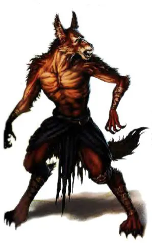

# Homem Chacal

## Bloco de estatísticas: Homem-Chacal

*Humanoide Médio (metamorfo), caótico e mau*

**Classe de Armadura** 12  
**Pontos de Vida** 18 (4d8)  
**Deslocamento** 12 m

| FOR | DES | CON | INT | SAB | CAR |
| :---: | :---: | :---: | :---: | :---: | :---: |
| 11 (+0) | 15 (+2) | 11 (+0) | 13 (+1) | 11 (+0) | 10 (+0) |

**Perícias** Enganação +4, Furtividade +4, Percepção +2  
**Imunidade a Dano** concussão, cortante e perfurante de ataques não-mágicos que não sejam de prata  
**Sentidos** Percepção passiva 12  
**Idiomas** Comum (não pode falar em forma de chacal)  
**Nível de Desafio** 1/2 (100 XP)

***Audição e Olfato Aguçados***. O homem-chacal tem vantagem em testes de Sabedoria (Percepção) relacionados à audição e ao olfato.

***Metamorfo***. O homem-chacal pode usar sua ação para se metamorfosear numa forma humana Média, em uma forma híbrida de humanoide e chacal ou de volta para sua forma verdadeira (que é de um chacal Pequeno). Fora seu tamanho, suas

Chacais comuns maculados por poder demoníaco, os homens-chacal assombram as estradas e trilhas, extorquindo e assassinando aqueles que encontra.

Um homem-chacal possui três formas físicas entre as quais ele pode trocar. Em sua forma verdadeira, ele é indistinguível de um chacal normal. Ele pode tomar uma forma humana, parecendo magro e tendo uma atitude de miserável para implorar pela boa vontade de estranhos. Quando viajantes encontram-se com um homem-chacal em seu caminho, o monstro adota sua forma hibrida de tamanho humano, com pelo e cabeça de chacal ficando sobre duas pernas quando ataca.

***Enganadores e Covardes***. O lorde demônio Graz’zt criou os homens-chacal para servir suas servas devotadas, as lâmias. Estendendo sua mão do Abismo, ele concedeu aos chacais o dom de falar e a habilidade de assumir formas humanoides. Um homem-chacal nasceu para mentir, e criaturas perceptivas podem notar ele estremecendo de dor quando fala a verdade.

Um homem-chacal prefere lutar ao lado de chacais e outros de sua espécie. Sob as ordens de homens-chacal, os chacais são companheiros ferozes e leais.

***Servos Sobrenaturais***. Os homens-chacal raptam humanoides para suas mestras lâmias, condenando as vítimas a uma vida inteira de escravidão ou a uma morte agonizante. O olhar mágico de um homem-chacal deixa um adversário inconsciente, permitindo que o monstro prenda a criatura ou arraste-a. Um homem-chacal também pode usar seu olhar para incapacitar um inimigo perigoso tempo o suficiente para que possa escapar.

estatísticas são as mesmas em qualquer forma. Qualquer equipamento carregado não será transformado. Se for morto, o quasit volta a sua forma de demônio.

***Táticas de Matilha***. O homem-chacal tem vantagem nas jogadas de ataque contra uma criatura se, pelo menos, um dos aliados do homem-chacal estiver a 1,5 metro da criaturas e não estiver incapacitado.

### Ações

***Mordida (Apenas nas Formas de Chacal e Híbrida)***. *Ataque* *Corpo-a-Corpo com Arma*: +4 para atingir, alcance 1,5 m, um alvo. *Acerto*: 4 (1d4 + 2) de dano perfurante.

***Cimitarra (Apenas nas Formas de Humana e Híbrida)***. *Ataque* *Corpo-a-Corpo com Arma*: +4 para atingir, alcance 1,5 m, um alvo. *Acerto*: 5 (1d6 + 2) de dano cortante.

***Olhar Adormecente***. O homem-chacal fita seu olhar em uma criatura que ele possa ver a até 9 metros dele. O alvo deve realizar um teste de resistência de Sabedoria CD 10. Se fracassar na resistência, o alvo sucumbe a um sono mágico, caindo inconsciente por 10 minutos ou até que alguém use uma ação para sacudi-lo até acordar. Uma criatura que seja bem sucedida contra esse efeito é imune ao olhar do homem-chacal pelas próximas 24 horas. Mortos-vivos e criaturas imunes a serem enfeitiçadas não podem ser afetados por isso.
