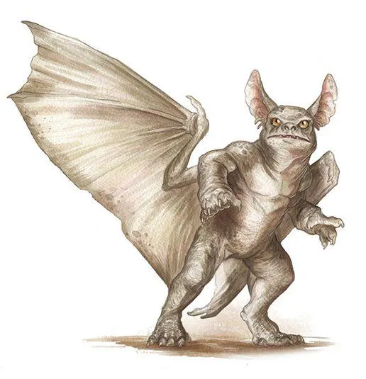

# Homúnculo

## Bloco de estatísticas: Homúnculo

*Constructo Miúdo, neutro*

**Classe de Armadura** 13 (armadura natural)  
**Pontos de Vida** 5 (2d4)  
**Deslocamento** 6 m, voo 12 m

| FOR | DES | CON | INT | SAB | CAR |
| :---: | :---: | :---: | :---: | :---: | :---: |
| 4 (–3) | 15 (+2) | 11 (+0) | 10 (+0) | 10 (+0) | 7 (–2) |

**Imunidade a Dano** veneno  
**Imunidade a Condição** enfeitiçado, envenenado  
**Sentidos** visão no escuro 18 m, Percepção passiva 10  
**Idiomas** compreende os idiomas do seu criador, mas não pode falar  
**Nível de Desafio** 0 (10 XP)

***Vínculo Telepático***. Enquanto o homúnculo estiver no mesmo plano de existência do seu mestre, ele pode transmitir magicamente seus sentidos para seu mestre, e ambos podem se comunicar telepaticamente.

### Ações

***Mordida***. *Ataque Corpo-a-Corpo com Arma*: +4 para atingir, alcance 1,5 m, uma criatura. *Acerto*: 1 dano perfurante, e o alvo deve ser bem sucedido num teste de resistência de Constituição CD 10 ou ficará envenenado por 1 minuto. Se o teste de resistência fracassar por 5 ou mais, o alvo, ao invés disso, fica envenenado por 5 (1d10) minutos e inconsciente enquanto estiver envenenado dessa forma.

Modelando uma mistura de barro, cinzas, raiz de mandrágora e sangue, alguém pode canalizar a mágica rara de um ritual para criar um fiel companheiro de um esquilo.

Um homúnculo é um constructo miúdo que age como uma extensão do seu criador, com ambos compartilhando pensamentos, sentidos e idiomas através de um vínculo místico. Um mestre pode ter apenas um homúnculo por vez (qualquer tentativa de criar outro sempre falha), e quando seu mestre morre, o homúnculo morre também.

***Mente Partilhada***. Um homúnculo sabe tudo que seu criador sabe, incluindo todos os idiomas que o criador possa falar e ler. Da mesma forma, tudo que o constructo sente também é sabido por seu mestre, mesmo a grandes distâncias, considerando que ambos estejam no mesmo plano de existência. Funcionando como um espião, batedor, emissário ou mensageiro, um homúnculo é um servo inestimável para conjuradores engajados em experimentos secretos e aventura.
