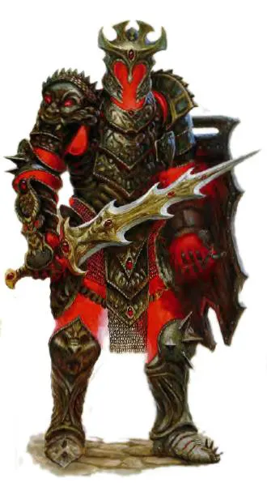

# Horror de Elmo

Esse constructo possui inteligência, a habilidade de raciocinar e ajustar suas táticas e uma devoção inabalável por seu criador, que persistem mesmo após o desaparecimento do seu construtor. Lembrando uma armadura de placas vazia e inanimada, um horror de elmo serve sem ambições ou emoções.

***Propósito Mágico***. Apesar de se gastar mais recursos mágicos para se criar um horror de elmo que uma armadura animada inferior, o horror de elfo requer menos direcionamento e manutenção enquanto ele realiza as tarefas designadas. Um horror de elfo segue as ordens com total lealdade, e é inteligente o suficiente para compreender a diferença entre as intenções de uma ordem e a redação exata. Diferente de muitos constructos, ele busca cumprir as ordens anteriores ao invés de seguir cegamente as mais recentes.

***Esperteza Tática***. Um horror de elmo luta com a astúcia de um guerreiro experiente, erguendo-se no ar enquanto ataca os personagens mais fracos e os conjuradores primeiro. Porém, um horror de elmo não possui o discernimento para mudar o meio ambiente, fortalecendo-o, ou de qualquer forma realizar medidas ativas para melhorar sua posição defensiva.

***Natureza de Constructo***. Um horror de elmo não precisa respirar, comer, beber ou dormir.

## Bloco de estatísticas: Horror de Elmo

*Constructo Médio, neutro*

**Classe de Armadura** 20 (placas, escudo)  
**Pontos de Vida** 60 (8d8 + 24)  
**Deslocamento** 9 m, voo 9 m

| FOR | DES | CON | INT | SAB | CAR |
| :---: | :---: | :---: | :---: | :---: | :---: |
| 18 (+4) | 13 (+1) | 16 (+3) | 10 (+0) | 10 (+0) | 10 (+0) |

**Perícias** Percepção +4  
**Resistência a Dano** concussão, cortante e perfurante de ataques não-mágicos que não sejam de adamante  
**Imunidade a Condição** amedrontado, atordoado, cego, enfeitiçado, envenenado, exausto, paralisado, petrificado, surdo  
**Sentidos** percepção às cegas 18 m (cego além desse raio), Percepção passiva 14  
**Idiomas** compreende os idiomas do seu criador, mas não pode falar  
**Nível de Desafio** 4 (1.100 XP)

***Imunidade à Magia***. O horror de elmo é imune a três magias escolhidas por seu criador. Imunidades típicas incluem *bola de* *fogo, esquentar metal* e *relâmpago*.

***Resistência à Magia***. O horror de elmo possui vantagem nos testes de resistência contra magias e outros efeitos mágicos.

### Ações

***Ataques Múltiplos***. O horror de elmo realiza dois ataques de espada longa.

***Espada Longa***. *Ataque Corpo-a-Corpo com Arma*: +6 para atingir, alcance 1,5 m, um alvo. *Acerto*: 8 (1d8 + 4) de dano cortante, ou 9 (1d10 + 4) de dano cortante se usada com as duas mãos.
