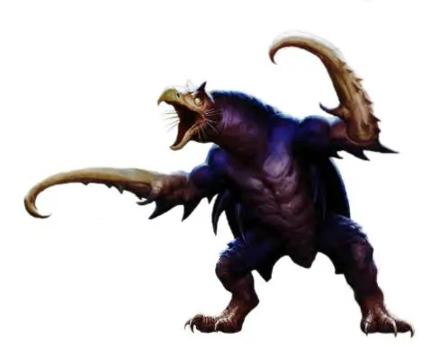

# Horror de Gancho

Um feroz predador do Subterrâneo, o horror de gancho defende agressivamente seus territórios de caça. As cavernas subterrâneas onde essas criaturas vivem ecoam com os estalos e raspas constantes dos seus ganchos enquanto eles fazem seus caminhos penhasco acima e pelas paredes das cavernas.

O monstruoso horror de gancho tem uma cabeça semelhante a de um abutre e o torso de um enorme besouro, com um exoesqueleto cravejado de protuberâncias ósseas afiadas. Ele recebeu seu nome devido aos seus braços e pernas longos e poderosos, terminados em garras terrivelmente curvadas.

***Ecos na Escuridão***. Os horrores de gancho se comunicam ao bater com seus ganchos contra seus exoesqueletos ou em superfícies rochosas a sua volta. O que soa para os outros como estalos aleatórios é, na verdade, uma linguagem complexa que apenas os horrores de gancho compreendem, e que é levada por quilômetros através do Subterrâneo ecoante.

***Predadores de Bando***. Os horrores de gancho são onívoros que comem sanguessugas, fungos, plantas e qualquer criatura que eles possam agarrar. Os membros curvos de um horror de gancho lhes dão uma excelente vantagem em superfícies rochosas, e essas criaturas usam suas habilidades de escalada para emboscar suas presas de cima. Eles caçam em bandos, trabalhando juntos contra os oponentes maiores e mais perigosos. Se uma batalha se tornar desvantajosa, um horror de gancho rapidamente escalará a parede de uma caverna para fugir.

***Clãs Dedicados***. Os horrores de gancho vivem em grandes grupos familiares ou clãs. Cada clã é comandado pela fêmea mais velha, que geralmente coloca seu parceiro no comando dos caçadores do clã. Os horrores de gancho põem ovos, que são chocados numa área central bem defendida dos lares cavernosos do clã.

## Bloco de estatísticas: Horror de Gancho

*Monstruosidade Grande, neutro*

**Classe de Armadura** 15 (armadura natural)  
**Pontos de Vida** 75 (10d10 + 20)  
**Deslocamento** 9 m, escalada 9 m

| FOR | DES | CON | INT | SAB | CAR |
| :---: | :---: | :---: | :---: | :---: | :---: |
| 18 (+4) | 10 (+0) | 15 (+2) | 6 (–2) | 12 (+1) | 7 (–2) |

**Perícias** Percepção +3  
**Sentidos** percepção às cegas 3 m, visão no escuro 18 m, Percepção passiva 13  
**Idiomas** Horror de Gancho  
**Nível de Desafio** 3 (700 XP)

***Eco Localização***. O horror de gancho não pode usar sua percepção às cegas enquanto estiver surdo.

***Audição Aguçada***. O horror de gancho tem vantagem em testes de Sabedoria (Percepção) relacionados à audição.

### Ações

***Ataques Múltiplos***. O horror de gancho realiza dois ataques de gancho.

***Gancho***. *Ataque Corpo-a-Corpo com Arma*: +6 para atingir, alcance 3 m, um alvo. *Acerto*: 11 (2d6 + 4) de dano perfurante.
