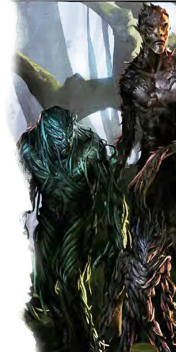

# Infectados

Plantas despertas dotadas de poderes de inteligência e mobilidade, os infectados empesteiam as terras contaminadas pelas trevas. Alimentando-se das trevas do solo, um infectado carrega a vontade de um mal ancestral e tenta espalhar esse mal por onde quer que vá.

***Raízes da Árvore de Gulthias***. Lendas contam sobre um vampiro chamado Gulthias que usou uma mágica terrível e ergueu uma abominável torre chamada Pináculo da Presa Noturna. Gulthias foi eliminado quando um herói enfiou uma estaca de madeira em seu coração, mas quando o vampiro foi destruído, seu sangue infundiu a estaca com um poder horrendo. Com o tempo, gavinhas brotaram da madeira, crescendo em um broto infundido com a essência maligna do vampiro. Dizem que um druida louco encontrou o broto, transplantando-o para uma gruta subterrânea onde ele pode crescer. Dessa árvore de Gutlhias vieram as sementes de onde brotaram os primeiros infectados.

***Conquista das Trevas***. Onde quer que uma árvore ou planta seja contaminada por um fragmento de uma mente ou poder maligno, uma árvore de Gulthias pode se erguer para infestar e corromper a floresta ao redor. Sua maldade se espalha através das raízes e do solo para outras plantas, que perecem ou se transformam em infectados. Conforme esses infectados se espalham, eles envenenam e extirpam plantas sadias, substituindo-as por espinheiros, ervas daninhas tóxicas e outros de sua espécie.

Em florestas infestadas por infectados, as árvores e plantas crescem numa velocidade sobrenatural. As vinhas e matagais espalham-se rapidamente por construções e sobre trilhas e estradas. Após os infectados terem matado ou expulsado seus habitantes, vilas inteiras podem desaparecer em períodos de dias.

***Controlados pelo Mal***. Os infectados são criaturas independentes, mas a maioria age sob o controle da árvore de Gulthias, muitas vezes exibindo os hábitos e traços da força vital ou espírito que os gerou. Ao atacar os antigos inimigos do seu progenitor ou buscar tesouros valiosos para ele, eles dão continuidade ao legado de mal a muito esquecido.

### Espeto Infectado

Nas sombras de uma floresta, espetos infectados podem ser confundidos à distância com humanoides curvados e distorcidos. De perto, essas criaturas revelam-se como horrendas plantas cujas coníferas similares a agulhas cresceram pelos seus corpos em aglomerados trêmulos. Um espeto infectado golpeia com essas agulhas ou arremessa-as em um assalto aéreo que pode penetrar armaduras e carne.

Quando os espetos infectados detectam uma ameaça, eles liberam um pólen carregado pelo vento até outros espetos infectados pela floresta. Advertidos sobre a localização dos seus inimigos, os espetos infectados convergem de todos os lados para banhar suas raízes com sangue.

### Galho Infectado

Os galhos infectados podem se enraizar no solo, que é o que eles fazem quando presas vivas estão escarças. Enquanto estão enraizados, eles lembram arbustos lenhosos. Quando se liberta do solo para se mover, os ramos retorcidos de um galho infectado se unem para formar um corpo vagamente humanoide com cabeça e membros.

Os galhos infectados buscam parques e poços de água, se enraizando neles para preparar emboscadas a vítimas em potencial que vierem beber ou descansar. Juntando-se em grupos, os galhos infectados mesclam-se com a vegetação natural da área ou com pilhas de entulho ou lenha.

Devido a serem muito secos, os galhos infectados são particularmente suscetíveis ao fogo.

### Vinha Infectada

Parecendo com massas de trepadeiras sinuosas, as vinhas infectadas escondem-se no subterrâneo e aguardam que suas presas se aproximem. Ao animar as plantas a sua volta, as vinhas infectadas enredam e prendem os inimigos antes de ataca-los.

As vinhas infectadas são os únicos infectados capazes de falar. Através da conexão com o espírito maligno da árvore de Gulthias a que serve, uma vinha infectada fala com uma versão distorcida da voz do seu mestre morto, provocando suas vítimas ou negociando com adversários poderosos.

## Bloco de estatísticas: Espeto Infectado

*Planta Média, neutro e mau*

**Classe de Armadura** 12 (armadura natural)  
**Pontos de Vida** 11 (2d8 + 2)  
**Deslocamento** 9 m

| FOR | DES | CON | INT | SAB | CAR |
| :---: | :---: | :---: | :---: | :---: | :---: |
| 12 (+1) | 12 (+1) | 13 (+1) | 4 (–3) | 8 (–1) | 3 (–4) |

**Imunidade a Condição** cego, surdo  
**Sentidos** percepção às cegas 18 m (cego além desse raio), Percepção passiva 9  
**Idiomas** compreende Comum, mas não pode falar  
**Nível de Desafio** 1/4 (50 XP)

### Ações

***Garras***. *Ataque Corpo-a-Corpo com Arma*: +3 para atingir, alcance 1,5 m, um alvo. *Acerto*: 6 (2d4 + 1) de dano perfurante.

***Agulhas***. *Ataque à Distância com Arma*: +3 para atingir, distância 9/18 m, um alvo. *Acerto*: 8 (2d6 + 1) de dano perfurante.

## Bloco de estatísticas: Galho Infectado

*Planta Pequena, neutro e mau*

**Classe de Armadura** 13 (armadura natural)  
**Pontos de Vida** 4 (1d6 + 1)  
**Deslocamento** 6 m

| FOR | DES | CON | INT | SAB | CAR |
| :---: | :---: | :---: | :---: | :---: | :---: |
| 6 (–2) | 13 (+1) | 12 (+1) | 4 (–3) | 8 (–1) | 3 (–4) |

**Perícias** Furtividade +3  
**Vulnerabilidade a Dano** fogo  
**Imunidade a Condição** cego, surdo  
**Sentidos** percepção às cegas 18 m (cego além desse raio), Percepção passiva 9  
**Idiomas** compreende Comum, mas não pode falar  
**Nível de Desafio** 1/8 (25 XP)

***Aparência Falsa***. Enquanto o infectado permanecer imóvel, ele é indistinguível de um arbusto morto.

### Ações

***Garras***. *Ataque Corpo-a-Corpo com Arma*: +3 para atingir, alcance 1,5 m, um alvo. *Acerto*: 3 (1d4 + 1) de dano perfurante.

## Bloco de estatísticas: Vinha Infectada

*Planta Média, neutro e mau*

**Classe de Armadura** 12 (armadura natural)  
**Pontos de Vida** 26 (4d8 + 8)  
**Deslocamento** 3 m

| FOR | DES | CON | INT | SAB | CAR |
| :---: | :---: | :---: | :---: | :---: | :---: |
| 15 (+2) | 8 (–1) | 14 (+2) | 5 (–3) | 10 (+0) | 3 (–4) |

**Perícias** Furtividade +1  
**Imunidade a Condição** cego, surdo  
**Sentidos** percepção às cegas 18 m (cego além desse raio), Percepção passiva 10  
**Idiomas** Comum  
**Nível de Desafio** 1/2 (100 XP)

***Aparência Falsa***. Enquanto o infectado permanecer imóvel, ele é indistinguível de um emaranhado de vinhas.

### Ações

***Constrição***. *Ataque Corpo-a-Corpo com Arma*: +4 para atingir, alcance 3 m, um alvo. *Acerto*: 9 (2d6 + 2) de dano de concussão, e um alvo Grande ou menor fica agarrado (CD 12 para escapar). Até esse agarrão acabar, o alvo fica impedido, e o infectado não pode constringir outro alvo.

***Plantas Constritoras (Recarrega 5–6)***. Raízes e vinhas agarradoras brotam num raio de 4,5 metros centrado no infectado, definhando após 1 minuto. Pela duração, a área torna-se terreno difícil para criaturas não-plantas. Além disso, cada criatura na área, à escolha do infectado, quando as plantas aparecem, deve ser bem sucedida num teste de resistência de Força CD 12 ou ficará impedida. Uma criatura pode usar sua ação para realizar um teste de Força CD 12, libertando a si ou a outro criatura enredada ao alcance num sucesso.
