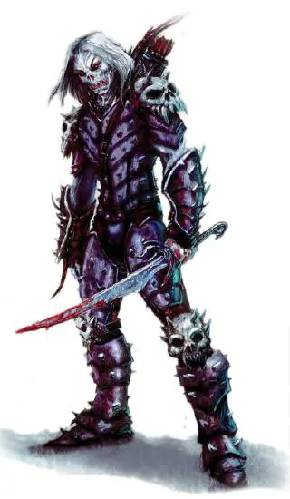

# Inumano

A palavra “inumano” significava “pessoa” nos dias de outrora, mas o nome agora se refere a mortos-vivos malignos que foram mortais guiados por desejos obscuros e grande vaidade. Quando a morte silencia o coração de uma criatura assim e sufoca sua suspiro de vida, seu espírito suplica para o lorde demônio Orcus ou a alguma deus vil do submundo por adiamento: morte-vida em troca de uma guerra eterna contra os vivos. Se um poder obscuro ouvir esse chamado, é concedida ao espírito a morte-vida na qual ele pode perseguir sua própria agenda maligna.

Os inumanos possuem as memórias e objetivos do seus antigo eu vivo. Eles irão atender ao chamado de qualquer que seja a entidade trevosa que os transformou em mortos-vivos, fazendo juramentos para acalmar seu novo senhor, enquanto mantem sua autonomia. Nunca se cansando, um inumano pode perseguir seus objetivos sem descanso e sem distração.

***Devoradores de Vida***. Nem morto nem vivo, um inumano existe em um estado transitório entre um mundo e o próximo. A centelha luminosa que ele possuía em vida se foi, e em seu lugar ficou um desejo de consumir a centelha de todas as coisas vivas. Quando um inumano ataca, essa essência brilha como brasas brancas em seus olhos negros, e o toque frio do inumano pode drenar a centelha através da carne, roupas e armaduras.

***Sombra da Cripta***. Os inumanos fugiram do mundo durante o dia, se afastando da luz do sol, a qual eles detestam. Eles recuam para as covas, criptas e tumbas onde habitam. Seus covis são locais desolados e silenciosos, cercados por plantas mortas, visivelmente enegrecido e evitado por pássaros e bestas.

Os humanoides mortos por um inumano se erguem como zumbis sob seu controle. Motivados por uma fome por almas vivas e levados pelo mesmo desejo de poder que os despertaram como mortos-vivos, alguns inumanos servem como tropas de choque para líderes malignos, incluindo aparições. Como soldados, eles são capazes de planejar, mas raramente o fazem, contando com sua fome de destruição para sobrepujar qualquer criatura que fique em seu caminho.

***Natureza Morta-Viva***. Um inumano não precisa respirar, comer, beber ou dormir.

## Bloco de estatísticas: Inumano

*Morto-vivo Médio, neutro e mau*

**Classe de Armadura** 14 (couro batido)  
**Pontos de Vida** 45 (6d8 + 18)  
**Deslocamento** 9 m

| FOR | DES | CON | INT | SAB | CAR |
| :---: | :---: | :---: | :---: | :---: | :---: |
| 15 (+2) | 14 (+2) | 16 (+3) | 10 (+0) | 13 (+1) | 15 (+2) |

**Perícias** Furtividade +4, Percepção +3  
**Resistência a Dano** necrótico; concussão, cortante e perfurante de ataques não-mágicos que não sejam de prata  
**Imunidade a Dano** veneno  
**Imunidade a Condição** envenenado, exausto  
**Sentidos** visão no escuro 18 m, Percepção passiva 13  
**Idiomas** os idiomas que conhecia em vida  
**Nível de Desafio** 3 (700 XP)

***Sensibilidade à Luz Solar***. Enquanto estiver sob luz solar, o inumano tem desvantagem nas jogadas de ataque, assim como em testes de Sabedoria (Percepção) relacionados a visão.

### Ações

***Ataques Múltiplos***. O inumano realiza dois ataques com espada longa ou dois ataques com arco longo. Ele pode usar seu Drenar Vida no lugar de um ataque de espada longa.

***Drenar Vida***. *Ataque Corpo-a-Corpo com Magia*: +4 para atingir, alcance 1,5 m, uma criatura. *Acerto*: 5 (1d6 + 2) de dano necrótico. O alvo deve ser bem sucedido num teste de resistência de Constituição CD 13 ou seu máximo de pontos de vida será reduzido em um valor igual ao dano sofrido. Essa redução dura até o alvo terminar um descanso longo. O alvo morre se esse efeito reduzir seu máximo de pontos de vida a 0. Um humanoide morto por esse ataque, se ergue 24 horas depois como um zumbi sob controle do inumano, a não ser que o humanoide seja trazido de volta à vida ou seu corpo seja destruído. O inumano pode ter até doze zumbis sob seu controle ao mesmo tempo.

***Espada Longa***. *Ataque Corpo-a-Corpo com Arma*: +4 para atingir, alcance 1,5 m, um alvo. *Acerto*: 6 (1d8 + 2) de dano cortante, ou 7 (1d10 + 2) de dano cortante se usada com as duas mãos.

***Arco Longo***. *Ataque à Distância com Arma*: +4 para atingir, distância 45/180 m, um alvo. *Acerto*: 6 (1d8 + 2) de dano perfurante.
