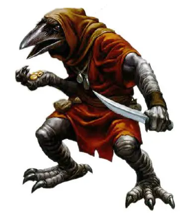

# Kenku

## Bloco de estatísticas: Kenku

*Humanoide Médio (kenku), caótico e neutro*

**Classe de Armadura** 13  
**Pontos de Vida** 13 (3d8)  
**Deslocamento** 9 m

| FOR | DES | CON | INT | SAB | CAR |
| :---: | :---: | :---: | :---: | :---: | :---: |
| 10 (+0) | 16 (+3) | 10 (+0) | 11 (+0) | 10 (+0) | 10 (+0) |

**Perícias** Enganação +4, Furtividade +5, Percepção +2  
**Sentidos** Percepção passiva 12  
**Idiomas** compreendem Auran e Comum, mas falam apenas através do uso do traço Imitar  
**Nível de Desafio** 1/4 (50 XP)

***Emboscador***. Na primeira rodada de combate, o kenku tem vantagem nas jogadas de ataque contra qualquer criatura que ele surpreender.

***Imitar***. O kenku pode imitar qualquer som que tenha ouvido, incluindo vozes. Uma criatura que ouça os sons pode dizer que são imitações com um teste de Sabedoria (Intuição) CD 14, bem sucedido.

### Ações

***Espada Curta***. *Ataque Corpo-a-Corpo com Arma*: +5 para atingir, alcance 1,5 m, um alvo. *Acerto*: 6 (1d6 + 3) de dano perfurante.

***Arco Curto***. *Ataque à Distância com Arma*: +5 para atingir, distância 24/96 m, um alvo. *Acerto*: 6 (1d6 + 3) de dano perfurante.

Os kenku são humanoides emplumados que perambulam pelo mundo como vagabundos, guiados pela ganância. Eles podem imitar perfeitamente qualquer som que escutem.

***Ovelhas Negras***. Os kenku vestem mantos, robes e mantos mal ajustados. Esses trajes cobrem as penas suaves e elegantes de seus corpos, que envolvem seus braços e pernas nus. Eles pisam suavemente quando caminham sobre garras feitas para se agarrar a galhos de árvores e arrebatar presas do alto dos céus. Eles se movem de forma tão suave quanto o vento, para não atrair a atenção para suas formas vergonhosas.

Certa vez, os kenku sentiam o vento sob suas asas, abraçando o céu tempestuoso e cantando a doce língua do canto dos pássaros. Servindo um mestre cuja identidade agora já está perdida em sua memória, os kenku cobiçavam as bugigangas brilhantes de suas casas, e ansiavam falar para que pudessem persuadir e enganar os outros por tais tesouros. Roubando o segredo da fala de um livro na biblioteca de seu mestre, eles se disfarçaram em trapos para mendigar coisas bonitas. Quando seu mestre descobriu a ganância deles, ele arrancou suas asas como punição, forçando-os a mendigar para sempre.

***Falando em Pantomima***. Os kenku podem imitar o som de qualquer coisa que ouçam. Um kenku pedindo por dinheiro pode fazer o som de moedas tilintando, e um kenku se referindo a um mercado agitado pode reproduzir a cacofonia dos gritos dos vendedores, cães latindo, ovelhas berrando e o choro dos meninos de rua. Quando estiverem imitando vozes, eles podem repetir apenas palavras e frases que já tenham ouvido, mas não criar novas sentenças. Conversar com um kenku é como testemunhar uma atuação de sons imitados e todo tipo de versículos sem sentido.

Os kenku falam uns com os outros praticamente da mesma forma. Por serem capazes de interpretar os olhares e gestos uns aos outros, os sons que eles fazem para comunicar ideias complexas e emoções podem ser sucintos. Grupos de kenku também desenvolvem códigos secretos. Por exemplo, um miado de gato pode ser o código secreto para “Preparem-se para atacar!” ou “Corram por suas vidas!”

O talento deles para imitação estende-se a escrita, e organizações criminosas muitas vezes contratam kenku para forjar documentos. Quando um kenku comete um crime, ele pode forjar evidência para comprometer outra criatura.

***Os Saudosos sem Asas***. Todos os kenku sentem falta da habilidade de voar, e por isso, as punições que eles aplicam uns aos outros envolvem asas falsas, como pesadas asas de madeira carregadas como marca de vergonha. Como um lembrete final trágico das asas que eles já tiveram, os kenku fazem execuções arremessando seus condenados de prédios ou penhascos altos.
