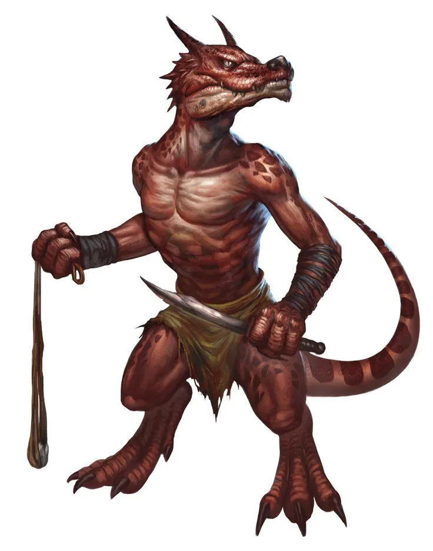

# Kobolds

Os kobolds são humanoides reptilianos covardes que veneram dragões e semideuses malignos e os servem como lacaios e bajuladores. Os kobolds vivem em covis de dragões quando podem, mas eles comumente infestam masmorras, coletando tesouros e bugigangas para adiciona-los a sua própria minúscula fortuna.

***Força em Números***. Os kobolds são criaturas ovovivíparas. Eles amadurecem rapidamente e podem viver para se tornarem “grandes anciões” por mais de um século. No entanto, muitos kobolds perecem antes de alcançarem o fim de sua primeira década. Fisicamente fracos, eles são presas fáceis para predadores. Essa vulnerabilidade forçou-os a se juntarem em bandos. A superioridade numérica deles pode vencer batalhas contra adversários poderosos, mas geralmente com casualidades massivas do lado kobold.

***Escavadores e Construtores***. Os kobolds suplantam sua ineptidão física com esperteza para criar armadilhas e túneis. Seus covis consistem em túneis baixos pelos quais eles podem se mover facilmente, mas que entravariam humanoides maiores. Os kobolds também enchem seus covis com armadilhas. As armadilhas kobolds mais traiçoeiras são feitas usando perigos naturais e outras criaturas. Um fio teso poderia se conectar a uma armadilha de mola que arremessasse panelas de barro cheias de lodo verde de carne digerida ou arremessasse cestas de centopeias venenosas gigantes em intrusos.

***O Deus Perdido***. Além dos dragões que eles veneram, os kobolds adoram um deus menor chamado Kurtulmak. Lendas contam de como Kurtulmak serviu como vassalo de Tiamat nos Nove Infernos até Garl Glittergold, o deus dos gnomos, roubar uma quinquilharia do tesouro da Rainha Dragão. Tiamat enviou Kurtulmak para recuperar o item, mas Garl Glittergold bolou uma arapuca para ele, desmoronando a terra e prendendo o

## Bloco de estatísticas: Kobold

*Humanoide Pequeno (kobolds), leal e mau*

**Classe de Armadura** 12  
**Pontos de Vida** 5 (2d6 – 2)  
**Deslocamento** 9 m

| FOR | DES | CON | INT | SAB | CAR |
| :---: | :---: | :---: | :---: | :---: | :---: |
| 7 (–2) | 15 (+2) | 9 (–1) | 8 (–1) | 7 (–2) | 8 (–1) |

**Sentidos** visão no escuro 18 m, Percepção passiva 8  
**Idiomas** Comum, Dracônico  
**Nível de Desafio** 1/8 (25 XP)

***Sensibilidade à Luz Solar***. Enquanto estiver sob luz solar, o kobold tem desvantagem nas jogadas de ataque, assim como em testes de Sabedoria (Percepção) relacionados a visão.

***Táticas de Matilha***. O kobold tem vantagem nas jogadas de ataque contra uma criatura se, pelo menos, um dos aliados do kobold estiver a 1,5 metro da criaturas e não estiver incapacitado.

### Ações

***Adaga***. *Ataque Corpo-a-Corpo com Arma*: +4 para atingir, alcance 1,5 m, um alvo. *Acerto*: 4 (1d4 + 2) de dano perfurante.

***Funda***. *Ataque à Distância com Arma*: +4 para atingir, distância 9/36 m, um alvo. *Acerto*: 4 (1d4 + 2) de dano de concussão.

deus kobolds em um labirinto subterrâneo pela eternidade. Por essa razão, os kobolds odeiam os gnomos e travessuras de qualquer tipo. Os adoradores mais devotados de Kurtulmak dedicaram-se a encontrar e libertar seu deus perdido do seu labirinto-prisão.

***Kobolds Alados***. Alguns poucos kobolds nasceram com asas de couro e podem voar. Conhecidos como *urds*, eles espreitam em parapeitos elevados e jogam pedras em transeuntes. Já que as asas dos urds são vistas como dádivas de Tiamat, a Rainha Dragão, os kobolds sem asas tem inveja dessas dádivas e não se juntam com os urds.

## Bloco de estatísticas: Kobold Alado

*Humanoide Pequeno (kobolds), leal e mau*

**Classe de Armadura** 13  
**Pontos de Vida** 7 (3d6 – 3)  
**Deslocamento** 9 m, voo 9 m

| FOR | DES | CON | INT | SAB | CAR |
| :---: | :---: | :---: | :---: | :---: | :---: |
| 7 (–2) | 16 (+3) | 9 (–1) | 8 (–1) | 7 (–2) | 8 (–1) |

**Sentidos** visão no escuro 18 m, Percepção passiva 8  
**Idiomas** Comum, Dracônico  
**Nível de Desafio** 1/4 (50 XP)

***Sensibilidade à Luz Solar***. Enquanto estiver sob luz solar, o kobold tem desvantagem nas jogadas de ataque, assim como em testes de Sabedoria (Percepção) relacionados a visão.

***Táticas de Matilha***. O kobold tem vantagem nas jogadas de ataque contra uma criatura se, pelo menos, um dos aliados do kobold estiver a 1,5 metro da criaturas e não estiver incapacitado.

### Ações

***Adaga***. *Ataque Corpo-a-Corpo com Arma*: +5 para atingir, alcance 1,5 m, um alvo. *Acerto*: 5 (1d4 + 3) de dano perfurante.

***Derrubar Pedra***. *Ataque à Distância com Arma*: +5 para atingir, um alvo diretamente abaixo do kobold. *Acerto*: 6 (1d6 + 3) de dano de concussão.
