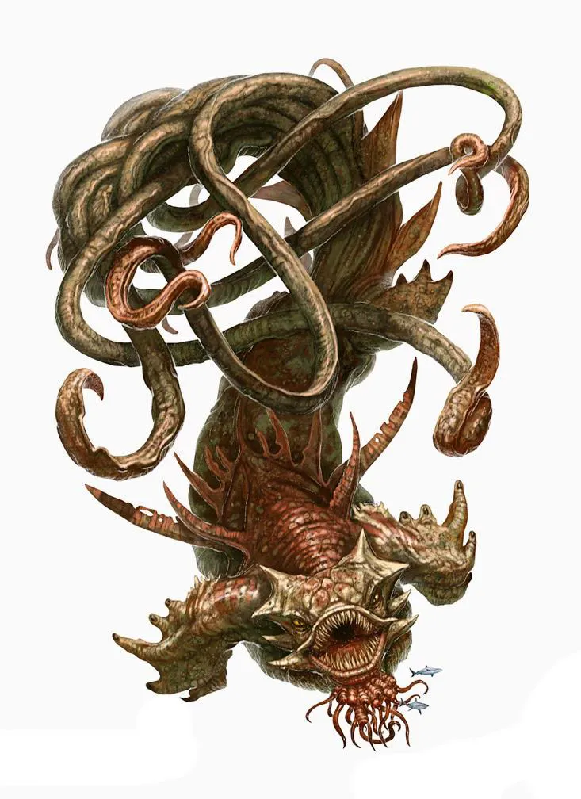

# Kraken

Abaixo das ondas, o kraken dorme por incontáveis eras, esperando por algum sinal ou chamado. Mortais terrestre que naveguem em mar aberto esquecem as razões pelas quais seus ancestrais temiam o oceano, até mesmo as raças das profundezas ignoram estranhos furos em suas histórias quando suas civilizações quase desapareceram após a aparição do horror de tentáculos.

***Leviatãs das Lendas***. No início dos tempos, os krakens serviam como ferozes guerreiros dos deuses. Quando a guerra dos deuses acabou, os krakens foram libertos de sua servidão, nunca mais sendo vinculados por outros seres.

Nações inteiras tremeram de medo quando o kraken emergiu de seu domínio obscuro e, mesmo no meio dos mais profundos oceanos, tempestades surgem ou terminam de acordo com sua vontade. O kraken é uma força primitiva que oblitera as maiores conquistas de civilizações como se fossem castelos de areia. Seus ataques devastadores podem destruir comércios marítimos e interromper comunicações entre cidades costeiras.

Uma escuridão sinistra prenuncia o ataque do kraken, e uma nuvem de tinta venenosa tinge a água ao seu redor. Galeões e navios de guerra desaparecem quando seus tentáculos os arrastam para as profundezas, o kraken quebra seus mastros como gravetos antes de dragar o navio e sua tripulação para baixo.

Nem mesmo os moradores da superfície trancados estão a salvo da ira de um kraken. Os krakens podem respirar ar tão facilmente quanto água, e alguns rastejam rios acima para pôr ovos em lagos de água fresca, destruindo cidades e vilas pelo caminho. Aventureiros contam que esse monstro descansa em ruínas de cidadelas lacustres, onde seus tentáculos se enrolam e inclinam torres de rocha desintegrada.

***Inimigos Mortais***. Alguns krakens são virtualmente deuses, os quais cultos e lacaios se espalham pelo mar e terra. Outros se aliam com Olhydra, a Princesa maligna Elemental da Água, e usa os cultistas dela para reforçar sua vontade na terra e no mar. Um kraken satisfeito com seus adoradores pode acalmar mares revoltos e trazer uma pescaria abundante para seus fiéis. No entanto, a mente diabólica do kraken é mais antiga que se possa imaginar, e está fundamental inclinada a arruinar todas as coisas.

### O Covil do Kraken

O kraken vive em profundezas escuras, geralmente em fendas profundas ou em cavernas cheias de detritos, tesouros e navios naufragados.

### Ações de Covil

No valor de iniciativa 20 (quebrando toda a sequência de iniciativa), o kraken realiza uma ação de covil fazendo um dos efeitos a seguir:

- Uma forte correnteza se move pelo covil do kraken. Cada criatura a até 18 metros do kraken deve ser bem sucedida num teste de resistência de Força CD 23 ou será empurrada 18 metros para longe do kraken. Com um sucesso, a criatura é empurrada 3 metros para longe do kraken.
- As criaturas na água a até 18 metros do kraken tem vulnerabilidade a dano elétrico até a contagem de iniciativa 20 na próxima rodada.
- A água no covil do kraken tornasse eletricamente carregada. Todas as criaturas a até 36 metros do kraken devem ser bem sucedidas num teste de resistência de Constituição CD 23, sofrendo 10 (3d6) de dano elétrico se falharem na resistência, ou metade desse dano caso obtenham sucesso.

### Efeitos Regionais

A região contendo o covil de um kraken é deformada pela presença da criatura, o que cria um ou mais dos seguintes efeitos mágicos:

## Bloco de estatísticas: Kraken

*Monstruosidade Imensa (titã), caótico e mau*

**Classe de Armadura** 18 (armadura natural)  
**Pontos de Vida** 472 (27d20 + 189)  
**Deslocamento** 6 m, natação 18 m

| FOR | DES | CON | INT | SAB | CAR |
| :---: | :---: | :---: | :---: | :---: | :---: |
| 30 (+10) | 11 (+0) | 25 (+7) | 22 (+6) | 18 (+4) | 20 (+5) |

**Testes de Resistência** For +17, Des +7, Con +14, Int +13, Sab +11  
**Imunidade a Dano** elétrico; concussão, cortante e perfurante de ataques não-mágicos  
**Imunidade a Condição** amedrontado, paralisado  
**Sentidos** visão verdadeira 36 m, Percepção passiva 14  
**Idiomas** compreende Abissal, Celestial, Infernal e Primordial, mas não pode falar, telepatia 36 m  
**Nível de Desafio** 23 (50.000 XP)

***Anfíbio***. O kraken pode respirar ar e água.

***Monstro de Cerco***. O kraken causa o dobro do dano a objetos e estruturas.

***Movimentação Livre***. O kraken ignora terreno difícil e efeitos mágicos não podem reduzir o deslocamento ou deixa-lo impedido. Ele pode gastar 1,5 metro do deu deslocamento para escapar de impedimentos não-mágicos ou de um agarrão.

### Ações

***Ataques Múltiplos***. O kraken realiza três ataques de tentáculo, cada um desses pode ser substituído com um uso de Arremessar.

***Mordida***. *Ataque Corpo-a-Corpo com Arma*: +17 para atingir, alcance 1,5 m, um alvo. *Acerto*: 23 (3d8 + 10) de dano perfurante. Se o alvo for uma criatura Grande ou menor agarrada pelo kraken, ele é engolido e o agarrão termina. Enquanto estiver engolido, a criatura está cega e impedida, ela tem cobertura total contra ataques e outros efeitos do lado de fora do kraken e sofre 42 (12d6) de dano de ácido no início de cada um dos turnos do kraken. Se o kraken sofrer 50 ou mais de dano em um único turno de uma criatura dentro dele, o kraken deve ser bem sucedido num teste de resistência de Constituição CD 25 no final do turno dele, ou regurgitará todas as criaturas engolidas, que cairão em um

- O kraken pode alterar o clima, à vontade, num raio de

até 9 quilômetros, centrado no seu covil. O efeito é idêntico a magia *controlar o clima*.

- Elementais da água coalescem a até 9 quilômetros do covil. Esses elementais não podem deixar a água e possuem valores de Inteligência e Carisma 1 (–5).
- As criaturas aquáticas a até 9 quilômetros do covil que possuírem valor de Inteligência 2 ou menor são enfeitiçadas pelo kraken e tornam-se agressivas contra intrusos na área.

Se o kraken morrer, todos esses efeitos regionais somem imediatamente.

espaço a até 3 metros do kraken. Se o kraken morrer, uma criatura engolida não estará mais impedida por ele e poderá escapar do corpo usando 4,5 metro de movimento, estando caída ao sair.

***Tentáculo***. *Ataque Corpo-a-Corpo com Arma*: +17 para atingir, alcance 6 m, um alvo. *Acerto*: 20 (3d6 + 10) de dano de concussão, e o alvo é agarrado (CD 18 para escapar). Até o agarrão terminar, o alvo fica impedido. O kraken possui dez tentáculos, cada um deles pode agarrar um alvo.

***Arremessar***. Um objeto segurado ou criatura agarrada pelo kraken, Grande ou menor, é jogado a até 18 metros em uma direção aleatória e fica caído no chão. Se um alvo arremessado atingir uma superfície sólida, o alvo sofre 3 (1d6) de dano de concussão para cada 3 metros que ele tenha percorrido. Se o alvo for arremessado em outra criatura, essa criatura deve ser bem sucedida num teste de resistência de Destreza CD 18 ou sofrerá o mesmo dano e será derrubada no chão.

***Tempestade Elétrica***. O kraken cria magicamente três raios de eletricidade, cada um pode ser disparado em um alvo que o kraken possa ver, a até 36 metros dele. Um alvo deve realizar um teste de resistência de Destreza CD 22, sofrendo 22 (4d10) de dano elétrico se falhar na resistência, ou metade desse dano caso obtenha sucesso.

### Ações Lendárias

O kraken pode realizar 3 ações lendárias, escolhidas dentre as opções abaixo. Apenas uma ação lendária pode ser usada por vez e apenas no final do turno de outra criatura. O kraken recupera as ações lendárias gastas no começo do turno dele.

**Ataque de Tentáculo ou Arremessar**. O kraken realiza um ataque de tentáculo ou usa seu Arremessar.  
**Tempestade Elétrica (Custa 2 Ações).** O kraken usa a Tempestade Elétrica.  
**Nuvem de Tinta (Custa 3 Ações).** Enquanto estiver submerso, o kraken expele uma nuvem de tinta num raio de 18 metros. A nuvem se espalha, dobrando esquinas, e a área é de escuridão densa para as outras criaturas fora o kraken. Cada criatura diferente do kraken que termine seu turno na nuvem, deve ser bem sucedida num teste de resistência de Constituição CD 22, sofrendo 16 (3d10) de dano de veneno se falhar na resistência, ou metade desse dano caso obtenha sucesso. Uma correnteza forte dispersa a nuvem, que, do contrário, desaparece no final do próximo turno do kraken.
