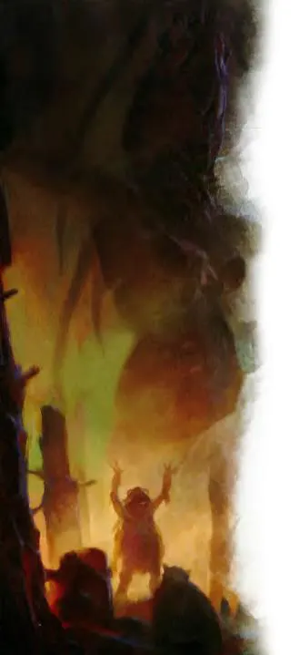
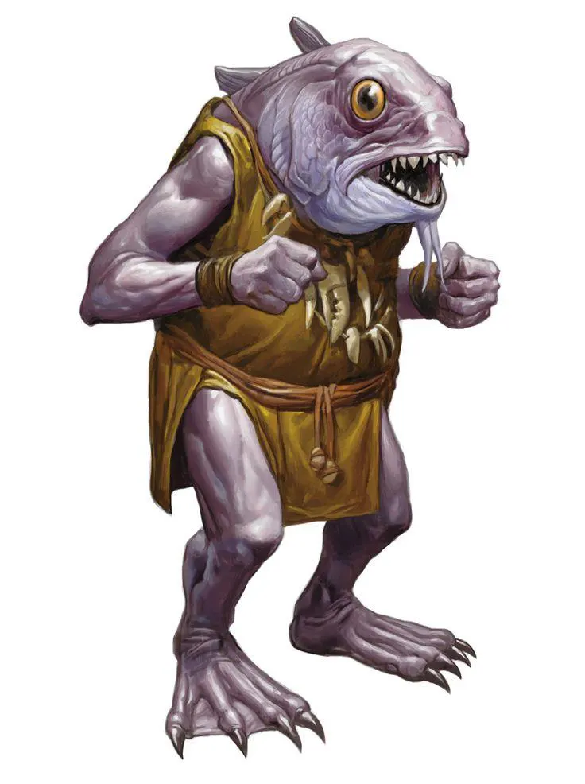
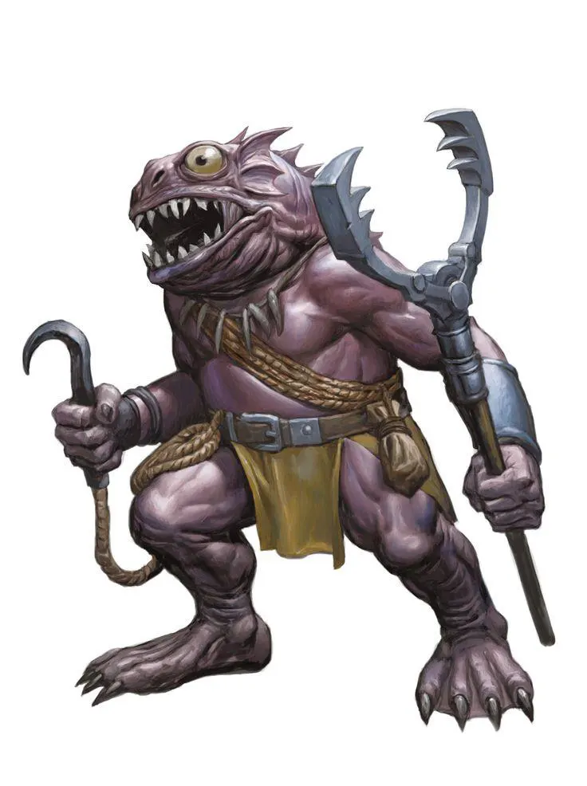
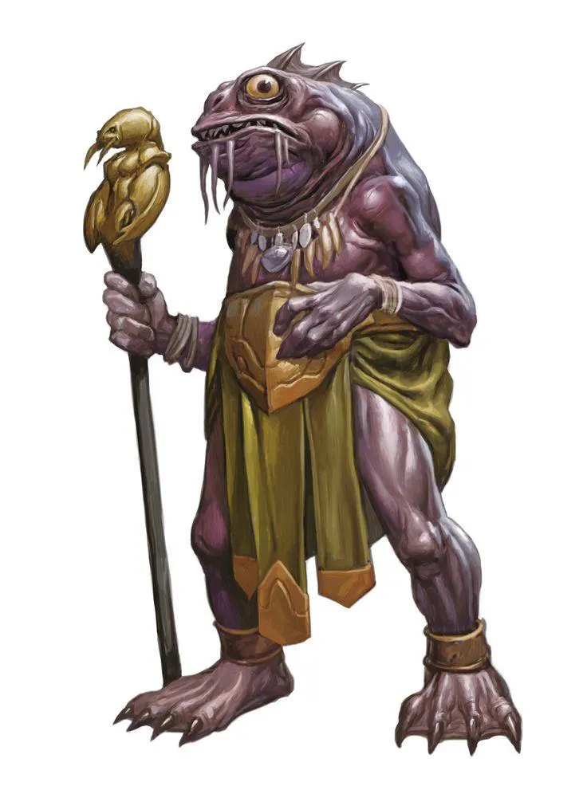

# Kuo-toa

Os kuo-toa são humanoides-peixe degenerados que já habitaram as costas e ilhas do mundo da superfície. Muito tempo atrás, os humanos e sua laia enviaram os kuo-toa para o subterrâneo, onde eles vivem em loucura e noite eterna. Os kuo-toa não conseguem mais suportar a luz do dia.

***Escravos Loucos***. No auge do império ilitides, os devoradores de mentes capturaram os kuo-toa aos milhares e forçaram-nos a escravidão. Os kuo-toa eram criaturas simples, nunca conseguindo se opor a força mental opressiva que os ilitides lançavam sobre eles. Conforme os ilitides os abandonaram, a subjugação física prolongada sofrida pelos kuo-toa levou-os à loucura.

Suas mentes foram danificadas além do reparável, os kuo-toa adotaram um fervor religioso, inventando deuses para protege-los de ameaças. A mais notável dessas ameaças são os drow, que tem assassinado os kuo-toa a vista desde o dia em que ambas as raças se conheceram.

***Criadores de Deuses***. Os kuo-toa veneram deuses de suas próprias criações insanas, mas se kuo-toa suficientes acreditarem que um deus é real, a energia do subconsciente coletivo deles pode fazer com que o deus se manifeste como uma entidade física. A forma que um deus kuo-toa adquire depende da inspiração de sua imagem divina, e geralmente é aleatória ou sem sentido.

Um dos deuses mais reverenciados pelos kuo-toa é Blibdoolpoolp, a Mãe Mar, que tem a forma de uma humana com uma cabeça de lagosta, pinças de lagosta e uma carapaça articulada cobrindo seus ombros. Blipdoolpoolp provavelmente foi inventada por um kuo-toa que aprimorou uma estátua humana quebrada adicionando membros e cabeça de um crustáceo. Em temor repentino de sua obra, ele a nomeou resultando na criação de um deus.

Os kuo-toa que cruzam o caminho de um abolete acabam por venera-lo como um deus, a loucura deles os cega ao fato de que o abolete está meramente os usando para seus próprios fins nefários.

***Governantes Teocráticos***. Os kuo-toa arcebispos ficam rodeados por devotos fanáticos de sua fé. O arcebispo de um domínio kuo-toa exige que todos os seus súditos adorem um deus especifico. A crença insana em seu deus por um arcebispo é tão fervorosa que ele manifesta os poderes de um alto clérigo. O arcebispo também pode conferir magias a lacaios devotados chamados açoitadores. Um ou mais desses açoitadores s também são filhos do arcebispo, e seu papel primário na sociedade kuo-toa é de lutar até a morte para reivindicar o trono quando o arcebispo morrer. Se um açoitador desagradar o arcebispo, o arcebispo pode retirar sua capacidade de conjuração, isso se não tirar sua vida.

Os decretos do arcebispo são aplicados por monitores, kuo-toa devotados que atuam como olhos e ouvidos do arcebispo. Os monitores são combatentes mortais em combate mano-a-mano, e os kuo-toa menores vivem temendo-os.

***Equipamento Kuo-toa***. Muitas armas dos kuo-toa são designadas para capturar ao invés de matar. Redes são comuns, apesar de alguns carregarem bastões pinçados (também chamados de mancatchers) designados para prender e imobilizar oponentes. Os kuo-toa guerreiros também aplicam uma substância pegajosa em seus escudos para prender armas que os atinja.

Em geral, os kuo-toa não gostam do peso de uma armadura em seus corpos escorregadios e confiam em sua pele borrachuda natural como proteção. Porém, eles gostam de ostentar joias feitas de ossos, conchas, pérolas, gemas e fragmentos de carapaça coletados.

> **Variação: Kuo-Toa Monitor**
>
> Um kuo-toa monitor tem nível de desafio 3 (700 XP). Ele possui as mesmas estatísticas de um kuo-toa açoitador, exceto por ele adicionar seu modificador de Sabedoria a sua Classe de Armadura (CA 13), perder o traço de Conjuração e substituir a ação de chicote com as seguintes opções de ação.
>
> ***Ataques Múltiplos***. O kuo-toa realiza um ataque com sua mordida e dois golpes desarmados.
>
> ***Mordida***. *Ataque Corpo-a-Corpo com Arma*: +6 para atingir, alcance 1,5 m, um alvo. *Acerto*: 4 (1d4 + 2) de dano perfurante.
>
> ***Golpe Desarmado***. *Ataque Corpo-a-Corpo com Arma*: +6 para atingir, alcance 1,5 m, um alvo. *Acerto*: 5 (1d6 + 2) de dano de concussão e o alvo não pode realizar reações até o final do próximo turno do kuo-toa.

## Bloco de estatísticas: Kuo-Toa

*Humanoide Médio (kuo-toa), neutro e mau*

**Classe de Armadura** 13 (armadura natural, escudo)  
**Pontos de Vida** 18 (4d8)  
**Deslocamento** 9 m, natação 9 m

| FOR | DES | CON | INT | SAB | CAR |
| :---: | :---: | :---: | :---: | :---: | :---: |
| 13 (+1) | 10 (+0) | 11 (+0) | 11 (+0) | 10 (+0) | 8 (–1) |

**Perícias** Percepção +4  
**Sentidos** visão no escuro 36 m, Percepção passiva 14  
**Idiomas** Subcomum  
**Nível de Desafio** 1/4 (50 XP)

***Anfíbio***. O kuo-toa pode respirar ar e água.

***Escorregadio***. O kuo-toa tem vantagem em testes de habilidade e testes de resistência para escapar de um agarrão.

***Percepção Transcendental***. O kuo-toa pode sentir a presença de qualquer criatura a até 9 metros dele que esteja invisível ou no Plano Etéreo. Ele pode localizar com precisão tais criaturas que estejam se movendo.

***Sensibilidade à Luz Solar***. Enquanto estiver sob luz solar, o kuo-toa tem desvantagem nas jogadas de ataque, assim como em testes de Sabedoria (Percepção) relacionados a visão.

### Ações

***Mordida***. *Ataque Corpo-a-Corpo com Arma*: +3 para atingir, alcance 1,5 m, um alvo. *Acerto*: 3 (1d4 + 1) de dano perfurante.

***Lança***. *Ataque Corpo-a-Corpo ou à Distância com Arma*: +3 para atingir, alcance 1,5 m ou distância 6/18 m, um alvo. *Acerto*: 4 (1d6 + 1) de dano perfurante ou 5 (1d8 + 1) de dano perfurante se usada com as duas mãos para realizar ataques corpo-a-corpo.

***Rede***. *Ataque à Distância com Arma*: +3 para atingir, distância 1,5/4,5 m, uma criatura Grande ou menor. *Acerto*: o alvo fica impedido. Uma criatura pode usar sua ação para realizar um teste de Força CD 10 para se libertar ou libertar outra criatura na rede, terminando o efeito caso obtenha sucesso. Causar 5 de dano cortante a rede (CA 10) liberta o alvo sem feri-lo e destrói a rede.

### Reações

***Escudo Pegajoso***. Quando uma criatura erra um kuo-toa com um ataque corpo-a-corpo com arma, o kuo-toa usa seu escudo pegajoso para apanhar a arma. O atacante deve ser bem sucedido num teste de resistência de Força CD 11, ou a arma ficará presa ao escudo do kuo-toa. Se o portador da arma não puder soltar a arma, ele ficará agarrado enquanto a arma permanecer presa. Enquanto estiver presa, a arma não pode ser usada. Uma criatura pode remover a arma ao realizar uma ação para fazer um teste de Força CD 11 e ser bem sucedido.

## Bloco de estatísticas: Açoitador Kuo-Toa

*Humanoide Médio (kuo-toa), neutro e mau*

**Classe de Armadura** 11 (armadura natural)  
**Pontos de Vida** 65 (10d8 + 20)  
**Deslocamento** 9 m, natação 9 m

| FOR | DES | CON | INT | SAB | CAR |
| :---: | :---: | :---: | :---: | :---: | :---: |
| 14 (+2) | 10 (+0) | 14 (+2) | 12 (+1) | 14 (+2) | 11 (+0) |

**Perícias** Percepção +6, Religião +4  
**Sentidos** visão no escuro 36 m, Percepção passiva 19  
**Idiomas** Subcomum  
**Nível de Desafio** 1 (200 XP)

***Anfíbio***. O kuo-toa pode respirar ar e água.

***Conjuração***. O kuo-toa é um conjurador de 2° nível. Sua habilidade de conjuração é Sabedoria (CD de resistência de magia 12, +4 para atingir com ataques com magia). Ele possui as seguintes magias de clérigo preparadas:

Truques (à vontade): *chama sagrada, taumaturgia* 1° nível (3 espaços): *escudo da fé, perdição*

***Escorregadio***. O kuo-toa tem vantagem em testes de habilidade e testes de resistência para escapar de um agarrão.

***Percepção Transcendental***. O kuo-toa pode sentir a presença de qualquer criatura a até 9 metros dele que esteja invisível ou no Plano Etéreo. Ele pode localizar com precisão tais criaturas que estejam se movendo.

***Sensibilidade à Luz Solar***. Enquanto estiver sob luz solar, o kuo-toa tem desvantagem nas jogadas de ataque, assim como em testes de Sabedoria (Percepção) relacionados a visão.

### Ações

***Ataques Múltiplos***. O kuo-toa realiza dois ataques: um com sua mordida e um com seu bastão pinçado.

***Mordida***. *Ataque Corpo-a-Corpo com Arma*: +4 para atingir, alcance 1,5 m, um alvo. *Acerto*: 4 (1d4 + 2) de dano perfurante.

***Bastão Pinçado***. *Ataque Corpo-a-Corpo com Arma*: +4 para atingir, alcance 3 m, um alvo. *Acerto*: 5 (1d6 + 2) de dano perfurante. Se o alvo for uma criatura Média ou menor, ele fica agarrado (CD 14 para escapar). Até esse agarrão acabar, o kuo-toa não pode usar seu bastão pinçado em outra criatura.

## Bloco de estatísticas: Arcebispo Kuo-Toa

*Humanoide Médio (kuo-toa), neutro e mau*

**Classe de Armadura** 13 (armadura natural)  
**Pontos de Vida** 97 (13d8 + 39)  
**Deslocamento** 9 m, natação 9 m

| FOR | DES | CON | INT | SAB | CAR |
| :---: | :---: | :---: | :---: | :---: | :---: |
| 16 (+3) | 14 (+2) | 16 (+3) | 13 (+1) | 16 (+3) | 14 (+2) |

**Perícias** Percepção +9, Religião +6  
**Sentidos** visão no escuro 36 m, Percepção passiva 19  
**Idiomas** Subcomum  
**Nível de Desafio** 6 (2.300 XP)

***Anfíbio***. O kuo-toa pode respirar ar e água.

***Conjuração***. O kuo-toa é um conjurador de 10° nível. Sua habilidade de conjuração é Sabedoria (CD de resistência de magia 14, +6 para atingir com ataques com magia). Ele possui as seguintes magias de clérigo preparadas:

Truques (à vontade): *chama sagrada, orientação, taumaturgia* 1° nível (4 espaços): *detectar magia, escudo da fé, santuário* 2° nível (3 espaços): *arma espiritual, imobilizar pessoa* 3° nível (3 espaços): *espírito guardião, idiomas* 4° nível (3 espaços): *adivinhação, controlar a água* 5° nível (2 espaços): *curar ferimentos em massa, vidência*

***Escorregadio***. O kuo-toa tem vantagem em testes de habilidade e testes de resistência para escapar de um agarrão.

***Percepção Transcendental***. O kuo-toa pode sentir a presença de qualquer criatura a até 9 metros dele que esteja invisível ou no Plano Etéreo. Ele pode localizar com precisão tais criaturas que estejam se movendo.

***Sensibilidade à Luz Solar***. Enquanto estiver sob luz solar, o kuo-toa tem desvantagem nas jogadas de ataque, assim como em testes de Sabedoria (Percepção) relacionados a visão.

### Ações

***Ataques Múltiplos***. O kuo-toa realiza dois ataques corpo-a-corpo.

***Cetro***. *Ataque Corpo-a-Corpo com Arma*: +6 para atingir, alcance 1,5 m, um alvo. *Acerto*: 6 (1d6 + 3) de dano de concussão mais 14 (4d6) de dano elétrico.

***Golpe Desarmado***. *Ataque Corpo-a-Corpo com Arma*: +6 para atingir, alcance 1,5 m, um alvo. *Acerto*: 5 (1d4 + 3) de dano de concussão.
